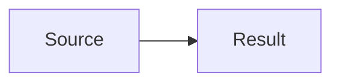

# Authoring

The examples below describe syntax only; they are not published entries. The migrated course notes live in the Studies collection.

## Files and URLs

Write `.md` or `.mdx` under one of these directories:

| Collection | Purpose | URL prefix |
| --- | --- | --- |
| `src/content/publications/` | Research publications | `/publications/` |
| `src/content/projects/` | Personal projects | `/projects/` |
| `src/content/explorations/` | Paper reading, source analysis, technical writing | `/explorations/` |
| `src/content/studies/` | Course and independent study notes | `/studies/` |

Use lowercase filenames with hyphens. Nested folders are supported: `explorations/systems/your-title.md` becomes `/explorations/systems/your-title/`. A nested `index.md` uses its containing directory's URL. Root-level `index` and `page` names are reserved for listings and pagination. Do not create both `topic.md` and `topic/index.md`; they would name the same entry. The file path determines the URL; frontmatter `slug` overrides are not part of this framework.

Use site URLs for links to other entries, such as `[Related writing](/explorations/systems/your-title/)`. This keeps links independent of the source directory layout. Do not use Obsidian wikilinks or relative `.md` links.

Organize course notes as `studies/<semester>/<course>/<chapter>.md`, for example `studies/2026-autumn/operating-systems/04-process-model.md`. The course folder is the lowercase kebab-case form of `course`, including plural endings: `Computer Networks` uses `computer-networks`. Keep lecture numbers in filenames and use `summary.md` or `questions.md` for review notes. Put the course's images in its own `assets/` folder; an image reference from a chapter is `./assets/filename.png`. Copying a course directory then carries its images with it. Update incoming `/studies/…/` links when renaming a directory, then run `pnpm check:links` after building. The migrated semesters are `2026-autumn` and `2026-spring`; their semester and subject tags provide browse links in the Studies listing.

Two starter files are included: `src/content/explorations/template.md` for technical investigations and `src/content/studies/template.md` for study notes. Copy one within its collection, rename it to your own kebab-case filename, and replace its title, description, publication date, tags, and prompts. Set `draft: false` when the completed entry is ready. The original templates remain drafts and are excluded from the site, search, and RSS.

## Common frontmatter

To import existing notes from configured directories, see [Importing course notes](importing-notes.md). Use `pnpm notes --dry-run` to preview dates, chapter order, and file changes.

Every entry requires a title and description. Include a publication date, or for Publications without an exact date, supply a `year` instead:

```yaml
---
title: "Your title"
description: "A concise description of this entry."
published: 2026-01-01
updated: 2026-01-02 # Optional; set manually after a meaningful revision.
draft: true
tags: [systems, reading-notes]
featured: false
lang: en
---
```

Replace the example values with your own material and date. Keep `draft: true` while writing; remove it or set it to `false` when ready.

Set `updated` manually after a meaningful revision, or remove it when there is no revision date to show. It appears as `Updated` on the article page and supplies its modification metadata. Saving a file does not update this field automatically; `modified` is not a supported field name. Set `lang: zh-CN` for a Chinese body.

| Field | Required | Meaning |
| --- | --- | --- |
| `title` | Yes | Non-empty page and listing title |
| `description` | Yes | Summary used in listings, search, feeds, and SEO |
| `published` | Except Publications with `year` | Exact ISO date or timestamp; dates without a time use UTC |
| `updated` | No | Most recent meaningful revision date |
| `tags` | No | Lowercase words joined with hyphens; defaults to `[]` |
| `draft` | No | Omit the entry from every public surface; defaults to `false` |
| `featured` | No | Include the entry in the homepage selection; defaults to `false` |
| `lang` | No | Body language (`en` or `zh-CN`); defaults to `en` and sets the article language and structured metadata |

Published entries are sorted newest first. Drafts and future-dated entries are excluded from article routes, listing pages, tags, search, RSS, and sitemap. This is a static site: a future entry appears after the next build following its publication date, not automatically when the clock reaches it.

Astro still parses and validates files in the collections. Drafts need valid frontmatter and Markdown/MDX, and any PlantUML fences must be cached. A draft is a publishing control, not encryption. Source files remain visible to anyone with repository access, and files placed in `public/` are always published.

## Collection-specific metadata

Add these fields to the common frontmatter as needed.

| Collection | Field | Meaning |
| --- | --- | --- |
| Publications | `authors` | Known author list; defaults to `[]` when not supplied |
| Publications | `year` | Four-digit year; required when `published` is omitted |
| Publications | `period` | Display label such as `Spring 2026`, without inferring an exact date |
| Publications | `status` | `accepted` or `published` |
| Publications | `authorRole` | Contribution label such as `Third author` |
| Publications | `venue` | Conference, journal, or other venue |
| Publications | `paper` | HTTP(S) paper URL |
| Publications | `code` | HTTP(S) supporting code URL |
| Publications | `doi` | DOI identifier such as `10.xxxx/...`; omit the `https://doi.org/` prefix |
| Projects | `repository` | HTTP(S) source repository URL |
| Projects | `website` | HTTP(S) project or demonstration URL |
| Projects | `status` | `active`, `completed`, or `archived` |
| Studies | `course` | Course or subject name |

For accepted work, omit an unknown `published` date or author list rather than filling placeholders. A year-only entry sorts at year granularity; `period` supplies its readable date label. Unknown publication dates are omitted from RSS and SEO metadata, and an absent author list is omitted from structured metadata. `authorRole` records your role separately from the paper's author list.

Research interests are a separate list in `site.config.ts`. Add actual interests there; they appear on Home and Publications. No research area is inferred from a paper you happen to read.

## Headings, prose, and code

The layout supplies the page's `h1`. Start article sections at `##`; headings from levels two to four appear in the TOC. Heading links, duplicate-heading IDs, and keyboard navigation are generated during rendering. Code fences use Shiki's light/dark GitHub themes.

Code blocks have a macOS-style frame with decorative window dots, a language label at the upper left and a copy icon at the upper right. Specify the fence language (`python`, `cpp`, `bash`, `f90`, etc.); unlabelled blocks display `Text`. Long lines scroll inside the block instead of wrapping. The copy action uses the code text alone, preserving indentation, tabs, blank lines and literal HTML characters. It shows `Copied` on success or `Copy failed` when clipboard access is unavailable. HTTP previews use a selection-based fallback. Without JavaScript, the language header and highlighted code remain readable and the copy control stays hidden. Inline code, equations, Mermaid and PlantUML keep their existing rendering.

````md
## Your section

An ordinary paragraph with **emphasis** and `inline code`.

```ts
const message: string = 'A code example';
```
````

Use regular Markdown tables, blockquotes, lists, footnotes, and horizontal rules. Wide code blocks, tables, and equations scroll within the article rather than widening the entire page.

Chinese study notes keep their original body text and section headings. Use English for `title` and `course`; the migrated descriptions and tags are English too. Set `lang: zh-CN` for the body while the surrounding site navigation remains English.

Study descriptions use `CourseName, Lecturexx.`, for example `Operating Systems, Lecture01.` Keep the date in `published`; it is displayed separately from the description. The lecture number follows the filename without a space after `Lecture`; `00-conclusion.md` uses `Lecture00`. Use `Review` for `summary.md` and `Questions` for `questions.md`, for example `Computer Networks, Review.`

Obsidian callouts are supported, including nested content and folding:

```md
> [!tip] 本节要点
> 保留中文解释、列表和公式。

> [!question]- 思考题
> 默认收起；使用 `+` 可默认展开。
```

Other Obsidian-only features such as wikilinks and note embeds are not resolved. Use regular Markdown links and images.

## Math

Use `$...$` for inline math and `$$...$$` for display math. KaTeX renders during the build; readers do not download a math renderer.

```md
Inline: $a^2 + b^2 = c^2$.

$$
\sum_{i=1}^{n} i = \frac{n(n+1)}{2}
$$
```

KaTeX supports a subset of LaTeX. Review the build diagnostics and rendered equations, and correct unsupported commands before publishing.

## Images and captions

Store article images beside the source, often in an `assets/` folder, and reference them relatively. Astro processes local images and generates their production asset URLs and dimensions.

```md


```

A Markdown image title opts into a numbered `<figure>` caption. The alt text remains the accessible description. Put the image in its own paragraph. Ordinary images without a title keep ordinary image semantics.

The original project's width and credit parser is also supported:

```md

```

Supported widths include `80%`, `320px`, and `24rem`. A bare numeric pipe segment, such as `|320` or `|320x200`, sets the width in pixels; height follows the source aspect ratio. Width metadata also works on inline images and reference-style images.

`Figure:` or `图 3：` at the start of the alt text is another way to request a caption. Explicit figure numbers are preserved, and automatic numbering continues from them. A Chinese title such as `"图 1：计算机系统栈"` keeps the caption in Chinese. Captionless images remain ordinary images; the migration added titles where the old site used automatic captions.

The old caption shorthand is supported: `@@bold@@`, `@italic@`, and `[[label|https://example.com]]` or `{{label|https://example.com}}` links in captions and credits. Both `|credit: Source` and the legacy `%% credit: Source` are accepted. Generated text is escaped, and executable URL schemes are not turned into links.

Two or three captioned images in adjacent paragraphs, or separated by whitespace in one paragraph, form a group. They appear side by side on wider screens and stack on phones. PNG, JPEG, SVG, and animated GIF images use Astro's local asset pipeline, including intrinsic dimensions and lazy loading.

The migrated notes contain Markdown image references, not raw HTML `` tags. For hand-written HTML, use a public URL such as `` with the file in `public/images/`. A raw HTML tag does not receive Markdown caption parsing or local-image optimization; use Markdown for images in a course's `assets/` folder, or Astro's `Image` component in MDX.

Use `public/downloads/` for PDFs and other public downloads, linked as `/downloads/filename.pdf`. All files under `public/` are published whether referenced or not. For MDX attachments that should participate in the build graph, import the file with a Vite `?url` import and use that URL in a link.

## MDX

MDX shares the Markdown pipeline and adds imports and components. Astro components render on the server unless you explicitly choose a supported client directive. Keep interactive components exceptional.

```mdx
import { Image } from 'astro:assets';
import picture from './assets/figure.png';
import attachment from './assets/notes.pdf?url';

<Image src={picture} alt="An accessible description" />
<a href={attachment}>Download the notes</a>
```

Follow MDX's escaping rules for literal braces and angle brackets in prose. The content integration test exercises both `.md` and `.mdx` without adding public articles.

## Mermaid

Use a `mermaid` fence:

````md

````

The Mermaid bundle is requested only by article pages containing a Mermaid block. Diagrams follow theme changes and use Mermaid's strict security mode. If JavaScript or the optional bundle is unavailable, the source remains readable. Diagram-specific accessibility titles and descriptions can be included using Mermaid's own `accTitle` and `accDescr` syntax.

## PlantUML

Use a `plantuml` fence; its optional metadata becomes image alt text:

````md
```plantuml Request sequence
Client -> Server: Request
Server --> Client: Response
```
````

Populate the cache explicitly:

```sh
pnpm diagrams          # Render missing or invalid diagrams
pnpm diagrams --check  # Check the cache, without network access or file writes
pnpm diagrams --force  # Render all diagrams again
pnpm build
```

The command scans all `.md` and `.mdx` files in `src/content/`, including drafts. Without a local renderer, it sends diagram source to `https://www.plantuml.com/plantuml`. Set `PLANTUML_SERVER` to your own server's base URL to use that service instead. This happens only when running the diagram command; install, build, and cache checks do not contact a PlantUML service.

For fully local generation, install Java and obtain a PlantUML JAR, then set `PLANTUML_JAR` to its path. Some diagram types also require Graphviz. For example, in PowerShell:

```powershell
$env:PLANTUML_JAR = 'C:\tools\plantuml.jar'
pnpm.cmd diagrams
```

Generated SVGs live in `.plantuml-cache/`, named by the hash of the normalized source and shared style. Commit the cache for reproducible offline builds. Missing cache entries fail the build with instructions rather than adding a network request inside Astro's content loader. SVGs are embedded as images in the published page, so no client PlantUML runtime is needed.

## Before publishing

Run `pnpm verify`. Check the local preview, the title and description, image alt text, citations, and the displayed publication date. Upload the generated `dist/` only after the checks pass. The build does not require any real content; the empty site is a supported state.
