编译器的静态调度看不到运行时的分支走向和 cache miss，本讲在补完树高约简、踪迹调度和软件流水之后，转向由硬件在运行时重排指令的动态调度（乱序执行）。主线是：先说明乱序执行的收益、它放大的 RAW/WAR/WAW 冒险以及寄存器重命名，再按历史顺序剖析记分板（集中记账、一律停顿）、Tomasulo（保留站重命名加 CDB 转发）和重排序缓冲 ROB（乱序执行、顺序提交），最后统一流水线术语，并以拓展章节介绍精确异常、分支恢复、访存消歧与 Spectre/Meltdown。阅读前需要熟悉五级流水线、数据冒险与前递（forwarding）、Amdahl 定律，以及 L04 的循环展开、多发射与分支预测。

---

## 树高约简与踪迹调度

> [!abstract] 本节要点
> - 树高约简利用结合律重排表达式：$((R2+R3)+R4)+R5$ 改写为 $(R2+R3)+(R4+R5)$ 后，3 条串行 ADD 的依赖链长度从 3 降为 2；前提是运算满足结合律，而 C 语言对多数算术规定从左到右求值，需要编译器来做这种改写。
> - 执行时间 $= IC \times CPI \times CCT$；树高约简、全局调度、软件流水这类 ILP 优化主要降低 $CPI$。
> - 静态 ILP 调度分两类：全局调度面向含大量条件分支的通用整数程序 DAG，软件流水面向循环。
> - 非数值程序的基本块通常只有 5~20 条指令，块内找不到足够多的独立指令，所以要跨基本块做全局调度；全局调度分踪迹调度和基于 DAG 的调度，本课只讲踪迹调度。
> - 踪迹调度按常见路径调度并用修复代码处理例外，收益要用 Amdahl 定律连同修复代价一起算：常见路径占 80% 时间、提速 15% 时加速比为 1.117；若其余 20% 因修复代码慢 30%，加速比只剩 1.046，约 2/3 的收益被抵消。

### 树高约简（Tree Height Reduction）

编译器把一个算式翻译成指令时，如果每一步都要用上一步的结果，这些指令只能一条接一条执行，硬件再多也没有可以同时执行的指令。树高约简就是从算式本身入手，把这种长依赖链拆短。它是静态调度优化技术中的第四种（Technique 4），前三种在上一讲 L04 中介绍。

**树高约简**（tree height reduction）的目标是：利用**结合律**（associativity law）重新组合运算，缩短计算的**关键路径**（critical path）。 把计算看成一棵表达式树（或依赖图），叶子是操作数，内部结点是运算；树越高，串行步数越多。改写不减少运算次数，只降低树的高度。

#### 例：四个数相加

C 代码 `R8 = R2 + R3 + R4 + R5` 按从左到右的语义是 $R8=((R2+R3)+R4)+R5$，直接翻译为：

```asm
I1: ADD R6, R2, R3    ; R6 = R2 + R3
I2: ADD R7, R6, R4    ; R7 = R6 + R4，读 I1 的结果 R6
I3: ADD R8, R7, R5    ; R8 = R7 + R5，读 I2 的结果 R7
```

I2 读 I1 写的 R6，I3 读 I2 写的 R7，两处都是写后读（RAW）真相关，依赖图是一条链 $I1 \to I2 \to I3$。三条指令中任意两条都不能同时执行，关键路径长度为 3。

利用结合律改写为 $R8=(R2+R3)+(R4+R5)$：

```asm
I1: ADD R6, R2, R3    ; R6 = R2 + R3
I2: ADD R7, R4, R5    ; R7 = R4 + R5，与 I1 无关
I3: ADD R8, R7, R6    ; 同时依赖 I1 和 I2
```

现在只有 I3 依赖 I1（读 R6）和 I2（读 R7），I1 与 I2 之间没有依赖，可以同时执行。依赖图从一条长度为 3 的链变成了两个叶子汇到一个根，关键路径长度从 3 降为 2。指令数仍然是 3 条。

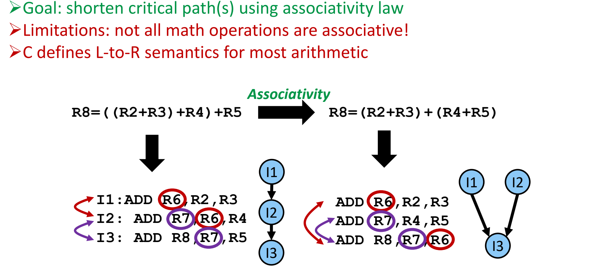

图：利用结合律把 $((R2+R3)+R4)+R5$ 改写为 $(R2+R3)+(R4+R5)$。左侧 $I1 \to I2 \to I3$ 是长度为 3 的串行链，右侧 I1、I2 相互独立、只有 I3 依赖二者，关键路径缩短为 2；圆圈标出了产生依赖的寄存器 R6 和 R7。

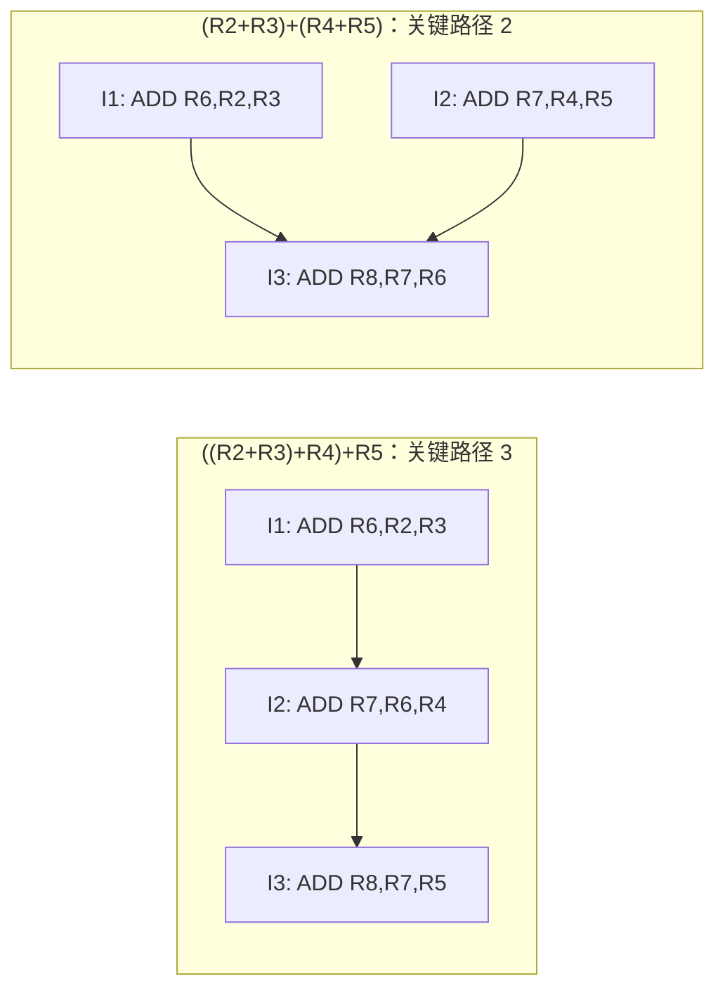

#### 局限

1. **不是所有运算都满足结合律**：只有满足结合律的运算才能这样重新加括号，很多算式找不到这种改写。
2. **C 语言对多数算术规定从左到右（L-to-R）求值**：程序员不写括号时，源代码的语义天然就是左结合的串行链。要得到较矮的树，需要编译器分析能否安全地改写，以减少依赖关系。

> [!note] 补充解释
> 整数加法（含溢出回绕）满足结合律；浮点加法因每一步都要舍入，严格说不满足结合律，$(a+b)+c$ 与 $a+(b+c)$ 的结果可能不同。因此编译器一般不会自动对浮点表达式做树高约简，除非用户放宽浮点语义（例如 GCC/Clang 的 `-ffast-math`）。

> [!info] 可视化资源
> [Georgia Tech CS6290 笔记：树高约简](https://one2bla.me/cs6290/lesson10/tree-height-reduction.html)：用四个操作数求和的汇编例子演示如何把串行加法链改写成并行求和，并说明只适用于满足结合律的运算。

> [!warning] 易错点
> 树高约简减少的是**关键路径长度**（串行步数），不是指令条数。上例前后都是 3 条 ADD，好处只在有足够硬件同时执行 I1、I2 时才能体现。

### 静态 ILP 调度的目标与分类

在讲具体调度技术前，先明确这些技术优化的是哪一项。程序执行时间可以分解为

$$
\text{Execution Time} = IC \times CPI \times CCT
$$

其中 $IC$（Instruction Count）是执行的指令条数，$CPI$（Cycles per Instruction）是平均每条指令的时钟周期数，$CCT$（Clock Cycle Time）是时钟周期长度。本部分讨论的指令级并行（ILP）优化主要降低 $CPI$：指令总数和时钟频率不变，让更多指令重叠执行，平均每条指令占用的周期就少了。 上例树高约简就是这样：指令仍是 3 条，但完成它们所需的串行步数从 3 降到 2。

**指令级并行调度**（scheduling for instruction-level parallelism）的目标是安排指令顺序，使整个程序尽早完成。由编译器完成的**静态 ILP 调度**（static ILP scheduling）分为两类：

| 类别 | 调度对象 | 典型程序 |
| --- | --- | --- |
| **全局调度**（global scheduling） | 通用整数程序的 DAG（有向无环图，Directed Acyclic Graph），其中有大量条件分支 | 分支多、循环少的非数值程序 |
| **软件流水**（software pipelining） | 任意代码中的循环 | 循环体反复执行的程序 |

两类目标不同：全局调度要把被许多分支隔开的代码放到一起调度，软件流水要把一个循环的多次迭代交错起来调度。本节讲全局调度，软件流水见[软件流水与编译器局限](#软件流水与编译器局限)。

### 基本块与全局调度（Global Scheduling）

**基本块**（basic block）是一段中间没有分支跳入、也没有分支跳出的指令序列：控制流只能从第一条指令进入，从最后一条指令离开。 例如讲义中的控制流图里，`x:=a+b; y:=a*b` 是一个基本块，条件判断 `y>a` 单独构成一个基本块，循环体 `a:=a+1; x:=a+b` 又是一个基本块。

问题在于基本块太小。非数值计算程序的基本块一般只有 **5~20 条指令**。 每隔几条到十几条指令就有一个分支，块内能够并行处理的独立指令数量不够。如果调度只在基本块内进行，编译器很难填满流水线或多发射槽位。而跨过分支调度又要面对分支预测：一旦预测错误，提前执行的指令就是错的。

**全局调度**就是为了解决这个问题：既然基本块太小、找不到足够的独立指令，就跨所有基本块（即"全局"地）调度指令，把多个基本块合在一起处理，就像它们能一起执行一样。

全局调度有两种实现方式：

- **踪迹调度**（trace-based scheduling）：本课讲解的方法，见下一节。
- **基于 DAG 的调度**（DAG-based scheduling）：本课不讲。

### 踪迹调度（Trace-based Scheduling）

踪迹调度是全局调度的一种方法。它的思路比较直接：分支虽然多，但每个分支通常有一个方向更常见；只要把最常见的那条执行路径当作一个大基本块来调度，就能获得足够多的独立指令，偶尔走另一个方向时再补救。

**踪迹调度**的做法如下：

1. **适用范围**：作用于所有代码，不只是循环。
2. **取常见路径**：选出常见情况（common case）的执行**踪迹**（trace），即程序最常走的一条执行路径。
3. **当作无分支调度**：把这条踪迹上的代码当作没有分支来调度，在更大的范围内重排指令。
4. **择机检查分支条件**：原来的分支条件并没有消失，在方便的位置检查它。
5. **预测错就清理**：如果检查发现这次没有走常见路径（预测错误），就执行修复代码来清理（clean up the mess），恢复正确的结果。

常见情况通过**程序分析**（program analysis，静态分析代码）或 **profiling**（先实际运行程序，统计各分支方向的频率）找出。


#### 例：把 if-else 并入一个大基本块

原始代码：

```c
a = log(x);
if (b > 0.01) {
    c = a / b;     // 90%
} else {
    c = 0;         // 10%
}
y = sin(c);
```

假设 profiling 表明 $b>0.01$ 的情况占 90%。这段代码被 `if` 切成多个很小的基本块：`a=log(x)` 一块、`c=a/b` 一块、`c=0` 一块、`y=sin(c)` 一块，每块只有一条语句，编译器没什么可调度的。

踪迹调度的改写：

1. 既然 90% 的情况都会执行 `c=a/b`，就默认它一定执行，把它直接接在 `a=log(x)` 后面。
2. `y=sin(c)` 也顺便提到前面，于是 `a=log(x); c=a/b; y=sin(c);` 成为一个包含三条语句的大基本块，可以统一调度和优化。
3. 剩下 10% 的情况仍需处理：在块后检查原条件的反面 `if (b <= 0.01) goto fixit;`。
4. 修复代码 `fixit` 把前面按常见路径算出的 `c` 和 `y` 改成正确值：`c=0`，`y=0`（因为 $\sin(0)=0$）。

```c
a = log(x);
c = a / b;               // 90%
y = sin(c);
if (b <= 0.01)           // 10%
    goto fixit;

fixit:
    c = 0;
    y = 0;               // sin(0)
```

改写后的代码为踪迹调度和其他优化提供了更大的基本块，在常见情况下比原始写法执行得更快。

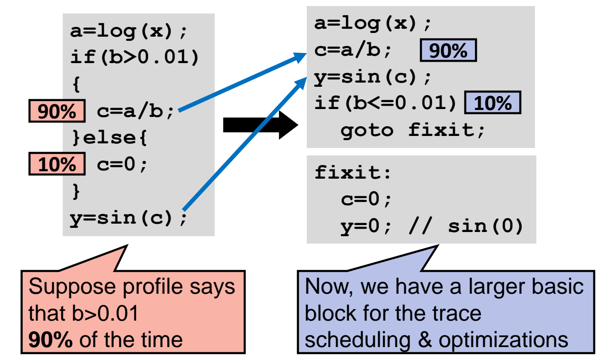

图：profile 显示 $b>0.01$ 占 90%。左侧原始 if/else 被改写为右侧的大基本块，箭头表示 `c=a/b` 与 `y=sin(c)` 被直接并入；只在 $b \le 0.01$（10%）时跳到 `fixit` 执行修复代码 `c=0; y=0`。

> [!info] 可视化资源
> [Wikipedia：踪迹调度（Trace scheduling）](https://en.wikipedia.org/wiki/Trace_scheduling)：补充踪迹调度的来历（Josh Fisher 为 VLIW 提出）与补偿代码（compensation code）思想，可对照本例的 `fixit` 修复代码及代码膨胀代价。

> [!warning] 易错点
> 踪迹调度并没有删除分支：`if (b <= 0.01)` 仍要检查，只是检查被移到了常见路径代码之后。修复代码也不能只写 `c=0`，所有在常见路径上依据错误假设算出的值（这里还有 `y`）都要被修正。

### 修复代码的代价分析

踪迹调度让常见路径变快，但修复代码会让不常见路径变慢：走 10% 那条路时，不仅要执行修复代码，还白算了 `c=a/b` 和 `y=sin(c)`。这种优化是否值得，要把加速和减速放进同一个公式里计算。

所用的工具是 **Amdahl 定律**（Amdahl's law）：系统中某一部分被加速时，整体加速比取决于这部分在原执行时间中所占的比例。

$$
\text{Speedup} = \frac{1}{(1-P) + \frac{P}{S}}
$$

其中 $P$ 是被加速部分占原执行时间的比例，$S$ 是该部分自身的加速比。分母是优化后的执行时间（以原时间为 1），其倒数就是系统整体性能的提升倍数。（Amdahl 定律的完整介绍在课程第二讲。）

> [!example] 例：踪迹调度到底赚了多少
> 已知：$b>0.01$ 那部分代码占 80% 的执行**时间**；优化后的踪迹快 15%，即 $P=0.8$，$S=1.15$。
>
> 1. **只算收益**：其余 20% 时间不变，
>    $$\text{Speedup} = \frac{1}{(1-0.8)+\frac{0.8}{1.15}} = \frac{1}{0.2+0.6957} = \frac{1}{0.8957} \approx 1.117$$
>    整体提速 11.7%。
> 2. **计入修复代价**：修复代码使其余 20% 的时间再慢 30%，这部分时间变为 $(1-0.8)\times1.3=0.26$，
>    $$\text{Speedup} = \frac{1}{(1-0.8)\times1.3+\frac{0.8}{1.15}} = \frac{1}{0.26+0.6957} = \frac{1}{0.9557} \approx 1.046$$
>    整体只提速 4.6%。
> 3. **比较**：$4.6\%/11.7\% \approx 0.39$，约 $\frac{2}{3}$ 的收益被修复代码抵消。

结论：评估一项编译优化时，要同时算两部分：被加速部分能加速多少，以及为保证正确性而加入的额外代码带来多少性能损失。两者合起来才能判断这项优化是否合理、有没有必要做。

> [!warning] 易错点
> 例题中的 80% 是**执行时间**占比，不是前面 profiling 给出的 90% 分支概率；Amdahl 定律中的 $P$ 必须用时间占比。另外，减速是乘在未加速的那部分 $(1-P)$ 上，写成 $(1-P)\times1.3$，而不是把 1.3 乘到整个分母上。

> [!question]- 自测：对 $R1+R2+\cdots+R8$ 这 8 个数求和，按 C 从左到右语义编译和用结合律改写成平衡树，关键路径各为几条 ADD？指令条数各为多少？
> 从左到右是一条 7 级的串行链，关键路径 7；平衡树是两两相加、逐层合并，层数为 $\log_2 8 = 3$，关键路径 3。两种写法都是 7 条 ADD：树高约简只缩短关键路径，不减少运算次数。

> [!question]- 自测：沿用"80% 时间、踪迹快 15%"的条件，修复代码让其余 20% 时间慢多少时，踪迹调度就完全没有收益了？
> 令 $\frac{1}{0.2k+0.8/1.15}=1$，得 $0.2k = 1-0.6957 = 0.3043$，$k\approx1.52$。也就是其余部分慢约 52% 时加速比降到 1，再慢就比不优化还差。

> [!question]- 自测：某程序 profiling 发现某个分支两个方向各占约 50%，用踪迹调度把其中一个方向并入大基本块，可能出现什么问题？
> 常见情况不明显时，约一半执行都会走修复路径：常见路径所占时间比例 $P$ 小，修复代码拖慢的那部分 $(1-P)$ 却很大，按 Amdahl 定律收益很可能被抵消甚至变成负的。踪迹调度依赖分支有明显偏向的常见路径。

---

## 软件流水与编译器局限

> [!abstract] 本节要点
> - **软件流水**：当前迭代还没结束就启动下一次迭代，让不同迭代的不同指令在同一周期重叠执行；执行过程分为 prolog（爬升）、kernel（满宽度）、epilog（下降）三段。
> - 只有 kernel 段能填满 VLIW 长指令的全部槽位；prolog 和 epilog 只含部分指令，是并行度的 "ramp up" 与 "ramp down"。
> - 循环展开 4 份后直接调度（ld 2 周期、fadd 3 周期，6 个功能单元）：同类指令扎堆，4 个 ld 全挤在 M1、4 个 fadd 全挤在 FP+，11 个周期里大部分槽位空着，几乎是串行执行。
> - 软件流水让同一周期内来自不同迭代的 ld / fadd / sd / add / bne 并行；按调度表推算，稳态下每 4 个周期完成一组 4 个元素，而展开后直接调度每组要 11 个周期。开头的 load 段利用率仍低，是拆开迭代的代价。
> - 循环展开每次迭代都要付启动（startup）和收尾（wind-down）开销，软件流水每个循环只付一次。编译器静态调度有两个根本局限：拿不到有代表性的动态信息，也无法应对 data cache miss 这类不可预测事件，因此需要硬件动态调度。

### 软件流水（Software Pipelining）

循环展开（见 L04 循环展开与 VLIW 的相关章节）把几次迭代的**同一条指令**排在一起。这些指令类型相同，会去争同一个功能单元，其他类型的功能单元却闲着。软件流水的做法正好相反：把不同迭代拆开、错开排，让同一时刻执行的是**不同类型**的指令。

**软件流水**（software pipelining）的做法是：循环的当前迭代结束之前，就开始执行下一次迭代，从而让不同迭代重叠执行（overlapping different iterations）。

#### 迭代重叠的图示

设循环体有 4 条指令 Inst1–Inst4，每次迭代依次执行它们，相邻两次迭代错开 1 个时间步启动。把 iteration1–iteration6 画成阶梯状并按时间对齐，同一行（同一时间步）里就同时有来自 4 个不同迭代的指令：

- iteration4 的 Inst1、iteration3 的 Inst2、iteration2 的 Inst3、iteration1 的 Inst4 在同一时间步执行；
- 下一行依次换成 iteration5 的 Inst1、iteration4 的 Inst2、iteration3 的 Inst3、iteration2 的 Inst4；
- 依此类推。

一个时间步里凑齐 Inst1–Inst4 全部 4 种指令的行，就是循环的稳态。

#### Prolog、Kernel 与 Epilog

按"一行能否凑齐全部指令"可以把执行过程分成三段：

1. **爬升段**（prolog）：前几次迭代刚启动，一行里只有 Inst1，或 Inst1+Inst2，等等，只是指令的一个子集，并行度逐步上升（ramp up）。
2. **核心段**（kernel）：图中阴影部分，每行都包含 Inst1–Inst4 全部指令，分属不同迭代。只有这一段能**填满 VLIW 长指令的全部宽度**（the full width of the VLIW instruction）。
3. **收尾段**（epilog）：最后几次迭代没有后继迭代来补位，一行里的指令又只剩子集，并行度逐步下降（ramp down）。


> [!tip] 课堂强调
> 软件流水与 VLIW 关系很紧密。VLIW 要把不同类型的指令打包进一条长指令，单靠循环展开几乎做不到，因为展开后相邻的是同类指令；软件流水把不同迭代的不同类型指令拼在一起，正好满足 VLIW 的需要。不过普通处理器的编译优化也会用到软件流水。prolog / epilog 与硬件流水线"逐步填满、逐步排空"是同一个意思，只是换了名字。

拆开迭代、错开执行的直接好处是：同类指令不再同时争同一个功能单元，各类功能单元都能派上用场，bubble（空槽）也就少了。

> [!note] 补充解释
> 拆开迭代还有一层与依赖相关的好处：同一次迭代内的 $ld \to fadd \to sd$ 是一条 RAW 依赖链，后一条必须等前一条的延迟走完；拆开迭代后，这些等待的空档可以填入其他迭代的独立指令。

### 循环展开代码的直接调度

要看出软件流水好在哪里，先看只做循环展开、再直接做静态调度会得到什么。

#### 例子设定

源循环把数组中每个元素加上 `f0`，再存到另一个数组。下面是展开 4 份（unroll 4 ways）后的代码：

```asm
loop: ld   f1, 0(r1)
      ld   f2, 8(r1)
      ld   f3, 16(r1)
      ld   f4, 24(r1)
      add  r1, 32
      fadd f5, f0, f1
      fadd f6, f0, f2
      fadd f7, f0, f3
      fadd f8, f0, f4
      sd   f5, 0(r2)
      sd   f6, 8(r2)
      sd   f7, 16(r2)
      sd   f8, 24(r2)
      add  r2, 32
      bne  r1, r3, loop
```

- `r1` 指向源数组，`r2` 指向目标数组。每个元素 8 字节，所以 4 个元素一共推进 32 字节（`add r1, 32` / `add r2, 32`）。
- 依赖链：`ld f1` → `fadd f5, f0, f1`（读 `f1`）→ `sd f5, 0(r2)`（读 `f5`），其余 3 条链同理。
- 假设：**ld 延迟 2 个周期，fadd 延迟 3 个周期**。
- 机器有 6 个功能单元，可在同一周期各发一条指令：整数单元 Int1、Int2，访存单元 M1、M2，浮点加法 FP+，浮点乘法 FPx。

#### 调度结果

| 周期 | Int1 | Int2 | M1 | M2 | FP+ | FPx |
| --- | --- | --- | --- | --- | --- | --- |
| 1 |  |  | ld f1 |  |  |  |
| 2 |  |  | ld f2 |  |  |  |
| 3 |  |  | ld f3 |  |  |  |
| 4 | add r1 |  | ld f4 |  | fadd f5 |  |
| 5 |  |  |  |  | fadd f6 |  |
| 6 |  |  |  |  | fadd f7 |  |
| 7 |  |  |  |  | fadd f8 |  |
| 8 |  |  | sd f5 |  |  |  |
| 9 |  |  | sd f6 |  |  |  |
| 10 |  |  | sd f7 |  |  |  |
| 11 | add r2 | bne | sd f8 |  |  |  |

逐段来看：

1. **周期 1–4**：4 个 ld 都只能用 M1 这一个访存单元，挨个发射。`add r1` 不依赖它们，可以和 `ld f4` 一起放进周期 4 的 Int1。
2. **周期 4–7**：`fadd f5` 要等 `ld f1` 的 2 周期延迟（图中红色箭头），之后 4 个 fadd 依次占用 FP+。
3. **周期 8–11**：`sd f5` 要等 `fadd f5` 的 3 周期延迟，4 个 sd 又依次挤在 M1。最后一个周期里 `add r2`、`bne` 和 `sd f8` 并行。

整个循环体 15 条指令用了 11 个周期。按调度表统计，6 个功能单元一共有 $11\times 6=66$ 个发射槽，只用了 15 个；M2 和 FPx 自始至终没用过，大多数周期只有一个单元在工作。机器虽然是超标量 / 多发射的，并行能力却几乎没发挥出来，指令基本是**串行**执行，效率很低。

> [!warning] 易错点
> 循环展开消除了循环控制开销，也提供了更多独立指令，但这不等于功能单元利用率就高。展开后相邻的是**同一类**指令（4 个 ld、4 个 fadd、4 个 sd），它们争同一个功能单元，同时又要等上一类指令的延迟，所以调度结果仍是一类一类地排队。

### 软件流水的调度结果

先把循环展开 4 份（unroll 4 ways first），再对展开后的循环体做软件流水：一组（4 个元素）的 ld 还没做完，就开始下一组的 ld，同时执行上一组的 fadd 和更上一组的 sd。

把相继的三组记为 A、B、C（图中分别用紫、绿、红色区分）。调度结果如下：

| 周期 | Int1 | Int2 | M1 | M2 | FP+ | FPx |
| --- | --- | --- | --- | --- | --- | --- |
| 1 |  |  | ld f1 (A) |  |  |  |
| 2 |  |  | ld f2 (A) |  |  |  |
| 3 |  |  | ld f3 (A) |  |  |  |
| 4 | add r1 (A) |  | ld f4 (A) |  |  |  |
| 5 |  |  | ld f1 (B) |  | fadd f5 (A) |  |
| 6 |  |  | ld f2 (B) |  | fadd f6 (A) |  |
| 7 |  |  | ld f3 (B) |  | fadd f7 (A) |  |
| 8 | add r1 (B) |  | ld f4 (B) |  | fadd f8 (A) |  |
| 9 |  |  | ld f1 (C) | sd f5 (A) | fadd f5 (B) |  |
| 10 |  |  | ld f2 (C) | sd f6 (A) | fadd f6 (B) |  |
| 11 |  | add r2 (A) | ld f3 (C) | sd f7 (A) | fadd f7 (B) |  |
| 12 |  | bne (A) | ld f4 (C) | sd f8 (A) | fadd f8 (B) |  |
| 13 |  |  |  | sd f5 (B) | fadd f5 (C) |  |
| 14 |  |  |  | sd f6 (B) | fadd f6 (C) |  |
| 15 |  | add r2 (B) |  | sd f7 (B) | fadd f7 (C) |  |
| 16 |  | bne (B) |  | sd f8 (B) | fadd f8 (C) |  |
| 17 |  |  |  | sd f5 (C) |  |  |

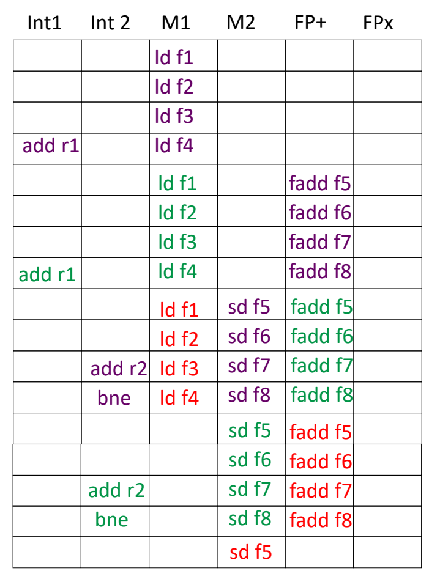

图：软件流水后的调度表（6 个功能单元 Int1/Int2/M1/M2/FP+/FPx）。紫、绿、红三种颜色代表相继三组迭代，同一行里出现不同迭代的 ld、fadd、sd 与 add/bne，体现迭代重叠执行。

对照前面的三段划分：

1. **周期 1–8 是 prolog**：周期 1–4 只有 A 组的 ld（加 `add r1`）；周期 5–8 加入 A 组的 fadd 和 B 组的 ld。每个周期最多有 2–3 个单元在工作。
2. **周期 9–12 是 kernel**：同一个周期里，M1 执行组 $i+2$ 的 ld，FP+ 执行组 $i+1$ 的 fadd，M2 执行组 $i$ 的 sd，Int2 执行组 $i$ 的 `add r2` / `bne`。ld、fadd、sd、add、bne 这些**不同类型、不同迭代**的指令在并行执行。由表可推算：稳态下每 4 个周期完成一组 4 个元素，而展开后直接调度每组要 11 个周期。
3. **周期 13 以后是 epilog**：后面没有新组的 ld 了，只剩 B、C 组的 fadd 和 sd，并行度降回去。表格画到 `sd f5 (C)` 为止，C 组其余的 sd 和 `add r2`、`bne` 未画出。

依赖延迟仍然满足：A 组 `ld f1` 在周期 1、`fadd f5` 在周期 5，ld→fadd 间隔 4 个周期，大于 ld 的 2 周期延迟；`fadd f5` 在周期 5、`sd f5` 在周期 9，间隔 4 个周期，大于 fadd 的 3 周期延迟。每组的指令依赖延迟被其他组的独立指令"填满"了，而不是空等。

> [!warning] 易错点
> 软件流水也不是每个周期都满载。开头的 load 段（周期 1–4 只有 M1 在工作）利用率仍然很低。这是拆开迭代的必然代价：第一组的 ld 前面没有更早的组可以并行，最后一组的 sd 后面也没有更晚的组来补位。只有 kernel 段能把功能单元用满。另外，图中 kernel 段只画了 C 组的 ld，没有画出 C 组对应的 `add r1`（A、B 组的 `add r1` 都和各自的 `ld f4` 同周期，位于 Int1）。

### 循环展开与软件流水的开销对比

两种技术都靠增加可并行的指令来提高性能，区别在于填满、排空的开销要付几次。

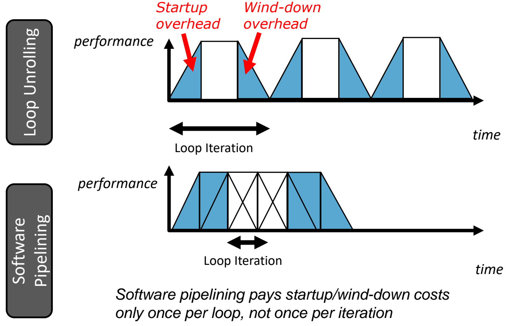

图：横轴为时间，纵轴为性能（并行度）。上图循环展开每次迭代都有爬升（startup）和下降（wind-down）开销；下图软件流水只在整个循环开头和结尾各付一次，中间保持满性能。

- **循环展开**：每次（展开后的）循环迭代都要经历一个梯形：先是**启动开销**（startup overhead），性能从 0 爬升到峰值；然后在峰值维持一段；最后是**收尾开销**（wind-down overhead），性能降回 0。下一次迭代再重复一遍。所以每次迭代都要付一次启动和收尾开销。
- **软件流水**：只在整个循环开头爬升一次（prolog）、结尾下降一次（epilog），中间相邻迭代首尾重叠，性能一直保持在峰值（kernel）。图中软件流水的 "Loop Iteration" 区间比循环展开短得多，因为相邻迭代互相重叠。

结论：**软件流水每个循环只付一次启动 / 收尾开销，而不是每次迭代付一次**（pays startup/wind-down costs only once per loop, not once per iteration）。 它把性能最饱满的区间尽量拉长，从原理上说静态调度的整体性能更好。

| 对比维度 | 循环展开（Loop Unrolling） | 软件流水（Software Pipelining） |
| --- | --- | --- |
| 同一周期执行的指令 | 同一组迭代中的同类指令 | 不同迭代的不同类型指令 |
| 功能单元利用 | 同类指令争同一单元，其余单元闲置 | 各类单元同时工作（kernel 段） |
| 启动 / 收尾开销 | 每次迭代付一次 | 每个循环只付一次（prolog + epilog） |
| 与 VLIW 的配合 | 难以凑出满宽度长指令 | kernel 段填满 VLIW 全部宽度 |

> [!info] 可视化资源
> [Wikipedia：软件流水（Software pipelining）](https://en.wikipedia.org/wiki/Software_pipelining)：逐行列出 prologue、kernel、epilogue 中每个周期执行哪些迭代的哪条指令，并与循环展开、模调度（modulo scheduling）对比。

> [!question]- 自测：在上面的 6 功能单元机器上，循环要处理 $4n$ 个元素（$n$ 组，$n$ 较大）。只做 4 份展开再直接调度，和做软件流水，大约各需要多少个周期？
> 展开后直接调度每组 11 个周期，各组之间不重叠，共约 $11n$ 个周期。软件流水在 prolog（周期 1–8）之后每 4 个周期完成一组，再加上 epilog 的若干周期，共约 $4n$ 加上一个常数。$n$ 越大，常数项（只付一次的启动 / 收尾开销）占比越小，所以两者之比趋近 $11:4$。

### 编译器静态调度的局限（Why Compiler Might not Work）

树高约简、踪迹调度（见[树高约简与踪迹调度](#树高约简与踪迹调度)）和软件流水都是编译器在编译时完成的**静态调度**。它们有两个绕不开的局限，这正是引入硬件动态调度的原因。

1. **不能总是绕着分支做调度**（can't always schedule around branches）：编译器能用的动态信息有限，基本只有 profile 信息。
   - 可能根本没有 profile 信息；
   - 即使有，也可能**不具代表性**（not representative）。例如某个分支在程序前一半总是 taken（T），后一半总是 not taken（NT），profile 统计出来是 50-50，看上去完全无法预测。如果知道它"前半段跳、后半段不跳"这一动态规律，就可以前半段按 taken 调度、后半段按 not taken 调度。编译器只拿到汇总后的 50%，做不出这种调度。
2. **不是所有停顿都能预知**（not all stalls are predictable）：编译器无法对运行时的动态事件做出反应，典型例子是 **data cache miss**。一旦发生 cache miss，load 的实际延迟会远高于编译器调度时假定的正常延迟（比如前面例子里假定的 2 个周期）。静态排好的指令序列对这种突发事件毫无应对能力，后面依赖这个 load 的指令只能一起等。

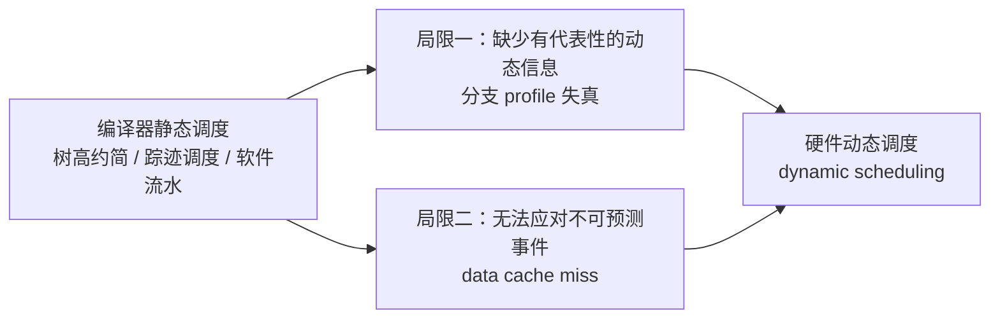

硬件在运行时能看到真实的分支走向和真实的访存延迟，所以后续各章转向 CPU 中的**动态调度**。它的定义、乱序执行的收益与代价，见[乱序执行与寄存器重命名](#乱序执行与寄存器重命名)。

> [!warning] 易错点
> profile 给出的"分支 taken 概率 50%"不等于"这个分支无法预测"。profile 只统计整体比例，丢掉了**时间上的规律**（前一半 T、后一半 NT）。这类分支对静态调度来说像随机分支，运行时却很好预测。

> [!question]- 自测：编译器按 ld 延迟 2 周期排好了软件流水的 kernel。运行时 A 组的 `ld f1` 发生 data cache miss，延迟变成几十个周期。会发生什么？为什么编译器无能为力？
> 依赖 `f1` 的 `fadd f5 (A)` 无法在原定周期执行。在严格按静态顺序执行的机器上，后续所有指令都会被一起拖住，kernel 的满载状态被打断。cache miss 只有运行时才知道是否发生，编译器调度时只能按正常延迟假设，没办法针对它调整指令顺序。这正是静态调度的第二个局限，也是硬件动态调度（乱序执行）要解决的问题。

> [!question]- 自测：程序中某分支前 50% 的执行全部 taken，后 50% 全部 not taken。编译器做踪迹调度时应把哪个方向当作 common case？
> 它选不出好的方向。profile 统计结果是 50-50，任选一个方向，都有一半的执行要走修复代码。根本原因是编译器只拿到汇总的 profile 信息，看不到"前半段 T、后半段 NT"这一动态变化。

---

## 乱序执行与寄存器重命名

> [!abstract] 本节要点
> - 动态调度就是乱序执行（Out-of-Order execution，OoO / O3）：由硬件在运行时重排指令流以减少停顿；“乱序”只指执行（execution）阶段不按程序顺序，其他阶段不一定乱序。
> - O3 的收益来自用无依赖的指令填满停顿的空隙：A~G 七条指令中 A 发生 cache miss 时，1 路顺序 10 周期、2 路顺序 8 周期、1 路乱序 7 周期、2 路乱序 5 周期。
> - O3 会放大寄存器数据冒险：RAW 读到旧数据，WAR 读到“未来”数据，WAW 的新结果被旧数据覆盖。
> - WAR、WAW 是名字（存储位置）相关，可用硬件寄存器重命名消除：映射表（MapTable）记录架构寄存器到物理寄存器的映射，每个目的寄存器从空闲列表（FreeList）取一个新物理寄存器；RAW 是真相关，重命名后仍然保留，只能等待。
> - O3 的三步：取指把 100+ 条指令放进指令窗口（依靠分支预测越过分支）→ 重命名去除假相关 → 寄存器和内存依赖一满足就执行；每条指令在缓冲中检查 ready 位，发射顺序由依赖图决定。

### 动态调度与乱序执行（Out-of-Order Execution）

编译器做静态调度时拿不到运行时信息，遇到 cache miss 这类突发的长延迟也无法应对（见[编译器静态调度的局限](#软件流水与编译器局限)）。动态调度把调度工作交给 CPU 硬件，在程序运行时根据实际情况重排指令。

指令调度分为两类：

- **静态调度**：由编译器完成，包括循环展开等常规技术，以及全局调度、软件流水等面向 ILP 的高级技术。
- **动态调度**：由 CPU 硬件完成，本讲按历史顺序介绍三种实现：记分板（Scoreboard）、Tomasulo 算法、重排序缓冲（Reorder Buffer，ROB）。记分板出现最早、做法最朴素，Tomasulo 改进了不少，ROB 则是今天几乎所有处理器都在用的结构。

**动态调度**（Dynamic Scheduling）指的就是**乱序执行**（Out-of-Order execution），简写为 OoO 或 O3：指令的执行顺序可以与原来的程序顺序不同。

> [!tip] 课堂强调
> “execution”在这里是一个具体的流水线阶段，即 ALU 执行的那一级，不是笼统的“运行”。乱序只说明**执行阶段**不按程序顺序，流水线的其他阶段不一定乱序。

例如后面的记分板里，issue 是顺序的，只有之后的读操作数、执行和完成是乱序的。

围绕 O3 有三个问题，下面三小节依次回答：

1. O3 怎样获得性能收益？
2. O3 会带来什么问题？
3. O3 具体怎样工作？

### 乱序执行的收益

只要指令之间没有依赖，硬件就可以把后面的指令提前，**重排指令流来减少停顿**（Hardware rearranges the instruction stream to reduce stalls）。

例子使用下面七条指令：

```text
A: R1 = Load 16[R2]
B: R3 = R1 + R4
C: R6 = Load 8[R9]
D: R5 = R2 – 4
E: R7 = Load 20[R5]
F: R4 = R4 – 1
G: BEQ R4, #0
```

RAW 依赖只有三对：B 读 A 写的 R1，E 读 D 写的 R5，G 读 F 写的 R4；C 与其他指令都无关。

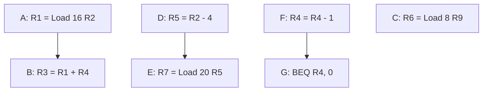

假设 A 发生 cache miss，B 要等到第 5 个周期才能执行。四种机器的执行情况如下：

| 机器 | 各周期执行的指令 | 总周期 |
| --- | --- | --- |
| 1 路顺序（1-wide In-Order） | 1:A，2–4:停顿（cache miss），5:B，6:C，7:D，8:E，9:F，10:G | 10 |
| 2 路顺序（2-wide In-Order） | 1:A，2–4:停顿，5:B C，6:D，7:E F，8:G | 8 |
| 1 路乱序（1-wide Out-of-Order） | 1:A，2:C，3:D，4:E，5:B，6:F，7:G | 7 |
| 2 路乱序（2-wide Out-of-Order） | 1:A C，2:D F，3:E G，5:B | 5 |

逐行分析：

1. **1 路顺序**：A 的 cache miss 结束后才能执行 B，后面的 C~G 也只能排在 B 之后，共 10 周期。
2. **2 路顺序**：A 的停顿仍然躲不掉，因为 B 依赖 A，而顺序机器不能越过 B。之后每周期最多发两条，但不能把有依赖的两条放在同一周期：B、C 无关，同一周期执行；D、E 有依赖，D 单独一个周期；E、F 同一周期；G 依赖 F，最后执行。共 8 周期。
3. **1 路乱序**：B 照样要等 A，但 C、D、E 与 A 无关，可以塞进 cache miss 的等待期，共 7 周期。
4. **2 路乱序**：A 与 C 同周期，D、F 同周期，E、G 同周期，等待期被充分填满，B 的数据一到就执行，只需 5 周期。

结论：**只要没有依赖关系，乱序执行就能把等待的空隙填满**，这是 O3 的主要收益。

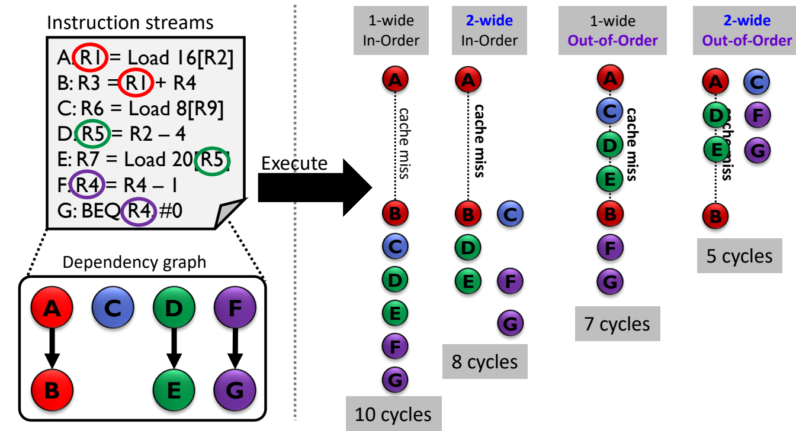

图：左侧是七条指令及其依赖图，右侧四列是各机器的执行时间线。A 发生 cache miss 时，1 路顺序需 10 周期、2 路顺序 8 周期、1 路乱序 7 周期、2 路乱序 5 周期，乱序把无关指令填进等待空隙。

> [!note] 补充解释
> 2 路乱序的时间线里 F 在第 2 周期就执行，早于第 5 周期的 B。B 读 R4、F 写 R4，两者之间还有一个 WAR 名字相关；若 F 直接改写 R4，B 会读到减 1 后的值。这正是下一小节要说的乱序冒险，需要靠寄存器重命名来消除，图中的 5 周期隐含了这一前提。

> [!warning] 易错点
> 增加发射宽度不能代替乱序。2 路顺序机器仍然要在 A 的 cache miss 上停顿 3 个周期，只从 10 降到 8 周期；1 路乱序机器即使每周期只执行一条，也能把等待期用起来，降到 7 周期。

### 乱序执行放大数据冒险

顺序执行的五级流水线中，数据冒险大多可以通过前递（forwarding）解决，一般不引起额外停顿。乱序执行允许后面的指令先于前面的指令执行，寄存器依赖就可能被破坏，冒险问题更严重。

下面三个例子的寄存器初值都是 $R1=5,\ R2=-2,\ R3=9,\ R4=3$，比较顺序执行（先 A 后 B）与不加检查的乱序执行（先 B 后 A）：

| 冒险类型 | 指令 | 顺序执行（A→B） | 乱序执行（B→A） | 后果 |
| --- | --- | --- | --- | --- |
| 写后读 RAW（Read-After-Write） | A: `R1 = R2 + R3`；B: `R4 = R1 * R4` | A 得 $R1=7$；B 得 $R4=7\times3=21$ | B 先执行得 $R4=5\times3=15$；A 再得 $R1=7$ | B **读到旧数据**（Read old data） |
| 读后写 WAR（Write-After-Read） | A: `R1 = R3 / R4`；B: `R3 = R2 * R4` | A 得 $R1=9/3=3$；B 得 $R3=-2\times3=-6$ | B 先执行得 $R3=-6$；A 再得 $R1=-6/3=-2$ | A **读到“未来”数据**（Read future data） |
| 写后写 WAW（Write-After-Write） | A: `R1 = R2 + R3`；B: `R1 = R3 * R4` | A 得 $R1=7$；B 得 $R1=9\times3=27$，最终 $R1=27$ | B 先得 $R1=27$；A 再写 $R1=7$，最终 $R1=7$ | 新结果**被旧数据覆盖**（Will be overwritten by legacy data） |

三种情况的错误各不相同：

- **RAW**：B 需要 A 产生的新 R1，提前执行时 R1 还没更新，读到的是旧值 5。
- **WAR**：A 本该读 R3 的旧值 9，但 B 已提前把 R3 改为 $-6$，A 读到了程序顺序上“将来”才应出现的值。
- **WAW**：两条指令都写 R1，最终应保留程序顺序中较晚的 B 的结果 27，但较早的 A 后写，把它覆盖为 7。

所以乱序执行必须由硬件检查并维护这些依赖。

### 寄存器重命名（Register Renaming）

观察 WAR 和 WAW 的例子：A 与 B 之间并没有数据传递，冲突只是因为两条指令**碰巧用了同一个寄存器名字**。如果给后写的指令换一个存放位置，冲突就消失了。

**寄存器重命名**是由硬件完成的、消除 WAR 和 WAW 冒险的方法。它所依据的事实是：WAR 和 WAW 是对**名字/存储位置**的依赖（Dependency is on name/location），不是对数据本身的依赖，因此称为**假相关**（false dependence，也叫名字相关）。重命名能消除 WAR/WAW，但**保留 RAW**：RAW 是**真相关**（true dependence），后一条指令确实需要前一条的结果，只能等待（停顿），或通过其他优化让数据更快送达。

#### 映射表与空闲列表

重命名的做法是：分配一个新的存储位置，并把它记录在映射表里（Allocate new location by noting it in map-table）。 需要区分两类寄存器：

- **架构寄存器**：指令中出现的名字，如 `r1`、`r2`、`r3`。
- **物理寄存器**：硬件中真正存放数据的寄存器，如 `p1`~`p7`。

硬件维护两个结构：

- **映射表**（MapTable）：记录每个架构寄存器当前对应哪个物理寄存器。
- **空闲列表**（FreeList）：记录尚未分配的物理寄存器。

对每一条指令按程序顺序做：

1. **改写源寄存器**：查映射表，把每个源架构寄存器替换为它**当前**映射的物理寄存器。这样就保留了 RAW：读者总能找到最近一次写它的那条指令的结果。
2. **分配目的寄存器**：从空闲列表取出一个新的物理寄存器，作为本指令的目的寄存器。
3. **更新映射表**：把目的架构寄存器的映射改为这个新物理寄存器，后续指令读该架构寄存器时就会读到新位置。

先改写源、后改目的的顺序很重要：像 `mul r3,r2,r3` 这样源和目的同名的指令，源 `r3` 必须用改写前的映射。

#### 例：四条指令的重命名

原始指令：

```asm
add r1,r2,r3
sub r3,r2,r1
mul r3,r2,r3
div r1,r1,4
```

这段代码里的冒险：

- `add` 与 `sub`：`sub` 读 `r1`（RAW）；`add` 读 `r3` 而 `sub` 写 `r3`（WAR）。
- `sub` 与 `mul`：`mul` 读 `r3`（RAW）；两者都写 `r3`（WAW）。
- `add` 与 `div`：`div` 读 `r1`（RAW）；两者都写 `r1`（WAW）。
- `sub` 与 `div`：`sub` 读 `r1` 而 `div` 写 `r1`（WAR）。

开始时映射表为 `r1→p1, r2→p2, r3→p3`，空闲列表为 `p4, p5, p6, p7`，`add` 直接改写为 `add p1,p2,p3`。之后逐条处理：

| 指令 | 源寄存器改写 | 目的寄存器分配 | 映射表（r1, r2, r3） | 空闲列表 | 重命名后 |
| --- | --- | --- | --- | --- | --- |
| `add r1,r2,r3` | r2→p2，r3→p3 | r1→p1 | (p1, p2, p3) | p4, p5, p6, p7 | `add p1,p2,p3` |
| `sub r3,r2,r1` | r2→p2，r1→p1 | r3→p4（取自空闲列表） | (p1, p2, p4) | p5, p6, p7 | `sub p4,p2,p1` |
| `mul r3,r2,r3` | r2→p2，r3→p4 | r3→p5 | (p1, p2, p5) | p6, p7 | `mul p5,p2,p4` |
| `div r1,r1,4` | r1→p1 | r1→p6 | (p6, p2, p5) | p7 | `div p6,p1,4` |

重命名后，各冒险的处理结果：

1. `add`–`sub` 的 WAR：`add` 读 `p3`，`sub` 写 `p4`，两者不再冲突，即使 `sub` 先执行也不会改坏 `add` 的源操作数。
2. `sub`–`mul` 的 WAW：`sub` 写 `p4`，`mul` 写 `p5`，两个结果各占一个位置，不会互相覆盖。
3. `add`–`div` 的 WAW、`sub`–`div` 的 WAR：`div` 写的是新的 `p6`，`add` 的结果 `p1` 不会被覆盖，`sub` 读到的仍是 `p1`。
4. RAW 全部保留：`sub` 读 `p1`（来自 `add`），`mul` 读 `p4`（来自 `sub`），`div` 读 `p1`（来自 `add`）。这些指令仍须等待各自的生产者完成。

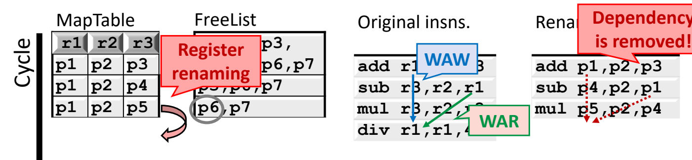

图：左侧是逐条变化的映射表（MapTable）和空闲列表（FreeList），中间标出原始指令中的 WAW 与 WAR，右侧是重命名结果 `add p1,p2,p3`、`sub p4,p2,p1`、`mul p5,p2,p4`。每重命名一条指令就从 FreeList 取一个新物理寄存器写入 MapTable，假相关被消除，RAW 依然存在。此帧尚未显示 `div` 一行。

> [!warning] 易错点
> 讲义中有一帧（第 20 页）是动画的中间帧，其“Renamed insns.”一列（如 `sub p2,p4,p5`、`mul p2,p5,p6`、`div p4,4,p7`）是错误的。正确结果以第 21~23 页为准：`add p1,p2,p3 / sub p4,p2,p1 / mul p5,p2,p4 / div p6,p1,4`。

> [!warning] 易错点
> 不要以为重命名能消除所有相关。判断方法：后一条指令是否**真正需要**前一条的计算结果。需要（RAW）就是真相关，重命名后仍须等待；只是用了同一个名字（WAR、WAW），就是假相关，换一个物理寄存器即可消除。

> [!note] 补充解释
> 例子把 `add` 的目的寄存器直接记为 `p1`，相当于把 `add` 重命名后的映射当成起点，以便展示后三条指令的重命名。严格按规则执行时，`add` 也会从空闲列表取一个新的物理寄存器（下面“总体结构”中的例子就是这样，`add` 的目的被分配为 p4）。

记分板不做重命名；Tomasulo 用保留站完成硬件重命名，见[Tomasulo 算法](#tomasulo-算法)。

> [!info] 可视化资源
> [Wikipedia：寄存器重命名（Register renaming）](https://en.wikipedia.org/wiki/Register_renaming)：解释 WAR/WAW 为何是假相关，以及物理寄存器堆、空闲标签队列、重映射表等结构，可对照本节的 MapTable/FreeList。

### 乱序执行的三个步骤

五级流水线每周期取一条指令，译码后就执行。动态调度不同，它要求硬件**同时看到很多条指令**，从中挑出可以执行的。O3 分三步完成：

1. **取指进入指令窗口**：从静态程序（Static Program）中把大量指令取入**指令窗口**（instruction window），形成动态指令流（Dynamic Instruction Stream）。今天的处理器调度窗口有 100 条以上的指令；要越过分支继续取指，需要用分支预测做推测（speculate past branches）。
2. **重命名**：对动态指令流做寄存器重命名，去除假相关（WAW 和 WAR），得到重命名后的指令流（Renamed Instruction Stream）。
3. **调度执行**：寄存器和内存的依赖一旦满足，指令就执行（Execute instructions as soon as dependencies are known），通常按功能部件的数量把就绪的指令分配到各个功能部件。由此得到动态调度后的指令（Dynamically Scheduled Instructions）。所谓乱序，就是执行顺序偏离了原来的程序顺序（out of the original sequential order）。


#### 分支预测对 O3 的意义

分支预测（L04 补充材料）是动态调度的关键部件，原因如下：

- 程序中**大约每 10 条指令就有一个分支**。不做预测，每遇到一个分支就要停下来等它解析，窗口里最多只能攒下约 10 条指令，填不满 100 多条的窗口。
- 有了分支预测，取指单元可以提前沿预测路径取指，窗口才能装满，硬件才能从中找到足够多无依赖的指令。
- 代价是一旦**预测错误**，预测路径上取进来的指令都要冲刷掉，**整个指令窗口作废**。

> [!tip] 课堂强调
> 分支预测是乱序执行中非常关键的部件，在现代处理器中越来越重要：处理器有很多条流水线同时工作，为了找出足够多没有依赖的指令，需要一次取很多条指令，而分支预测正是让这件事成为可能的前提。

预测错误后的恢复机制见[精确异常与推测执行](#精确异常与推测执行)。

> [!info] 可视化资源
> [Wikipedia：乱序执行（Out-of-order execution）](https://en.wikipedia.org/wiki/Out-of-order_execution)：对比顺序与乱序处理器的流水步骤（取指、译码、重命名、分派、发射、退休），并梳理从 CDC 6600、IBM 360/91 到现代处理器的历史。

### 动态调度的总体结构

把上面三步放到处理器结构里：

1. **前端**：指令 cache（I\$）与分支预测器（BP）配合，每周期按（预测的）程序顺序取指。
2. **译码与重命名**：指令经过取指、译码、重命名后进入**指令缓冲**（insn buffer）。
3. **检查就绪**：每条指令（概念上）每个周期检查其源物理寄存器的 **ready 位**，ready 位记录在就绪表（Ready Table）中。
4. **发射执行**：源操作数全部就绪的指令发射到执行单元（ALU、D\$）；结果写回寄存器堆，并把对应物理寄存器标为 ready，唤醒等待它的指令。

讲义上的例子（已重命名）：

```asm
Inst1: add p4,p2,p3
Inst2: sub p5,p2,p4
Inst3: mul p6,p2,p5
Inst4: div p7,4,p4
```

依赖图为 I1→I2、I1→I4、I2→I3。随时间推移，就绪表与发射过程如下：

| 时刻 | 已就绪的物理寄存器 | 本时刻发射 |
| --- | --- | --- |
| 1 | P2, P3 | I1（只需 P2、P3） |
| 2 | P2, P3, P4 | I2、I4（都只等 P4） |
| 3 | P2, P3, P4, P5, P7 | I3（等 P5） |
| 4 | P2~P7 全部就绪 | — |

因此发射顺序是 I1 → {I2, I4} → I3，由**依赖图**决定，与程序顺序 I1, I2, I3, I4 不同：I4 越过了 I3。

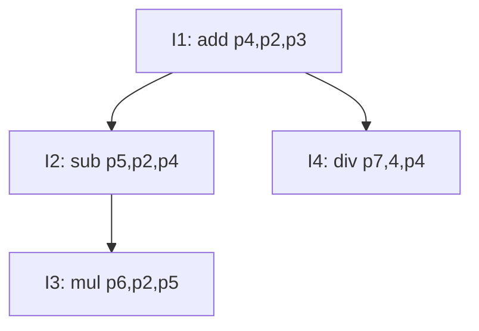

> [!warning] 易错点
> 讲义此例左侧的原始代码第一条写作 `add r4,r2,r3`，与右侧重命名结果不一致，应为 `add r1,r2,r3`。右侧结果对应 `add r1,r2,r3 / sub r3,r2,r1 / mul r3,r2,r3 / div r1,4,r1`，初始映射为 `r2→p2, r3→p3`，`r1` 依次映射到 p4、p7，`r3` 依次映射到 p5、p6。按这个原始代码分析依赖图即可。

这里只说明了概念上的“每周期检查 ready 位”。硬件上的具体实现，以及把译码拆成 issue、读操作数等更细阶段，见[记分板算法](#记分板算法)。

> [!question]- 自测：在 1 路乱序机器上执行指令 A~G（A cache miss，B 最早在第 5 周期执行），若把 F 改为 `F: R4 = R7 – 1`（依赖 E），总周期数会变吗？
> 不变，仍为 7 周期。1:A，2:C，3:D，4:E，5:B，6:F，7:G。E 在第 4 周期执行，F 在第 6 周期执行时 E 已完成，新增的 E→F 依赖不引起额外停顿。原本就有的 G 依赖 F 也满足。

> [!question]- 自测：对代码 `add r1,r2,r3 / mul r2,r1,r3 / sub r1,r2,r2` 做重命名。初始映射 `r1→p1, r2→p2, r3→p3`，空闲列表 `p4,p5,p6`，每条指令的目的寄存器都从空闲列表新取。写出重命名结果，并指出哪些相关被消除。
> 结果：`add p4,p2,p3`（r1→p4）；`mul p5,p4,p3`（r2→p5）；`sub p6,p5,p5`（r1→p6）。最终映射为 (p6, p5, p3)，空闲列表为空。被消除的是 `add` 读 r2 而 `mul` 写 r2 的 WAR、`mul` 读 r1 而 `sub` 写 r1 的 WAR，以及 `add` 与 `sub` 同写 r1 的 WAW。保留的 RAW 是 `mul` 读 p4、`sub` 读 p5。

> [!question]- 自测：某乱序处理器的指令窗口有 120 项，但没有分支预测器，遇到分支就停止取指直到分支解析。若程序约每 10 条指令有一个分支，窗口实际能被利用多少？
> 平均只有约 10 条指令，远低于 120。分支未解析前无法继续取指，窗口里只能攒下当前分支之前的指令。有了分支预测才能越过分支推测取指，把窗口填满；代价是预测错误时整个窗口作废。

---

## 记分板算法

> [!abstract] 本节要点
> - 记分板（Scoreboard）是最早的动态调度实现（CDC 6600，1964）：用一张集中式"记账表"跟踪指令、功能单元和寄存器的状态，遇到任何冒险都靠**停顿**解决，没有旁路。
> - 记分板把译码拆成 Dispatch → Issue → Read operands：Issue 按序、检查结构冒险与 WAW；Read operands 检查 RAW；Write back 检查 WAR；Issue 之后的阶段乱序。
> - 三张表：Instruction status（各阶段完成的周期）、Functional unit status（每个 FU 9 个字段 B/Op/dst/src1/src2/Q1/Q2/R1/R2）、Register result status（哪个 FU 将写该寄存器）。
> - 6 条指令的例子（Integer 1、Mult 10、Add 2、Divide 40 周期）最终时序为 LD1 1/2/3/4、LD2 5/6/7/8、MULTD 6/9/19/20、SUBD 7/9/11/12、DIVD 8/21/61/62、ADDD 13/14/16/22：按序发射、乱序执行、乱序完成。
> - 优点是便宜（三张表约等于 1 个 FP 单元面积）、对 FORTRAN 科学计算约 1.7× 加速；缺点是无旁路、结构/WAW 冒险堵住发射、RAW 必须等写回、WAR 推迟写回，改进方向是硬件寄存器重命名。

### 记分板与 CDC 6600

[乱序执行](#乱序执行与寄存器重命名)要求硬件在运行时知道"哪条指令现在可以无冒险地执行"。最直接的办法是像球赛记分牌一样，把每条指令走到了哪一步、每个功能单元在干什么、每个寄存器正等着谁来写，全部记下来，再据此决定放行还是停顿。

**记分板**（Scoreboard）就是这样一种集中式的记账（bookkeeping）机制：它跟踪指令、寄存器和功能单元的流转状态，检查哪些数据通路部件正在被使用、哪些可以使用，从而找出能在没有冒险的情况下执行的指令。 记分板实现运行时乱序执行的关键就是这套记账技术本身。

记分板的第一个实现是 **CDC 6600**（1964 年）：

- 有 16 个独立的、**非流水**的功能单元：7 个整数单元、4 个浮点单元、5 个访存单元；
- **没有寄存器旁路**（register bypassing，即 L03 中学过的 forwarding 的同义词）。结果必须先写回寄存器堆，后续指令才能从寄存器堆读到它，这一点会在后面的例子里反复造成停顿。

本节例子使用的简化记分板结构如下：左边是浮点寄存器 F0、F2、…、F10；中间是 5 个功能单元 Integer（1 周期）、Mult1（10 周期）、Mult2（10 周期）、Add（2 周期）、Divide（40 周期），括号内是执行所需周期数；右边是存放 6 条指令的指令缓存；下方的 Scoreboard 控制寄存器读写和各功能单元。 在本例中，load 指令使用 Integer 单元，执行 1 个周期。

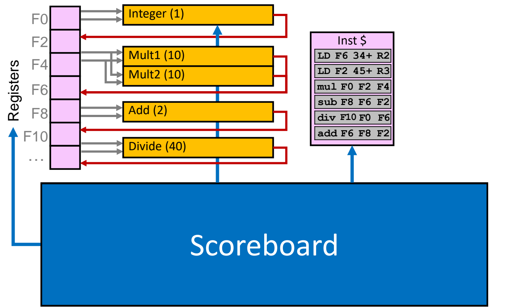

图：记分板集中控制寄存器堆与各功能单元：Integer（1 周期）、Mult1/Mult2（10）、Add（2）、Divide（40），右侧指令 cache 中是例题的 6 条指令。

### 记分板的流水线阶段

传统五级流水线 IFetch → Decode → Execute → Memory → Writeback 中，指令一旦在译码时遇到冒险就整体卡住，后面的指令也过不去。记分板的关键想法是**把 Decode 拆成三个子阶段**：分派 Dispatch（D）、发射 Issue（S）、读操作数 Read operands（R），并在中间加一个**指令缓冲**（instruction buffer）。

- **Dispatch**：把译码后的指令**按序**累积到指令缓冲里；
- **Issue**：指令缓冲把指令送往流水线的其余部分。Issue 是**按序**的，其后的阶段都是**乱序**的。

完整的记分板流水线及各阶段负责的冒险如下：

1. **分派 Dispatch（D）**：在指令缓冲中分配一个槽位，按序放入一条指令。这里出现一种**新的结构冒险**：指令缓冲满时无法继续分派。
2. **发射 Issue（S，也记作 ID1）**：按程序顺序发射，检查两件事，有冒险就停顿、不发射：
   - **结构冒险**：该指令需要的功能单元（FU）是否正忙；
   - **WAW**：目的寄存器是否已被另一条在途指令（尚未写回）占用为目的寄存器。
3. **读操作数 Read operands（R，也记作 ID2）**：检查 **RAW**。查看寄存器堆中源操作数是否可用；若某个源操作数还要等前面的指令产生，就停在这里等待；可用时读出，功能单元随即开始执行。
4. **执行 Execute（EX）**：多个功能单元并行工作，每个 FU 执行 $m$ 个周期（$m$ 即图中括号里的数）。结果就绪时，FU 通知记分板"已完成执行"。
5. **写回 Write back（WB）**：检查 **WAR**。若存在先发射、但**还没读取**本指令目的寄存器的指令，就停顿，直到那条更早的指令读完该寄存器；没有 WAR 时，FU 把结果写入寄存器。

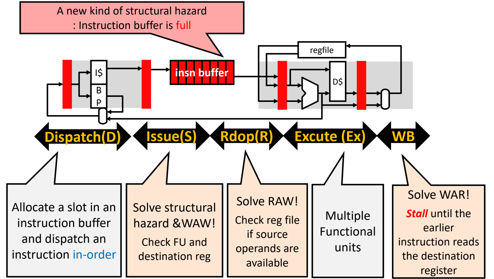

图：记分板把流水线分为 Dispatch、Issue、Rdop、Execute、WB：Issue 检查结构冒险与 WAW，Read operands 检查 RAW，WB 处理 WAR；指令缓冲满是新的结构冒险。

一条指令在记分板中的推进与停顿条件可以概括为：

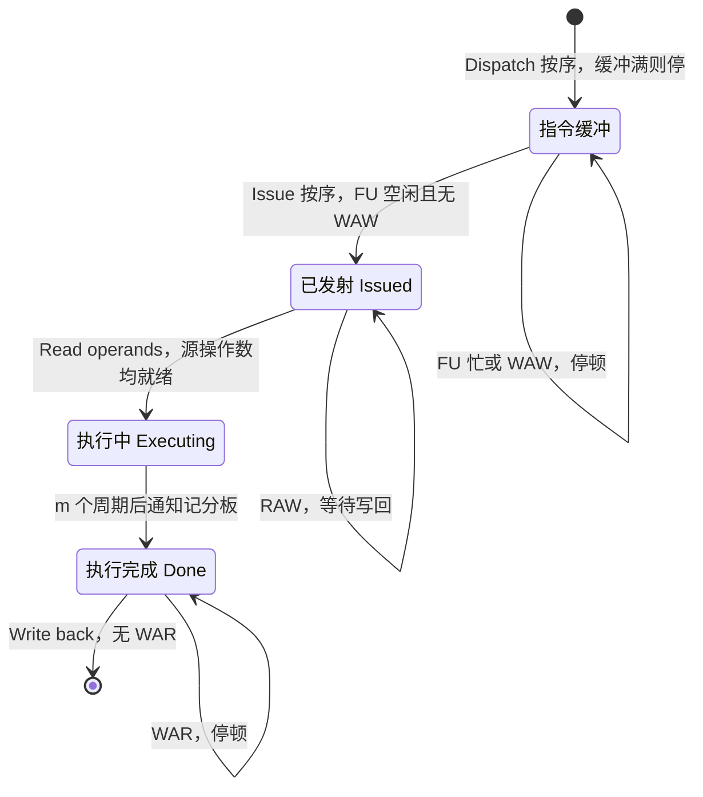

三类数据冒险分别在三个不同阶段处理：WAW 在 Issue、RAW 在 Read operands、WAR 在 Write back；Execute 阶段不再需要检查任何冒险，因为它之前的依赖已经解决。

> [!tip] 课堂强调
> 记分板对三种冒险的处理位置各不相同，但都"比较合理"；整个机制"比大家预期的要简单得多，所以不用纠结"。指令缓冲满引起的结构冒险只作提示，课程后面不再把它当作关键问题。

> [!info] 可视化资源
> [爱丁堡大学 HASE：CDC 6600 仿真模型](https://www.icsa.inf.ed.ac.uk/research/groups/hase/models/6600/index.html)：给出 CDC 6600 的处理器组织图和功能单元控制示意，说明记分板如何处理一、二、三阶冲突（对应 WAW/结构、RAW、WAR）；模型需下载到 HASE 桌面环境运行。

> [!warning] 易错点
> "乱序"只从 Issue 之后开始：Dispatch 和 Issue 都是按序的。因为 Issue 按序，一条指令因结构冒险或 WAW 卡在 Issue，它后面的所有指令也都发射不了，即使它们自己没有任何冒险。

### 记分板的三张表

要在每个周期判断上面各阶段的条件，记分板需要记录三类信息，对应三张表：

**指令状态表**（Instruction status）：每条指令一行，记录它在 4 个步骤中各自完成的周期号：

- ID1：Issue；
- ID2：Read operands；
- EX：Execute 阶段完成；
- WB：把结果写入寄存器。

**功能单元状态表**（Functional unit status）：每个 FU 一行，表示该功能单元的状态，共 9 个字段：

| 字段 | 含义 |
| --- | --- |
| $B$ | Busy，该单元是否被占用 |
| Op | 单元中要执行的操作（如 + 或 −） |
| dst | 目的寄存器 |
| src1, src2 | 源寄存器编号 |
| $Q_1, Q_2$ | 将产生 src1、src2 的功能单元（空表示不必等待） |
| $R_1, R_2$ | 标志位，src1/src2 就绪时置位 |

**寄存器结果状态表**（Register result status）：每个寄存器一项，记录哪个功能单元将写这个寄存器；若没有在途指令要写它，该项为空。

三张表分别支撑各阶段的检查：

- Issue 查 FU 状态表的 $B$ 判断结构冒险，查寄存器结果状态表中目的寄存器一项是否非空判断 WAW；发射时填写该 FU 的一行，并在寄存器结果状态表中登记目的寄存器。对每个源寄存器，若它在寄存器结果状态表中有登记，就把登记的 FU 填入 $Q$，并令 $R=$ No；否则 $R=$ Yes。
- Read operands 等待 $R_1=R_2=$ Yes。
- Write back 写回后清空该 FU 的一行和目的寄存器的登记，并把所有 $Q$ 等于该 FU 的源操作数的 $R$ 置为 Yes。

> [!info] 可视化资源
> [Wikipedia：记分板（Scoreboarding）](https://en.wikipedia.org/wiki/Scoreboarding)：给出四阶段与三张表（FU 状态的 9 个字段 Busy/Op/Fi/Fj/Fk/Qj/Qk/Rj/Rk）的定义和伪代码，字段与本节 B/Op/dst/src1/src2/Q1/Q2/R1/R2 一一对应。

> [!note] 补充解释
> 本例的表格在指令读操作数之后仍保留 $R=$ Yes（如第 17 周期 Mult1 行已读过操作数，$R_1=R_2=$ Yes）。按这种记法，判断 WAR 要同时看指令状态表：某条更早发射的指令源寄存器等于本指令的 dst，且它的 Read operands 一栏还是空的（如第 17 周期 DIVD 的 src2 为 F6、ID2 为空），本指令就不能写回。Hennessy & Patterson 教材的写法是读操作数后把 $R_1,R_2$ 清为 No，于是 WAR 条件可以只看 FU 状态表："存在其他 FU 的 src 等于本指令 dst 且对应 $R=$ Yes"。两种记法得到的时序完全相同。

### 逐周期例子：6 条指令

**已知**：指令序列与功能单元延迟如下（Integer 1、Mult 10、Add 2、Divide 40 周期）；每周期最多发射 1 条指令，但不同阶段的多条指令可以在同一周期同时推进。

```asm
LD    F6, 34(R2)    ; LD#1  -> Integer
LD    F2, 45(R3)    ; LD#2  -> Integer
MULTD F0, F2, F4    ;       -> Mult1
SUBD  F8, F6, F2    ;       -> Add
DIVD  F10, F0, F6   ;       -> Divide
ADDD  F6, F8, F2    ;       -> Add
```

先找出依赖：MULTD、SUBD、ADDD 通过 F2 依赖 LD#2（RAW）；SUBD 通过 F6 依赖 LD#1（RAW）；DIVD 通过 F0 依赖 MULTD（RAW）；ADDD 通过 F8 依赖 SUBD（RAW）；ADDD 要写 F6，而更早的 DIVD 要读 F6（WAR）。两条 LD 共用一个 Integer 单元，SUBD 与 ADDD 共用一个 Add 单元（结构冒险）。

#### 逐周期事件

| 周期 | 发生的事件 | 关键表项变化 / 停顿原因 |
| --- | --- | --- |
| 1 | Issue LD#1（Integer 空闲） | Int：Yes, LD, F6, R2, $R=$ Yes；F6 ← Int |
| 2 | LD#1 读操作数（R2 无 RAW） | LD#2 无法发射：Integer 被 LD#1 占用（结构冒险） |
| 3 | LD#1 执行完成（1 周期） | LD#2 仍在等 Integer |
| 4 | LD#1 写回 F6，释放 Int 行与 F6 登记 | Integer 空闲，下一周期可发射 |
| 5 | Issue LD#2 | Int：Yes, LD, F2, R3；F2 ← Int |
| 6 | LD#2 读操作数；Issue MULTD 到 Mult1 | Mult1：MUL, F0, F2, F4, $Q_1=$ Int, $R_1=$ No, $R_2=$ Yes；F0 ← Mult1 |
| 7 | LD#2 执行完成；Issue SUBD 到 Add | MULTD 不能读操作数：F2 还没写回（RAW）；Add：SUB, F8, F6, F2, $R_1=$ Yes, $Q_2=$ Int, $R_2=$ No；F8 ← Add |
| 8a（前半周期） | Issue DIVD 到 Divide | Div：DIV, F10, F0, F6, $Q_1=$ Mult1, $R_1=$ No, $R_2=$ Yes；F10 ← Div |
| 8b（后半周期） | LD#2 写回 F2，释放 Int 行与 F2 登记 | MULTD 的 $R_1$、SUBD 的 $R_2$ 变为 Yes |
| 9 | MULTD、SUBD 同时读操作数，开始执行 | DIVD 不能读：F0 等 Mult1（RAW）；ADDD 无法发射：Add 被 SUBD 占用（结构冒险） |
| 10 | 计算中 | — |
| 11 | SUBD 执行完成（9 + 2） | — |
| 12 | SUBD 写回 F8，释放 Add | Add 空闲 |
| 13 | Issue ADDD 到 Add | Add：ADD, F6, F8, F2, $R_1=R_2=$ Yes；F6 ← Add |
| 14 | ADDD 读操作数 | — |
| 16 | ADDD 执行完成（14 + 2） | — |
| 17 | ADDD 不能写回 F6（停顿持续到 21） | DIVD 先发射但还没读 F6（WAR） |
| 19 | MULTD 执行完成（9 + 10） | — |
| 20 | MULTD 写回 F0，释放 Mult1 | DIVD 的 $R_1$ 变为 Yes |
| 21 | DIVD 读操作数（F0、F6） | WAR 解除 |
| 22 | ADDD 写回 F6 | — |
| 61 | DIVD 执行完成（21 + 40） | — |
| 62 | DIVD 写回 F10 | 全部完成 |

第 8 周期被分成两半，是因为同一周期内既有发射（读取表项、登记新指令）又有写回（清除表项、更新就绪位）。课件让 DIVD 的发射发生在前半周期，LD#2 的写回发生在后半周期；写回释放的功能单元和更新的就绪位，要到下一周期才能被发射或读操作数使用（Integer 在第 4 周期释放、LD#2 在第 5 周期发射；Add 在第 12 周期释放、ADDD 在第 13 周期发射）。

#### 最终指令状态表

例子结束时的指令状态表如下：

| 指令 | Issue（ID1） | Read operands（ID2） | Execute complete（EX） | Write result（WB） |
| --- | --- | --- | --- | --- |
| LD F6, 34(R2) | 1 | 2 | 3 | 4 |
| LD F2, 45(R3) | 5 | 6 | 7 | 8 |
| MULTD F0, F2, F4 | 6 | 9 | 19 | 20 |
| SUBD F8, F6, F2 | 7 | 9 | 11 | 12 |
| DIVD F10, F0, F6 | 8 | 21 | 61 | 62 |
| ADDD F6, F8, F2 | 13 | 14 | 16 | 22 |

#### 例子中的关键事件

1. **结构冒险推迟发射**：LD#2 要等 LD#1 在第 4 周期写回、释放 Integer 单元，第 5 周期才能发射；ADDD 要等 SUBD 在第 12 周期释放 Add 单元，第 13 周期才能发射。
2. **没有旁路，RAW 必须绕寄存器堆一圈**：LD#2 第 7 周期就算出 F2，但要第 8 周期写回寄存器后，MULTD 和 SUBD 第 9 周期才能读到；DIVD 同理，要等 MULTD 第 20 周期写回 F0，第 21 周期才能读。
3. **WAR 推迟写回**：ADDD 第 16 周期执行完，本可在第 17 周期写回 F6；但更早发射的 DIVD 要读的是**旧的** F6，若 ADDD 先写回就会覆盖它。因此 ADDD 一直停到 DIVD 第 21 周期读完 F6，第 22 周期才写回。
4. **整体顺序**：Issue 列 1、5、6、7、8、13 单调递增，即**按序发射**；Execute complete 列 3、7、19、11、61、16 和 Write result 列 4、8、20、12、62、22 都不按程序顺序，即**乱序执行、乱序完成**（in-order issue, out-of-order execution & out-of-order commit）。

> [!note] 补充解释
> 从例子可以归纳出记分板的时序规则（设读操作数周期为 $R$，FU 延迟为 $m$）：执行完成周期 $X = R + m$；写回周期 $W \ge X + 1$，且必须晚于所有"更早发射、要读本指令目的寄存器"的指令的读操作数周期；读操作数周期 $R$ 必须晚于发射周期和所有源操作数生产者的写回周期；发射周期必须晚于前一条指令的发射周期和所需 FU 上一条指令的写回周期。例如 MULTD：$R = 9$（F2 在第 8 周期写回），$X = 9 + 10 = 19$，$W = 20$。

> [!tip] 课堂强调
> 记分板这里的写回（write back）也可以称为提交（commit），所以说记分板是"乱序 commit"。后面的 Tomasulo、ROB 对各阶段的定义会略有不同。

> [!warning] 易错点
> - 每周期只能**发射**一条指令，但读操作数、执行完成、写回可以与发射在同一周期发生，也可以多条同时发生（如第 9 周期 MULTD 和 SUBD 同时读操作数）。
> - 在有 forwarding 的五级流水线里，LD#2 的结果可以直接送给 MULTD；记分板没有旁路，必须"写回寄存器 → 下一周期再读"。
> - ADDD 的 WAR 停顿发生在 **Write back** 阶段，不在 Issue 阶段：ADDD 第 13 周期就正常发射并执行完毕，只有写回被推迟。

### 记分板的优缺点

**优点**：

- **硬件便宜**：只需增加记分板，即 InsnStatus、FuStatus、RegStatus 三张表加上状态更新逻辑，面积约等于 1 个浮点单元；
- **性能不错**：对 FORTRAN（科学计算、数组）程序约有 $1.7\times$ 的加速（相对传统按序执行）。

**缺点**：

1. **没有旁路**：结果必须先写回寄存器堆，再从寄存器堆读出，后续指令才能使用。
2. **调度范围有限**：结构冒险和 WAW 冒险都会推迟发射，而发射是按序的，所以一条指令卡住就会挡住后面所有指令，能被调度的窗口很小。
3. **真相关（RAW）指令发射慢**：RAW 只能停在读操作数阶段，等生产者写回后再读。
4. **WAR 冒险推迟写回**：如例中 ADDD 从第 17 周期停到第 22 周期。

本质上，记分板对一切冒险都只会"停顿"，没有用任何手段去消除冒险，所以效率很低。WAW 和 WAR 是假相关，可以用**硬件寄存器重命名**消除（原理见[寄存器重命名](#乱序执行与寄存器重命名)）；把重命名与转发结合起来就是下一代方案 Tomasulo 算法，见[Tomasulo 算法](#tomasulo-算法)。

> [!question]- 自测：若把例子中的 Add 单元换成两个（Add1、Add2，各 2 周期），ADDD 的四个时间会变成多少？
> 变为 9/13/15/22。Add2 空闲，没有结构冒险，F6 也没有在途写者（无 WAW），但发射仍须按序且每周期一条，DIVD 第 8 周期发射，所以 ADDD 第 9 周期发射。源操作数 F8 要等 SUBD 第 12 周期写回、F2 已在第 8 周期写回，所以第 13 周期读操作数，第 15 周期执行完成。写回仍要等 DIVD 第 21 周期读 F6（WAR），所以第 22 周期写回。多一个加法器只消除了结构冒险，RAW 和 WAR 的停顿依然存在。

> [!question]- 自测：在例子末尾追加一条 `MULTD F10, F2, F4`，它能否在第 14 周期发射？
> 不能。第 14 周期 Mult1 仍被 MULTD 占用，但 Mult2 一直空闲，没有结构冒险；但目的寄存器 F10 在寄存器结果状态表中登记为 Div（DIVD 要到第 62 周期才写回），这是 WAW 冒险，记分板在 Issue 阶段停顿，直到 DIVD 第 62 周期写回、释放 F10 登记后，第 63 周期才能发射。

> [!question]- 自测：第 7 周期结束时，功能单元状态表中 Add 行的 $Q_1, Q_2, R_1, R_2$ 分别是什么？为什么？
> $Q_1$ 为空、$R_1=$ Yes，$Q_2=$ Int、$R_2=$ No。SUBD 的 src1 是 F6，LD#1 已在第 4 周期写回，寄存器结果状态表中 F6 无登记；src2 是 F2，此时登记为 Int（LD#2 尚未写回），所以 SUBD 要等 Integer 单元写回 F2。

---

## Tomasulo 算法

> [!abstract] 本节要点
> - Tomasulo 算法（IBM 360/91，1966）本质上是两项技术：**硬件寄存器重命名**消除 WAR/WAW 假相关，**数据转发**（CDB 广播）缩短 RAW 真相关的等待。
> - 保留站 RS 就是重命名映射表：源操作数就绪则直接存**值**（V），否则存产生它的保留站**标签**（Tag，Tag $=0$ 表示就绪）；RS 不保存寄存器名，所以后续指令改写该寄存器不再构成 WAR。
> - 三阶段：Issue（保留站空闲才发射，拷贝值或记标签，并在寄存器结果状态中登记“所有权”）→ Execute（两个操作数都就绪才执行）→ Write result（结果经 CDB 广播给所有 RS 和寄存器，然后释放 RS）。
> - 同一段 6 条指令：Tomasulo 在周期 6 就发射完全部指令（记分板的 ADDD 要到周期 13），总时长 57 个周期 vs 记分板 62 个周期；记分板慢在结构冒险（只有一个 LD 单元）和缺少转发。
> - Tomasulo 仍是按序发射、乱序执行、乱序完成；其 load/store 缓冲在真实处理器中合并为 Load Store Queue（LSQ）。

### 从记分板到 Tomasulo

记分板（见[记分板算法](#记分板算法)）对所有冒险只有一种手段：停顿。遇到 RAW 真相关，就停住指令直到冒险解除；遇到 WAW、WAR 这类名字相关，也把它们当作冒险来停顿。停顿太多，乱序执行的收益远没有发挥出来。

**Tomasulo 算法**（Tomasulo's algorithm）的出发点是：用硬件**动态**地重命名寄存器，从而去掉假相关（WAW、WAR）。编译器也能静态重命名寄存器，但运行时才出现的相关（例如 cache miss 打乱的时序）编译器看不到，这正是硬件要做而编译器做不到的部分。实现上的关键是把记账信息**分布**到各个保留站中，而不是像记分板那样放在一张集中式的表里。 寄存器重命名的一般原理见[寄存器重命名](#乱序执行与寄存器重命名)，本节只讲 Tomasulo 的具体做法。

> [!tip] 课堂强调
> 严格说，Tomasulo 就是两项技术的组合：一是加入转发（forwarding），二是加入寄存器重命名（register renaming）。目标都是避免相关带来的额外停顿。

#### IBM 360/91

Tomasulo 算法最早用于 **IBM 360/91**（1966 年），比 CDC 6600 晚 3 年。两者的 ISA 差别是：

| 对比项 | IBM 360/91 | CDC 6600 |
| --- | --- | --- |
| 每条指令的寄存器说明符 | 2 个 | 3 个 |
| 浮点寄存器 | 4 个 | 8 个 |
| 存储器-寄存器操作 | 有 | 无 |

从配置看，IBM 360/91 并不比 CDC 6600 强（两者出自不同公司），但靠架构上的优化，性能并不比 CDC 6600 差。它值得学习的原因是影响深远：Alpha 21264、MIPS R10000、Pentium II、PowerPC 604 等后续处理器都继承了 Tomasulo 的思想。

#### 例子中的重命名

本节始终使用和记分板相同的 6 条指令：

```asm
LD    F6, 34(R2)     ; Load#1
LD    F2, 45(R3)     ; Load#2
MULTD F0, F2, F4
SUBD  F8, F6, F2
DIVD  F10, F0, F6
ADDD  F6, F8, F2
```

其中既有 RAW 相关（例如 MULTD 读 Load#2 写的 F2），也有假相关：SUBD、DIVD 读 F6，而之后的 ADDD 要写 F6，构成 WAR。RAW 是真相关，无法消除；WAR 可以消除。

按一般的重命名思路，可以把 ADDD 的目的寄存器 F6 改名为一个新寄存器（例如 F11）。Tomasulo 的做法是从硬件视角改名：把 SUBD、DIVD 的源操作数 F6 改名为 **Load1**，即“产生这个值的那条指令（所在的缓冲项）的输出”，并在值产生后把它直接转发到需要的地方。这样 SUBD、DIVD 等的是 Load1 而不是寄存器 F6，ADDD 写 F6 就不再影响它们。 这里的 Load1 正是后面要讲的保留站。

### Tomasulo 的结构：保留站与 CDB

Tomasulo 的整体结构与记分板相似，也有指令缓冲和寄存器堆，另外加了两种新机制。

1. **FP 操作队列**（FP Operation Stack，FPOS）：存放待发射的指令，按序发出。
2. **FP 寄存器**（FP Registers，FLR）：F0、F2、…、F10。
3. **功能单元**：FP 加法器（FP Adders），执行 2 个周期；FP 乘/除单元（FP Mult/Div），乘法 10 个周期、除法 40 个周期。乘法和除法合用一个单元。
4. **FP Load Buffers（FLB）**：来自存储器的数据，共 6 项；**Store Data Buffers（SDB）**：送往存储器的数据。Tomasulo 把 load 和 store 也当作一种功能单元。 与记分板只有一个 LD/ST 功能单元不同，这里是一串缓冲项，多个 load 可以同时在途。

#### 机制 1：保留站（Reservation Station）

**保留站**（Reservation Station，RS）是每个功能单元前面的缓冲，它本身就是寄存器重命名的映射表：指令发射后在保留站里等待操作数，操作数以“值”或“产生它的保留站名”的形式登记。 不仅功能单元有保留站，FP 寄存器也有对应的状态，记录将要写该寄存器的是哪个保留站。

保留站等表项的字段如下。

**寄存器结果状态**（Register Result Status）：对每个寄存器，记录哪个功能单元（保留站）将写它；若没有待完成的指令要写这个寄存器，则为空。它用来跟踪假相关（WAW 和 WAR）。

**Load buffer**：

- **Busy（B）**：该保留站项或功能单元是否被占用。
- **Addr**：load 指令的目标存储器地址。

**功能单元保留站**（FU buffer）：

- **Busy（B）**：跟踪 RAW 和结构冒险。
- **Op**：在功能单元中执行的操作。
- **V1、V2**：源操作数的**值**。store buffer 也有 V 字段，存放待写入存储器的数据。
- **Tag1、Tag2**：将产生源操作数的保留站。Tag1、Tag2 $=0$ 即表示就绪，没有记分板那样单独的 ready 标志位。store buffer 只有 $\mathrm{Tag}_{\rm dst}$，指向产生待存结果的保留站。

对每个源操作数，V 和 Tag 二者必有其一有效：要么已经拿到值，要么记着正在等哪个保留站。

> [!tip] 课堂强调
> RS 不保存任何寄存器名，操作数就绪时直接把寄存器的**值**存进来。记分板在写回时要检查前面的指令是否还要读这个寄存器（WAR），否则就停顿；而 Tomasulo 的值已经拷进保留站，不再依赖寄存器堆里的那个位置，所以这个问题不存在。这一点需要回过头对照记分板的例子再看一遍。

#### 机制 2：公共数据总线（Common Data Bus）

**公共数据总线**（Common Data Bus，CDB）把任一功能单元的结果**广播**给所有功能单元（保留站）和寄存器堆。等待某个结果的保留站一直监听 CDB，结果一出现就立即取走并缓冲，不必等它先写进寄存器堆再读出来。

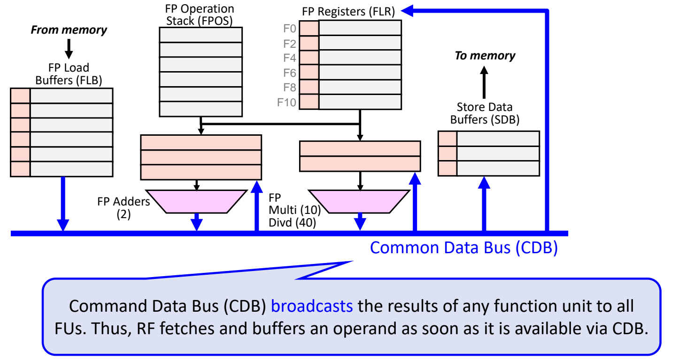

图：Tomasulo 结构。FP Load Buffers、FP 操作栈、FP 寄存器、加法器与乘除法器前的保留站和 Store Data Buffers 都挂在公共数据总线 CDB 上：load 缓冲、加法器、乘除器的输出接到 CDB，CDB 再接回各保留站、store 缓冲和 FP 寄存器；寄存器和缓冲项左侧的小格是存放标签的状态位。

五级流水线的转发是在特定的两个阶段之间专门拉一条旁路；CDB 则把结果放到一条总线上，任何需要它的单元都能从总线取值，是一种更通用的转发。

> [!info] 可视化资源
> [Wikipedia：Tomasulo 算法](https://en.wikipedia.org/wiki/Tomasulo%27s_algorithm)：含 IBM 360/91 浮点单元结构图和算法执行过程的动画 GIF，可对照本节保留站字段（Wikipedia 记作 Op/Vj/Vk/Qj/Qk/A/Busy）与 CDB 广播。

> [!warning] 易错点
> 讲义在介绍机制 2 时把 CDB 写作 “Command Data Bus”，标准名称是 **Common Data Bus**（课上也这样称呼）。

### 三个阶段

Tomasulo 把指令处理分为三个阶段：Issue、Execute（执行完成）、Write result。

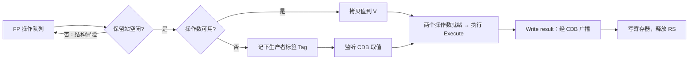

#### 阶段 1：Issue

从操作队列按序取出指令，发射前依次检查：

1. **保留站是否空闲**：这是结构冒险检查。注意检查对象是保留站，而记分板检查的是功能单元本身是否空闲。保留站已满则不能发射。
2. **操作数是否可用**：
   - 可用：把操作数的值拷进 V 字段，不需要重命名，直接发射。
   - 有操作数正被尚未完成的指令占用：仍然发射，但做硬件寄存器重命名，即把该操作数的 Tag 设为将产生它的保留站，例如 `mul F0, LD2, F4` 中 F2 被改成 LD2，该操作数处于 pending 状态。
3. **更新寄存器结果状态**：把目的寄存器的状态改为本指令所在的保留站，表示这个寄存器现在归它所有（ownership）。

#### 阶段 2：Execute

只有两个操作数都就绪（Tag1、Tag2 都为 0）时，指令才进入功能单元开始执行。 在执行完成的那个周期记下“执行完成”时间。

#### 阶段 3：Write result

写结果分两步：

1. 功能单元的结果经 CDB 广播。
2. 寄存器收到结果后写入，寄存器结果状态清除，该保留站被释放（clean up RS）。

与此同时，所有处于 pending 的保留站一直在侦听 CDB，发现自己等的标签出现在 CDB 上，就直接把值存入本地 V 字段，Tag 清零，操作数就绪。

> [!note] 补充解释
> 寄存器结果状态只记录**最新**的那个生产者。若较早指令的结果广播时，寄存器状态已被后发射的指令改写成别的标签，寄存器就不该接收这个旧结果，这正是 Tomasulo 用重命名消除 WAW 的方式；等这个旧结果的保留站照样能从 CDB 取到值。本例中 LD1 在 ADDD 发射前就写回了 F6，没有出现这种情况。

### 逐周期例子

为简洁起见，例子把 load buffer 从 6 项减为 3 项（Load1–Load3），并省略 store data buffer（它与 load buffer 相同）。 加法器有 3 个保留站 Add1–Add3，乘除器有 2 个保留站 Mult1–Mult2。所有寄存器初值为 0，并假设 $\mathrm{Mem}[R2+34]=34$、$\mathrm{Mem}[R3+45]=45$。 load 需要 2 个周期，加减 2 个周期，乘 10 个周期，除 40 个周期；流水化的结构允许同一周期处理多条指令（一条在写结果，另一条在发射等）。

表中各列记录：发射周期 D（Issue）、执行完成周期 X、写结果周期 W。保留站、寄存器状态在物理上分散在各个单元旁边，例子只是为了便于观察把它们集中画在下方；记分板才真有一张集中的表。

#### 周期事件表

本例中，同一周期内先处理写结果再处理发射，所以发射时能直接读到本周期刚写回的值（见周期 4 的 SUBD）。

| 周期 | 事件 | 关键状态变化 |
| --- | --- | --- |
| 1 | 发射 LD1：Load1 空闲，R2 可用 | Load1：Busy=Yes，Addr=$34+R2$；F6 → Load1 |
| 2 | LD1 开始执行（2 周期）；发射 LD2：还有空闲 load 项 | Load2：Addr=$45+R3$；F2 → Load2。记分板只有一个 LD 单元，这里可以有多个 load 同时在途  |
| 3 | LD1 执行完成；LD2 开始执行；发射 MULTD：Mult1 空闲，F2 未就绪 | Mult1：Op=MUL，V2=0（F4），Tag1=Load2；F0 → Mult1  |
| 4 | LD1 写结果：CDB 广播 34，F6=34，释放 Load1；LD2 执行完成；发射 SUBD：F6=34 可用，F2 未就绪 | Add1：Op=SUB，V1=34，Tag2=Load2；F8 → Add1 |
| 5 | LD2 写结果：CDB 广播 45，Add1、Mult1 同时取走 45，F2=45，释放 Load2；发射 DIVD：F0 未就绪，F6=34 可用 | Add1：V2=45；Mult1：V1=45；Mult2：Op=DIV，V2=34，Tag1=Mult1；F10 → Mult2 |
| 6 | SUBD、MULTD 开始执行；发射 ADDD：F8 未就绪，F2=45 可用 | Add2：Op=ADD，V2=45，Tag1=Add1；F6 → Add2。全部 6 条指令已发射  |
| 7 | SUBD 执行完成，结果 $34-45=-11$ | — |
| 8 | SUBD 写结果：CDB 广播 $-11$，Add2 取走，F8=$-11$，释放 Add1 | Add2：V1=$-11$，两个 Tag 均为 0 |
| 9 | ADDD 开始执行 | — |
| 10 | ADDD 执行完成，结果 $-11+45=34$ | — |
| 11 | ADDD 写结果：F6=34，释放 Add2 | — |
| 15 | MULTD 执行完成（周期 6–15 共 10 个周期），结果 $45\times0=0$ | — |
| 16 | MULTD 写结果：CDB 广播 0，Mult2 取走，F0=0，释放 Mult1 | Mult2：V1=0，V2=34，就绪 |
| 56 | DIVD 执行完成（周期 17–56 共 40 个周期），结果 $0/34=0$ | — |
| 57 | DIVD 写结果：F10=0，释放 Mult2 | 全部完成 |

周期 5 体现了 CDB 广播的价值：一次广播同时满足了 SUBD 和 MULTD 两个等待者，它们下一个周期就能开始执行。周期 6 发射 ADDD 时，DIVD 早已把 F6 的值 34 拷进了 Mult2 的 V2，所以 ADDD 把 F6 的所有权改为 Add2、随后在周期 11 写 F6，都不影响 DIVD，WAR 被消除。

#### 最终状态

| 指令 | dst | src1 | src2 | D（发射） | X（执行完成） | W（写结果） |
| --- | --- | --- | --- | --- | --- | --- |
| LD | F6 | 34+ | R2 | 1 | 3 | 4 |
| LD | F2 | 45+ | R3 | 2 | 4 | 5 |
| MULTD | F0 | F2 | F4 | 3 | 15 | 16 |
| SUBD | F8 | F6 | F2 | 4 | 7 | 8 |
| DIVD | F10 | F0 | F6 | 5 | 56 | 57 |
| ADDD | F6 | F8 | F2 | 6 | 10 | 11 |

最终寄存器值：F0=0，F2=45，F6=34，F8=$-11$，F10=0。

从 D 列看，发射是**按序**的；从 X、W 列看，执行和完成（写结果）都是**乱序**的，例如 ADDD 在周期 11 写结果，早于周期 16 的 MULTD。和记分板一样，Tomasulo 是按序发射、乱序执行、乱序完成。 完成顺序乱序带来的问题见[重排序缓冲与顺序提交](#重排序缓冲与顺序提交)。

关于本例约定的两个细节：

- **多个保留站同时就绪**：同一功能单元前若有多个保留站都已就绪，早期设计没有复杂的选择策略，直接挑先进入的那一条执行。
- **发射时截取 CDB**：本例中发射只从寄存器堆或已有标签取操作数，不会在发射的同一周期直接截取 CDB 上正在广播的结果；那是一种可能的优化，1966 年的设计没有采用。

### Tomasulo 与记分板的比较

#### 完成时间

同一段代码，记分板在周期 62 完成，Tomasulo 在周期 57 完成。

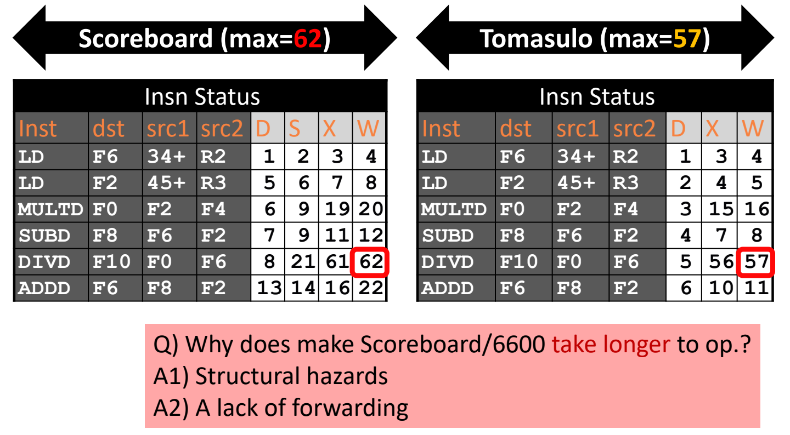

图：同一 6 条指令的状态表对比。左表为记分板（D/S/X/W = 发射 / 读操作数 / 执行完成 / 写回），DIVD 在周期 62 写回；右表为 Tomasulo（D/X/W = 发射 / 执行完成 / 写结果），DIVD 在周期 57 写结果；下方框注给出记分板更慢的两个原因：结构冒险和缺少转发。

| 指令 | 记分板 D/S/X/W | Tomasulo D/X/W |
| --- | --- | --- |
| LD F6 | 1 / 2 / 3 / 4 | 1 / 3 / 4 |
| LD F2 | 5 / 6 / 7 / 8 | 2 / 4 / 5 |
| MULTD | 6 / 9 / 19 / 20 | 3 / 15 / 16 |
| SUBD | 7 / 9 / 11 / 12 | 4 / 7 / 8 |
| DIVD | 8 / 21 / 61 / 62 | 5 / 56 / 57 |
| ADDD | 13 / 14 / 16 / 22 | 6 / 10 / 11 |

总时长只少了 5 个周期，是因为 40 个周期的 DIVD 占了大头；逐条看，MULTD 的写回从 20 提前到 16，ADDD 从 22 提前到 11，许多指令的完成时间提前了接近一半。

记分板更慢有两个原因：

1. **结构冒险**：记分板只有一个 LD 单元，LD2 要等 LD1 写回后才能在周期 5 发射；只有一个加法单元，ADDD 要等 SUBD 在周期 12 释放后才能在周期 13 发射。Tomasulo 有多项 load buffer 和多个保留站，周期 6 就发射完所有指令。
2. **缺少转发**：记分板的结果要先写回寄存器堆，消费者再从寄存器堆读操作数，多花一个周期。例如 LD2 在周期 8 写回，MULTD 周期 9 才读操作数、周期 10 才开始执行；Tomasulo 中 LD2 在周期 5 经 CDB 广播，MULTD 周期 6 就开始执行。此外记分板的 ADDD 在周期 16 就执行完，却因 DIVD 还没读 F6（WAR）要拖到周期 22 才能写回；Tomasulo 的 DIVD 早已拷走 F6 的值，ADDD 在周期 11 就写结果。

#### 机制对比

| 对比项 | Tomasulo（IBM 360/91） | 记分板（CDC 6600） |
| --- | --- | --- |
| 功能单元 | 流水化功能单元（6 Load、3 Store、3 +、2 ×/÷） | 多个功能单元（1 LD/ST、1 +、2 ×、1 ÷） |
| 窗口大小 | $\le 14$ 条指令 | $\le 5$ 条指令 |
| 结构冒险 | 无空闲保留站则不发射 | 无空闲功能单元则不发射 |
| WAR | 重命名消除 | 推迟完成（写回） |
| WAW | 重命名消除 | 推迟发射 |
| RAW | 在 RS 中等待（Tag $\ne 0$），从 CDB 转发取值 | 在读操作数阶段停顿，直到生产者写回寄存器堆 |
| 功能单元结果 | 从 FU 广播 | 写寄存器、再读寄存器 |
| 控制 | 保留站（分布式） | 集中式记分板 |

窗口大小正好等于可同时容纳的指令数：Tomasulo $6+3+3+2=14$，记分板 $1+1+2+1=5$。

> [!warning] 易错点
> 讲义的 Tomasulo vs. Scoreboard 对比表有误，课后有同学指出，老师确认需要修改：原表把 RAW 写成 “Renaming avoids / Stall issue”，把 WAW 写成 “Renaming&Forward avoids”。RAW 是真相关，重命名消除不了：Tomasulo 让指令在保留站里等待并通过 CDB 转发拿到值，记分板则在读操作数阶段（而不是 Issue）停顿；“转发”对应的是 RAW 而不是 WAW。上表已按课程机制改正。
>
> 原表结构冒险一行两栏都写 “No issue”，意思是“不发射”：Tomasulo 没有空闲保留站、记分板没有空闲功能单元时，指令停在发射阶段。

#### Load Store Queue 的提法

Tomasulo 把记分板唯一的 LD/ST 功能单元改成了 load buffer 和 store buffer，从而能同时支持多条 load 和多条 store 指令。但分开的两个缓冲并不是最优解：真实处理器把它们合并成一个 **Load Store Queue**（LSQ）。 LSQ 与访存消歧的细节见[精确异常与推测执行](#精确异常与推测执行)。

> [!question]- 自测：若把例子里的加法器保留站从 3 个减为 1 个，ADDD 最早在哪个周期发射？
> 周期 9。SUBD 在周期 4 占用唯一的加法保留站，直到周期 8 写结果后才释放；ADDD 必须等保留站空闲（结构冒险）；按与记分板例子相同的约定（写结果的周期释放，下一周期才能重新分配，如记分板中 SUBD 周期 12 写回、ADDD 周期 13 发射），ADDD 周期 9 才能发射。此时 F8 已经写回（$-11$），ADDD 发射时直接拷贝值，不需要标签。

> [!question]- 自测：周期 5 发射 DIVD 时，其保留站 Mult2 的 V1、V2、Tag1、Tag2 各是什么？为什么 ADDD 之后改写 F6 不会让 DIVD 读错值？
> V1 空、Tag1=Mult1（F0 由 MULTD 产生，尚未完成）；V2=34、Tag2=0（F6 已在周期 4 由 LD1 写回）。DIVD 保存的是 F6 的值 34 而不是寄存器名 F6，ADDD 在周期 11 写 F6 改的是寄存器堆，与 Mult2 中的拷贝无关，所以 WAR 不会造成错误或停顿。

> [!question]- 自测：记分板中 MULTD 在周期 19 执行完成，Tomasulo 中是周期 15。这 4 个周期的差距各来自哪里？
> 记分板只有一个 LD 单元，LD2 推迟到周期 5 发射、周期 8 才写回（结构冒险，多出 3 个周期：Tomasulo 的 LD2 在周期 5 广播）；之后记分板还要在周期 9 读寄存器堆，周期 10 才开始执行，而 Tomasulo 从 CDB 取值后下一周期即可执行（缺少转发，多 1 个周期）。两者乘法都执行 10 个周期，故相差 $3+1=4$。

---

## 重排序缓冲与顺序提交

> [!abstract] 本节要点
> - Tomasulo 有两个遗留问题：保留站同时充当重命名标签，必须等指令完成才能释放；指令乱序完成，使异常和分支预测错误很难处理。
> - ROB 的思想是乱序执行、顺序提交：ROB 暂存乱序产生的结果，ARF 只按程序顺序更新，外界因此“相信”指令是顺序执行的。
> - Tomasulo w/ ROB 在原结构上做三处改动：FP 寄存器改称 ARF；新增由 head/tail 指针管理的循环队列 ROB；新增 RAT，记录每个架构寄存器的最新值在 ARF 还是在某个 ROB 项。
> - 四个阶段依次是 Issue（检查 RS 和 ROB、读 RAT、分配 tail 项）、Execution begin（操作数齐了才开始）、Write result（CDB 广播并写入自己的 ROB 项，ARF 不动）、Commit（head 项完成后写 ARF，head 前进）。
> - 按 Intel 命名，乱序处理器的 fetch/decode/issue 和 commit 按序进行，只有 exec/write 乱序；commit 绝不能乱序。

### Tomasulo 的两个问题

Tomasulo 用保留站和 CDB 解决了结构冒险和数据冒险，具体见[Tomasulo 算法](#tomasulo-算法)。但它还留下两个问题，ROB 就是为解决这两个问题而引入的。

#### 问题 1：保留站释放太晚

先看保留站（RS）在调度中要承担什么：

1. RS 要有**关联逻辑**，侦听 CDB 上广播的结果，并更新自己等待的操作数；
2. RS 要保存指令的全部信息，包括 opcode、操作数值和依赖标签等；
3. 这些信息**只在指令开始执行之前**有用，指令一旦送进功能单元，功能单元会自己保存运算所需的数据。

照理说，指令开始执行时 RS 就可以释放了。但在 Tomasulo 中，RS 要到**指令完成**、结果写回之后才能释放。原因是 Tomasulo 的寄存器重命名把 RS 编号用作临时名字（标签），结果广播时要用这个名字通知等待者，所以 RS 不能提前让出。由此产生的思路是**把寄存器重命名从 RS 中分离出去**，让 RS 不再兼任名字，就有可能更早释放。

#### 问题 2：乱序完成使异常和控制冒险难以处理

此前讲流水线冒险时，把流水线冒险分为结构冒险、数据冒险、控制冒险和异常四类。记分板和 Tomasulo 都只处理前两类，没有处理异常（例如整数溢出、除零）和控制冒险（分支预测错误）。

在 Tomasulo 中指令是**乱序完成**的，带来两个后果：一是异常很难正确处理，二是分支预测错误后很难恢复。 下面的时序例子说明了这一点：

| 指令 | Is | Ex | Wr |
| --- | --- | --- | --- |
| 1. `DIV.D F10,F0,F6` | 1 | 2 | 42 |
| 2. `L.D F2,45(R3)` | 2 | 3 | 5 |
| 3. `MUL.D F0,F2,F4` | 3 | 6 | 16 |
| 4. `SUB.D F8,F2,F6` | 4 | 6 | 8 |

假设除法在周期 41 检测到除零。按程序员看到的顺序语义，第 1 条指令出现异常时，第 2 到 4 条都还不应执行，F2、F0、F8 应保持旧值。可是 `L.D` 在周期 5、`SUB.D` 在周期 8、`MUL.D` 在周期 16 已经写回，三个寄存器的旧值都已丢失，程序状态与顺序执行时的状态对不上。

由此得出结论：指令可以乱序执行，但必须**按程序顺序完成**，这样乱序执行后的最终结果才和顺序执行一致，程序才是正确的。

> [!question]- 自测：在上表中，如果异常出在第 3 条 `MUL.D`（假设它在周期 15 被检测到），哪些寄存器的状态已经违背了顺序语义？
> F8 已经违背。按顺序语义，第 3 条出现异常时，第 1、2 条应已完成，第 4 条不应执行；但 `SUB.D` 在周期 8 已把结果写入 F8。反过来，F10 也不对：`DIV.D` 要到周期 42 才写回，此时它本应已经完成。可见乱序完成既可能让后面的指令“多做”，也可能让前面的指令“没做完”。

### 重排序缓冲的关键思想（Re-Order Buffer）

ROB 要解决的是：既保留乱序执行带来的性能，又让程序表现得和顺序执行一样。

- **目标**：让指令按程序顺序完成。
- **关键思想**：指令乱序执行，但让外界“相信”它是按顺序执行的。
- **方案**：重排序缓冲加架构寄存器文件。
  - **重排序缓冲**（Re-Order Buffer, ROB）保存乱序执行产生的临时结果；
  - **架构寄存器文件**（Architected Register File, ARF）保存最终结果，向外界提供“顺序执行”的假象。

要把结果留在 ROB 里，就把目的寄存器**重命名为一个 ROB 项**。这样临时名字由 ROB 提供，不再由 RS 提供，正好对应问题 1 提出的“把重命名从 RS 中分离”。

讲义用 ROB 中的 A 到 K 十项来说明这一点：ROB 按程序顺序存放 A、B、C……，各项可以以任意顺序执行完成；但结果只能从队首开始、按顺序写回 ARF。例如 C、F 先完成时只能留在 ROB 中；A 完成后立即写入 ARF，B 完成后再依次写 B、C；只要排在前面的某一项还没完成，后面已完成的项就只能等待。到某一时刻 A 到 E 都已写回 ARF，外界“看到”的就是 A、B、C、D、E 依次执行完毕。

ROB 是现代乱序处理器普遍采用的结构，各家叫法和容量不同：

| 处理器 | 结构名称 | 容量 |
| --- | --- | --- |
| MIPS R10K（1996） | Active list | 32 |
| MIPS R12K | Active list | 48 |
| Alpha 21264 | In-Flight Window | 80 |
| Intel P4 | Reorder Buffer | 126 μops |

### Tomasulo w/ ROB 的结构：ARF、ROB 与 RAT

ROB 一般不单独使用，而是在 Tomasulo 的基础上增加，合称 Tomasulo w/ ROB。相对原来的 Tomasulo（FP Op Queue、Add1–3 与 Mult1–2 保留站、FP 加法器和乘法器、CDB、FP 寄存器），改动有以下几处：

1. **FP 寄存器改称 ARF**：它和普通处理器的寄存器文件一样，区别是只能在新增的 commit 阶段被更新，保存的是“官方”的寄存器状态。
2. **新增 ROB**，存放乱序产生的结果。ROB 是**循环队列**，用两个指针管理——**head** 指向最老、下一个要提交的项，**tail** 指向下一个可分配的空项。
3. **新增 RAT**（Register Alias Table，寄存器别名表），保存重命名信息。每个架构寄存器在 RAT 中有一项，指出该寄存器的最新值位于 ARF 还是某个 ROB 项。查一次 RAT 就能知道操作数最新的数据在哪里。

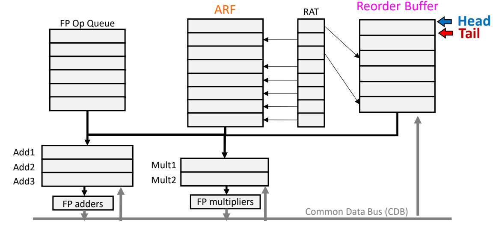

图：在 Tomasulo 基础上把 FP 寄存器改称 ARF，新增由 Head（蓝）/Tail（红）指针管理的 Reorder Buffer，RAT 中的箭头指向 ARF 或某个 ROB 项，表示该架构寄存器的最新值所在位置；CDB 把结果送回保留站和 ROB。

在课程的逐周期例子中，各表的字段如下：

| 结构 | 字段 | 含义 |
| --- | --- | --- |
| ROB 项 | Type | 将更新这一项的指令类型（DIV、MUL 等） |
| | Dst | 重命名之前的原目的架构寄存器（例如 R2） |
| | Val | 指令的结果 |
| | Fin | ready/finished 位 |
| RS（FU buffer） | Op | 功能单元要执行的操作 |
| | dst | 目的的标签，即分配到的 ROB 项 |
| | T1、T2 | 源操作数的标签（ROB 项） |
| | V1、V2 | 源操作数的值（来自 ARF，或来自已完成的 ROB 项） |
| RAT | 每个 $R_i$ 一项 | 用 $A_i$ 表示值在 ARF，用 $B_j$ 表示值在 ROBj |

每个源操作数的 T 和 V **只能有一个有效**：要么已经拿到值（V），要么记下要等的 ROB 标签（T）。例如 RAT 中 R3 指向 ROB2、R4 指向 ARF 时，`div R2,R3,R4` 进入 RS 后变成 `DIV ROB1 ROB2 val4`：目的分配为 ROB1，第一个源等 ROB2，第二个源直接拿到值 $val4$。

> [!warning] 易错点
> RAT 中的项不是数据，而是一个指向数据位置的指针（ARF 或某个 ROB 项）。issue 时把目的寄存器在 RAT 中指向的是 **tail 指针当前所指的那一项**，即新分配给这条指令的 ROB 项，而不是 ROB 里任意一个空位。

### ROB 的四个阶段

加入 ROB 后，Tomasulo 原来的三个阶段变为四个，多出来的是 **提交**（Commit）：把数据从 ROB 写到 ARF。


#### Stage 1：发射（Issue）

从 FP Op Queue 中按程序顺序取出队首指令，然后做以下几步：

1. **检查 RS**：对应类型的保留站是否有空项（例如 `div` 需要一个空的 Mult 保留站）；
2. **检查 ROB**：tail 指针所指的项是否可用，即 ROB 是否已满；
3. **读 RAT，重命名源寄存器**：对每个源寄存器查 RAT。若指向 ARF，就把 ARF 中的值复制进 RS 的 V 字段；若指向某个 ROB 项，就把该 ROB 编号记入 T 字段等待（该项若已完成，可直接取它的值）；
4. **写 RS 和 ROB**：把操作和操作数写入 RS，并在 ROB 的 tail 项登记指令类型和原目的寄存器；再把目的寄存器在 RAT 中改为指向这个新 ROB 项。例如 `div R2,R3,R4` 的目的寄存器 R2 原来指向 ARF，发射后 RAT 中 R2 指向 ROB1，RS 中的指令写作 `div ROB1 val3 val4`；
5. **更新 tail**：tail 加 1，指向下一个空项。

只要 RS 或 ROB 中有一个不可用，就是结构冒险，**发射停顿**（stall）；后面的指令也不能越过它发射，因为发射是按序的。

#### Stage 2：开始执行（Execution begin）

这一阶段的行为取决于指令的状态：

- **操作数未就绪**：在 RS 中等待，直到所有操作数从 CDB 上到达；
- **操作数全部就绪**：立即送入功能单元执行。

> [!tip] 课堂强调
> Stage 2 记录的是**开始执行**（execution begin）的周期，不是执行完成的周期。做状态表时，E 列填的是开始执行的周期。

#### Stage 3：写结果（Write result）

在**执行完成后的下一个周期**写结果，分三步：

1. **在 CDB 上广播结果**：等待这个 ROB 标签的 RS 都把值取走。例如 ROB1 的结果广播后，`mul ROB2 ROB1 val6` 变为 `mul ROB2 (ROB1 的值) val6`；
2. **把结果写回自己的 ROB 项**（Val 字段）；
3. **置 ROB 项的 ready/finished 位**。在逐周期例子里，这一步同时释放该指令占用的 RS。

这一阶段**不写 ARF**。ARF 保存的是“官方”寄存器状态，只能按程序顺序更新。

> [!warning] 易错点
> 讲义讲写结果阶段的动画把 `div R2,R3,R4` 的结果写成 `ROB1=val3+val4`（以及 `v3+v4`）。这是笔误，除法的结果应为 $val3/val4$；在下面的拓展例子中就是 $45/5=9$。

#### Stage 4：提交（Commit）

只有当 **head 指针所指的 ROB 项**的 ready/finished 位已置位时，才执行提交：

1. **写结果**：把该项的值写入它的 Dst 所对应的 ARF 寄存器。这就是外界看到的结果，即“顺序完成”的假象；
2. **head 前进**：head 移向下一条指令，释放这一项。

如果 head 项还没完成，后面已经完成的项也只能等待，提交因此严格按程序顺序进行。

> [!question]- 自测：某时刻 ROB 中 head 指向 ROB3（`Fin` 为空），ROB4、ROB5 的 `Fin` 都是 Y。本周期能提交哪些项？
> 一项也不能提交。提交只看 head 所指的项，ROB3 还没完成，ROB4 和 ROB5 即使已经完成，也必须等 ROB3 提交、head 前进之后才能依次提交。

### 流水线术语与顺序 / 乱序阶段

#### 术语不统一

不同公司和学术圈对流水线各阶段的叫法并不统一。下图中蓝色是 Intel 的命名，橙色是部分学术圈的命名：

| 阶段（结构位置） | Intel 命名（蓝） | 部分学术圈（橙） |
| --- | --- | --- |
| 取指 | fetch | fetch |
| 译码 | decode | decode |
| 放入保留站之前 | dispatch | — |
| 从保留站发往功能单元 | issue | dispatch |
| 功能单元执行 | exec | issue |
| 结果写入 ROB | write | — |
| 从 ROB 按序写回 | commit | complete / retire / graduate |

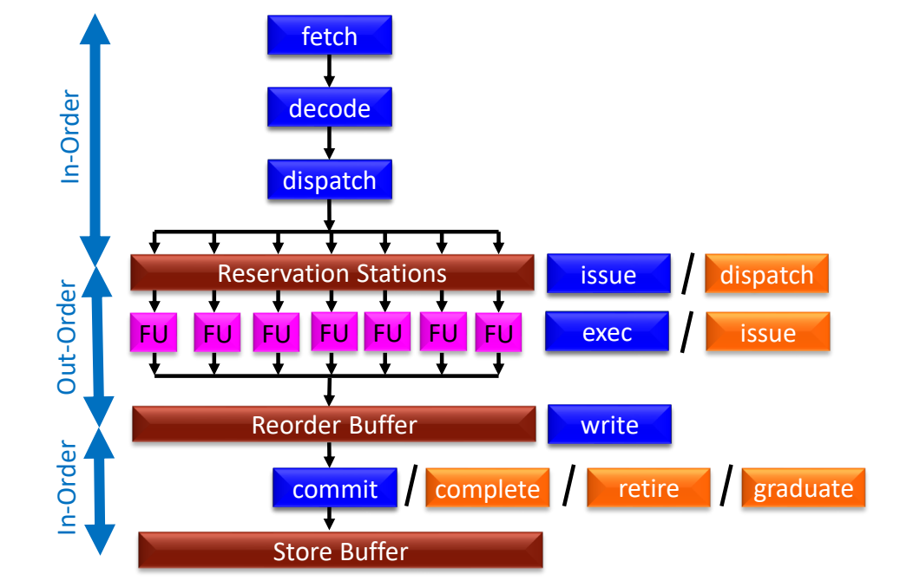

图：fetch、decode、dispatch 按序，经保留站与功能单元乱序执行，到 ROB 后 commit 又按序；蓝色是课程采用的 Intel 命名，橙色是部分学术界叫法（issue/dispatch 互换，commit 也叫 complete/retire/graduate）。

两个容易混淆的地方：

- 学术圈有时把 Intel 的 issue 叫 dispatch，把 Intel 的 exec 叫 issue，两者恰好错开一位；
- 很多人说的“乱序发射”，意思其实就是乱序执行。

> [!tip] 课堂强调
> 本课程讲解和考试都**采用 Intel 命名**。按 Intel 命名，issue 应当按序，不是乱序。看到 commit、retire、graduate 等不同说法时，要结合具体语境判断它们指的是哪个阶段。

#### 顺序处理器与乱序处理器

| 阶段（Intel 命名） | fetch | decode | issue | exec | write | commit |
| --- | --- | --- | --- | --- | --- | --- |
| 顺序处理器 | 按序 | 按序 | 按序 | 按序 | 按序 | 按序 |
| 乱序处理器 | 按序 | 按序 | 按序 | **乱序** | **乱序** | 按序 |

- **顺序处理器**（In-Order processor）：所有流水级都按序。
- **乱序处理器**（Out-of-Order processor）：只有执行和临时写回（写入 ROB）两级乱序，issue 和 commit 都必须按序。

> [!tip] 课堂强调
> 目前大部分乱序处理器都是这种结构。commit 不可能乱序，否则就会出现前面除零例子中的错误。

> [!info] 可视化资源
> [推测式 Tomasulo+ROB 网页模拟器（中山大学课程项目）](https://7eph-yr.github.io/Speculative-Tomasulo-Simulator/)：可在浏览器中载入 LD/SD/ADDD/MULTD 等指令逐周期运行，观察 6 项 ROB、保留站与寄存器状态如何变化及顺序提交（作者注明部分功能可能有 bug）。另见 [Wikipedia：重排序缓冲（Re-order buffer）](https://en.wikipedia.org/wiki/Re-order_buffer) 对 ROB 循环队列与表项字段的简述。

ROB 本身也不是完美的方案。熔断（Meltdown）和幽灵（Spectre）攻击都与乱序执行和推测执行有关，ROB 还必须进一步处理分支预测错误和异常，这些内容见[精确异常与推测执行](#精确异常与推测执行)。

> [!question]- 自测：一位同学说“这款处理器支持乱序发射”。按本课程采用的 Intel 命名，应该怎样理解这句话？
> 应理解为乱序执行：指令按序 issue 进保留站，从保留站进入功能单元执行的顺序是乱的。按 Intel 命名，issue 本身是按序的；在部分学术圈的叫法里，进入功能单元这一步恰好叫 issue，所以才有“乱序发射”的说法。

### 例：Simple ROB 逐周期执行

> [!info] 拓展内容
> 本例来自补充材料，课上留作自学，用同一套四阶段规则把 6 条指令从发射推演到全部提交。

#### 初始状态与假设

**指令序列**（FP Op Queue，按程序顺序）：

```asm
div R2, R3, R4    ; DIV
mul R1, R5, R6    ; MUL#1
add R3, R7, R8    ; ADD#1
mul R1, R1, R3    ; MUL#2
sub R4, R1, R5    ; SUB
add R1, R4, R2    ; ADD#2
```

**延迟假设**：ADD（含 SUB）2 个周期，MUL 10 个周期，DIV 40 个周期。保留站有 Add1–3 和 Mult1–2，DIV 与 MUL 共用 Mult 保留站；ROB 共 6 项（ROB1–ROB6）。

**初始 ARF**：

| R1 | R2 | R3 | R4 | R5 | R6 | R7 | R8 |
| --- | --- | --- | --- | --- | --- | --- | --- |
| $-23$ | 16 | 45 | 5 | 3 | 4 | 1 | 2 |

**初始 RAT**：$R_i \to A_i$，即所有寄存器的最新值都在 ARF 中（A 表示 ARF，B 表示 ROB）。

#### 逐周期事件

| 周期 | 事件 | RS / ROB / RAT 变化 |
| --- | --- | --- |
| 1 | 发射 DIV：Mult 保留站和 ROB 都有空项；读 RAT 得 R3、R4 在 ARF | Mult1 = `DIV ROB1 45 5`；ROB1 = (DIV, R2)；RAT R2→B1；tail→ROB2 |
| 2 | DIV 开始执行（剩余 40 周期）；发射 MUL#1，R5、R6 在 ARF | Mult2 = `MUL ROB2 3 4`；ROB2 = (MUL, R1)；RAT R1→B2 |
| 3 | MUL#1 开始执行（10 周期）；发射 ADD#1，R7、R8 在 ARF | Add1 = `ADD ROB3 1 2`；ROB3 = (ADD, R3)；RAT R3→B3 |
| 4 | ADD#1 开始执行（2 周期）；尝试发射 MUL#2：Mult1、Mult2 被 DIV 和 MUL#1 占用，**结构冒险，停顿** | 不变；后续指令都不能发射 |
| 5 | DIV、MUL#1、ADD#1 继续计算，ADD#1 本周期算完 | — |
| 6 | ADD#1 写结果：CDB 广播，ROB3 = 3（$1+2$），Fin = Y，释放 Add1 | 此时没有指令在等 ROB3 |
| 7–12 | DIV 和 MUL#1 继续计算，MUL#2 仍停顿 | — |
| 13 | MUL#1 写结果：ROB2 = 12（$3\times4$），Fin = Y，释放 Mult2 | — |
| 14 | 发射 MUL#2（Mult2 已空）：读 RAT 得 R1→B2、R3→B3，两项都已完成，直接取值 12 和 3 | Mult2 = `MUL ROB4 12 3`；ROB4 = (MUL, R1)；RAT R1→B4 |
| 15 | MUL#2 开始执行（10 周期）；发射 SUB：R1→B4 未就绪，记标签等待；R5 在 ARF | Add1 = `SUB ROB5 ROB4 3`；ROB5 = (SUB, R4)；RAT R4→B5 |
| 16 | 发射 ADD#2：R4→B5、R2→B1，都未就绪；SUB 等待 ROB4 | Add2 = `ADD ROB6 ROB5 ROB1`；ROB6 = (ADD, R1)；RAT R1→B6 |
| 17–24 | DIV、MUL#2 继续计算 | ROB 6 项已满 |
| 25 | MUL#2 写结果：ROB4 = 36（$12\times3$），Fin = Y；SUB 从 CDB 抓到 36，变为就绪；释放 Mult2 | Add1 = `SUB ROB5 36 3` |
| 26 | SUB 开始执行（2 周期） | — |
| 28 | SUB 写结果：ROB5 = 33（$36-3$），Fin = Y；ADD#2 抓到 33；释放 Add1 | Add2 = `ADD ROB6 ROB1 33`（仍等 ROB1） |
| 29–41 | DIV 继续计算（周期 2 到 41 共 40 周期） | — |
| 42 | DIV 写结果：ROB1 = 9（$45/5$），Fin = Y；ADD#2 抓到 9，变为就绪；释放 Mult1 | Add2 = `ADD ROB6 33 9` |
| 43 | head = ROB1 已完成，**提交 DIV**：ARF R2 = 9，清除 ROB1，head 前进；RAT 中 R2 仍指向 B1，恢复为 A2。同周期 ADD#2 开始执行 | — |
| 44 | **提交 MUL#1**：ARF R1 = 12，清除 ROB2；RAT 中 R1 已指向 B6，保持不变 | — |
| 45 | **提交 ADD#1**：ARF R3 = 3，清除 ROB3，RAT R3 恢复为 A3。同周期 ADD#2 写结果：ROB6 = 42（$33+9$），Fin = Y，释放 Add2 | — |
| 46 | **提交 MUL#2**：ARF R1 = 36，清除 ROB4；RAT R1 仍为 B6 | — |
| 47 | **提交 SUB**：ARF R4 = 33，清除 ROB5，RAT R4 恢复为 A4 | — |
| 48 | **提交 ADD#2**：ARF R1 = 42，清除 ROB6，RAT R1 恢复为 A1 | ROB 清空，RAT 全部为 $A_i$ |

> [!note] 补充解释
> 提交时更新 RAT 的规则讲义没有单独写出，可从本例各周期的 RAT 变化归纳：只有当 RAT 中该寄存器**仍指向正在提交的 ROB 项**时，才把它恢复为指向 ARF（周期 43、45、47、48 的 “Update RAT”）；如果 RAT 已被更晚的指令改指（例如周期 44 提交 MUL#1、周期 46 提交 MUL#2 时 R1 已指向 B6），就保持不变，因为更新的值还在 ROB 中。

#### 最终状态

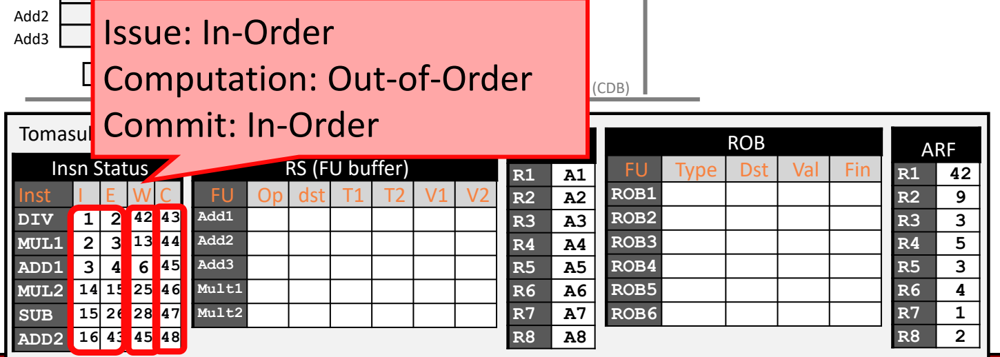

图：ROB 例子结束时的指令状态表（I/E/W/C 四列）、RAT（全部指回 ARF）与 ARF；注意发射列与提交列单调递增、写结果列乱序。讲义此页 ARF 中 R4 仍显示 5，按 SUB 在第 47 周期提交应为 33。

| 指令 | I | E | W | C |
| --- | --- | --- | --- | --- |
| DIV | 1 | 2 | 42 | 43 |
| MUL#1 | 2 | 3 | 13 | 44 |
| ADD#1 | 3 | 4 | 6 | 45 |
| MUL#2 | 14 | 15 | 25 | 46 |
| SUB | 15 | 26 | 28 | 47 |
| ADD#2 | 16 | 43 | 45 | 48 |

最终 ARF：R1 = 42，R2 = 9，R3 = 3，R4 = 33，R5 到 R8 保持 3、4、1、2。

从表中可以直接看出三种顺序：**I 列递增，发射按序；E、W 列不单调，执行乱序**（ADD#1 在周期 6 就写了结果，DIV 要到 42）；**C 列为连续的 43 到 48，提交按序**。

> [!warning] 易错点
> 讲义周期 48 页和最终状态页的 ARF 中，R4 仍显示 5，但 SUB 在周期 47 已把 33 提交到 R4，所以正确的终值是 R4 = 33。周期 47、48 的说明文字写的是 “clean ROB4”，按上下文应分别为 ROB5 和 ROB6。

> [!warning] 易错点
> 本例 MUL#2 的停顿发生在 **issue** 阶段，原因是结构冒险（没有空的 Mult 保留站）；而 SUB、ADD#2 的等待发生在 RS 内，原因是 RAW（等 ROB 标签），两者不要混淆。

> [!question]- 自测：如果 DIV 在周期 41 检测到除零，在这个 ROB 例子中 ARF 会处于什么状态？与 Tomasulo 的情况有何不同？
> ARF 仍为初始值（R1 = $-23$，R2 = 16，R3 = 45，R4 = 5，……）。最早的提交发生在周期 43，在此之前所有结果都只存在 ROB 中，所以 DIV 之后的指令都没有改动架构状态，丢弃这些 ROB 项就能恢复。Tomasulo 没有 ROB，结果直接写进寄存器，F2、F0、F8 的旧值已经丢失。异常的具体处理方式见[精确异常与推测执行](#精确异常与推测执行)。

---

## 精确异常与推测执行

> [!abstract] 本节要点
> - **统一保留站**让所有类型的指令共享同一组 RS 项，由每类 FU 各自的仲裁器挑选就绪指令；$N$ 个 FU 需要 RS 有 $N$ 个读端口。它消除了“RS 配比与程序指令分布不匹配”造成的结构冒险。
> - 单发射、单 CDB、单提交的 Tomasulo（+ROB）最多维持 1 IPC；要超过 1 IPC，取指/译码、发射（双重命名）、写回（多条 CDB）、提交（ROB 额外读口、ARF 额外写口）每一级都必须 $>1$ IPC。
> - **精确异常**：机器状态如同程序恰好执行到引发异常的指令为止；实现方法是在 ROB 中加异常标志，执行时只记录 fault，指令到达提交点时才真正触发异常并冲刷其余 ROB 项。
> - 分支预测错误后 RAT 留有错误路径的映射：“停顿并排空”简单但慢；“检查点”在每个分支复制 RAT，预测错误时直接从副本恢复。
> - 访存地址由寄存器值决定（操作数说明符是模糊的），因此需要访存消歧与 store-to-load 转发，由按序分配的 LSQ 解决；store 只在提交时写内存。被冲刷的推测指令留下的 cache 痕迹可被计时侧信道读出，这就是 Spectre / Meltdown 的根源。

> [!info] 拓展内容
> 本节全部内容来自课程补充材料（ROB 与异常的进阶讨论），供有兴趣的同学自学，**不纳入考试范围**。补充材料的出发点是：ROB 并不是完美的方案，它还要处理分支预测错误和异常，熔断（Meltdown）、幽灵（Spectre）攻击也与它有关。

本节以 [ROB 与顺序提交](#重排序缓冲与顺序提交) 中的 Tomasulo+ROB 结构为起点（ARF、RAT、ROB 的 head/tail 指针等概念都在那里定义），讨论这一结构在资源利用、吞吐率、异常、分支恢复、访存相关和安全性方面面临的挑战与对应设计。

### 统一保留站（Unified Reservation Stations）

在分离式保留站里，加法器和乘法器各自拥有固定数量的 RS 项（如 Add1–Add3、Mult1–Mult2）。每个 ALU 配多少个 RS 应当与程序的指令分布相匹配，但不同程序的分布不同，固定配比总会在某些程序上造成结构冒险。

**回顾 ROB 例子的第 4 周期**：在 [ROB 逐周期例子](#重排序缓冲与顺序提交) 中，DIV 和第一条 MUL 已经占满 Mult1、Mult2，第二条 MUL（`mul R1,R1,R3`）找不到空闲的乘法 RS，只能停顿发射直到第 14 周期，后面的 SUB、ADD 也被顺序发射堵住。如果再多一个 Mult3，全部 6 条指令在第 6 周期就都能发射出去。

再看两个极端程序：

- **程序 1（乘法密集）**：DIV、MUL、MUL、MUL、ADD。只有 2 个乘法 RS，第 3 条乘除类指令就遇到结构冒险，而 3 个加法 RS 闲置。
- **程序 2（加法密集）**：ADD、ADD、SUB、SUB、MUL。3 个加法 RS 不够用，第 4 条加减类指令遇到结构冒险，而乘法 RS 闲置。

**统一保留站**（unified reservation stations）把所有 RS 项合并成一个池（如 RS1–RS5），任何类型的指令都可以占用任意空项。这样无论程序的指令分布如何，都能尽可能消除这类结构冒险。

#### 实现：每类 FU 一个仲裁器

代价是仲裁和执行通路稍复杂一些（但不算太糟）。设统一 RS 有 8 项，有两个 FU（一个 ADD、一个 MULT），每周期的选择过程是：

1. **ADD 竞争**：所有就绪（ready，即全部操作数都已到齐）的 ADD 指令竞争加法器。
2. **MULT 竞争**：所有就绪的 MUL 指令同样竞争乘法器。
3. **仲裁**：每类 FU 有一个仲裁器（Adder Arbiter、Multiplier Arbiter），各自从候选中挑出一条去执行。
4. **执行**：被选中的指令经 RS 的读端口送入对应的 FU 执行。

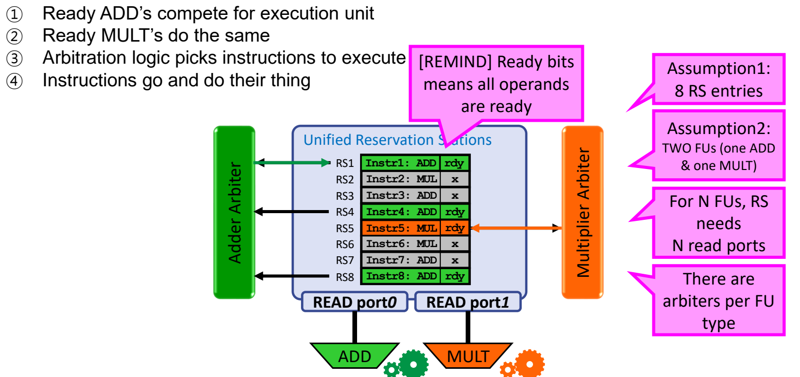

图：8 项统一保留站由 ADD 与 MULT 共享。RS1、RS4、RS8 中就绪（rdy）的 ADD 都请求加法器，加法仲裁器选中 Instr1；RS5 是唯一就绪的 MUL，被乘法仲裁器选中。两条指令同一周期分别经 READ port0、READ port1 送出，所以 **$N$ 个 FU 需要 RS 有 $N$ 个读端口**。

### 突破 1 IPC：多发射的 Tomasulo+ROB

前面描述的 Tomasulo（+ROB）CPU 虽然是乱序执行，但不是完整的超标量，只能维持 **1 IPC** 的持续吞吐率。流水线中顺序的前端（fetch、decode、dispatch）、乱序的 RS 与 FU、顺序的 ROB 与提交，任何一级只要每周期只能处理一条指令，整体就被限制在 1 IPC。 具体有三处限制：

1. **前端**：需要超标量的取指、译码等。
2. **写回**：只有一条 CDB，每周期只有一条指令能把结果写回 ROB。
3. **提交**：提交也必须 $>1$ IPC。

结论是**所有流水线阶段都必须 $>1$ IPC**，各级对应的方案如下：

| 阶段 | 目标 | 方案 |
| --- | --- | --- |
| 发射（issue 到 RS） | $>1$ IPC | 双发射（Dual Issue）+ 双重命名（Dual Rename） |
| 送 FU 执行 | $>1$ IPC | Tomasulo 已经做到：指令就绪且 FU 空闲就去执行 |
| 写回 ROB | $>1$ IPC | 多条 CDB（Multiple CDBs） |
| 提交到 ARF | $>1$ IPC | ROB、ARF 增加端口（Extra Ports） |

#### 双发射与双重命名

**多发射**的目标是一个时钟周期发射多条指令，有两种基本形式：超标量（superscalar）与 VLIW（也称 EPIC），见 L04 的多发射内容。 双发射的难点在重命名。[寄存器重命名](#乱序执行与寄存器重命名) 的步骤是：① 读出所有源操作数的当前映射；② 为目的寄存器分配新名字。在 Tomasulo+ROB 中新名字就是 ROB 项，所以一组两条指令的目的分别分配 $\text{ROB\_tail}$ 和 $\text{ROB\_tail}+1$。

关键问题是**同一发射组内的 RAW 相关**：第二条指令的源可能正是第一条的目的，而此时 RAT 里还是旧映射。所以每个源操作数都要和组内更早指令的目的寄存器比较，命中则用新分配的 ROB 号，否则用 RAT 的读数。

> [!example] 例：双重命名
> 当前 RAT：R1→ROB21，R2→ROB17，R3→ARF3，R4→ROB22；ROB tail 指向 ROB23。本组两条指令为 `add R1,R2,R3` 与 `sub R4,R1,R4`。
>
> 1. **分配目的**：inst1 的目的 R1 → ROB23，inst2 的目的 R4 → ROB24。
> 2. **inst1 的源**：R2、R3 查 RAT，得 ROB17、ARF3，写入 RS：`add ROB23, ROB17, ARF3`。
> 3. **inst2 的 src1（R1）**：与 inst1 的目的 R1 比较，相等，所以不能用 RAT 中的 ROB21，而要用新分配的 ROB23。
> 4. **inst2 的 src2（R4）**：与 inst1 的目的 R1 比较，不等，用 RAT 中的 ROB22。RS 项为 `sub ROB24, ROB23, ROB22`。
> 5. **更新 RAT**：R1→ROB23，R4→ROB24。
>
> 每个比较器（“=?”）后面接一个二选一多路选择器，在“来自 RAT”和“新 ROB 号”之间选择。若漏掉组内比较，inst2 会错误地读 ROB21，即 R1 的上一个版本。

#### 多条 CDB

用多条 CDB 每周期广播多个结果是可行的，当今 CPU 正是这么做的。代价是**每个 RS 项的每个源操作数都必须与每条 CDB 比较**，面积、逻辑和功耗都增加。

> [!example] 例：两条 CDB 同周期广播
> 统一 RS 中有：`div ROB1, 8, 2`、`add ROB2, 1, 2`、`mul ROB3, ROB1, 3`、`sub ROB4, ROB2, 7`、`div ROB5, 9, 3`、`sub ROB6, ROB1, 1`。
>
> 1. DIV 和 ADD 同一周期完成，ROB1 = $8/2=4$ 走 CDB1，ROB2 = $1+2=3$ 走 CDB2。
> 2. 每个 RS 项的源标签同时与两条 CDB 比较：RS3 的 ROB1 → 4，RS4 的 ROB2 → 3，RS6 的 ROB1 → 4。
> 3. 若只有一条 CDB，这两个结果要分两个周期广播。

#### 每周期提交多条

提交逻辑必须判断哪些指令可以提交，规则保持顺序提交：

1. **head 未完成**：什么都不提交（即使后面的项已经完成）。
2. **head 完成、下一条未完成**：只提交 head。
3. **head 与下一条都完成**：两条都提交。

> [!example] 例：沿用 ROB 例子的结果
> ROB 中 ROB3（R3 = 3）、ROB4（R1 = 36）、ROB5（R4 = 33）都已完成。
>
> 1. 此时 head ROB1（DIV）未完成 → 不提交。
> 2. ROB1 = 9 完成，但 ROB2（MUL）未完成 → 只提交 ROB1。
> 3. 若 ROB1 = 9 与 ROB2 = 12 都已完成 → 二者同周期提交。

一周期提交多条，意味着要同时从 ROB 向 ARF（store 则是向内存）写回多个结果：**ROB 需要额外的读端口，ARF 需要额外的写端口**。 端口数直接决定 SRAM 位单元面积，讲义以 0.18 μm TSMC 工艺下 16 端口与 32 端口 SRAM 位单元的版图对比说明端口越多面积越大。

### 推测执行中的异常与精确异常

回顾 O3 已有的三项技术：用 ROB 寄存器重命名和操作数比较消除 WAW、WAR 假相关；用 RS 中的标签和 CDB 广播把结果转发给等待的指令；用 ROB 部分地实现推测执行以提高 ILP。 推测执行还有更多问题要处理。

**推测执行**（speculative execution）分为两类：

- **控制推测**（control speculation）：推测分支方向（branch direction）和分支目标（branch target）。
- **数据推测**（data speculation）：推测数据位置（data location）和数据值（data value）。

下面先讨论控制推测下的异常处理和分支恢复，再讨论与数据位置有关的访存相关。

#### 异常的定义与分类

**异常**（exception）是为响应某些事件而把执行控制转移给操作系统/系统：系统执行异常处理程序（exception handler）处理该事件，然后把控制交还用户程序。正常控制流只包括顺序执行、跳转、分支、调用和返回。 异常按起因分为两类：

| 类型 | 起因 | 例子 |
| --- | --- | --- |
| **异步异常**（asynchronous exception），即中断（interrupt） | 处理器外部事件，通过置位处理器的中断引脚通知 | I/O 中断；键盘按 Ctrl-C；网络包到达；磁盘数据到达；定时器中断；硬复位中断（按复位键）；软复位中断（如 PC 上的 Ctrl-Alt-Delete） |
| **同步异常**（synchronous exception） | 某条指令执行的结果 | trap：系统调用、断点、特殊指令；fault：缺页、保护错误、浮点异常；abort：奇偶校验错、machine check |

在 MIPS 五级流水线中，各级可能产生的异常为：

- **IF**：取指缺页、访存未对齐、内存保护违例。程序中的任何一条指令都可能在 IF 级产生异常。
- **ID**：未定义或非法的操作码。
- **EX**：算术异常（如除零 divByZero）。
- **MEM**：与 IF 相同的几类，以及内存错误。
- **WB**：无。

#### 推测执行遇到 fault 的两类错误

推测执行的指令遇到 fault 时，如果立刻处理，会导致程序执行结果错误：

1. **漏掉指令（missing instructions）**：程序顺序为 A→B→C→D→E→F。乱序执行时 D 先执行并发生除零，若立即处理，此时只有 A、B 已提交。外部看到的是“A → B → fault”，而不是正确的“A → B → C → D → fault”，C 被漏掉了。
2. **意外的异常（un-expected exception）**：B 是分支且被错误预测，处理器沿错误路径执行了 F、E，E 发生 fault。正确路径其实是 W→X，这个 fault 根本不应该被用户看到。

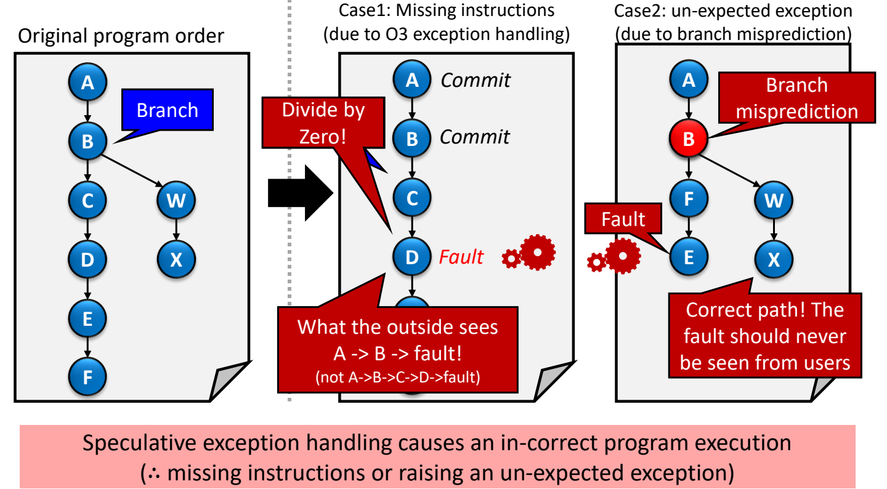

图：左为原程序顺序（B 为分支）；中为乱序时 D 除零被立即处理，外界只看到 $A \to B \to$ fault、漏掉了 C；右为 B 预测错误时错误路径上的 E 触发 fault，而正确路径 $W \to X$ 本不应看到该异常。

#### 精确异常（Precise Exceptions）

**精确异常**指机器状态保持得如同程序恰好执行到引发异常的那条指令为止，具体要求三条：

1. 之前的所有指令都已执行完毕。
2. 之后的所有指令都没有修改进程状态（如 ROB、寄存器等资源）。
3. 引发异常的指令本身是否执行，取决于体系结构的定义和异常原因。

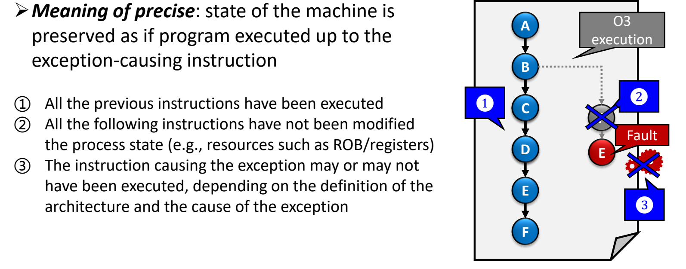

图：精确异常。引发异常的 E 之前的指令全部完成（①），之后被乱序提前执行的指令不能修改状态（②），E 本身是否执行取决于体系结构定义（③）。

#### 方案：把 fault 当作结果

ROB 处理普通寄存器结果的方式是：结果先写入 ROB，直到该指令成为最老的指令（可以按序更新状态），并且已知是非推测的，才写入体系结构状态。对 fault 采取同样的做法，在 ROB 中增加一列**异常标志**（exception flag）：

1. **执行时**：记录发生的 fault，但不向外部暴露。
2. **提交时**：只有当该指令到达提交点，才真正暴露（触发）这个 fault。

于是 ROB 每项包含：FU、目的寄存器、结果值、Ready/Finished、Exceptions。

> [!example] 例：ROB 中的异常标志
> 程序顺序与 ROB 分配：
>
> ```text
> ROB1  LOAD R1 = 0[R2]
> ROB2  ADD  R3 = R2 + R4
> ROB3  SUB  R1 = R5 - R6
> ROB4  DIV  R4 = R7 / R5
> ROB5  LOAD R6 = 0[R8]
> ```
>
> 1. ROB1 的 LOAD cache miss，迟迟未完成；ROB2 = 100、ROB3 = 50 已完成（Ready = 1）。
> 2. 第 5 条指令（ROB5 的 LOAD）发生缺页：结果值为“-”，Ready = 1，Exceptions = 1。不触发异常，只记录。
> 3. 第 4 条指令（ROB4 的 DIV）因 R5 = 0 发生除零：结果值为 NULL，Ready = 1，Exceptions = 1，同样只记录。
> 4. ROB1 的 miss 被处理完，结果 200，Ready = 1。
> 5. ROB1–ROB3 依次正常提交；head 到达 ROB4（第 4 条指令）。
> 6. ROB4 的异常标志为 1，此时才触发异常：冲刷 ROB 其余项（包括 ROB5），转入异常处理程序。
>
> fault 被推迟到体系结构上正确的位置才处理；ROB5 的缺页被冲刷，如同“从未发生”。最终状态满足精确异常的三条要求：DIV 之前的指令全部完成，之后的指令没有修改状态。

> [!warning] 易错点
> 异常标志只“记录”，不“触发”。按完成顺序看，ROB5 的缺页比 ROB4 的除零更早被检测到，但处理器报告的是程序顺序中更早的 DIV 除零；ROB5 的缺页根本不会被报告。决定报告哪个异常的是提交顺序，而不是检测顺序。

### 分支预测错误的恢复

ROB 的提交和异常标志保证了错误路径指令不会改写 ARF，但还有一个状态没有恢复：RAT。回忆两条性质：ARF 对应最老的未提交指令之前的状态；RAT 对应最近一条被重命名的指令之后的映射。

**问题示例**：ARF 初值 R1–R8 = $-23$、16、45、5、3、4、1、2，RAT 全部指向 ARF。指令 Instr1 `ADD R1`、Instr2 `SUB R2`、Instr3 `BEQ`，BEQ 预测为 taken，于是错误路径上的 Instr4 `MUL R1`、Instr5 `MUL R2`、Instr6 `BEQ` 也进入了流水线：

1. 重命名 Instr1、Instr2：R1→ROB1，R2→ROB2。
2. 重命名错误路径 Instr4、Instr5：R1→ROB3，R2→ROB4。
3. BEQ 结果表明预测错误：错误路径指令从机器中冲刷。
4. 但 RAT 仍是 R1→ROB3、R2→ROB4，即错误路径留下的无效映射。正确路径的新指令若按此重命名，会读到不存在的值。

#### 方案 1：停顿并排空（Stall and Drain）

1. **排空**：让所有（正确路径上的）已有指令执行并提交，ARF 对应最后一条已提交的指令。例中 Instr1、Instr2 提交后 ARF 的 R1 = 10、R2 = 9。期间从取指送来的正确路径指令不能重命名，形成分支气泡（bubbles）。
2. **ARF 即正确状态**：此时 ARF 恰好对应下一条待重命名指令之前的状态。
3. **复位**：复位 RAT 和 ROB，使所有映射都指向 ARF。
4. **继续**：恢复对新的正确路径指令的重命名，例如 Instr4 `ADD R3` → ROB1，Instr5 `ADD R4` → ROB2。

优点是实现很简单；缺点是停顿造成性能损失。

#### 方案 2：检查点（Checkpointing）

**关键思想**：在每个分支处复制一份 RAT（该分支时刻的寄存器映射）作为检查点。 预测错误时：

1. **冲刷**错误路径指令。
2. **释放**该分支之后的 RAT 检查点。
3. **从检查点恢复** RAT。
4. **继续重命名**。

> [!example] 例：两个分支的检查点
> 指令序列 Instr1 `ADD R1`、Instr2 `SUB R2`、Instr3 `BEQ`、Instr4 `MUL R1`、Instr5 `MUL R2`、Instr6 `BEQ`、Instr7 `ADD R3`，两条 BEQ 都预测 taken。
>
> 1. 到 Instr3 时 RAT 为 R1→ROB1、R2→ROB2，其余指向 ARF，保存为 RAT-v1。
> 2. 到 Instr6 时 RAT 为 R1→ROB3、R2→ROB4，保存为 RAT-v2；Instr7 再把 R3 映射到 ROB5。
> 3. Instr3 被判定预测错误：冲刷 Instr4 之后的指令，释放 RAT-v2，用 RAT-v1 恢复 RAT。
> 4. 立即重命名正确路径的 Instr4 `ADD R3`、Instr5 `ADD R4` 等，无需等待 Instr1、Instr2 提交。

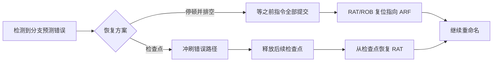

到这里，分支预测消除了控制相关，寄存器重命名消除了寄存器假相关，带异常标志和检查点的 ROB 处理了异常和分支预测错误。

> [!warning] 易错点
> 讲义总结页写“寄存器重命名消除了假相关（RAW & WAW）”，这里的 RAW 是笔误。重命名消除的假相关是 WAR 与 WAW，RAW 是真相关，无法消除，见[寄存器重命名](#乱序执行与寄存器重命名)。

### 访存相关与 Load Store Queue

寄存器相关处理完了，还剩访存相关。基本约束是：**store 只在提交时写内存**，否则 store 被取消（例如处于错误路径）时内存已经被改写，无法恢复。由此产生的问题是：一条在 store 之后的 load，比如 `SW R1, 0(R2)` 之后的 `LW R1, 0(R3)`，它的数据该从哪里来？

#### 不考虑访存相关会怎样

> [!example] 例：load 越过 store 读到旧值
> 初值：ARF 中 R1 = 3，R2 = 1，R3 = 0，R4 = 5，R5 = 3，R6 = 0，R7 = 0，R8 = 0，R9 = 1；内存 Mem[0] = 1，Mem[2] = 100。程序顺序：
>
> ```text
> LOAD  R3 = 0[R6]
> ADD   R7 = R3 + R9
> STORE R4 → 0[R7]
> SUB   R1 = R1 - R2
> LOAD  R8 = 0[R1]
> ```
>
> 乱序执行的实际顺序：
>
> 1. ❶ 第一条 LOAD 发射，cache miss；SUB 发射，R1 = $3-1=2$。
> 2. ❷ 第二条 LOAD 发射，地址 R1 = 2，cache hit，R8 = Mem[2] = 100。
> 3. ❸ 第一条 LOAD 的 miss 处理完，R3 = Mem[0] = 1。
> 4. ❹ ADD 发射，R7 = $1+1=2$。
> 5. ❺ STORE 发射，Mem[2] = R4 = 5。
>
> 若 $R1 \ne R7$，第二条 LOAD 从内存取到的就是正确数据；但这里 R1 = R7 = 2，LOAD R8 本应得到 STORE 写入的 5，却拿到了旧值 100。

#### 访存消歧问题（Memory Disambiguation）

非访存指令不会出这种问题，因为它们的**操作数说明符是绝对的**：`ADD R7 = R1 + R2` 中的“R1”就指那一个寄存器。访存指令的**操作数说明符是模糊的**：`LOAD R2 = 0[R1]` 中的“R1”指的是由 R1 的值确定的内存位置，指针改变，位置也随之改变。在地址算出来之前，硬件无法判断一条 load 与之前的 store 是否访问同一地址。

**朴素方案**是完全不允许 load 乱序执行。讲义用 8 条指令 A–H 的依赖图对比（A、B、E、H 为访存指令，C、D、F、G 为整数或乘法指令；依赖为 A→C、B→C、B→D、D→G、E→F、F→G）：

- **load 乱序执行**（不考虑访存相关）：关键路径只有 3 步，$\mathrm{ILP}=8/3=2.67$。
- **load 按序执行**：访存指令被串起来，关键路径拉长到 7 步，$\mathrm{ILP}=8/7=1.14$。

所以让 load 按序执行并不是好办法，需要专门的硬件在乱序的同时保证正确。

> [!info] 可视化资源
> [Wikipedia：访存消歧（Memory disambiguation）](https://en.wikipedia.org/wiki/Memory_disambiguation)：解释 store 队列如何避免 WAR/WAW、store-to-load 转发的 CAM 搜索、RAW 违例检测及 LSQ，可对照本节的 LSQ 机制。

#### 两个问题与 LSQ

O3 访存指令面临两个问题：

1. **访存消歧**（memory disambiguation）：（我是一条 load）是否有更早的、尚未执行的 store 写同一个地址？这是二元问题，答案是“是”或“否”。讲义给出的对应方案是 store-to-load 转发。
2. **store-to-load 转发问题**（store-to-load forwarding）：（我是 load）我该从哪一条更早的 store 取值？（我是 store）我该把值转发给哪些更晚的 load？这不是二元问题，答案是一个或多个指令标识。对应方案是 Load Store Queue。

讲义这样配对的逻辑是：消歧问题的答案若为“是”，就要靠 store-to-load 转发拿到正确的值；而要回答“从哪条 store 转发”，就需要一个按程序顺序记录所有 load/store 地址的结构，即 LSQ。实际上 LSQ 同时完成了两件事，如下所述。

**Load Store Queue**（LSQ）管理访存的顺序。每项记录 L/S、PC、序号 Seq、地址 Addr 和值 Value，最老的在上、最年轻的在下：

- **消歧**：指令按程序顺序分配进 LSQ；一条 load 必须等所有更早 store 的地址都算出来后才能执行。
- **转发**：load 广播并搜索整个 LSQ，寻找地址匹配的 store。

图中的转发关系：41777 号 load（0x3290）从更早的 41775 号 store（0x3290，$-17$）得到 $-17$；41780 号 load（0x3410）从 41774 号 store 得到 25；41781 号 load（0x3290）从更近的 41779 号 store（0x3290，0）得到 0，而不是 41775 号的 $-17$，即应取**程序顺序上最近的那条更早的同地址 store**；没有匹配 store 的 load（如 41776 号 0x3418）则从 Data Cache 读取 1234。

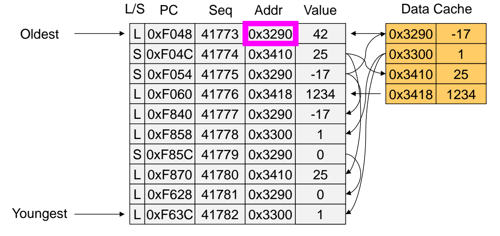

图：LSQ 按程序顺序从 Oldest 到 Youngest 排列 load/store 的 PC、序号、地址与值；箭头表示 load 在队列中搜索地址相同的更早 store 取得转发值，否则从数据 cache 读取。

#### LD/ST 在 ROB 流水线中的处理

在 Tomasulo+ROB 结构中，访存单元配有 LD/ST1–LD/ST5 队列项和地址计算单元（address unit）。以 `LD R1=0[R2]` 与 `ST R3→0[R4]` 为例：

1. **发射**：除了分配 ROB 项，还要为新的 LD/ST 分配一个 LSQ 项。例中 `LD ROB1=0[R2]`（ROB1→R1）、`ST ROB2→0[R4]`（ROB2→R3）。
2. **执行**：① 生成地址（更新或查找 LSQ），得到 `LD ROB1=Addr1`、`ST ROB2→Addr2`；② 产生结果（更新 ROB，标记完成）。
3. **提交**：如果是 store，此时才把值送往内存；然后移动 LSQ head 和 ROB head。

#### 现代乱序处理器的组成

把本讲的部件放在一起，就是现代乱序微处理器的骨架：

| 部件 | 职责 |
| --- | --- |
| ALLOC | 分配指令（ROB、RS、LSQ 项） |
| RAT（Register Alias Table） | 重命名体系结构寄存器 |
| RS（Reservation Station） | 把指令发往功能部件 |
| ROB（Reorder Buffer） | 保存状态信息（物理寄存器），支持精确中断和推测执行 |
| ARF（Architectural Register File） | 体系结构寄存器文件 |
| LSQ（Load Store Queue） | 维护访存顺序 |

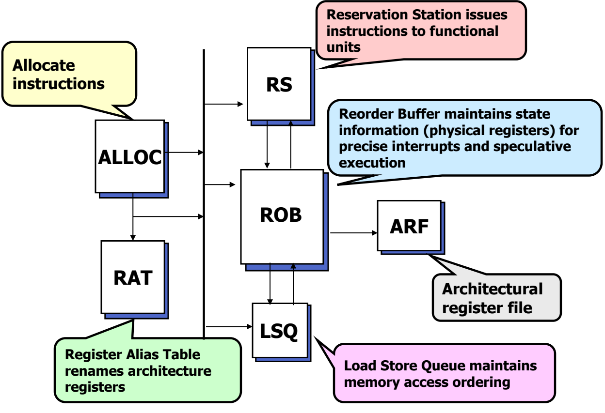

图：现代乱序处理器的分工：ALLOC 分配指令，RAT 重命名架构寄存器，RS 向功能单元发射，ROB 为精确中断与推测执行保存状态，ARF 保存架构状态，LSQ 维护访存顺序。

### Spectre 与 Meltdown

乱序执行和推测执行会提前执行后面的指令或分支后的代码段。一个自然的想法是：只要推测指令不提交，用户就看不到它的结果。这在体系结构状态（寄存器、内存）层面是对的，但攻击者可以使用**侧信道攻击**（side channel attack），即利用从计算机系统获得的其他信息（如 cache、时间、功耗监测、电磁等）发动攻击。

#### cache 计时侧信道

**计时攻击**（timing attack）是侧信道攻击的一种，关键在于能判断某个数据是否在 cache 中：命中约 80 CLK，缺失约 200 CLK。

> [!example] 例：猜出 SECRET_VALUE
> 受害者程序：
>
> ```c
> q = SECRET_VALUE;
> x = array[q];      // 把 array[q] 所在 cache 行带入 cache
> ```
>
> 攻击者程序逐个计时访问：
>
> ```c
> for (i = 1; i < 11; i++) {
>     start_timer();
>     array[i];
>     stop_timer();
> }
> ```
>
> 测得的访问时间中只有第 7 个 cache 行明显更快（命中），所以 SECRET_VALUE = 7。

O3 与推测执行攻击主要有三种变体：Variant1 边界检查绕过（Bounds Check Bypass）、Variant2 分支目标注入（Branch Target Injection），二者称为 **Spectre** 攻击；Variant3 恶意数据缓存加载（Rogue Data Cache Load），称为 **Meltdown** 攻击。Variant2 属于分支预测的内容，这里不展开。

#### Variant1：边界检查绕过（Spectre）

目标是推测执行。推测执行错误时，相应指令会被丢弃，但被推测指令带入 cache 的数据仍留在 cache 中，攻击者可以把它“偷”出来。 攻击针对如下代码模式：

```c
if (x < array1_size)
    y = array2[array1[x] * 256];
```

需要同时满足三个攻击条件：

1. `x` 的值可以由用户设置（如 API 输入）。
2. `x` 被用作数组（`array1`）的下标。
3. 用户可以访问数组 `array2`。

攻击过程：

1. **训练**：多次使用落在 `array1_size` 范围内的 `x`，使分支预测器预测第 2 行会被执行。
2. **越界**：使用超出 `array1_size` 的 `x`。虽然越界，但分支预测为执行，第 2 行被推测执行：读出越界的秘密字节 `array1[x]`，并访问 `array2[array1[x] * 256]`。
3. **探测**：分支判定后推测结果被冲刷，但 `array2` 中由秘密值索引的那一行已在 cache 中。攻击者用 cache 侧信道依次计时访问 `array2` 中与各个可能秘密值对应的位置（讲义图示 `array2` 有 256 个页），找到命中的那一个，即可得出秘密值（讲义例中 `array1[x] = 75`）。

> [!warning] 易错点
> 讲义第 ❸ 步写“array1[x] is cached”，容易误读为攻击者探测的是 `array1`。实际上被探测的是 `array2[array1[x] * 256]` 所在的 cache 行：秘密值决定了哪一行被带入 cache，乘以 256 是为了让不同的秘密值落在不同的 cache 行上。

#### Variant3：恶意数据缓存加载（Meltdown）

目标是乱序执行。访问内核内存的权限由处理器的 supervisor 位判定，异常要到指令提交时才触发；思路是把攻击代码放在触发异常的访问之后，让它在异常生效前被乱序执行。 攻击过程：

```c
clflush(M0); clflush(M1);   // 1. 把 M0、M1 逐出 cache
Load(Target);               // 2. 读取内核区的秘密到 R0：权限不足，将触发异常
if (R0 的某一位 == 0)       // 3. 由于 O3，在异常生效前就已执行
    M2 = M0;
else
    M2 = M1;
```

1. **清空**：`clflush` 把 M0、M1 从 cache 中清除。
2. **越权读**：`Load(Target)` 读内核区的秘密，会触发异常；但在异常生效之前，秘密值已被乱序执行读入 R0。
3. **依赖秘密的访存**：第 3 段代码依赖 R0 的某一位，同样被乱序执行：若该位为 0，就访问 M0，把 val0 带入 cache。
4. **探测**：异常发生后寄存器结果被丢弃，但 cache 状态保留。攻击者计时读 M0 和 M1：M0 因 cache 命中更快，于是推断该位为 “0”。逐位重复即可读出秘密。

讲义的代码判断的是 R0 的 “first bit”，结论处却写 “last bit”；两处指的是同一个被测试的比特，只是措辞不一致。

> [!info] 可视化资源
> [Meltdown and Spectre 官方网站（TU Graz）](https://meltdownattack.com/)：说明两种攻击的区别，提供论文链接、受影响处理器列表及演示视频，可对照本节的推测执行与 cache 侧信道。

两类攻击的共同根源是本节的核心机制：ROB 保证被冲刷的推测指令不改变**体系结构状态**，但它们对 cache 等**微体系结构状态**的影响不会被撤销。

> [!question]- 自测：统一 RS 有 6 项，配 2 个加法器和 1 个乘法器。RS 至少需要几个读端口？若某周期有 3 条就绪 ADD、2 条就绪 MUL，最多几条开始执行？
> 至少 3 个读端口（$N$ 个 FU 需要 $N$ 个读端口）。加法仲裁器从 3 条就绪 ADD 中选 2 条，乘法仲裁器从 2 条就绪 MUL 中选 1 条，所以最多 3 条同时开始执行。

> [!question]- 自测：双发射一组 `mul R2,R1,R3` 与 `add R5,R2,R2`，RAT 中 R1→ARF1、R2→ROB9、R3→ROB4，ROB tail = ROB12。写出两条指令重命名后的形式和更新后的 RAT。
> mul 的目的分配 ROB12，源为 ARF1、ROB4：`mul ROB12, ARF1, ROB4`。add 的目的分配 ROB13；两个源 R2 都与 mul 的目的 R2 相等，组内存在 RAW，所以都用 ROB12 而不是 RAT 里的 ROB9：`add ROB13, ROB12, ROB12`。RAT 更新为 R2→ROB12、R5→ROB13。

> [!question]- 自测：ROB 中 ROB2（ADD）已完成，ROB3（LOAD）标记了缺页，ROB1（MUL）因操作数溢出也标记了异常，ROB4 尚未完成。处理器报告哪个异常？ROB2 的结果会写入 ARF 吗？
> 报告 ROB1 的异常。head ROB1 到达提交点时检查到异常标志，立即冲刷 ROB2–ROB4 并转入异常处理程序，所以 ROB2 虽已完成也不会提交，ROB3 的缺页如同从未发生。这满足精确异常：之前的指令全部完成（ROB1 之前没有指令），之后的指令没有修改状态。

---

## 本讲小结


### 三种动态调度方案对比

| 对比项 | 记分板（CDC 6600） | Tomasulo（IBM 360/91） | Tomasulo + ROB |
| --- | --- | --- | --- |
| 控制方式 | 集中式三张表 | 分布在各保留站 | 保留站 + ROB + RAT |
| 结构冒险 | 无空闲 FU 则停在 Issue | 无空闲 RS 则停在 Issue | 无空闲 RS 或 ROB 项则停在 Issue |
| RAW | 在 Read operands 停顿，等生产者写回寄存器堆 | 在 RS 中等标签，经 CDB 转发取值 | 在 RS 中等 ROB 标签，经 CDB 转发取值 |
| WAR | 推迟写回 | 重命名消除（RS 存值） | 重命名到 ROB 项消除 |
| WAW | 推迟发射 | 重命名消除 | 重命名到 ROB 项消除 |
| 各阶段顺序 | 按序发射、乱序执行、乱序完成 | 按序发射、乱序执行、乱序完成 | 按序发射、乱序执行与写结果、按序提交 |
| 异常 / 分支错误 | 不处理 | 难以处理（旧值已被覆盖） | 提交前只写 ROB，可精确恢复 |

### 核心数字与公式

| 内容 | 结果 |
| --- | --- |
| 执行时间分解 | $\text{Execution Time} = IC \times CPI \times CCT$，ILP 优化瞄准 $CPI$ |
| Amdahl 定律 | $\text{Speedup} = \frac{1}{(1-P)+P/S}$；踪迹调度例 $1.117 \to 1.046$ |
| 乱序收益例 | 1 路顺序 10、2 路顺序 8、1 路乱序 7、2 路乱序 5 周期 |
| 同一 6 条指令 | 记分板 62 周期完成，Tomasulo 57 周期完成 |
| 窗口大小 | 记分板 $1+1+2+1=5$ 条，Tomasulo $6+3+3+2=14$ 条 |
