处理器的频率与并行度不断提高，而一次 DRAM 访问的延迟几十年来一直在 80–100 ns 左右，这道“内存墙”使访存成为性能瓶颈。本讲说明缓存如何借助程序的局部性弥合这一差距：先认识 SRAM、DRAM 两种存储介质和存储层次，再用命中率、3C 缺失与 AMAT 度量缓存性能，然后依次回答缓存设计的几个基本问题——块放在哪里、如何查找（直接映射、组相联、全相联），缺失时替换谁，写操作怎么处理，最后以 AMAT 为纲介绍降低缺失代价的四类技术。阅读前需要熟悉 L02 的 CPU 性能公式 $\text{CPU time} = IC \times CPI \times T_{clk}$、流水线停顿的概念以及二进制地址的位划分；降低缺失率和命中时间的优化留到 L08。

---

## 内存墙与存储技术

> [!abstract] 本节要点
>
> - 内存墙：DRAM 一次访问的延迟几十年来一直约 80–100 ns，而处理器频率和并行度不断提高，所以一次 DRAM 访问折合的时钟周期数越来越多，缓存就是为了缓解这个问题。
> - "随机访问"的意思是访问任意地址所需时间相同（SRAM、DRAM）；磁带、磁盘、CD-ROM、SSD 属于非随机访问存储，访问时间随操作、位置和时间变化，读带宽通常远高于写带宽。
> - SRAM 单元为 6T，靠两个交叉耦合的反相器保持状态，不需要刷新，快，但密度低、功耗高、价格贵，用来做缓存。DRAM 单元为 1T1C，数据以电荷形式存在电容里，约每 64 ms 必须刷新一次，刷新占 1%–2% 的活跃周期；DRAM 密度高、便宜，但慢，用来做主存。两者断电后都会丢失数据（易失性）。
> - RAM 阵列的访问分两步：行地址经行译码器选中一条字线（wordline），整行单元接到位线（bitline）上，再由列地址在列选择器中选出需要的位或字。
> - SRAM 芯片一次送入全部地址（如 $2\mathrm{M}\times16$ 芯片有 21 位地址）。DRAM 容量大，把地址分成行（RAS）和列（CAS）两次送入，以节省引脚。同样用 SRAM 做的 L1/L2/L3，延迟分别约 1、5–10、10–20 个周期，因为阵列越大，选中一个单元的代价越高。

**L02 勘误回顾**：分支目标地址在 MIPS 中是 $PC+4+\text{sext}(imm)\times4$，在 RISC-V 中是 $PC+\text{sext}(imm)\times2$，两种架构本来就设计得不同。 LR/SC 方面，一个 hart 同一时刻只能持有一个保留（reservation），SC 只能与程序顺序上最近的一条 LR 配对，所以 L02 中 Case 3 的 t2、t3 都是失败。 完整规则见 L02《07 分支过程调用与栈》和 L02《08 同步与寻址方式》。

### 内存墙（Memory Wall）

计算机由处理器（控制器 + 数据通路）、存储器和 I/O 设备组成。前几讲讨论的流水线、乱序调度和执行单元只是处理器的一部分。真正决定程序能跑多快的，往往是"数据能否及时送到"。

> [!tip] 课堂强调
> 在 Intel Sandy Bridge 的芯片照片中，乱序调度、退休和执行单元大约只占核心面积的 $1/3$。大部分面积给了 L1D\$、L1I\$、L2\$ 以及访存管理与执行部件，L3 还在核心之外另占面积。 从芯片面积看，存储系统才是处理器的大头，这也是本课要花大量时间讲存储的原因。

**内存墙**（memory wall）指逻辑电路（处理器）与 DRAM 之间的速度差距持续扩大。 这一差距可以从两个方向看：

1. **处理器一侧**：衡量指标是每条指令的时钟周期数（clocks per instruction，即 CPI）。1980 年前后的 VAX 是多周期处理器，执行一条指令约需 10 个周期。后来引入流水线（PPro/1996 约 0.25 周期/指令），再加上超标量等并行技术，到 2010 年以后每个周期能完成几十条指令（图中约 0.04 周期/指令）。
2. **存储器一侧**：衡量指标是每次 DRAM 访问的时钟周期数（clocks per DRAM access）。同一时期它从个位数涨到了约 100，再到约 1000。

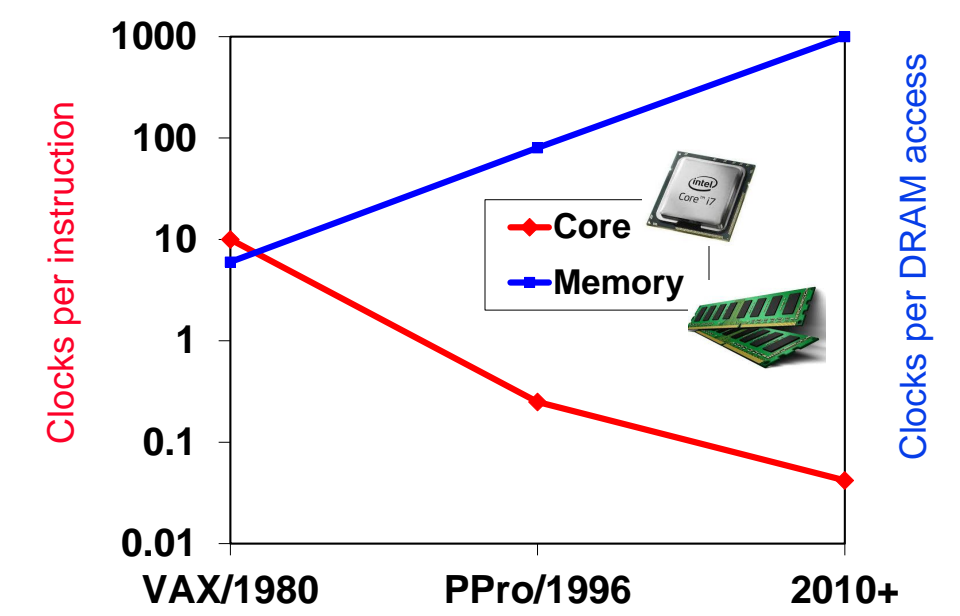

图：对数纵轴上，从 VAX/1980 到 PPro/1996 再到 2010+，Core 的每条指令时钟数从约 10 降到约 0.04，而 Memory 的每次 DRAM 访问时钟数从约 6 升到约 1000，两条曲线的剪刀差就是内存墙。 红线 Core 对应左轴、蓝线 Memory 对应右轴，两线在 1980 年附近相交，此后差距持续扩大。

DRAM 访问的周期数在增加，并不是因为 DRAM 变慢了。原因如下：

- DRAM 的**访问延迟本身基本不变**，二十年前和现在都约为 80–100 ns。
- 处理器时钟频率从约 100 MHz 提高到 5–6 GHz，时钟周期从 10 ns 缩短到约 0.2 ns。
- 固定的纳秒延迟除以越来越短的周期，得到的周期数自然越来越多：

$$
N_{\rm DRAM} = \frac{t_{\rm DRAM}}{T_{\rm clk}} = t_{\rm DRAM}\times f_{\rm clk}
$$

其中 $t_{\rm DRAM}$ 是一次 DRAM 访问的延迟（ns），$T_{\rm clk}$ 是时钟周期（ns），$f_{\rm clk}$ 是时钟频率（GHz），$N_{\rm DRAM}$ 是一次访问折合的周期数。

> [!example] 例：同一块 DRAM 在不同处理器上"有多慢"
> 取 $t_{\rm DRAM}=100\ \text{ns}$。
>
> 1. $f_{\rm clk}=100\ \text{MHz}$：$T_{\rm clk}=10\ \text{ns}$，$N_{\rm DRAM}=100/10=10$ 个周期。
> 2. $f_{\rm clk}=5\ \text{GHz}$：$T_{\rm clk}=0.2\ \text{ns}$，$N_{\rm DRAM}=100\times5=500$ 个周期。
> 3. 再考虑到每个周期能发射多条指令，一次 DRAM 访问期间损失的是上千条指令的执行机会。

处理器越快、并发度越高，DRAM 就越成为瓶颈。解决思路是在处理器和 DRAM 之间插入又小又快的存储，也就是缓存（cache），并依靠程序的局部性让大部分访问在缓存中完成。局部性和存储层次见[局部性与存储层次](#局部性与存储层次)。缓存对 CPU 时间的具体影响见[缓存性能度量](#缓存性能度量)。

> [!info] 可视化资源
> [交互图：Latency Numbers Every Programmer Should Know](https://colin-scott.github.io/personal_website/research/interactive_latency.html)：拖动 1990–2020 年份滑块，对比 L1/L2 引用（几个周期）与主存引用（约 100 ns，2000 年后基本不变）的延迟，直观体会内存墙。

### 随机访问与非随机访问存储

要设计存储层次，首先要了解各种存储介质的特性。按访问时间是否与地址有关，可以把存储介质分成两大类。

**随机访问存储**（random access memory，RAM）是指访问任意一个地址所需的时间都相同（或非常接近）的存储器。"随机"在这里是优点：不管访问哪个位置，代价都一样。DRAM 和 SRAM 都属于这一类。

**非随机访问存储**（"not-so-random" access technology）是指访问时间因操作、位置和时间不同而变化，且差别可能很大的存储器，例如磁带、磁盘、CD-ROM、SSD。它的特点有：

- **随操作变化**：读和写的延迟完全不同。这类存储的读带宽通常远高于写带宽，可以高出很多倍。在笔记本或手机上测一下存储的读写速度，会发现读快、写慢。
- **随位置变化**：磁盘要先把磁头移到对应磁道，再等盘片转到目标扇区才能开始读；磁带要把带子卷到目标位置。目标位置离当前位置越远，等待越久。
- **随时间变化**：访问从什么时刻开始、设备当时处于什么状态，都会影响延迟。SSD 的情况比前几种更复杂，后续课程再讲。

除了上面这些，Optane 以及 PRAM 等新型存储也是**非易失性存储**（non-volatile memory），都具有"不那么随机"的特点。

> [!warning] 易错点
>
> - "随机访问"不是"支持按任意地址访问"的意思。磁盘也能按任意地址读写，但访问时间随位置变化，所以不算随机访问。判断标准是：访问时间与地址无关。
> - "动态（dynamic）"和"静态（static）"说的是**是否需要刷新**，与是否断电保存无关。SRAM 和 DRAM 都是**易失性存储**（volatile memory），断电后数据都会丢失。

### SRAM 单元（6T SRAM Cell）

缓存要求快，所以它需要一种只要通电就能稳定保存数据、读写只需改变电压的存储单元。这种单元就是 SRAM。

**SRAM**（静态随机访问存储器，Static Random Access Memory）的每个单元由 6 个晶体管（6T）组成：中间 4 个晶体管构成两个**交叉耦合的反相器**，两侧各有 1 个晶体管作为访问开关。只要不断电，数据就会一直保持（"forever"），不需要刷新，所以叫"静态"。 SRAM 的逻辑简单、速度快，但价格贵，通常用在存储层次的上层，也就是缓存。

#### 前置知识：MOS 管与 CMOS 反相器

反相器是理解 SRAM 单元的基础，下面先介绍它的构成。

**MOSFET**（金属-氧化物-半导体场效应晶体管，Metal-Oxide-Semiconductor Field-Effect Transistor），也叫 MOS 管或晶体管。"金属-氧化物-半导体"是指它由这三种材料叠加构成。它有两种用途：一是做**开关**，CPU 中的晶体管基本都用作开关；二是做**放大器**，例如蓝牙耳机收到的微弱信号要先放大到能听见的强度。

MOS 管有三个端子：栅极（Gate）、源极（Source）和漏极（Drain）。它分为两种，合在一起使用就叫 **CMOS**（Complementary MOS）：

- **NMOS**（N 表示 negative）：栅极加高电平（正电压）时，源极和漏极导通。
- **PMOS**（P 表示 positive）：符号中栅极处多一个小圆圈。栅极加低电平（0 V 或负电压）时，源极和漏极导通，与 NMOS 正好相反。

**CMOS 反相器**（inverter）由一个 PMOS 管 $M_p$ 和一个 NMOS 管 $M_n$ 串联而成：$M_p$ 的一端接电源 $V_{DD}$，$M_n$ 的一端接地，两管的栅极连在一起作为输入 $V_{in}$，两管的连接点作为输出 $V_{out}$。

1. **输入高电平**：$M_p$ 截止，$M_n$ 导通，$V_{out}$ 经 $M_n$ 接地，输出 0 V（低电平）。
2. **输入低电平**：$M_p$ 导通，$M_n$ 截止，$V_{out}$ 经 $M_p$ 接到 $V_{DD}$，输出高电平。$M_n$ 断开，不影响输出。

所以输出总是输入取反，这就是反相器的功能。

#### 单元结构与读写

SRAM 单元的结构如下：

- **字线**（wordline，WL）：每个单元连一条字线，这条字线同时接到两侧两个访问晶体管的栅极。字线为高时两个开关导通，为低时断开。字线的作用是**选中单元**。
- **位线**（bitline，BL）：每个单元连**两条**位线 $b$ 和 $\bar b$。$\bar b$ 上的横线表示取反：一条为高电平时另一条为低电平。位线的作用是**读写单元**。
- **交叉耦合反相器**：反相器 A 的输出接反相器 B 的输入，B 的输出又接回 A 的输入。

保持数据的原理是**每个反相器不断产生另一个反相器的输入**。如果一侧节点为 1，经反相得到另一侧为 0，再反相又得到 1，这个状态会自我维持下去。

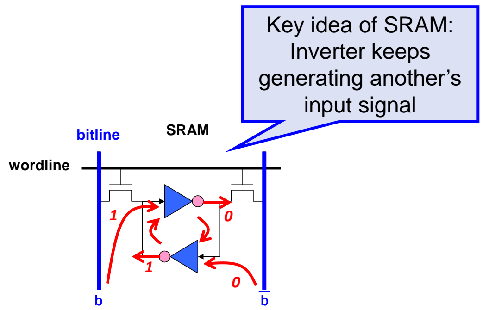

图：两个交叉耦合的反相器互相驱动对方输入以保持 1/0 状态，wordline 打开两侧访问管后，通过互补位线 $b$ 与 $\bar{b}$ 读写单元。 图中 $b$ 一侧节点为 1，经一个反相器得到 0，0 再经另一个反相器回到 1，两个反相器互相提供输入，形成稳定状态。

读写过程如下：

1. **选中**：拉高字线，两个访问晶体管导通，单元的两个内部节点分别接到 $b$ 和 $\bar b$。
2. **读**：先把两条位线预置为 $\frac{1}{2}V_{DD}$，再由单元内部两个反相器的状态把两条位线分别拉高、拉低。比较 $b$ 和 $\bar b$ 哪条高，就能读出存的是 0 还是 1。
3. **写**：外部电路强制驱动位线。例如写 1 时，把 $b$ 接高电平，把 $\bar b$ 接 0 V，迫使反相器翻转到新状态。字线关闭后，反相器继续互相维持这个状态，新数据就保存下来了。

**为什么 SRAM 密度低、功耗高**：

- 每个单元有 6 个晶体管，而 DRAM 单元只有 1 个。
- 每个单元要接两条位线，布线复杂，外围电路要求也高，所以面积更大。
- 两个反相器都接在电源和地之间，保持数据期间内部始终有电流流动，所以即使不访问也在耗电。

6T 不是唯一的 SRAM 实现，也有用更少晶体管（例如 3 个）做成的 SRAM 单元。这类设计省了晶体管，但会带来其他代价，属于特殊设计。传统 SRAM 单元指的就是 6T 结构。

> [!info] 可视化资源
> [Wikimedia Commons：6T SRAM 单元电路图](https://commons.wikimedia.org/wiki/File:SRAM_Cell_(6_Transistors).svg)：标出交叉耦合反相器、访问管、字线与互补位线，可对照上图理解 SRAM 的保持与读写。

### DRAM 单元与刷新（1T1C DRAM Cell）

主存需要大容量、低成本，所以每一位必须用尽量少的器件。DRAM 用一个电容存一位，是这种取舍的结果。

**DRAM**（动态随机访问存储器，Dynamic Random Access Memory）的每个单元由 1 个晶体管和 1 个电容（1T1C）组成。数据以电荷形式存放在电容中，晶体管只起开关作用。电容会漏电，所以单元必须**定期刷新**（refresh），约每 64 ms 一次，因此叫"动态"。 DRAM 便宜，但逻辑复杂，比 SRAM 慢得多，通常用作主存。

DRAM 的读写过程：

1. **选中**：和 SRAM 一样，字线控制访问晶体管，决定电容是否接到位线上。
2. **写**：写 1 就是给电容充电，写 0 就是让电容放电。
3. **读**：根据电容中的电荷量对位线电压的影响，判断存的是 0 还是 1。

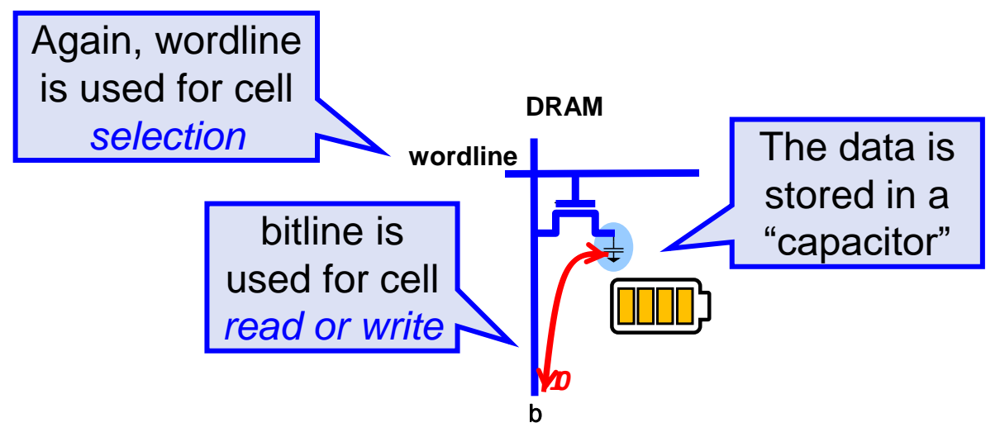

图：DRAM 单元只有一个晶体管和一个电容，wordline 选通单元，bitline 负责读写，数据以电容中的电荷存储。

**为什么需要刷新**：实际的电容都会漏电，不可能永远保存电荷。DRAM 单元的电容非常小，电荷很快就会流失。大约 64 ms 后，就可能分辨不出存的是 0 还是 1。所以必须定期把每个单元的数据读出来再写回去。

**刷新的代价**：刷新大约占 DRAM 活跃周期的 1%–2%。 如果一次访问恰好赶上刷新，就要等待，延迟会明显增加。因此有研究专门探讨如何把刷新和正常访问错开，以减少刷新的影响。

**为什么 DRAM 慢**：

- SRAM 单元用两条互补位线同时工作，而 DRAM 单元只有一条位线。
- SRAM 读写只需改变两个节点的电压（一高一低），而 DRAM 读写要对电容充放电，这本身就比较慢。

**为什么 DRAM 密度高、功耗低**：

- 每个单元只有 1 个晶体管和 1 个电容，只连 1 条字线和 1 条位线，外围电路要求也比 SRAM 简单，所以面积小。
- 开关断开后，电容上理论上没有电流流过，所以保持数据时几乎不耗电。

SRAM 与 DRAM 的对比如下：

| 维度        | SRAM                    | DRAM                                          |
| ----------- | ----------------------- | --------------------------------------------- |
| 单元结构    | 6T，两个交叉耦合反相器  | 1T1C，电容存电荷                              |
| 每单元连线  | 1 条字线 + 2 条互补位线 | 1 条字线 + 1 条位线                           |
| 是否刷新    | 不需要（static）        | 约每 64 ms 刷新（dynamic），占 1%–2% 活跃周期 |
| 密度 / 成本 | 低密度、贵              | 高密度、便宜                                  |
| 功耗        | 高（反相器持续有电流）  | 低（电容断开后几乎无电流）                    |
| 速度        | 快                      | 慢（单位线、电容充放电）                      |
| 断电后      | 丢失（易失性）          | 丢失（易失性）                                |
| 典型用途    | 缓存                    | 主存                                          |

两者的比例关系有两个典型值：同样存一位，SRAM 的面积是 DRAM 的 $4$–$16$ 倍（Size: SRAM/DRAM 4 to 16）；DRAM 的周期时间是 SRAM 的 $8$–$16$ 倍（Cycle time: DRAM/SRAM 8 to 16）。 DRAM 延迟约 80–100 ns，SRAM 则可能在 1 ns 到 10 ns 之间。

> [!tip] 课堂强调
> 4–16 倍和 8–16 倍都只是**典型值**，不是固定比例。SRAM 能做多大、多快，取决于晶体管的尺寸（晶体管越大，能承载的功率越高，切换越快）和外围电路设计，所以实际比例变化很大。

### RAM 阵列组织与芯片接口

单个单元只能存一位，要存下大量数据，就得把单元排成阵列，并用地址选出其中一部分。

**经典 RAM 组织**（classical RAM organization）把存储单元排成二维阵列：横线是**字线**（word/row line），竖线是**位线**（bit/data line），每个交叉点是一个单元，可以是 6T SRAM 单元，也可以是 1T DRAM 单元。 一次访问分以下几步：

1. **地址拆分**：输入地址被拆成**行地址**（row address）和**列地址**（column address）。
2. **行选择**：行地址送入**行译码器**（row decoder），选中一条字线，打开这一行所有单元的开关，整行单元都接到各自的位线上。
3. **列选择**：一整行存放的是一块数据，但通常只需要其中一位或一个字。所有位线都接到**列选择器与 I/O 电路**（column selector & I/O circuits），由列地址选出需要的位或字。
4. **输出**：选出的数据位或字送到数据总线上。DRAM 阵列上方通常还有一个**行缓冲**（buffer），SRAM 一般没有。行缓冲的细节在 DRAM 的课程中讲。

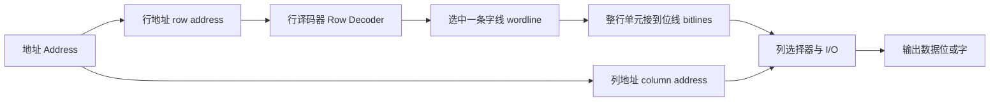

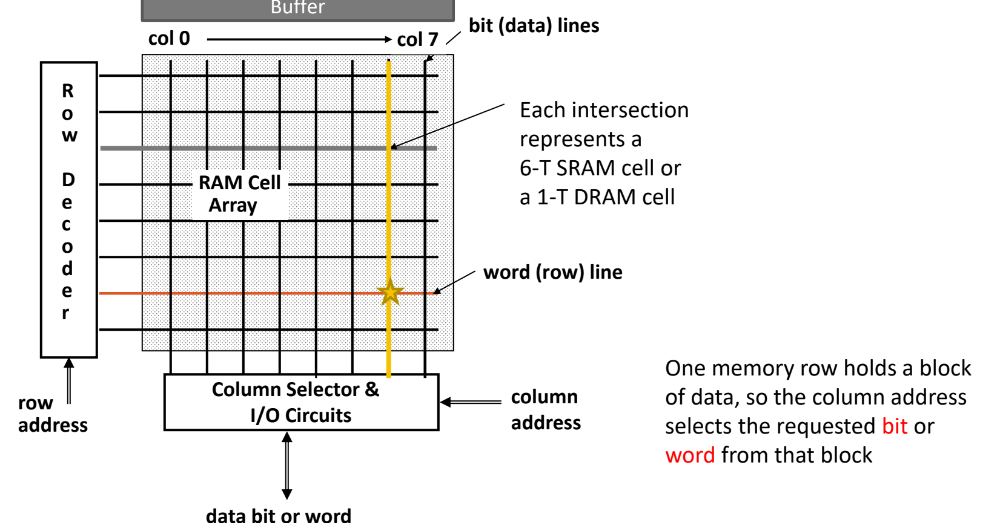

图：行地址经行译码器选中一条字线，整行数据进入缓冲，再由列地址通过列选择与 I/O 电路选出所需的位或字，阵列每个交点是一个 6T SRAM 或 1T DRAM 单元。

图中橙色的是被行译码器选中的字线，黄色的是被列地址选中的位线，五角星处就是本次访问的单元。

#### 为什么同为 SRAM，L1/L2/L3 延迟不同

L1、L2、L3 缓存都用 SRAM 做，但访问延迟差别很大：L1 约 $1$ 个周期，L2 约 $5$–$10$ 个周期，L3 约 $10$–$20$ 个周期。 原因不在介质本身，而在**阵列规模**：

- 阵列越大，行译码器要选的字线越多，字线和位线越长，负载越重。要导通并读写其中某个单元，付出的代价就越大，耗时也越长。
- 大缓存离处理器核心更远，信号走线距离更长，这也增加了延迟。

阵列大小对访问时间的具体影响会在后续课程中展开。

#### SRAM 芯片：一次送入全部地址

SRAM 用于缓存，是因为它速度快，而且制造工艺与逻辑电路兼容（technology compatibility）。 以一块 $2\mathrm{M}\times16$ 的 SRAM 芯片为例，它共有 $2\mathrm{M}=2^{21}$ 个存储单元，每个单元 16 位：

- **地址**（Address）：$\log_2(2^{21})=21$ 位，一次全部送入。
- **数据输入 / 输出**（Din[15-0] / Dout[15-0]）：各 16 位，由芯片的设计宽度决定。
- **片选**（Chip select）：系统中有多块芯片时，用它决定当前是否使用这块芯片，不用时可以关闭。
- **输出使能**（Output enable）和**写使能**（Write enable）：分别控制读出和写入。

#### DRAM：行列地址复用（RAS / CAS）

DRAM 用于主存，是为了容量（密度）。它的芯片与 SRAM 有一个明显区别：**地址分两半送入**。

- **RAS**（行访问选通，Row Access Strobe）：送入行地址，触发行译码器。
- **CAS**（列访问选通，Column Access Strobe）：送入列地址，触发列选择器。

分两次送的原因是 **DRAM 容量太大**，一次送全部地址需要的引脚太多。按字节编址时，$1\ \text{TB}=2^{40}\ \text{B}$，需要 40 位地址，32 位地址不够。如果一次全部送入，光地址就要 40 个引脚。阵列内部本来就分成行和列，所以把地址按行、列拆开，复用同一组引脚分两次送入，地址引脚大约可以减半。 SRAM 容量小，地址位数少，可以一次全部送入。

> [!warning] 易错点
>
> 分行列送地址的直接原因是**节省引脚**，不是"DRAM 必须先读出一行"。SRAM 阵列内部同样是先选行、再选列，但它容量小，不需要把地址拆开传。

非易失性内存（NVM）的容量比 DRAM 还大，地址更长，有的接口协议会把地址拆成三部分分别送入。

> [!question]- 自测：处理器主频 4 GHz，DRAM 访问延迟 80 ns，一次 DRAM 访问折合多少个时钟周期？若主频降到 1 GHz 呢？
> 4 GHz 时 $T_{\rm clk}=0.25\ \text{ns}$，$N=80/0.25=320$ 个周期；1 GHz 时 $N=80\times1=80$ 个周期。DRAM 的纳秒延迟没有变，周期数随频率成正比增长，这正是内存墙的成因。

> [!question]- 自测：某 DRAM 芯片按字节编址，有 $2^{34}$ 个可寻址单元，行列地址位数相等。采用 RAS/CAS 复用时至少需要几根地址引脚？不复用时需要几根？
> 不复用需要 $34$ 根。复用时行、列各 $17$ 位，经同一组引脚分两次送入，只需要 $17$ 根。代价是每次访问要分两步送地址。

> [!question]- 自测：有人说"SRAM 叫静态，所以断电后数据还在；DRAM 叫动态，所以会丢"。这句话错在哪里？
> "静态/动态"说的是是否需要刷新：SRAM 靠反相器互相维持状态，不需要刷新；DRAM 靠电容存电荷，会漏电，约 64 ms 就要刷新一次。断电后两者都会丢失数据，都是易失性存储。

---

## 局部性与存储层次

> [!abstract] 本节要点
>
> - 没有一种存储器同时又大、又快、又便宜：大存储器慢，快存储器小。存储层次把多种存储器组合起来，借助局部性在大多数时间里制造出“又大、又便宜、又快”的效果。
> - 局部性是存储层次设计的第一性原理。程序在任一时刻只集中访问地址空间中相对很小的一部分。
> - 时间局部性指刚访问过的数据很快会再被访问，对策是把最近访问的数据留在靠近处理器的上层。空间局部性指相邻的数据会被一并访问，对策是以“连续多字组成的块”为单位搬到上层。
> - 典型层次依次为寄存器 → L1 I\$/D\$（配 ITLB/DTLB）→ L2（SRAM）→ 主存（DRAM）→ 二级存储。访问延迟分别在 $\frac{1}{2}$、1、10、100、10,000 个周期量级，容量逐级增大，单位成本逐级降低。
> - 越往下层，传输粒度越大（字 4–8 B → 块 8–64 B → 页 1,024+ B），管理也越偏软件：寄存器由编译器管理，缓存由缓存控制器硬件管理，主存与外存之间由 OS、TLB 和用户共同管理。

### 存储层次的目标（Memory Hierarchy Goals）

处理器希望存储器容量无限大、访问零延迟、价格低廉，但现实中的每种存储器都只能满足其中一部分。要速度快，容量就小；要容量大，速度通常就慢。各种存储技术的速度、密度与成本差异（SRAM、DRAM 等）见[内存墙与存储技术](#内存墙与存储技术)。

基本事实是：**大存储器慢，快存储器小**（Large memories are slow, fast memories are small）。

**存储层次**（memory hierarchy）把不同类型的存储器按“越靠近处理器越快越小、越远越慢越大”的顺序叠成多级。它发挥各级的长处、掩盖各级的短处，让用户在**大多数时间**里感觉自己拥有一个容量很大、价格便宜、速度很快的存储器。 换个说法，它要让用户以**最便宜技术**所能提供的容量，享受到**最快技术**所能提供的速度。

这个效果之所以能成立，靠的是程序访存行为的统计规律，也就是局部性。“most of the time”这个限定很重要：只有当访问大多落在上层时，这种“又大又快”的效果才成立。上层命中的比例怎样度量、未命中要付出多大代价，见[缓存性能度量](#缓存性能度量)。

> [!tip] 课堂强调
> 学术界和工业界设计存储层次时都有一个共识，即一切设计都围绕**局部性**展开。局部性是存储层次的**第一性原理**，今天的缓存和存储层次之所以是现在这个样子，正是因为局部性。

### 局部性原理（Principle of Locality）

如果程序访问的地址在整个地址空间上均匀随机分布，那么一个小而快的上层存储器几乎总找不到要用的数据，分层也就失去了意义。分层有效的前提是访问高度集中。

**局部性原理**（principle of locality）是指：程序在任一时刻只访问地址空间中**相对很小的一部分**。

在 $0$ 到 $2^n-1$ 的整个地址空间上画出“被访问的概率”（probability of reference），可以看到：在某一段时间内，概率集中在一小片地址上，形成一个高峰，其余地址的访问概率接近零或很小。随着程序推进，这个高峰的位置会移动，但在任一时刻它都只覆盖很小的一片。

局部性细分为两类，每类各自给出一条缓存设计原则：

|              | **时间局部性**（temporal locality）        | **空间局部性**（spatial locality）           |
| ------------ | ------------------------------------------ | -------------------------------------------- |
| 含义         | 同一数据在一段时间内被反复访问             | 访问某个数据后，很可能接着访问与它相邻的数据 |
| 典型代码     | 反复读写循环变量、计数器                   | 顺序遍历数组                                 |
| 缓存设计启示 | 把**最近访问过**的数据留在靠近处理器的上层 | 以**连续多个字组成的块**为单位搬到上层       |

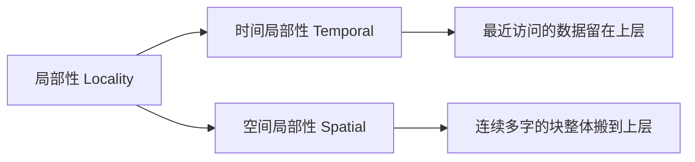

#### 时间局部性（Temporal Locality）

**时间局部性**（temporal locality，locality in time）是指：程序很可能在一段时间内**反复访问同一个数据**。

**例子**：在下面的代码中，`i` 被连续读写了很多次：`i+1`、`i < 20`、`i*i`、`3*i`、`A[i]`。

```c
i = i+1;
if (i < 20) {
    z = i*i + 3*i - 2;
}
q = A[i];
```

这段代码自始至终都在访问变量 `i`，因此 `i` 是一个被频繁重复访问的数据，具有时间局部性。

**设计对策**：数据被访问后，就把它从下层存储器（lower level memory）复制到上层存储器（upper level memory）。上层离处理器更近、访问更快，所以 `i` 后续的访问都能在上层快速完成。对应的缓存设计原则是——**把最近访问过的数据保留在靠近处理器的地方**（keep most recently accessed data items closer to the processor）。 上层容量有限、必须淘汰数据时，“最近被访问的更值得保留”这条原则会再次出现，见[替换策略](#替换策略)。

#### 空间局部性（Spatial Locality）

**空间局部性**（spatial locality，locality in space）是指：程序很可能访问**彼此相邻**的数据。访问某个数据时，它周边或与它相连的数据往往也会被访问。

**例子**：数组求和循环会依次访问 `a[0]`、`a[1]`、……、`a[n-1]`。

```c
sum = 0;
for (i = 0; i < n; i++)
    sum += a[i];
return sum;
```

数组元素在内存中连续存放，按下标顺序访问就是按地址顺序访问，自然满足空间局部性。（循环变量 `i` 和 `sum` 在这里同时具有时间局部性。）

**设计对策**：访问了 `a[i]` 之后，几乎一定还会访问 `a[i+1]`、`a[i+2]`、`a[i+3]`。因此不必只搬一个元素，而是把这一串连续的数据一次性复制到上层。对应的缓存设计原则是——**把由连续多个字组成的块搬到上层**（move blocks consisting of contiguous words to the upper levels）。 这里的“块”是缓存与下层之间交换数据的基本单位，块的组织方式和块大小的权衡见[直接映射缓存](#直接映射缓存)。

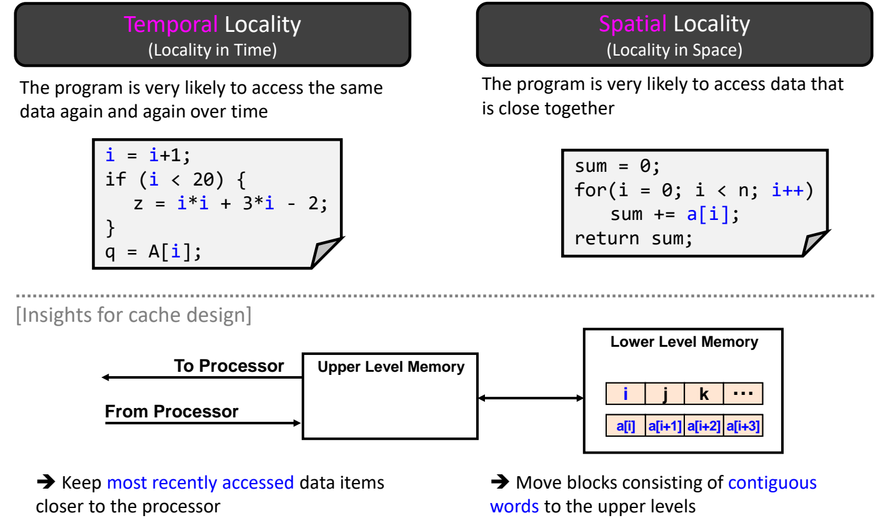

图：左侧代码反复使用变量 i 体现时间局部性，右侧顺序遍历 a[i] 体现空间局部性，下方对应缓存设计启示：保留最近访问的数据，并以连续字组成的块搬到上层存储。

> [!warning] 易错点
>
> 两种局部性的区别在于“重复的是什么”。时间局部性是**同一个地址**在时间上重复出现。空间局部性是**相邻的不同地址**先后出现。顺序遍历数组时，每个元素只访问一次，没有时间局部性，但空间局部性很强。反复访问同一个标量变量则主要体现时间局部性。

### 典型存储层次（A Typical Memory Hierarchy）

局部性解释了分层为什么有效，下面看实际计算机里有哪几层。各层按离处理器从近到远排列：

1. **寄存器文件**（RegFile）：位于数据通路（datapath）内部，是最高的一级。
2. **L1 缓存**：分为**指令缓存**（Instr Cache，I\$）和**数据缓存**（Data Cache，D\$）。拆分的原因在流水线设计中已经说明：取指和访存要在同一周期分别访问存储器（即此前流水线设计中为避免结构冒险而拆分指令与数据存储器）。与 L1 并列的还有 **ITLB / DTLB**，它们供虚拟内存的地址转换使用（TLB 属于操作系统虚拟内存的内容）。
3. **L2 缓存**（Second Level Cache），用 SRAM 实现。图中由于版面所限没有画出 L3，实际处理器通常还有 L3。
4. **主存**（Main Memory），用 DRAM 实现。
5. **二级存储**（Secondary Memory / Storage），即磁盘、SSD。

以上 1–3 级都在处理器芯片上，称为**片上部件**（on-chip components）。DRAM 主存在芯片之外，插在或集成在主板上。二级存储甚至可以不插在主板上，而是用线缆外接。整体规律是——**越快的部件离处理器越近，越慢、容量越大的部件离处理器越远**。

各级的速度、容量与成本如下。“速度”一栏指访问所需的处理器周期数的数量级：

| 层级       | 实现          | 访问时间（周期）                    | 容量量级    | 当前典型值                       | 单位成本 |
| ---------- | ------------- | ----------------------------------- | ----------- | -------------------------------- | -------- |
| 寄存器文件 | 触发器/寄存器 | $\frac{1}{2}$ 量级（不到 1 个周期） | 100 B 量级  | 约 1000 B 左右                   | 最高     |
| L1 I\$/D\$ | SRAM          | 1 量级                              | 10 KB 量级  | L1 通常 32 KB 或 64 KB           | ↓        |
| L2         | SRAM          | 10 量级                             | 100 KB 量级 | 几百 KB 到 1 MB 左右             | ↓        |
| 主存       | DRAM          | 100 量级                            | MB 到 GB    | 服务器约 1–2 TB                  | ↓        |
| 二级存储   | 磁盘 / SSD    | 10,000 量级（甚至可达 100,000）     | GB 到 TB    | 单块 SSD 可达 512 TB，接近 PB 级 | 最低     |

关于上表有几点说明：

- 讲义上二级存储的速度写作“1,0000's”，属于排版笔误，应读作 10,000's，即一万个周期量级。
- 服务器主存约 1–2 TB 这个数字不适用于笔记本。它来自服务器可以插 32 根内存条、每根 64 GB：$32 \times 64\ \text{GB} = 2048\ \text{GB} = 2\ \text{TB}$。
- 外存的单位容量价格大约比 DRAM 便宜 100 倍。
- 本节的周期数只是量级。各级缓存与 DRAM 的具体延迟（L1 约 1 周期、L2 约 5–10 周期、L3 约 10–20 周期、DRAM 约 80–100 ns）见[内存墙与存储技术](#内存墙与存储技术)。

> [!info] 可视化资源
> [Wikipedia：Memory hierarchy](https://en.wikipedia.org/wiki/Memory_hierarchy)：含存储层次示意图及 AMD Zen 4 各级（寄存器、L1、L2、L3、DDR5、SSD、HDD、磁带）的容量、带宽与延迟表，可用真实数据对照上表的周期量级。

#### DRAM 与外存之间的鸿沟

从上表可以看出，相邻两级之间大多相差约 10 倍，而 DRAM（100 周期量级）与二级存储（10,000 周期量级甚至更多）之间相差约 **100 到 1000 倍**，差距明显过大。

因此近年有大量研究尝试在 DRAM 与二级存储之间再加一个**中间层**，用新的介质来弥补这段速度差。代表方案有：

- **高速 SSD**：比普通 SSD 快得多的高速版固态盘；
- **Intel Optane（傲腾）**；
- **CXL 内存**（CXL memory）。

这些中间层在多级层次中如何组织（例如 eDRAM、存储级内存，以及上下层容量接近时采用排他式层次），见[降低缺失代价](#降低缺失代价)。

> [!note] 补充解释
> CXL（Compute Express Link）是建立在 PCIe 物理层之上的互连标准，允许处理器以缓存一致的 load/store 方式访问挂在 CXL 设备上的内存，从而在本地 DRAM 之外扩展容量。这类内存的延迟一般高于本地 DRAM，但远低于 SSD，正好落在两者之间。参见 [CXL Consortium](https://www.computeexpresslink.org/)。

### 传输粒度与管理者（Transfer Granularity and Management）

层次中相邻两级之间按什么单位交换数据、由谁决定数据放在哪一级，都随层级而变。决定因素是各级的速度和容量。

下图把存储层次画成一个**金字塔**。越往下，各级存储器的（相对）容量越大，离处理器也越远。最上面紧挨处理器的一层就是寄存器文件。

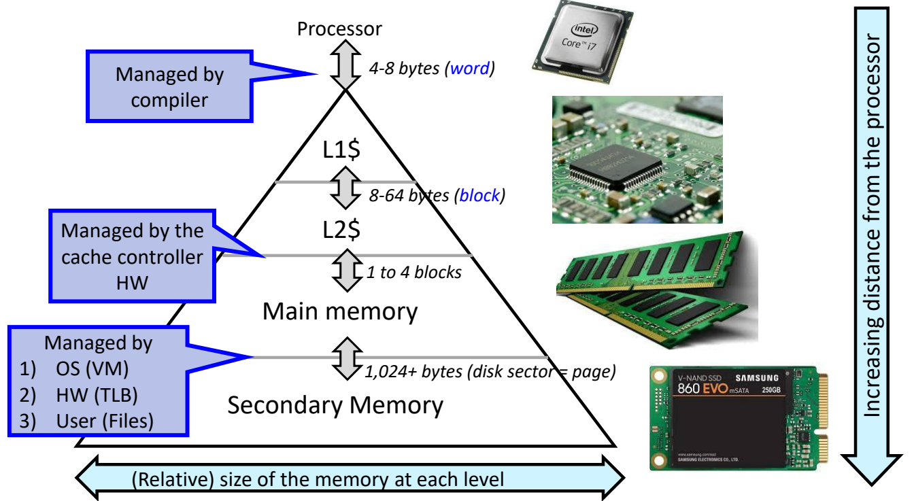

图：从处理器经 L1$、L2$、主存到辅存，越往下离处理器越远、容量越大，层间传输单位从字（4–8 字节）到块（8–64 字节）再到页（1024+ 字节），并分别由编译器、缓存控制器硬件和 OS/TLB/用户管理。

#### 传输粒度逐级变大

越往下层，一次传输的数据量越大：

| 相邻两级        | 传输单位                     | 大小        | 当前典型值                                           |
| --------------- | ---------------------------- | ----------- | ---------------------------------------------------- |
| 处理器 ↔ L1\$   | **字**（word）               | 4–8 B       | 取决于处理器位宽：32 位为 4 B，64 位为 8 B           |
| L1\$ ↔ L2\$     | **块**（block）              | 8–64 B      | 缓存块常见为 64 B                                    |
| L2\$ ↔ 主存     | 块                           | 1 到 4 个块 | 访问主存一般以 64 B 为单位                           |
| 主存 ↔ 二级存储 | **页**（page，对应磁盘扇区） | 1,024+ B    | 一页通常约 4 KB；早期机械硬盘（HDD）一个扇区为 512 B |

粒度逐级变大与空间局部性一致。下层访问一次的固定开销越大，就越值得一次多搬一些相邻数据，把开销分摊到随后会用到的那些数据上。

#### 管理者逐级从软件变为硬件

各级之间“哪些数据放在上层”由不同的主体管理：

1. **寄存器 ↔ 存储器：编译器管理**（managed by compiler）。寄存器访问不到一个周期就要完成，根本来不及经过任何运行时控制逻辑去判断，连硬件管理都来不及。因此由编译器在编译时决定把哪些变量放进哪个寄存器（寄存器分配），运行时直接执行。
2. **缓存 ↔ 主存：缓存控制器硬件管理**（managed by the cache controller HW）。缓存访问只有几个到几十个周期，交给操作系统等软件来管理太慢，必须由专门的硬件负责数据的调度、取放和替换，而且对程序员透明。
3. **主存 ↔ 二级存储：软件为主、硬件辅助**，具体包括：
   1. **操作系统**通过虚拟内存（VM）管理页的换入换出；
   2. **硬件 TLB** 加速虚拟地址到物理地址的转换；
   3. **用户**通过文件显式读写外存。

**规律**：越往上层，对速度要求越高，管理必须越“硬”（编译器静态决定，或者由硬件实时决定）。越往下层，单次访问本身就很慢，软件管理的开销相对可以忽略，因此适合用 OS 乃至用户这类较慢但更灵活的方式管理。 本讲接下来讨论的都是第 2 类，也就是由硬件管理的缓存。

> [!warning] 易错点
>
> 不要把“主存由 OS 管理”理解成“缓存也由 OS 管理”。缓存对软件透明：操作系统和用户程序都不决定某个块是否在缓存里，放置、查找和替换都由缓存控制器硬件完成。OS 管理的是主存和外存之间以页为单位的数据移动。

> [!question]- 自测：C 语言二维数组 `int a[1024][1024]` 按行优先存放。外层循环遍历行、内层循环遍历列，与外层遍历列、内层遍历行相比，哪一种更能利用存储层次？为什么？
> 前者更好，也就是内层循环遍历列下标 `a[i][j]`、`j++`。行优先存储时，同一行相邻元素的地址相差 4 B，内层循环按地址顺序访问，一次搬上来的块（例如 64 B，即 16 个 `int`）会被逐个用完，空间局部性得到充分利用。后者的内层循环每步跨越一整行（$1024 \times 4\ \text{B} = 4\ \text{KB}$），每次访问都落在不同的块上，块中其余数据还没用到就可能被换出。

> [!question]- 自测：在 `for (i = 0; i < n; i++) sum += a[i];` 中，`sum`、`i` 和 `a[i]` 分别主要体现哪种局部性？对应的缓存设计对策是什么？
> `sum` 和 `i` 每轮迭代都被重复访问，体现时间局部性，对策是把最近访问的数据保留在上层。`a[i]` 中每个元素只访问一次，但地址连续，体现空间局部性，对策是按连续多字的块整体搬到上层，使访问 `a[i]` 时 `a[i+1]`、`a[i+2]`…… 已经在上层。

> [!question]- 自测：为什么寄存器分配交给编译器，缓存的数据调度交给硬件，而主存与外存之间的页面调度可以交给操作系统？
> 由每一级可以容忍的管理开销决定。寄存器访问不到一个周期，连运行时硬件判断都来不及，只能由编译器预先决定。缓存访问只有几个到几十个周期，软件介入太慢，只能由缓存控制器硬件实时管理。外存访问需要上万个周期，操作系统执行几百条指令做页面管理的开销相对很小，同时还能换来灵活的策略。

---

## 缓存性能度量

> [!abstract] 本节要点
>
> - 命中时间 = 上层 RAM 访问时间 + 判定命中/缺失的时间；缺失代价 = 从下层取块并替换上层块的时间 + 把块送到处理器的时间；缺失率 $= 1 -$ 命中率，且命中时间 $\ll$ 缺失代价。
> - 3C 缺失：强制（冷）缺失是对块的首次访问；冲突缺失是多个地址映射到同一缓存位置而互相踢出；容量缺失是即使块可放在任意位置，缓存也装不下全部数据。
> - 把缓存纳入性能公式：$\text{CPU time} = IC \times (CPI_{ideal} + \text{Cycles}_{memory\text{-}stall}) \times T_{clk}$，括号内即 $CPI_{stall}$；读/写停顿 = 访问次数 × 缺失率 × 缺失代价，写停顿另加（可选的）写缓冲停顿。
> - 只评价缓存本身时用 $AMAT = \text{Hit time} + \text{Miss rate} \times \text{Miss penalty}$。
> - 例：$CPI_{ideal}=2$、缺失代价 100 周期、I\$ 缺失率 2%、D\$ 缺失率 4%、36% 访存指令 → 停顿 3.44、$CPI_{stall}=5.44$；把 $CPI_{ideal}$ 降到 1 或把时钟频率加倍，存储停顿占比都从 63% 升到 77%。

### 命中与缺失（Hit and Miss）

存储层次（见[局部性与存储层次](#局部性与存储层次)）把小而快的存储放在上层、大而慢的存储放在下层。要判断一个缓存设计好不好，先要能描述每次访问"在上层找到了没有、找到或找不到各要花多久"。下面的定义对任意相邻两级都成立，以"上层 = 缓存，下层 = 主存"为例。

**命中**（hit）：要访问的数据已经在上层的某个块中（例如块 X），直接由上层提供。

- **命中率**（hit rate）：所有存储访问中，在上层就找到数据的比例。
- **命中时间**（hit time）：访问上层所需的时间，由两部分组成：
  1. 上层 RAM 的访问时间（RAM access time），即真正把数据读出或写入上层存储阵列的时间；
  2. 判定命中还是缺失的时间（time to determine hit/miss），例如比对标签的时间。

**缺失**（miss）：上层没有所需数据，必须从下层的某个块（例如块 Y）取回。

- **缺失率**（miss rate）：

$$
\text{Miss rate} = 1 - \text{Hit rate}
$$

- **缺失代价**（miss penalty）：处理一次缺失所需的额外时间，也由两部分组成：
  1. 在上层替换一个块的时间——从下层把块读出（或写入），并放进上层、替换掉原有块；
  2. 把该块送达处理器的时间。

由于上层总选用快速存储、下层是慢速存储，天然有

$$
\text{Hit time} \ll \text{Miss penalty}
$$

这条不等式是后面所有分析的出发点：缺失哪怕只占很小的比例，也会因为代价大而主导平均访问时间。

> [!warning] 易错点
>
> 缺失代价不是"下层存储的访问时间"本身，而是"取块 + 替换上层块 + 送达处理器"的总时间；命中时间也不只是 RAM 阵列的读出时间，还要加上判定命中/缺失（查标签）的时间。

### 缺失的 3C 分类（3Cs）

知道"缺失了"还不够：不同原因的缺失要用不同手段去减少，所以要先按成因分类。**3C 分类**把缺失分为强制缺失、冲突缺失和容量缺失三种。

以一个只有 4 条缓存行（cache line）的缓存为例，处理器要写地址 `0x1234`，并假设按映射规则 `0x1234` 只能放在第一条缓存行：

1. **强制缺失**（compulsory miss，也叫**冷缺失** cold miss）：对一个块的**首次访问**。块此前从未被访问过，必然只在下层（DRAM）中，缓存里不可能有它；这次访问是该块在缓存中生命周期的开始。图中缓存四行全空，`0x1234` 第一次被访问，于是缺失。它是"冷"的客观事实，几乎没有办法消除（not a whole lot you can do about it）。
2. **冲突缺失**（conflict miss）——**多个存储地址映射到同一个缓存位置**。缓存并没有满（图中第四行仍空），但映射规则规定 `0x1234` 必须放进第一行，而第一行已被 `0x5670` 占用；两者互相竞争，一个块把另一个踢出去，下次再访问被踢出的块时只能从下层重新读回。
3. **容量缺失**（capacity miss）——**即使假设 `0x1234` 可以放在缓存的任何位置，缓存也装不下所有数据**。图中四行全满（`0x5670`、`0x91B1`、`0x1112`、`0x3113`），程序要用的数据超过了缓存容量，某些块必然被换出，之后再访问就会缺失。

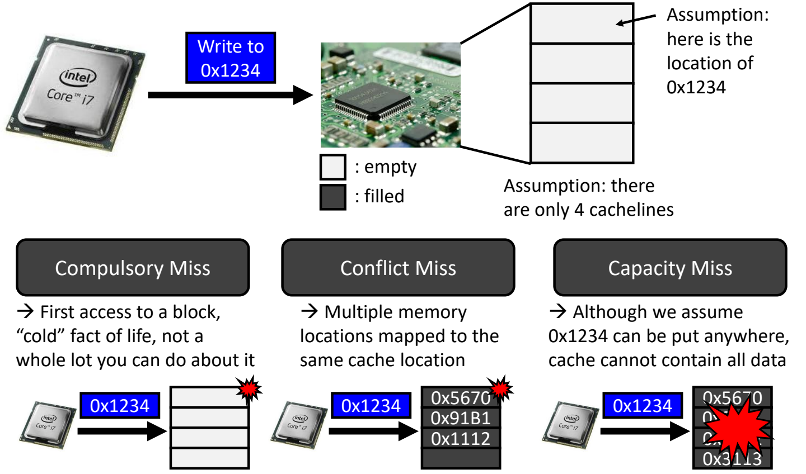

图：在只有 4 行的缓存中写 0x1234，空缓存首次访问为强制缺失，目标行已被 0x5670 占用为冲突缺失，即使可放任意位置但 4 行全满为容量缺失。

判断一次缺失属于哪一类，可以按下面的顺序问：

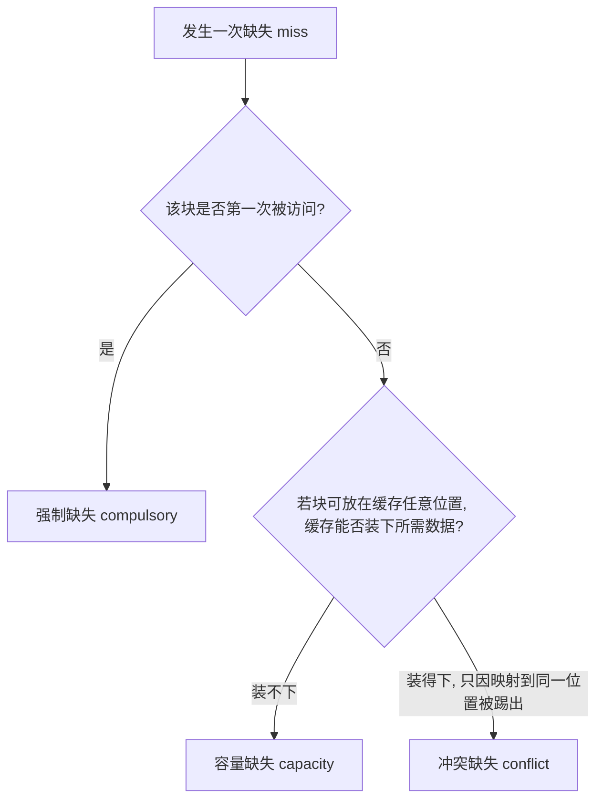

冲突缺失由"块只能放在特定位置"引起，因此与块放置方式直接相关：直接映射时每块只有一个可放位置，冲突最多；放置越自由，冲突越少。全相联缓存中块可放在任意位置，因而不存在冲突缺失。 放置方式本身见[直接映射缓存](#直接映射缓存)与[组相联与全相联](#组相联与全相联)。

> [!info] 可视化资源
> [p14m 交互式缓存模拟器](https://p14m.com/cache/)：逐次访问观察命中、缺失与被替换的行，内置顺序访问、时间局部性循环、抖动、2 的幂步长、列遍历等预设，并可切换直接映射、2 路、4 路，便于亲手区分强制缺失与冲突缺失。

> [!warning] 易错点
>
> 只要是对某块的**第一次**访问，就一定是强制缺失——即使这次访问恰好因映射冲突把另一个块踢了出去，被归类的是"这次访问"的成因（首次访问），而不是它造成的后果。被踢出的那个块**下次**再被访问时的缺失，才按冲突或容量来判断。

> [!note] 补充解释
> 教材（如 Hennessy & Patterson）中常用一个可操作的判定法来区分后两类：对同一访问序列，假想一个容量相同的全相联缓存，如果它在这次访问上也缺失，就算容量缺失；如果它会命中，而实际缓存缺失，就算冲突缺失。这与上面"假设块可放在任意位置仍装不下"的定义是一致的。

### 含存储停顿的 CPU 时间（CPU Time with Memory Stalls）

命中率和缺失率只描述缓存本身；要知道缓存对程序运行时间的影响，需要把它代入处理器性能公式。

回顾 L02《02 CPI与性能铁律》中的性能公式：$\text{CPU time} = IC \times CPI \times T_{clk}$。引入缓存后，**假设命中的开销已包含在正常的 CPU 执行周期中**，就可以把 CPI 拆成两部分：不含存储停顿的理想 CPI，加上每条指令因缓存缺失额外停顿的周期数。

$$
\text{CPU time} = IC \times \left(CPI_{ideal} + \text{Cycles}_{memory\text{-}stall}\right) \times T_{clk}
$$

其中：

- $IC$：指令数（Instruction Count）；
- $CPI_{ideal}$：所有访问都命中时的 CPI；
- $\text{Cycles}_{memory\text{-}stall}$：平均每条指令的存储停顿周期数；
- $T_{clk}$：时钟周期（Clock Cycle）；
- 括号内整体记为 $CPI_{stall} = CPI_{ideal} + \text{Cycles}_{memory\text{-}stall}$，即计入停顿后的实际 CPI。

存储停顿周期分为读停顿和写停顿两部分（以下按"每个程序"计）：

$$
\text{Read-stall cycles} = \frac{\text{Reads}}{\text{Program}} \times \text{Read miss rate} \times \text{Read miss penalty}
$$

$$
\text{Write-stall cycles} = \left(\frac{\text{Writes}}{\text{Program}} \times \text{Write miss rate} \times \text{Write miss penalty}\right) + \text{Write buffer stalls}
$$

写停顿比读停顿多一项**写缓冲停顿**（write buffer stalls），并标为可选（optional）：处理器为写操作加了写缓冲来优化，写缓冲满时也会让处理器停顿，计算时视情况把它考虑进去。写缓冲的工作方式见[写策略](#写策略)。

缺失代价在这里以**处理器时钟周期数**计量。把读写停顿之和除以 $IC$，就得到上式中每条指令的 $\text{Cycles}_{memory\text{-}stall}$。实际计算时通常按缓存类型分项：每条指令都要取指，访问一次指令缓存（I\$）；访存指令（load/store）还要访问一次数据缓存（D\$）。于是

$$
\text{Cycles}_{memory\text{-}stall} = 1 \times MR_{I\$} \times P_{miss} + f_{LD/ST} \times MR_{D\$} \times P_{miss}
$$

其中 $MR_{I\$}$、$MR_{D\$}$ 分别是指令、数据缓存的缺失率，$P_{miss}$ 为缺失代价（周期），$f_{LD/ST}$ 为访存指令占全部指令的比例。下面的例子就按这种方式计算。

> [!warning] 易错点
>
> 读/写停顿公式按"每个程序"计，而 CPU time 公式括号里的 $\text{Cycles}_{memory\text{-}stall}$ 是"每条指令"的平均值，两者相差一个因子 $IC$。另外，指令缓存的访问次数是每条指令 1 次，数据缓存的访问次数只算访存指令的比例，不要把两者都乘以访存比例。

### 平均存储访问时间（AMAT）

用整个 CPU time 来评价缓存牵涉指令数、理想 CPI 等与缓存无关的因素，不够直接。只评价缓存设计时，用一个更简单的指标——**平均存储访问时间**（Average Memory Access Time，AMAT）：

$$
AMAT = \text{Hit time} + \text{Miss rate} \times \text{Miss penalty}
$$

含义：每次访问至少付出一次命中时间（无论命中与否都要先查上层）；其中比例为缺失率的访问还要额外付出缺失代价。三个量对应三条改进方向：

- 提高命中率（即降低缺失率），$\text{Miss rate} \times \text{Miss penalty}$ 一项变小；
- 缺失率不变，但缩短命中时间，AMAT 同样下降；
- 缩短缺失代价。

因此 AMAT 既能衡量缓存设计的好坏，也指出了能做哪些性能优化；按这三个方向组织的优化框架见[降低缺失代价](#降低缺失代价)。

> [!example] 例：用 AMAT 比较两种设计（自拟数值）
> 设计 A：命中时间 1 周期，缺失率 5%，缺失代价 100 周期；设计 B：命中时间 2 周期，缺失率 2%，缺失代价 100 周期。
>
> 1. $AMAT_A = 1 + 0.05 \times 100 = 6$ 周期；
> 2. $AMAT_B = 2 + 0.02 \times 100 = 4$ 周期；
> 3. B 的命中时间虽然翻倍，但缺失率下降带来的收益更大，平均访问时间更短。这正是 $\text{Hit time} \ll \text{Miss penalty}$ 的体现。

### 处理器变快放大缓存影响（Impact of Cache Performance）

DRAM 的访问延迟多年来几乎不变（约 100 ns），缓存本身的访问速度也可能不变；但处理器越来越快，同样的存储延迟对整个系统的影响就越来越大。

**结论**：处理器性能提高（时钟频率更高和/或 CPI 更低）时，缓存缺失的**相对**代价会增大。 原因有两点：

1. 存储速度的提升赶不上处理器时钟周期的缩短。计算 $CPI_{stall}$ 时，缺失代价以处理器时钟周期计量——时钟加快，同样的纳秒级延迟折合成更多周期。
2. $CPI_{ideal}$ 降低时，停顿周期不变，于是停顿在 $CPI_{stall}$ 中的占比急剧上升。

> [!example] 例：计算存储停顿与 $CPI_{stall}$
> 已知：$CPI_{ideal} = 2$（讲义写作 "CPUideal = 2"，指理想 CPI）；缺失代价 $P_{miss} = 100$ 周期；I\$ 缺失率 2%，D\$ 缺失率 4%；访存（LD/ST）指令占 36%。求每条指令的存储停顿周期和 $CPI_{stall}$。
>
> 1. **指令缓存**：每条指令都取指、访问一次 I\$，停顿 $1 \times 2\% \times 100 = 2$ 周期。
> 2. **数据缓存**：只有 36% 的指令访问 D\$，停顿 $0.36 \times 4\% \times 100 = 1.44$ 周期。
> 3. 合计：$\text{Cycles}_{memory\text{-}stall} = 2\% \times 100 + 36\% \times 4\% \times 100 = 3.44$ 周期。
> 4. $CPI_{stall} = 2 + 3.44 = 5.44$。
> 5. 存储停顿占比：$3.44 / 5.44 \approx 63\%$。

接着分别让处理器在两个方向上变快：

> [!example] 例：处理器变快后的两种情形
> **情形 1：$CPI_{ideal}$ 降为 1**（缺失代价仍为 100 周期）
>
> 1. 停顿周期不变：$\text{Cycles}_{memory\text{-}stall} = 3.44$；
> 2. $CPI_{stall} = 1 + 3.44 = 4.44$；
> 3. 停顿占比：$3.44 / 4.44 \approx 77\%$（原来 63%）。
>
> **情形 2：时钟频率加倍**（$CPI_{ideal}$ 仍为 2）
>
> 1. 存储的绝对延迟不变，以新的、减半的时钟周期计量，缺失代价变为 200 周期；
> 2. $\text{Cycles}_{memory\text{-}stall} = 2\% \times 200 + 36\% \times 4\% \times 200 = 6.88$；
> 3. $CPI_{stall} = 2 + 6.88 = 8.88$；
> 4. 停顿占比：$6.88 / 8.88 \approx 77\%$（原来 63%）。

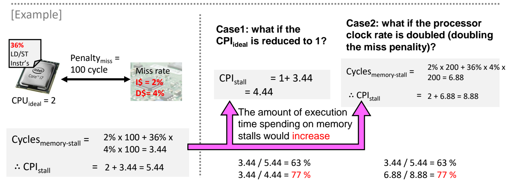

图：基础 $CPI_{ideal}=2$、缺失代价 100 周期、I$ 缺失率 2%、D$ 缺失率 4%、36% 访存指令时，$CPI_{stall}=2+3.44=5.44$；把 $CPI_{ideal}$ 降到 1 或时钟频率翻倍后，访存停顿占比都从 63% 升到 77%。

| 情形                         | $CPI_{ideal}$ | 缺失代价（周期） | $\text{Cycles}_{memory\text{-}stall}$ | $CPI_{stall}$ | 停顿占比 |
| ---------------------------- | ------------- | ---------------- | ------------------------------------- | ------------- | -------- |
| 基准                         | 2             | 100              | 3.44                                  | 5.44          | 63%      |
| 情形 1：$CPI_{ideal}$ 降为 1 | 1             | 100              | 3.44                                  | 4.44          | 77%      |
| 情形 2：时钟加倍             | 2             | 200              | 6.88                                  | 8.88          | 77%      |

这说明：缓存本身的性能可能完全没变，但只要处理器在任何层面变快，缓存（和存储）对整体性能的影响就会变大——"$CPI_{ideal}$ 下降，而 $CPI_{stall}$ 中停顿部分的分量急剧增加"。

> [!note] 补充解释
> 情形 2 中 $CPI_{stall}$ 从 5.44 涨到 8.88 并不意味着变慢：时钟周期减半，每条指令的平均时间从 $5.44\,T_{clk}$ 变为 $8.88 \times \frac{T_{clk}}{2} = 4.44\,T_{clk}$，加速比只有 $5.44 / 4.44 \approx 1.23$，远低于时钟频率提升的 2 倍。被"吃掉"的加速正是存储停顿占比上升的结果，这也是 Amdahl 定律（见 L02《03 性能汇总与Amdahl定律》）在存储系统上的体现。

> [!question]- 自测：一个程序依次访问块 A、B、C、A（缓存为直接映射，A 与 C 映射到同一缓存行，缓存总共可容纳 4 个块，开始时为空）。这四次访问分别属于哪类缺失或命中？
> 依次为：强制缺失、强制缺失、强制缺失、冲突缺失。A、B、C 都是首次访问，属于强制缺失（C 虽然踢出了 A，但 C 本身是首次访问）。第二次访问 A 时缓存只用了 2 行、远未满，若块可放在任意位置 A 不会被换出，缺失只因 A 与 C 映射到同一行，故为冲突缺失。

> [!question]- 自测：沿用正文例子（$CPI_{ideal}=2$、I\$ 缺失率 2%、D\$ 缺失率 4%、36% 访存指令），若通过优化把缺失代价从 100 周期降到 50 周期，$CPI_{stall}$ 和停顿占比各是多少？
> $\text{Cycles}_{memory\text{-}stall} = 2\% \times 50 + 36\% \times 4\% \times 50 = 1 + 0.72 = 1.72$，$CPI_{stall} = 2 + 1.72 = 3.72$，停顿占比 $1.72 / 3.72 \approx 46\%$。停顿周期与缺失代价成正比，代价减半，停顿周期也减半。

> [!question]- 自测：某缓存命中时间 1 周期、缺失代价 40 周期。要让 AMAT 不超过 2 周期，缺失率最高可以是多少？
> 由 $1 + MR \times 40 \le 2$ 得 $MR \le 1/40 = 2.5\%$，即命中率至少 97.5%。

---

## 直接映射缓存

> [!abstract] 本节要点
>
> - 缓存设计的第一个问题是**块放置与识别**：块放在上层的哪里？上层里怎么判断它在不在？直接映射的回答是：每个下层块只有一个位置，$\text{index} = \text{块地址} \bmod \text{缓存块数}$。
> - 地址自低到高分成 byte offset、(block offset)、index、tag 几段；命中的条件是 $\text{Valid}=1$ 且存储的 tag 等于地址的 tag。MIPS 1K 字、单字块：offset 为 $[1:0]$，index 为 $[11:2]$ 共 10 位，tag 为 $[31:12]$ 共 20 位。
> - 序列 `0 1 2 3 4 3 4 15` 在 4 块单字块缓存上 8 次访问有 6 次缺失；改用两字块（同样 4 字容量）后只有 4 次缺失，原因是多字块利用了空间局部性。4 字块、1K 字的 MIPS 缓存有 256 行，index 8 位，tag 20 位。
> - 块越大，缺失率先降后升，因为容量不变时块数变少；测得的曲线多在 64 B 附近最低。
> - 两个地址映射到同一行并交替访问时（如 `0 4 0 4 …`）会互相踢出，叫**乒乓效应**：8 次全缺失，其中 2 次是强制缺失，6 次是冲突缺失。

### 块放置与识别（Block Placement & Identification）

缓存比内存小得多，只能放内存的一部分，所以必须先回答两个问题：数据搬进缓存后放在哪，以及以后访问时怎么知道它在不在缓存里。

内存被划分成等大的**块**（block），上下层之间以块为单位复制数据。 由此引出缓存设计的第一组问题：

1. **块放置**：一个下层块可以放在上层（缓存）的哪个位置？
2. **块识别**：如果这个块在上层，怎样找到它？

这一组问题有多种答案，本节讲最简单的**直接映射**。同一问题的另外两种答案（组相联、全相联）见[组相联与全相联](#组相联与全相联)。块被换出时选谁、写操作怎么处理，分别见[替换策略](#替换策略)和[写策略](#写策略)。

### 直接映射缓存（Direct Mapped Cache）

直接映射的思路是：给每个内存块规定一个固定的缓存位置，查找时不用搜索，直接按地址算出该去哪一行。

**直接映射缓存**（direct mapped cache）中，下层的每个数据块在缓存里恰好只有一个可能的位置。下层块远多于缓存行，所以很多下层块必须共用同一个缓存位置。 位置的计算方法是

$$
\text{index} = \text{块地址} \bmod \text{缓存中的块数}
$$

缓存块数是 2 的幂时，取模就是取块地址的低若干位，硬件上不需要任何运算。

#### 地址划分：tag / index / byte offset

用一个小例子说明。设：

- 块大小 = 1 个字（32 bit，4 B）；
- 缓存中共有 4 个块；
- 内存大小为 64 B，所以地址有 $\log_2 64 = 6$ 位。

6 位地址从低到高切成三段：

| 字段                        | 位      | 宽度         | 由什么决定           | 作用                       |
| --------------------------- | ------- | ------------ | -------------------- | -------------------------- |
| **字节偏移**（byte offset） | $[1:0]$ | 2 位         | 块内字节数 $4 = 2^2$ | 在一个字里选出具体的字节   |
| **索引**（index）           | $[3:2]$ | 2 位         | 缓存块数 $4 = 2^2$   | 选出映射到的缓存行         |
| **标签**（tag）             | $[5:4]$ | $6-2-2=2$ 位 | 剩下的高位           | 区分共用这一行的不同内存块 |

去掉字节偏移后的 4 位 $[5:2]$ 就是块地址（这里也是字地址）。内存共有 $64/4=16$ 个块，缓存只有 4 行，所以每行由 4 个内存块共用：index 为 `00` 的块 `0000xx`、`0100xx`、`1000xx`、`1100xx` 都只能放进第 0 行，index 为 `01` 的都放进第 1 行，依此类推。这个映射是唯一的，块不可能放到别的行。

缓存的每一行存三样东西：**有效位**（valid bit）、tag 和数据。有效位表示这一行里是不是装着有效数据；刚上电时所有行都标为无效（invalid），否则一行垃圾数据可能碰巧和某个地址的 tag 相等，被误判为命中。

这两个问题的回答是：

- **Q1 数据在不在缓存里？** 把缓存行里存的 tag 和地址的高 2 位比较；相等（且该行有效）说明这个内存块就在缓存里。
- **Q2 去哪找这个块？** 用接下来的 2 个低位，也就是 index，直接选出缓存行，相当于块地址对缓存块数取模。

#### 查找过程

一次访问按以下步骤进行：

1. **切分地址**：把地址拆成 tag、index、byte offset。
2. **按 index 选行**：index 直接作为行号，读出该行的 valid、tag 和数据。
3. **比较 tag**：存储的 tag 与地址 tag 送入比较器，比较结果再与 valid 相与（AND）。
4. **命中**（hit）：结果为 1，读出该行数据，用 byte offset 选出所需字节。
5. **缺失**（miss）：数据不在这一行，需要访问下层存储，把整块取回后填入这一行（fill the cache），写入新 tag 并把 valid 置 1；原来在这一行的块被覆盖。

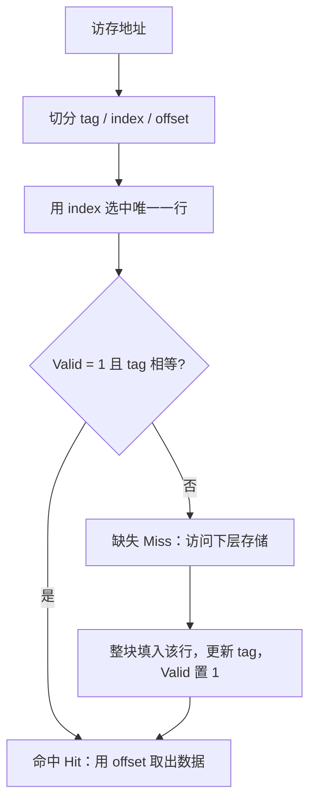

#### MIPS 直接映射缓存实例

换成真实参数：MIPS 地址 32 位，缓存容量 1K 字，每块 1 个字。

- **byte offset** $[1:0]$：2 位，因为一个字有 4 B；
- **index** $[11:2]$：缓存有 $1\text{K} = 2^{10}$ 行，需要 10 位，行号 0 到 1023；
- **tag** $[31:12]$：剩下的 $32-10-2=20$ 位。

地址中的 10 位 index 选中一行；该行存的 20 位 tag 与地址的 20 位 tag 送入比较器 `=`，比较结果和 Valid 相与得到 `Hit`；同时该行 32 位数据直接作为 `Data` 输出。命中就用这个数据，缺失就去访问下层内存。

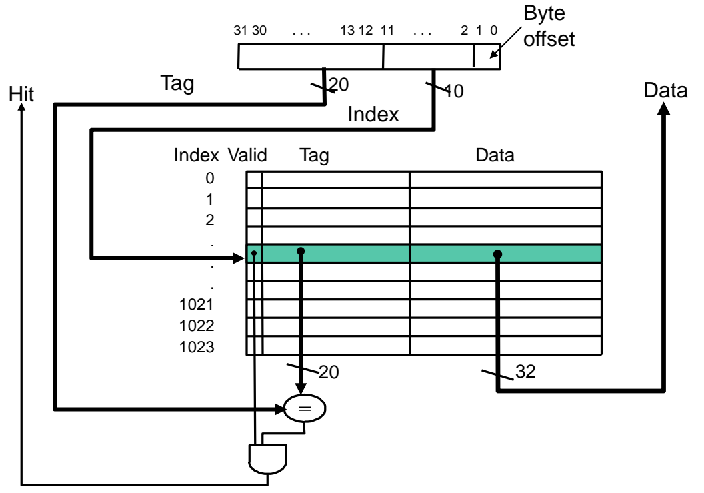

图：32 位地址分成 20 位 tag、10 位 index 与 2 位字节偏移，index 选中 1024 行中的一行，比较存储的 tag 并与 Valid 位相与得到 Hit，同时输出 32 位数据。

#### 一般规律

上面两个例子可以归纳成一般的位数计算方法。设地址宽 $A$ 位，每块 $2^m$ 个字（每字 4 B），缓存共 $2^n$ 个块，则

$$
\text{byte offset} = 2,\quad \text{block offset} = m,\quad \text{index} = n,\quad \text{tag} = A - n - m - 2
$$

单字块时 $m=0$，没有 block offset 字段。按这个式子，玩具例 $A=6, n=2, m=0$ 得 tag 2 位；MIPS 例 $A=32, n=10, m=0$ 得 tag 20 位。

> [!info] 可视化资源
> [UMich EECS 370 缓存模拟器](https://vhosts.eecs.umich.edu/370simulators/cache/simulator.html)：9 位地址，可配置组数、每组块数与块大小，逐条执行 ld/st 并显示 tag、set index、block offset 的拆分与命中统计，适合复现本节的地址划分与访问序列例题。

#### 单字块的访问序列

直接映射的第一个问题是缺失率高。 下面的例子用上面的 4 块单字块缓存，访问序列按字地址给出（括号内是 4 位字地址，低两位是 index，高两位是 tag）：

`0(0000) 1(0001) 2(0010) 3(0011) 4(0100) 3(0011) 4(0100) 15(1111)`

缓存开始为空，所有行都无效。

| #   | 字地址      | index | tag | 行内原有状态  | 结果 | 3C 类别 | 访问后该行                    |
| --- | ----------- | ----- | --- | ------------- | ---- | ------- | ----------------------------- |
| 1   | 0 (`0000`)  | 00    | 00  | 无效          | Miss | 强制    | `1 00 Mem[0]`                 |
| 2   | 1 (`0001`)  | 01    | 00  | 无效          | Miss | 强制    | `1 00 Mem[1]`                 |
| 3   | 2 (`0010`)  | 10    | 00  | 无效          | Miss | 强制    | `1 00 Mem[2]`                 |
| 4   | 3 (`0011`)  | 11    | 00  | 无效          | Miss | 强制    | `1 00 Mem[3]`                 |
| 5   | 4 (`0100`)  | 00    | 01  | tag 00 不匹配 | Miss | 强制    | `1 01 Mem[4]`（踢出 Mem[0]）  |
| 6   | 3 (`0011`)  | 11    | 00  | tag 匹配      | Hit  | —       | 不变                          |
| 7   | 4 (`0100`)  | 00    | 01  | tag 匹配      | Hit  | —       | 不变                          |
| 8   | 15 (`1111`) | 11    | 11  | tag 00 不匹配 | Miss | 强制    | `1 11 Mem[15]`（踢出 Mem[3]） |

结果：8 次访问，6 次缺失，缺失率 $6/8 = 75\%$。 缺失的三类划分（强制、容量、冲突）见[缓存性能度量](#缓存性能度量)。

> [!warning] 易错点
>
> 第 5 次访问 4 和第 8 次访问 15 发生了 tag 不匹配，并且踢出了旧块，但它们都是**第一次**访问这个块。按 3C 的定义，第一次访问必然缺失，属于**强制缺失**（compulsory miss），不是容量缺失。讲稿把这两次称为 capacity miss，按定义应更正为强制缺失。分类时先问"这个块以前访问过吗"，没访问过就是强制缺失，不看它有没有踢出别的块。

### 多字块（Multiword Block）

序列 `0 1 2 3` 是连续地址，但单字块每个字都要单独缺失一次。如果一次缺失就把相邻的几个字一起搬进来，后续访问就能命中。

**多字块直接映射**（multiword block direct mapped）的核心想法是用更大的块来利用**空间局部性**（spatial locality）：一行存多个连续的字，它们共用一个 tag。 空间局部性本身见[局部性与存储层次](#局部性与存储层次)。

#### 多字块的地址划分

块里有多个字后，地址需要多一个字段：**块内偏移**（block offset），用来选出块内的第几个字。从低到高依次是 byte offset、block offset、index、tag。

MIPS 例：每块 4 个字，缓存容量仍为 1K 字。

1. 行数 $= 1\text{K} / 4 = 256 = 2^8$，行号 0 到 255；
2. byte offset $[1:0]$，2 位；
3. block offset $[3:2]$，2 位，从块内 4 个字中选 1 个；
4. index $[11:4]$，8 位，选出 256 行中的一行；
5. tag $[31:12]$，$32-8-2-2=20$ 位。

查找时，index 选中一行，20 位 tag 比较加 Valid 得到 `Hit`；这一行有 4 个 32 位字，再由 block offset 通过多路选择器选出其中一个作为 `Data` 输出。

| 配置                           | 行数 | byte offset | block offset  | index           | tag              |
| ------------------------------ | ---- | ----------- | ------------- | --------------- | ---------------- |
| 玩具例：单字块，4 块，6 位地址 | 4    | $[1:0]$     | —             | $[3:2]$，2 位   | $[5:4]$，2 位    |
| MIPS：单字块，1K 字            | 1024 | $[1:0]$     | —             | $[11:2]$，10 位 | $[31:12]$，20 位 |
| MIPS：4 字块，1K 字            | 256  | $[1:0]$     | $[3:2]$，2 位 | $[11:4]$，8 位  | $[31:12]$，20 位 |

容量都是 1K 字时，单字块和 4 字块的 tag 都是 20 位：增加的 2 位 block offset 恰好来自 index 少掉的 2 位，tag 宽度只由总容量决定。

#### 同一序列在两字块下的表现

缓存总容量仍是 4 个字，但改成每块 2 个字，因此只有 2 行（index 只有 0、1）。6 位地址划分为 tag $[5:4]$ 2 位、index $[3]$ 1 位、block offset $[2]$ 1 位、byte offset $[1:0]$ 2 位。同样的序列 `0 1 2 3 4 3 4 15`：

1. **访问 0**（`0000`）：index 0 无效，Miss（强制缺失）。整块装入，该行为 `1 00 Mem[1] Mem[0]`。
2. **访问 1**（`0001`）：index 0，tag 00 匹配，Hit。字 1 已经随字 0 一起搬进来了。
3. **访问 2**（`0010`）：index 1 无效，Miss（强制缺失），装入 `1 00 Mem[3] Mem[2]`。
4. **访问 3**（`0011`）：index 1，tag 匹配，Hit。
5. **访问 4**（`0100`）：index 0，存的 tag 00 与 01 不匹配，Miss（强制缺失），装入 `1 01 Mem[5] Mem[4]`，踢出字 0、1。
6. **访问 3**：index 1，tag 00 匹配，Hit。
7. **访问 4**：index 0，tag 01 匹配，Hit。
8. **访问 15**（`1111`）：index 1，存的 tag 00 与 11 不匹配，Miss（强制缺失），装入 `1 11 Mem[15] Mem[14]`。

结果：8 次访问，4 次缺失，比单字块少 2 次。 少掉的两次正是访问 1 和访问 3：它们与之前缺失的字在同一块中，被顺带搬进来了。这里 4 次缺失（0、2、4、15）全是第一次访问所在的块，都是强制缺失（讲稿称 4、15 为 capacity miss，按定义同样应更正为强制缺失）。

### 块大小的权衡

既然大块能利用空间局部性，块是不是越大越好？不是。

当块大小占到缓存容量的相当比例时，缺失率反而上升，因为同样大小的缓存里能放的块数变少了。 块数少，意味着能同时驻留的不同地址区域少，原本可以共存的数据只能互相替换。

下图是早期的一组测试，缓存容量 8 KB 到 256 KB，块大小 16 B 到 256 B，纵轴为缺失率。曲线呈先降后升的"U 形"：块增大时先因空间局部性而降低，越过某一点后因块数不足而回升。容量越小回升越明显：8 KB 缓存从 64 B 处约 7% 升到 256 B 处约 9.5%（此时只剩 $8\text{KB}/256\text{B} = 32$ 块）；容量越大，曲线越平，最低点也向更大的块偏移（64 KB 在 128～256 B 基本持平）。多数曲线在 64 B 附近最低或接近最低。

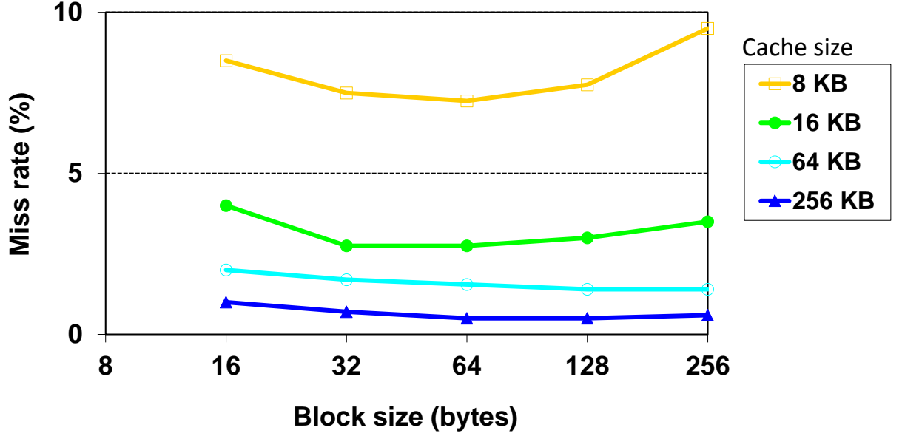

图：对 8 KB 到 256 KB 四种缓存容量，缺失率随块大小（16 到 256 字节）先降后升，小容量缓存（8 KB、16 KB）在块大小达到 256 字节时缺失率明显回升。

> [!tip] 课堂强调
> 多字块不是越大越好，过了某个点块越大效果越差；64 B 一般被认为是比较理想的块大小，目前市面上几乎所有 CPU 的 L1D 缓存都以 64 B 为缓存行粒度。

> [!note] 补充解释
> 块变大还有另一项代价：每次缺失要从下层搬运更多数据，传输时间变长，缺失代价随之增加。所以最佳块大小要同时看缺失率和缺失代价，见[缓存性能度量](#缓存性能度量)中的 AMAT。

### 乒乓效应（Ping-Pong Effect）

直接映射的第二个问题是：每个块只有一个位置可放，即使缓存里还有大量空行，两个映射到同一行的块也无法共存。

仍用 4 块单字块缓存，访问序列为 `0(0000) 4(0100) 0(0000) 4(0100) 0(0000) 4(0100) 0(0000) 4(0100)`。字地址 0 和 4 的 index 都是 `00`，tag 分别为 `00` 和 `01`：

1. **访问 0**：第 0 行无效，Miss，装入 `1 00 Mem[0]`。
2. **访问 4**：第 0 行 tag 00 与 01 不匹配，Miss，装入 `1 01 Mem[4]`，踢出 Mem[0]。
3. **访问 0**：tag 01 与 00 不匹配，Miss，装回 Mem[0]，踢出 Mem[4]。
4. 之后每次访问都把对方踢出，第 1、2、3 行始终空着。

结果：8 次访问，8 次缺失，缺失率 100%。 两个块在同一行里来回互相替换，称为**乒乓效应**（ping-pong effect）。

按 3C 分类：第 1 次访问 0 和第 1 次访问 4 是第一次访问，属于强制缺失；其余 6 次的块之前都在缓存里，只是被映射到同一行的另一块踢掉了，属于**冲突缺失**（conflict miss）。缓存总共 4 行、只用了 2 个块，容量并不缺，所以不是容量缺失。

> [!warning] 易错点
>
> 多字块不能解决乒乓效应。它改善的是空间局部性，而乒乓效应来自两个块映射到同一行。改善办法是让一个 index 对应多个可放的位置，即组相联，见[组相联与全相联](#组相联与全相联)；同一序列在 2 组 2 路的组相联缓存中只有前两次强制缺失。

> [!question]- 自测：MIPS 32 位地址、1K 字直接映射缓存，访问字节地址 `0x00001234`。单字块和 4 字块两种配置下，index、block offset 和 tag 各是多少？
> `0x1234` = `0001 0010 0011 0100`。
>
> - **单字块**：byte offset $[1:0]$ = 0；index $[11:2]$ = `0x1234 >> 2` 的低 10 位 = $1165 \bmod 1024 = 141$；tag $[31:12]$ = `0x1`。
> - **4 字块**：byte offset = 0；block offset $[3:2]$ = `01` = 1（块内第 1 个字）；index $[11:4]$ = `0x23` = 35；tag 仍为 `0x1`。
>
> 两种配置的 tag 相同，因为总容量相同，tag 都是地址的 $[31:12]$。

> [!question]- 自测：把 4 字容量的玩具缓存改成每块 2 字（2 行），访问 `0 4 0 4 0 4 0 4` 会有几次缺失？
> 仍然 8 次全缺失。字地址 0 在块 0，字地址 4 在块 2；块数 2 时 $0 \bmod 2 = 2 \bmod 2 = 0$，两者仍映射到第 0 行，tag 分别为 00 和 01，照样互相踢出。增大块只改善空间局部性，不改变"同一行只能放一个块"的冲突。

> [!question]- 自测：在图中的测试里，8 KB 缓存块大小从 64 B 增至 256 B 时缺失率上升，而 64 KB 缓存基本没有上升。为什么？
> 块数 = 容量 / 块大小。8 KB 缓存在 256 B 块时只有 32 块，能同时驻留的地址区域太少，大块带来的空间局部性收益抵不过块数减少引起的额外替换；64 KB 缓存即使用 256 B 块也有 256 块，块数仍然充足，所以曲线还没进入上升段。

---

## 组相联与全相联

> [!abstract] 本节要点
>
> - 组相联缓存把缓存分成若干**组**，每组有 $n$ **路**。一个块只能进入它所在的组，但可以放进该组的任意一路。index 负责选组，组内所有路并行比较 tag。
> - 6 位地址、4 块、2 组的例子：byte offset 2 位，index 1 位，tag 3 位。访问序列 `0 4 0 4 0 4 0 4` 在直接映射下 8 次全缺失，在 2 路组相联下只有 2 次强制缺失。
> - MIPS 4 路组相联例：1K 字、每块 1 字，共 $2^8=256$ 组，地址为 tag 22 位 + set index 8 位 + byte offset 2 位。代价是 $N$ 个比较器、命中判定延迟和选路多路器延迟，面积也随之增大。
> - 相联度越高缺失率越低，但下降幅度越来越小，1 路到 2 路的收益最大。容量固定时相联度每翻一倍，组数减半，index 少 1 位，tag 多 1 位。
> - 直接映射是 1 路组相联，全相联是只有 1 组的组相联，三者的比较次数分别为 $1$、相联度、块数。全相联没有冲突缺失，它的缺失只有强制缺失和容量缺失两种。

### 组相联的动机与定义（Set-Associative Cache）

在直接映射缓存里，一个块只有一个固定位置可去。几个频繁访问的块如果映射到同一行，就会互相驱逐，这就是乒乓效应：访问序列 `0 4 0 4 …` 每次都缺失（见[直接映射与乒乓效应](#直接映射缓存)）。增大块（多字块）解决不了这个问题，因为 0 和 4 仍然落在同一行。要解决它，就得让同一个位置能同时容纳多个块。

**组相联缓存**（set-associative cache）把缓存分成若干**组**（set），每组由 $n$ 个**路**（way）构成。一个内存块按地址映射到唯一的一组，但可以放进该组的任意一路。这样的缓存称为 **$n$ 路组相联**（$n$-way set associative），$n$ 叫作**相联度**（associativity）。

组相联的地址仍按 tag / index / offset 划分（划分方法见[地址划分](#直接映射缓存)），区别在于 index 现在选的是"组"而不是"行"。设缓存共有 $B$ 个块，相联度为 $n$，则：

$$
\#\text{sets} = \frac{B}{n},\qquad
\text{index 位数} = \log_2 \frac{B}{n},\qquad
\text{tag 位数} = \text{地址位数} - \text{index 位数} - \text{offset 位数}
$$

#### 最简例子：6 位地址、4 块、2 组

例子的设定如下：

- 每块一个字，32 bit 即 4 B，所以 byte offset 占 $\log_2 4 = 2$ 位。
- 缓存共 4 块，分 2 组，每组 2 路，所以 index 占 $\log_2 2 = 1$ 位。
- 内存地址为 6 位，所以 tag 占 $6 - 2 - 1 = 3$ 位。

与同样 4 块的直接映射比，index 从 2 位减到 1 位：直接映射有 4 行，要 2 位区分；现在只有 2 组，1 位就够了，多出的 1 位并入 tag。

查找一个地址时要回答两个问题：

1. **Q2：块在哪里找？** 用 byte offset 上方紧邻的 1 位（set index）选出一组，也就是用块号对组数取模。
2. **Q1：数据在不在缓存里？** 把选中组内各路的 tag 与地址高 3 位比较，某一路有效且 tag 相等就是命中。直接映射只比较一个位置，组相联要比较组内的**每一路**。

> [!example] 例：`0 4 0 4 0 4 0 4` 在 2 路组相联中的行为
> 下面的 0 和 4 指字地址（块号）。缓存初始为空，所有块的有效位为 0。
>
> 1. 字地址 0 的二进制是 `0000`，最低位 0 是 index，选中第 0 组，tag = `000`。第 0 组为空，**缺失**，把 Mem[0] 填入第 0 组的第 0 路（V=1，Tag=`000`）。
> 2. 字地址 4 的二进制是 `0100`，index 也是 0，tag = `010`。第 0 组第 0 路的 tag 不匹配，但第 1 路还空着，所以**缺失**后把 Mem[4] 填入第 1 路（V=1，Tag=`010`），**不驱逐** Mem[0]。
> 3. 再访问 0：第 0 组中有一路 tag 等于 `000`，**命中**。再访问 4：另一路 tag 等于 `010`，**命中**。
> 4. 之后的访问全部命中。
>
> 结果：8 次请求，2 次缺失，并且两次都是首次访问造成的强制缺失。同样的序列在每块一字的直接映射缓存中有 8 次缺失，组相联减少了 6 次。

> [!tip] 课堂强调
> 理想的缓存只有强制缺失（cold miss），一旦出现冲突缺失，效果就明显变差。容量缺失来自数据集比缓存大，强制缺失来自第一次访问，这两类都不好解决；冲突缺失是可以设法消除的，组相联针对的正是这一类。3C 的定义见[3C 缺失分类](#缓存性能度量)。

### 组相联的硬件结构与代价

在组相联中，块的位置不再唯一，硬件只能把选中组里的每一路同时读出、同时比较，再从中挑出命中的那一路。

#### MIPS 4 路组相联例

参数：每块 1 字，缓存容量 1K 字（4 KB），4 路组相联。

1. **组数**：$1024 / 4 = 256 = 2^8$ 组，每组 4 路，每路一个块。
2. **地址划分**（32 位字节地址）：byte offset 2 位，即位 $[1:0]$；set index 8 位，即位 $[9:2]$；tag $32 - 8 - 2 = 22$ 位，即位 $[31:10]$。
3. **存储阵列**：4 个结构相同的阵列，每个阵列有 256 个表项，表项包含 V、Tag、Data。

一次查找按下面的步骤进行：

1. **选组**：8 位 set index 同时送到 4 个阵列，读出编号相同的 4 个表项。
2. **并行比较**：每一路配一个比较器（"="），把本路存的 tag 与地址的 22 位 tag 比较，再与本路有效位 V 相与，得到该路的命中信号。
3. **命中判定**：4 路的命中信号相或，得到 Hit。
4. **选数据**：4 路的命中信号作为选择控制，驱动 4 选 1 多路器（4x1 select），从 4 路读出的 Data 中选出命中那一路，作为输出 Data。

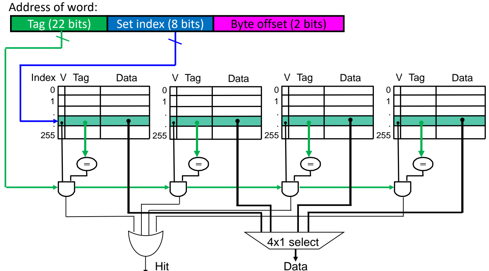

图：地址分成 22 位 tag、8 位组索引与 2 位字节偏移，组索引同时选中四路中同一组，四个比较器并行比较 tag，结果经或门得到 Hit，并控制 4x1 选择器输出命中路的数据。

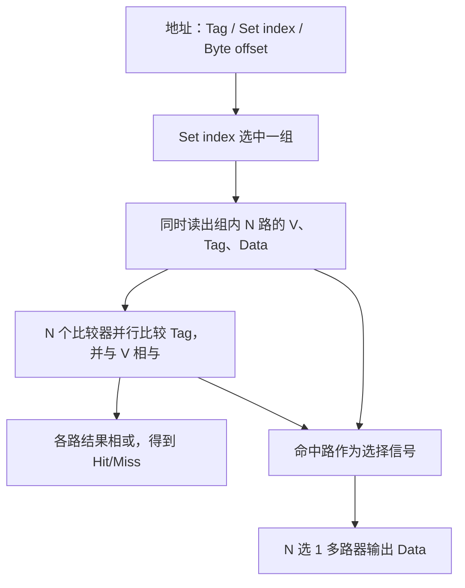

#### 与多字块直接映射的区别

多字块直接映射和组相联都让一个 index 对应多个字，但结构完全不同：

- **多字块**：一行里的 4 个字连续存放，**共用一个 tag**，查找时只比较一次 tag，再用 block offset 选字。
- **组相联**：组内每一路是独立的块，**各有自己的 V 和 tag**，可以存放内存中毫不相邻的块。index 一次要访问 $N$ 个阵列，比较 $N$ 次 tag，最后还要从 $N$ 份数据中选一份。

#### 代价

组相联相对直接映射或多字块直接映射，多出三项开销：

1. **$N$ 个比较器**（$N$ 路），带来面积和延迟。
2. **命中/缺失判定延迟**：必须等 $N$ 路比较完、再相或，才能知道是否命中。
3. **多路器延迟**：数据要经过选路多路器才能输出。直接映射在 tag 比较的同时就可以把数据送出，组相联则必须等比较结果出来后才能选路。

每一项单看都不大，但缓存处在访存关键路径上，这些延迟和面积在高速缓存里相当可观。

> [!warning] 易错点
>
> 讲义讨论代价的那张 4 路结构图把最低 2 位标成 "Block offset (2 bits)"，而前一张同一结构图中该字段标为 "Byte offset (2 bits)"。这个例子每块只有一个字，所以这 2 位是字内的**字节偏移**，不存在用来选字的 block offset。

> [!note] 补充解释
> 讲稿中提到"L1I 一般是直连，L1D 一般 4 路，8 路很少，因为延迟高"。这只能当作对延迟与相联度权衡的说明，不代表现代处理器的普遍配置。现代桌面和服务器 CPU 常见的是 32 KiB、8 路的 L1 缓存（L08 讲到的例子也是"标准的 32KB 8 路缓存"），L1I 也通常是组相联。真实处理器的具体参数要查厂商手册。

### 相联度与缺失率、地址位数

相联度增加以后缺失率会下降，但比较器和多路器的代价也随之上升。选直接映射还是组相联，取决于缺失的代价和实现的代价孰重。

**规律**：相联度的优势在于，较小的相联度就能明显降低缺失率。从 Hennessy & Patterson 的数据（缓存容量 4 KB 到 512 KB，相联度 1/2/4/8 路）可以看出：

1. **单调下降**：对每种容量，缺失率都随相联度增加而下降或持平。这与块大小不同，块大小的缺失率曲线先降后升。
2. **边际收益递减**：从直接映射到 2 路的收益最大。以 4 KB 为例，缺失率约从 9.8% 降到 7.6%；从 2 路到 4 路只降到约 7.1%；从 4 路到 8 路几乎没有变化。
3. **容量越大，相联度的作用越小**：512 KB 时，各相联度的缺失率都在 1% 以下，曲线接近水平。

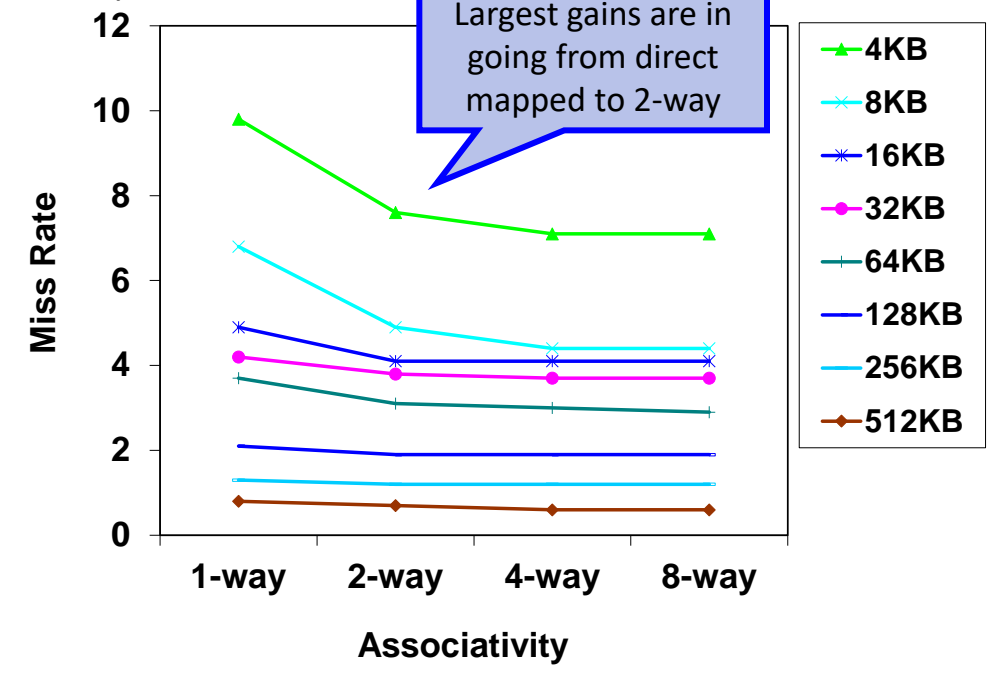

图：对 4KB 到 512KB 的缓存，相联度从 1-way 增加到 8-way 时缺失率下降，最大收益出现在从直接映射到 2 路组相联这一步，容量越大曲线越平。

由此可知，2 路、4 路是常见选择，最多到 8 路。再往上缺失率几乎不再下降，硬件代价却继续增加。

#### 相联度变化时的地址划分

**规则**：缓存容量固定时，相联度每增加一倍，每组的块数（路数）加倍，组数减半，于是 **index 少 1 位，tag 多 1 位**。

把地址从低位到高位排列：

| 字段         | 作用                     |
| ------------ | ------------------------ |
| Byte offset  | 选字内的字节             |
| Block offset | 选块内的字（支持多字块） |
| Index        | 选组                     |
| Tag          | 用于 tag 比较            |

相联度在两个极端之间连续变化：

- **直接映射**（只有一路）：index 最长，tag 最短，tag 长度由缓存容量决定。
- **全相联**（只有一组）：index 位数为 0，除 block offset 和 byte offset 以外的所有位都是 tag。

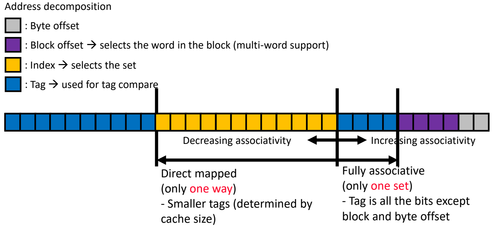

图：固定容量下，相联度每翻倍，index 少 1 位、tag 多 1 位；直接映射时 index 最长、tag 最短，全相联时只有一组，除块内偏移和字节偏移外全部是 tag。

block offset 一般不会很长，一块大约 8 个字左右。常见的划分是：低位放 offset，中间放 index，高位放 tag。这只是常用做法，不是必须的。tag 和 index 放在地址的哪些位，可以根据负载和应用来设计，例如 NVIDIA GPU 的地址映射就不采用这种简单划分。

> [!example] 例：容量固定、相联度变化时的位数
> 以 MIPS 例的容量为准：1K 字、每块 1 字，共 1024 块，32 位地址，byte offset 2 位。
>
> | 相联度 | 组数 | index 位数 | tag 位数 | 每次比较数 |
> | --- | --- | --- | --- | --- |
> | 1 路（直接映射） | 1024 | 10 | 20 | 1 |
> | 2 路 | 512 | 9 | 21 | 2 |
> | 4 路 | 256 | 8 | 22 | 4 |
> | 全相联（1024 路） | 1 | 0 | 30 | 1024 |
>
> 4 路那一行就是上面 MIPS 4 路例的 22 位 tag 和 8 位 set index。每往下一行，index 少 1 位、tag 多 1 位。

### 直接映射、组相联、全相联的统一视角

把组数（即 index 位数）调到两个极端，组相联就变成另外两种结构，所以三种映射可以放在同一个框架里看。

**全相联缓存**（fully associative cache）只有一组，一个块可以放在缓存的任意位置，查找时必须比较所有块的 tag。**直接映射**就是 **1 路组相联**，组数等于块数。全相联则是**全路组相联**（All-way SA），路数等于块数。组相联介于两者之间。

| 类型           | 内存块映射到缓存的位置 | 查找复杂度   | 组数          | 每组块数               | 定位方法                      | 比较次数 |
| -------------- | ---------------------- | ------------ | ------------- | ---------------------- | ----------------------------- | -------- |
| 直接映射（DM） | 固定的一个位置         | 索引快       | 缓存块数      | 1                      | 用 index 定位                 | 1        |
| 组相联（SA）   | 一组位置中的任意一个   | 查找稍复杂   | 块数 / 相联度 | 相联度（通常 2 到 16） | 用 index 选组，比较组内各 tag | 相联度   |
| 全相联（FA）   | 缓存中任意位置         | 需要大量硬件 | 1             | 缓存块数               | 比较所有块的 tag              | 块数     |

全相联要为每个块配一个比较器，代价最高，所以实际处理器里的缓存几乎都不是全相联的，只在少数特殊场合使用。

> [!info] 可视化资源
> [Wikipedia：Cache placement policies](https://en.wikipedia.org/wiki/Cache_placement_policies)：分别给出直接映射、全相联、2 路组相联的缓存结构图，并用 16 KB 主存 / 256 B 缓存的例子计算 tag、index、offset 位数，便于对照本节三种映射方式。

#### 全相联与 3C 缺失

把三种映射方式放回 3C 分类（定义见[缓存性能度量](#缓存性能度量)）来看：冲突缺失的前提是"块只能放在特定位置"，而全相联恰好取消了这个前提。

**结论**：全相联缓存**没有冲突缺失**。块可以放在任意位置，只要还有空行就不会因为位置冲突而被驱逐。所以全相联中的一次缺失，要么是首次访问造成的强制缺失，要么是缓存已满造成的容量缺失。 这也说明，提高相联度降低的是冲突缺失。缓存满后选哪个块驱逐属于替换策略，见[替换策略](#替换策略)。

> [!question]- 自测：32 位地址、32 KB 缓存、每块 64 B、8 路组相联，各字段多少位？若改为全相联呢？
> 块数为 $32\,\text{KB} / 64\,\text{B} = 512$。8 路组相联有 $512/8 = 64$ 组，所以 offset $\log_2 64 = 6$ 位（block offset 4 位加 byte offset 2 位），index 6 位，tag $32-6-6=20$ 位，每次比较 8 个 tag。全相联时 index 为 0 位，tag $32-6=26$ 位，每次要比较 512 个 tag。

> [!question]- 自测：6 位地址例的缓存（4 块、每块一字），字地址序列 `0 4 8 0 4 8`。分别按 2 路组相联（LRU 替换）和 4 块全相联计算缺失次数，并说明缺失类型。
> 0、4、8 的二进制最低位都是 0，在 2 路组相联中都映射到第 0 组。3 个块轮流争用 2 路，LRU 每次都恰好驱逐下一个要访问的块，所以 6 次访问**全部缺失**：前 3 次是强制缺失，后 3 次是冲突缺失（此时第 1 组还空着）。全相联时 3 个块都能放下，只有前 3 次强制缺失，后 3 次全部命中。

> [!question]- 自测：容量不变，把直接映射改成 2 路组相联，tag 存储总位数怎么变？命中时间可能怎么变？
> 组数减半，index 少 1 位，每个块的 tag 多 1 位，所以 tag 存储总共增加"块数 × 1"位。硬件上要多一个比较器，tag 比较完成后数据还要经过 2 选 1 多路器才能输出，命中判定和数据输出都会变慢。换来的是冲突缺失减少，而且按相联度–缺失率曲线，从 1 路到 2 路正是缺失率下降最多的一步。

---

## 替换策略

> [!abstract] 本节要点
>
> - 缓存满且发生缺失时，必须先逐出一行（victim）才能装入新块；直接映射只有唯一候选（static），只有组相联/全相联才需要在多路中做选择。
> - 常见策略：Random（随机选一路）、FIFO（按装入顺序淘汰最老的）、LRU（淘汰最久未被使用、即重用距离最长的行）、NRU（淘汰任一非最近使用的行，Itanium 2 的 L1/L2/L3 采用）。
> - 2 路组相联中 LRU 与 NMRU 等价，每组 1 位即可；超过 2 路时真 LRU 需要时间戳或有序表，每次访问都要更新/排序，难以在一个周期内完成。
> - 树形伪 LRU：$N$ 路用 $N-1$ 位组成二叉树，位为 0 表示左半更老、1 表示右半更老；访问时把路径上的位改为指向另一侧，替换时沿“更老”指针走到叶子。4 路依次访问 A、B、C、D 后，所有位为 0，victim 为 A。
> - 时钟算法：每路 1 位引用位 $R$，指针遇到 $R=1$ 就清零并前进，遇到 $R=0$ 就替换该路。

### 替换问题与策略分类

缓存容量有限。当缓存（或某个组）已经装满、又发生缺失时，新块要进来，就必须先把某一行逐出（evict）。这就是缓存设计的第三个问题——**块替换**（Block Replacement）：缺失时应当替换哪一块？

前两个设计问题（块放在哪里、如何识别）分别见[直接映射缓存](#直接映射缓存)与[组相联与全相联](#组相联与全相联)。替换问题是否存在，取决于放置方式：

- **静态替换**（Static）：直接映射缓存中，每个地址只能放在唯一的一行，缺失时被逐出的必然是这一行，没有选择余地。
- 组相联和全相联中，一个块可以放在组内多路中的任何一路（全相联可以看作只有一个组），组满时才需要从多个候选中选出一个 **牺牲块**（victim）。下面的策略都是针对这种情况的。

**缓存替换策略**（Cache Replacement Policy）就是从候选路中选出 victim 的规则。常见的几种策略如下：

1. **随机替换**（Random）：随机选一行替换，不考虑它是“热”还是“冷”。优点是实现极其简单。
2. **先进先出**（FIFO，First In First Out）：把组内各路看成一个环形队列，替换装入时间最早（最老）的一行，按队列顺序依次逐出。
3. **最近最少使用**（LRU，Least Recently Used）：替换最长时间没有被访问过的一行。
4. **最近未使用**（NRU，Not Recently Used）：替换任意一个“不是最近被使用”的行，是 LRU 的妥协版本。Itanium 2 的 L1、L2、L3 缓存都采用这种策略。

| 策略   | 适用的映射方式  | 选择依据                     | 实现难度                 |
| ------ | --------------- | ---------------------------- | ------------------------ |
| Static | 直接映射        | 地址唯一对应的那一行         | 无需额外状态             |
| Random | 组相联 / 全相联 | 随机                         | 最简单                   |
| FIFO   | 组相联 / 全相联 | 装入顺序，淘汰最早装入的     | 环形队列，简单           |
| LRU    | 组相联 / 全相联 | 访问顺序，淘汰最久未被访问的 | 超过 2 路时困难、昂贵    |
| NRU    | 组相联 / 全相联 | 只避开最近被访问的那一行     | 简单，只需记录最近使用者 |

> [!warning] 易错点
>
> FIFO 和 LRU 都“淘汰最老的”，但“老”的含义不同：FIFO 看**装入**时间，命中不改变顺序；LRU 看**最后一次访问**时间，每次命中都会让该行变成最新。一行频繁命中的块，在 FIFO 下仍可能因为装入得早而被逐出，在 LRU 下则不会。

### LRU 与 NMRU

替换策略的目标是逐出“未来最不会被用到”的块。根据时间局部性（见[局部性与存储层次](#局部性与存储层次)），最久之前被用过的块，未来大概率也不太会被用到，因此 LRU 一般比 Random、FIFO 效果更好。

**LRU**（Least Recently Used，最近最少使用）每次缺失时逐出组内最久没有被访问的行。它的关键思想可以用**重用距离**（reuse distance）表述：一个块从上一次被访问到下一次被访问之间隔了多久，就是它的重用距离；LRU 逐出的是重用距离最长的块。 例如依次访问 A、B、C、D 之后，A 是最长时间没有被用到的，所以 LRU 的 victim 是 A。

要实现 LRU，就得记住组内全部 $N$ 行最后一次被访问的先后顺序。 这一要求的代价随路数急剧变化：

#### 2 路：LRU 等价于 NMRU

**NMRU**（Not Most Recently Used，非最近使用）是指替换“不是最近一次被使用（MRU，Most Recently Used）”的那一行。2 路组相联中只有两个候选：一个是 MRU，另一个就必然是 LRU，因此“不选 MRU”与“选 LRU”完全相同。

实现只需：

1. 每组设 **1 位**，指示哪一路是 LRU（另一路即 MRU）。
2. 每次访问该组时，按访问的是哪一路置位或清零这一位。

#### 超过 2 路：真 LRU 困难且昂贵

$N>2$ 时，仅知道 MRU 不足以确定 LRU，必须追踪每一行何时被访问过：

1. **时间戳方案**：给每行加一个时间戳。问题一是时间戳需要多少位；问题二是理想实现要求每次逐出时在全部 $N$ 个时间戳中找最小值，这需要比较器网络。
2. **有序表方案**：维护一个按访问时间排序的列表。问题是**每次访问**（不只是缺失）都要重新排序。

缓存访问需要在一个周期内完成全部操作，而“记录时间戳 → 比较/排序 → 找出最老者”无法在一次访问的时间内完成。因此对于超过 2 路的缓存，完整的 LRU 基本无法实用，工程上改用近似 LRU 的**伪 LRU**（Pseudo-LRU，PLRU）。

> [!note] 补充解释
> 精确记录 $N$ 行的访问顺序，本质上是记住 $N!$ 种排列中的一种，至少需要 $\lceil \log_2 N! \rceil$ 位状态：4 路需 5 位，8 路需 16 位，并且每次访问都要改写这些状态。这从另一个角度说明了真 LRU 随路数增长的代价。

#### NRU：只避开最近使用者

**NRU**（Not Recently Used）是 LRU 的妥协：不追求找出“最久未用”的那一行，只要求不逐出“最近被用过”的行，从其余行中任选一个即可。 实现时只需记录上次用了哪一行，这次就换别的行逐出，因此硬件很简单。2 路时 NRU 与 NMRU、LRU 一致；路数更多时，它只保证 victim 不是最近被访问的行，不保证是最久未用的行。

### 树形伪 LRU（Tree-based Pseudo-LRU）

真 LRU 要追踪完整访问顺序，代价太高；树形伪 LRU 用一棵二叉树只记录“哪一半更老”，用很少的位近似 LRU。

**树形伪 LRU**（Tree-based Pseudo-LRU）把组内各路作为二叉树的叶子，每个内部节点用 1 位记录其左右两棵子树中哪一半更老（older）：

- 位 = 0：左边更老；
- 位 = 1：右边更老；
- 所有 PLRU 位初始化为 0。

$N$ 路组相联的二叉树有 $N-1$ 个内部节点，即每组 $N-1$ 位；树高为 $\log_2 N$，每次访问或查找 victim 只涉及根到叶子路径上的 $\log_2 N$ 个节点，所以这种实现称为 $O(\log N)$ 的实用伪 LRU。

以 4 路组相联为例，四路为 Way A、B、C、D，共 3 位：

- **L0**（AB/CD 位）：根节点，记录 AB 这一半还是 CD 这一半更老；
- **L1**（A/B 位）：记录 A 还是 B 更老；
- **L2**（C/D 位）：记录 C 还是 D 更老。

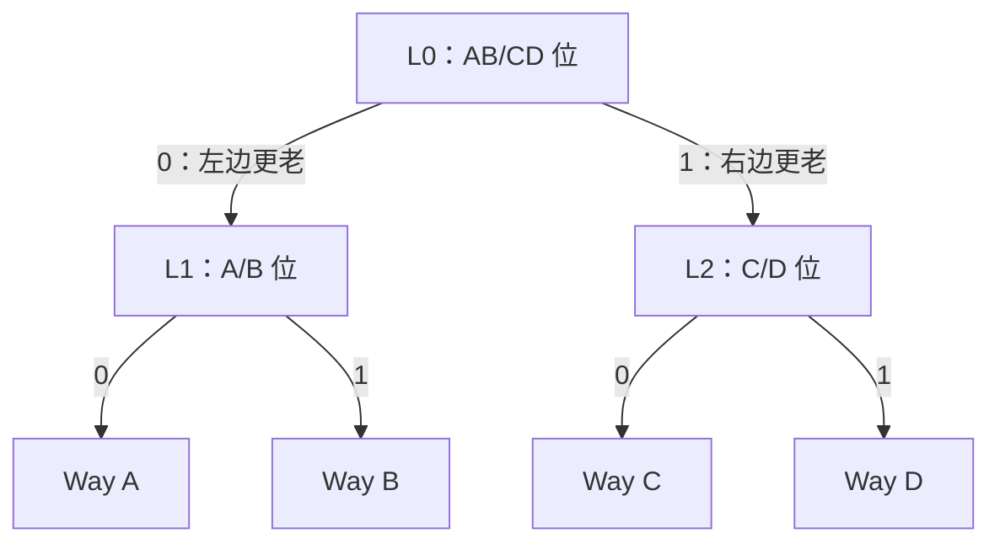

两种操作：

1. **访问（命中或装入）时更新**：被访问的那一路成为最新，因此把从根到该叶子路径上的每个节点都改为**指向另一侧**（另一侧更老）。不在路径上的节点不变。
2. **替换时查找 victim**：从根出发，每个节点按其位值走向“更老”的一侧（0 往左、1 往右），走到的叶子就是 victim。

> [!example] 例：4 路 PLRU 依次访问 A → B → C → D
> 初始 $L0=L1=L2=0$。记三位为 $(L0, L1, L2)$。
>
> 1. **访问 A**：路径为 L0 → L1 → A。A 在 L0 的左半，所以 $L0 \leftarrow 1$（CD 比 AB 更老）；A 是 L1 的左孩子，所以 $L1 \leftarrow 1$（B 比 A 更老）。状态 $(1,1,0)$。
> 2. **访问 B**：路径为 L0 → L1 → B。B 也在左半，L0 仍应指向右，保持 1；B 是 L1 的右孩子，$L1 \leftarrow 0$（A 比 B 更老）。状态 $(1,0,0)$。
> 3. **访问 C**：路径为 L0 → L2 → C。C 在右半，$L0 \leftarrow 0$（AB 比 CD 更老）；C 是 L2 的左孩子，$L2 \leftarrow 1$（D 比 C 更老）。状态 $(0,0,1)$。
> 4. **访问 D**：路径为 L0 → L2 → D。D 在右半，L0 保持 0；D 是 L2 的右孩子，$L2 \leftarrow 0$（C 比 D 更老）。状态 $(0,0,0)$。
> 5. **找 victim**：$L0=0$ 走左到 L1，$L1=0$ 再走左，到达 Way A。victim 是 A。
>
> 按真 LRU，访问顺序 A、B、C、D 之后最久未用的也是 A，两者结果一致，所以说 PLRU 近似 LRU。

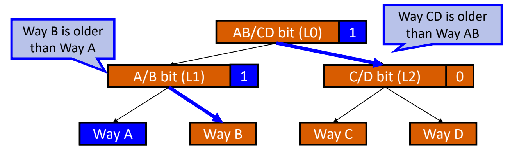

图：四路组的伪 LRU 用三位二叉树记录新旧，访问 Way A 后 A/B 位置 1 表示 Way B 更旧，AB/CD 位置 1 表示 Way CD 更旧，蓝色粗箭头指向较旧的一侧。

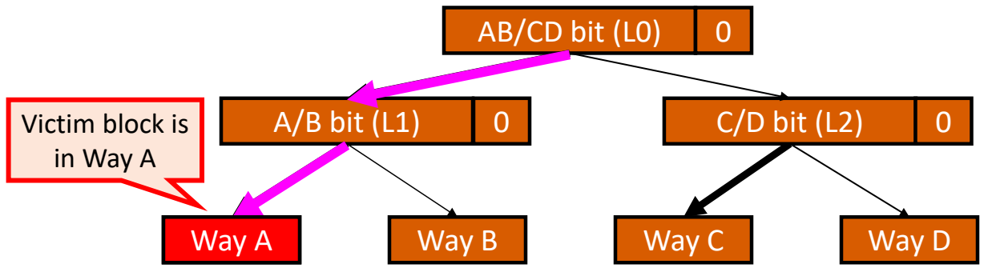

图：三个树节点位都为 0 时，从根沿指向较旧一半的指针向下走，经 AB/CD 位和 A/B 位到达 Way A，因此 Way A 被选为替换块。

> [!info] 可视化资源
> [Wikipedia：Cache replacement policies](https://en.wikipedia.org/wiki/Cache_replacement_policies)：含 LRU 访问序列 A B C D E D F 的逐步图示和 Pseudo-LRU 二叉树指针图示，可对照理解多路 LRU 的实现难度与近似方案。

> [!warning] 易错点
>
> - 节点位指向的是**更老**的一侧，而不是刚被访问的一侧。访问某路时，要把路径上的位设为“背离”该路的方向。
> - 一次访问只改根到该叶子路径上的 $\log_2 N$ 个位；另一棵子树里的位保持不变。例如访问 B 时 L2 不动。
> - PLRU 只是近似：每个节点只知道“哪一半更老”，不知道半区内部的完整顺序，因此在某些访问序列下选出的 victim 与真 LRU 不同（见下方自测）。

### 时钟算法（Clock Algorithm）

树形 PLRU 的更新规则仍比较复杂；时钟算法用更简单的机制近似 LRU。该算法源自操作系统的页面替换，用在缓存中时，把“页”换成组内的“路”即可。

**时钟算法**（Clock Algorithm）把所有路排成一个环形“时钟”，用一根指针（clock hand）指向下一个候选替换者，并为每一路记录 1 位**引用位** $R$：

- $R=0$：未被引用（unreferenced）；
- $R=1$：被引用过（referenced），某路被访问时其 $R$ 置 1。

需要替换时，从指针当前位置开始顺时针检查：

1. 若当前路 $R=0$，替换这一路，结束。
2. 若当前路 $R=1$，把它的 $R$ 清为 0，指针前进到下一路，回到第 1 步。
3. 一直继续，直到找到 $R=0$ 的路。这可能需要绕时钟整整一圈。

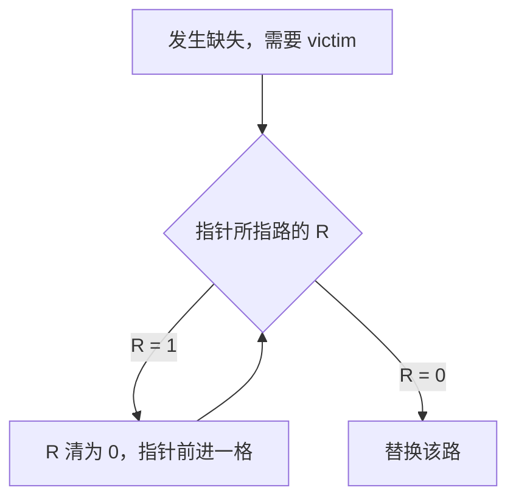

第 2 步“清零后跳过”的含义：这一路刚被访问过，暂时不选它；但如果指针绕回来时它还没再被访问过（$R$ 仍为 0），说明它已经是比较老的数据，就可以被替换。这样，最近被访问的路会被跳过一次，长时间未被访问的路会被选中，逻辑上与 LRU 相近，而硬件只需每路 1 位加一根指针。

> [!example] 例：指针从 A 开始寻找 victim
> 环上依次有 A、B、C、D、E、F、G、H，指针指向 A。A、B、C 的 $R=1$，D 的 $R=0$。
>
> 1. 检查 A：$R=1$，清零，前进。
> 2. 检查 B：$R=1$，清零，前进。
> 3. 检查 C：$R=1$，清零，前进。
> 4. 检查 D：$R=0$，选中 D 为 victim，新块 J 装入 D 原来的位置。
>
> 结束后 A、B、C 变为 unreferenced；新装入的 J 标记为 referenced，指针停在 J 处。

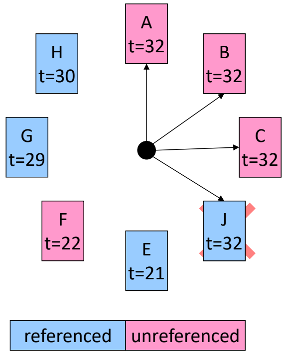

图：页面排成一圈，时钟指针遇到 R=1 的页面就清零并前进，遇到 R=0 的页面就替换；图中指针已扫过 A、B、C，并停在新换入的 J（t=32）处。

> [!warning] 易错点
>
> 指针遇到 $R=1$ 时不是直接跳过，而是**先清零再前进**。如果忘记清零，当所有路的 $R$ 都为 1 时指针会无限循环；正因为会清零，即使所有路都是 1，指针绕一圈后也一定能回到起点并在那里找到 $R=0$ 的路。

> [!question]- 自测：4 路 PLRU 初始全 0，依次访问 A、B、C、D、A，此时缺失，PLRU 和真 LRU 分别替换哪一路？
> PLRU 替换 C，真 LRU 替换 B，两者不同。前四次访问后 $(L0,L1,L2)=(0,0,0)$；再访问 A，路径 L0 → L1 → A，置 $L0=1$、$L1=1$，L2 仍为 0，状态 $(1,1,0)$。找 victim：$L0=1$ 走右到 L2，$L2=0$ 走左，得 C。真 LRU 中各路最后访问顺序为 B、C、D、A，最久未用的是 B。PLRU 的根位只知道“CD 半区比 AB 半区更老”，看不到 B 其实比 C、D 都老。

> [!question]- 自测：一个 2 路组相联缓存的某组中，最近一次访问的是第 1 路。此时该组缺失，LRU、NMRU、NRU 分别替换哪一路？每组需要几位状态？
> 三者都替换第 0 路。2 路时只有两个候选，不是 MRU 的那一路就是 LRU，所以三种策略结论相同。每组只需 1 位记录哪一路是 LRU/MRU，每次访问时置位或清零。

> [!question]- 自测：时钟环上 4 路 W、X、Y、Z 的 $R$ 全为 1，指针指向 W。发生缺失后，哪一路被替换？结束时各路的 $R$ 是多少？
> W 被替换。指针依次把 W、X、Y、Z 的 $R$ 清零并前进，绕一圈回到 W 时 $R=0$，于是替换 W。结束时 X、Y、Z 的 $R=0$；W 装入新块，被标记为 referenced（$R=1$）。这就是“可能需要绕时钟整整一圈”的情况。

---

## 写策略

> [!abstract] 本节要点
>
> - 写策略要回答两个问题：**写命中**时数据写到哪里（写直达 / 写回），**写缺失**时要不要把块调入缓存（写分配 / 不写分配）。
> - 写直达同时写缓存和下一级存储，两者始终一致；下一级很慢，所以写直达总是配一个写缓冲（如 4 项 FIFO）在后台排空，但缓冲写满时 CPU 仍要停顿。
> - 写回只写缓存块，允许缓存与内存暂时不一致；每个块需要一个脏位，块被替换时脏块才写回下一级，干净块直接丢弃。写回看似简单，却让后面的缓存一致性复杂得多。
> - 写分配在写缺失时先从下层读入整行、再把新数据写进这一行，因为一次写（如 8 B）远小于一个缓存行（如 64 B），行里其余字节必须是有效数据。
> - 不写分配在写缺失时绕过缓存，直接写下一级存储，多与写直达搭配。

### 写操作带来的问题

读操作不会改变数据，缓存里的副本和内存里的原件始终相同；写操作则不同，CPU 一旦往缓存里写入新值，缓存和下一级存储（memory）里就出现了两个版本。设计者必须决定新值写到哪一级、什么时候同步，以及写的地址不在缓存里时怎么办。这就是缓存设计的第四个问题——**写策略**（write strategy），排在块放置、块识别与[替换策略](#替换策略)之后。

写策略按"写的地址在不在缓存里"分成两组决策：

| 情形                 | 要决定的事                     | 两种做法                                                 |
| -------------------- | ------------------------------ | -------------------------------------------------------- |
| 写命中（write hit）  | 新值写到哪里、何时同步到下一级 | 写直达（write through） / 写回（write back）             |
| 写缺失（write miss） | 是否把目标块调入缓存           | 写分配（write allocate） / 不写分配（no write allocate） |

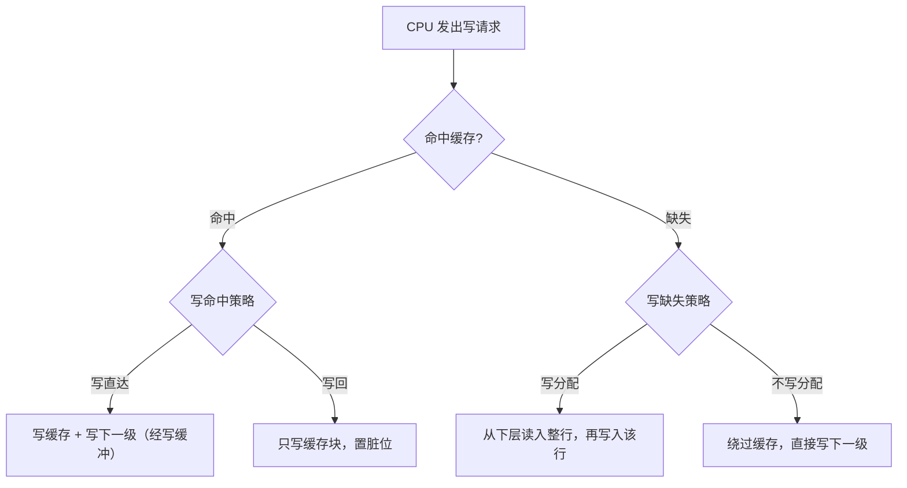

### 写直达与写缓冲（Write Through / Write Buffer）

最直接的保持一致的办法是每次写都把两边一起改。

**写直达**（write through）是指：写命中时，数据**同时写入缓存和下一级存储**，因此缓存与内存始终保持一致（consistent）。

它的核心缺点来自速度差：缓存很快，内存很慢。虽然新值第一时间就写进了缓存，但这次写操作要等内存也写完才算完成，每次写都要付出访问内存的长延迟。

解决办法是在缓存和下一级之间加一个**写缓冲**（write buffer）。写直达总是和写缓冲配合使用，用它来消除写内存的开销。 典型的写缓冲是一个 4 项的 FIFO（$\#\text{entry}=4$）。 它的工作过程是：

1. **CPU 写入**：CPU 写数据时，除了写缓存，只需把这次写放进写缓冲，写缓冲立刻响应，CPU 继续执行后续指令。
2. **后台排空**：在 CPU 没有新的写操作时，写缓冲按 FIFO 顺序把条目逐个写到内存。这一步对 CPU 不可见，是后台操作，从而**掩盖**了写内存的延迟。
3. **缓冲写满**：如果连续的写操作太多，写缓冲被填满，后来的写就没有地方放，写缓冲失去作用，CPU 必须停顿等待它腾出空位——这就是写直达仍然存在的写停顿代价（penalty）。

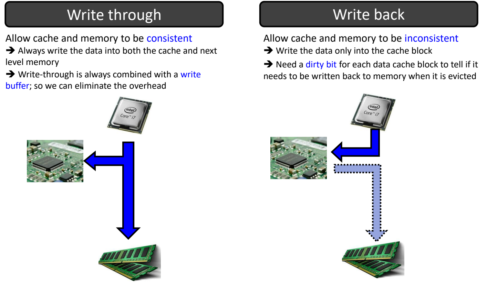

图：写直达时处理器的写同时进入缓存和下一级存储，保持一致；写回时只写缓存块，用 dirty 位标记，等块被替换时才写回内存（虚线箭头）。

> [!warning] 易错点
>
> 写缓冲只是把写内存的时间"挪到后台"，并没有减少写内存的次数。写直达下每一次写最终都会到达下一级存储；写操作的平均速率超过内存能吸收的速率时，再大的写缓冲也会被写满而导致停顿。

写缓冲之外，还有一种把多次小写合并成一次大写的写合并缓冲，属于降低缺失代价的优化，见[写合并缓冲](#降低缺失代价)。

### 写回与脏位（Write Back / Dirty Bit）

如果不想每次写都访问慢速的内存，就只能让内存暂时保留旧值，等到不得不同步时再写。

**写回**（write back）是指：写命中时，数据**只写入缓存块**，不写下一级存储，因此允许缓存与内存暂时不一致（inconsistent）。

既然内存里可能是旧值，块离开缓存时就必须判断要不要把它写回去。为此要给每个数据缓存块（和 tag、有效位一起）再加一个状态位：

**脏位**（dirty bit）：每个数据缓存块一位，记录该块自调入以来是否被 CPU 写过，用来判断它被替换（evicted）时是否需要写回内存。

写回缓存中一个块的生命周期如下：

1. **调入**：块从下一级读入缓存，此时内容与内存相同，脏位清零，称为**干净**（clean）块。
2. **写命中**：CPU 写这个块时只改缓存中的数据，并把脏位置 1，块变成**脏**（dirty）块。之后对它的多次写都只发生在缓存里。
3. **替换**：该块被替换策略选中要腾出位置时检查脏位：
   - 脏块：内存里是过时的数据，必须先把整块写回内存；
   - 干净块：内存里的副本与它相同，直接丢弃即可，不产生写内存流量。

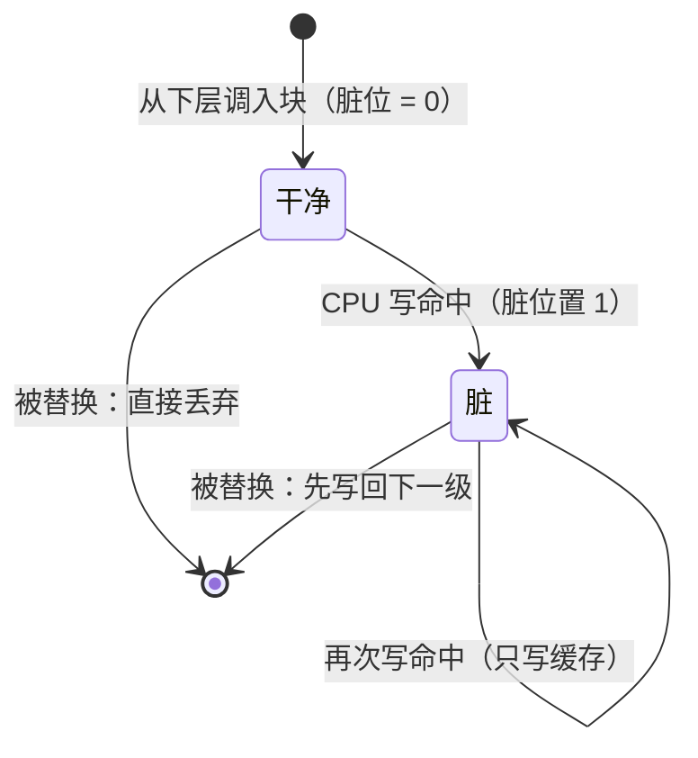

> [!tip] 课堂强调
> 写回看起来比写直达更简单（只写缓存），这是一个假象。写回让缓存与内存允许不一致，这会让后面的许多机制变得相当麻烦，最典型的就是**缓存一致性**（cache coherence），课程会在之后的章节专门讨论。

> [!note] 补充解释
> 写回省流量的原因在于：同一块上的多次写在缓存中合并，最终只在替换时写一次整块；而写直达每次写都要发往下一级。反过来，写回在替换脏块时要先写回再读入新块，单次缺失的处理更长。

### 写分配与不写分配（Write Allocate / No Write Allocate）

写缺失比读缺失多一个麻烦：CPU 每次写的数据远小于一个缓存行。以 RISC-V 64 位处理器为例，一次写最多 8 B（64 bit），而一个缓存行通常是 64 B，相差 8 倍。 如果直接把这 8 B 写进一个新分配的缓存行，行中其余 56 B 就没有有效数据；而缓存行要求整行内容有效，不能留空。

**写分配**（write allocate）是指：写缺失时，先在缓存中为目标块分配一行并从下一级读入整块，再把要写的数据写进这一行。 步骤为：

1. **Step 1 分配并读入**：发生写缺失时，在缓存中分配一个缓存行（cacheline），从 DRAM 把这一整块（如 64 B）读进来，把行填满。
2. **Step 2 写入新数据**：再把处理器要更新的那部分（如 8 B）写进刚分配的缓存行。之后整行数据完整，这次写才算完成。

写分配的代价很明显：一次写缺失要先等一次从内存读整块的操作。于是有了另一种做法。

**不写分配**（no write allocate）是指：写缺失时跳过缓存写入，直接把数据写到下一级存储（directly update the lower level memory），缓存内容不变。 它省去了"先读整块"的过程，处理简单得多。不写分配**多与写直达搭配使用**：写直达本来就要把每次写送往下一级，写缺失时只是省掉写缓存这一半。

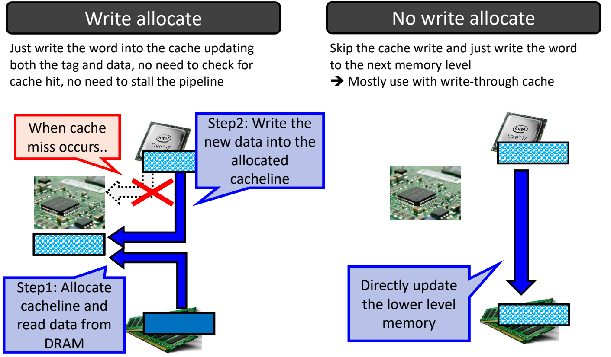

图：写缺失时，写分配先为该行分配缓存并从 DRAM 读入数据（Step1），再把新数据写入该缓存行（Step2）；非写分配跳过缓存，直接更新下一级存储，多与写直达配合。

> [!note] 补充解释
> 讲义写分配一栏的文字"just write the word into the cache updating both the tag and data, no need to check for cache hit, no need to stall the pipeline"出自 Hennessy & Patterson 教材对**每块只有一个字**的写直达缓存的描述：此时写入的字恰好覆盖整块，不需要从下层读入其余数据，直接更新 tag 和数据即可。块大于一次写的宽度时（如 64 B 行、8 B 写），必须按上面的两步先读入整行。

> [!note] 补充解释
> 与"不写分配 + 写直达"相对，另一种常见搭配是写回 + 写分配：写回希望后续对同一块的写都在缓存里完成，所以写缺失时把块调入缓存才有意义。

> [!info] 可视化资源
> [Wikimedia Commons：写回 + 写分配流程图](https://commons.wikimedia.org/wiki/File:Write-back_with_write-allocation.svg)：展示写回结合写分配时读/写命中与缺失的处理路径，包括脏块写回下层、缺失时先读入整块，可对照本节的脏位与写分配。

两组策略的对比：

| 策略     | 适用情形 | 写到哪里             | 需要的额外硬件 / 状态  | 主要代价                             |
| -------- | -------- | -------------------- | ---------------------- | ------------------------------------ |
| 写直达   | 写命中   | 缓存 + 下一级        | 写缓冲（如 4 项 FIFO） | 每次写都产生下层写流量；缓冲满时停顿 |
| 写回     | 写命中   | 只写缓存             | 每块一个脏位           | 替换脏块时要写回；缓存一致性更复杂   |
| 写分配   | 写缺失   | 先读入整行，再写缓存 | —                      | 写缺失要等一次整块读                 |
| 不写分配 | 写缺失   | 绕过缓存写下一级     | —                      | 之后读这块仍会缺失                   |

> [!warning] 易错点
>
> 写直达 / 写回只回答"命中时怎么写"，写分配 / 不写分配只回答"缺失时要不要调块"，二者是两个独立的维度，一个缓存要同时选定两者。不要把"不写分配"和"写直达"当成同一回事：前者只影响缺失，后者影响每一次写命中。

> [!question]- 自测：写回 + 写分配的缓存，某行被调入后 CPU 对它写了 5 次，之后它被替换。这期间对内存产生了多少次写？若换成写直达，又是多少？
> 写回：5 次写都只改缓存并置脏位，替换时因脏位为 1 写回整块一次，共 **1 次**（整块）写内存。写直达：每次写都要写下一级，共 **5 次**写（经写缓冲在后台完成）。若该行调入后从未被写过，写回缓存替换时脏位为 0，直接丢弃，写内存 0 次。

> [!question]- 自测：64 B 缓存行、写分配策略下，CPU 对一个不在缓存中的地址执行 8 B 的 `sd` 指令，为什么不能直接把 8 B 写进新分配的行？
> 因为新行其余 56 B 没有有效数据，而整行被视为有效块，之后对这 56 B 的读会读到错误内容。所以必须先从下层读入整块 64 B（Step 1），再写入这 8 B（Step 2）。只有块大小等于一次写的宽度（每块一个字）时，才可以不读入直接写。

> [!question]- 自测：一个写直达缓存配 4 项 FIFO 写缓冲。程序连续执行一长串 store，速度远快于内存写入速度，会发生什么？改用写回能否缓解？
> 写缓冲很快被 4 个未完成的写填满，之后每个 store 都要等缓冲排出一项才能进入，CPU 停顿，写缓冲失去掩盖延迟的作用。若这些 store 多次写同一批块，写回能缓解：写只改缓存并置脏位，只在替换时整块写回一次，下层写流量大大减少。

---

## 降低缺失代价

> [!abstract] 本节要点
>
> - 缓存优化都以降低 $\text{AMAT} = \text{Hit time} + \text{Miss rate} \times \text{Miss penalty}$ 为目标，分别针对缺失代价、缺失率、命中时间三项；降低缺失代价的四类技术是多级缓存、早启动与关键字优先、写合并、非阻塞缓存。
> - 多级缓存在处理器与主存之间加层（L1–L2 SRAM、L3–L4 eDRAM），在主存与外存之间还可加存储级内存（SCM）；层间内容关系分为包含（需反向无效化）、非包含非排他（NINE，当前 Intel/AMD 主流）、排他（有效容量最大，适合上下层容量相近的场合）。
> - 早启动：所需字一到就交给 CPU 继续执行；关键字优先：先向下层请求缺失的那个字，其余字随后再传。
> - x86 用 MTRR 为地址区间指定 UC/WC/WB/WT/WP 五种内存类型；写合并缓冲只服务 USWC 内存，把分散的写合并成连续块后一次写入下层。
> - 非阻塞缓存把缓存分 bank，用 MSHR（valid、块地址、LD/ST 信息）跟踪多个未完成缺失；对同一块的后续缺失只登记为 pending，数据返回后一并服务。

基本缓存回答了"放在哪、怎么找、怎么换、怎么写"，性能仍取决于平均访存时间（AMAT 的定义与计算见[缓存性能度量](#缓存性能度量)）。缓存优化就按 AMAT 的结构来组织：

$$
\text{AMAT} = \text{Hit time} + \text{Miss rate} \times \text{Miss penalty}
$$

三项各对应一类优化目标：

1. **降低缺失代价**（Miss Penalty ↓）：本节内容，包括多级缓存、关键字优先与早启动、写合并、非阻塞缓存四种技术。
2. **降低缺失率**（Miss Rate ↓）与 **降低命中时间**（Hit Time ↓）：在 L08 讲。

### 多级缓存（Multi-level Caches）

一次主存访问折合上百到上千个处理器周期（见[内存墙](#内存墙与存储技术)），只靠一级缓存无法同时做到"足够快"和"足够大"。**多级缓存**（multi-level caches）的核心思想是：在 CPU 与主存之间再增加一级（或多级）存储层次来填补这一差距。

- **过去**：处理器 → L1\$ → L2\$ → 主存 → 外存。
- **现在**：L1–L2 用 SRAM；其下再加 L3–L4，其中 L4 可用 **eDRAM**（embedded DRAM，嵌入式 DRAM）实现；在主存与外存之间还插入了 **存储级内存**（Storage-Class Memory，SCM）。

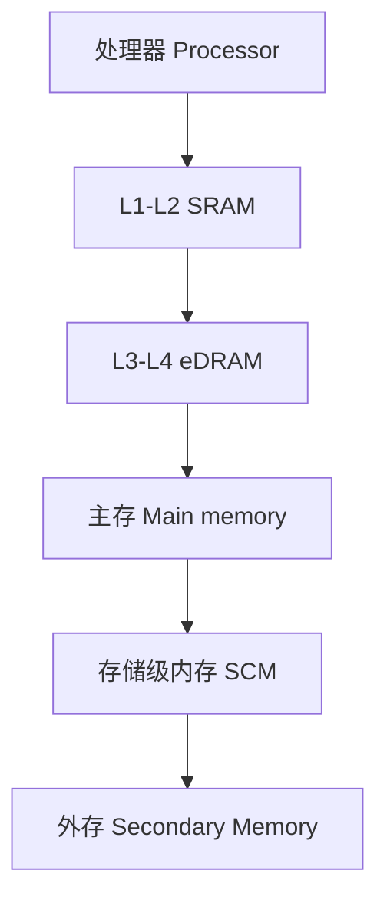

**eDRAM 作 L4**：SRAM 单元面积大、代价高，继续用它做更大的 L4 不划算，于是改用 eDRAM。它可以理解为尺寸更小的 DRAM，并与 CPU 芯片并排紧贴封装，因而访问比普通 DRAM 主存更快。

**存储级内存**：把存储介质改造成内存一样的使用形态，提供接近内存的性能，作为主存与外存之间的新一层。最典型的例子是 Intel 的 3D XPoint，商品名 Optane（傲腾）。

> [!tip] 课堂强调
> 带 eDRAM L4 的 CPU 大约出现在七八年前的笔记本中，现在已不再使用，原因是成本太高而性能提升不大；但这种"在 CPU 旁边贴一块 DRAM"的思路启发了苹果在 CPU 旁封装 DRAM 的设计。Optane 产品线也已停止，但作为在主存与外存之间加层的设计具有开创性。

> [!note] 补充解释
> 有了多级缓存，L1 的"缺失代价"本身就变成了"访问 L2 的平均时间"。以两级为例，把 AMAT 公式递归展开：
> $$
> \text{AMAT} = T_{\rm hit,L1} + MR_{\rm L1} \times \left( T_{\rm hit,L2} + MR_{\rm L2} \times MP_{\rm L2} \right)
> $$
> 其中 $T_{\rm hit,Li}$ 是第 $i$ 级命中时间，$MR_{\rm Li}$ 是第 $i$ 级的局部缺失率（在到达该级的访问中缺失的比例），$MP_{\rm L2}$ 是 L2 缺失后访问主存的代价。L2 把大部分 L1 缺失挡在主存之前，因此能大幅降低 L1 的有效缺失代价。

### 缓存层次的包含关系

有了多级缓存，就出现一个以前没有讨论过的问题：上层缓存中的数据，下层缓存里是否也一定有？按上层块是否同时存在于下层，层次分为三类。

**包含层次**（inclusive hierarchy）：上层的块**一定**存在于下层，即上层内容是下层内容的子集。

1. **填充**：访问的数据在上下两层都不存在时，从主存取回后同时填入上层（Upper）和下层（Lower）。
2. **上层替换**：上层驱逐一个块，它在下层仍有副本，不影响包含性。
3. **下层替换**：下层驱逐一个块（victim）时，必须通知上层把同一块也作废，否则上层会持有下层没有的块。这一操作称为 **反向无效化**（back-invalidation）。

**非包含层次**（non-inclusive hierarchy）：下层**可能**包含上层的块，但不作保证，也称 **非包含非排他**（Non-Inclusive Non-Exclusive，NINE）。填充时仍同时填入上下两层，所以多数情况下表现与包含层次相同；区别在于下层驱逐一个块时**不需要**反向无效化，上层可以继续保留它。好处是省去了不必要的驱逐操作。

**排他层次**（exclusive hierarchy）：上层的块**一定不**存在于下层，一个块要么在上层、要么在下层，不会同时在两层。

1. **填充**：从主存取回的块只填入上层。
2. **上层替换**：上层的 victim 被填入下层。
3. **下层替换**：下层放不下时再把 victim 驱逐到更下一层。

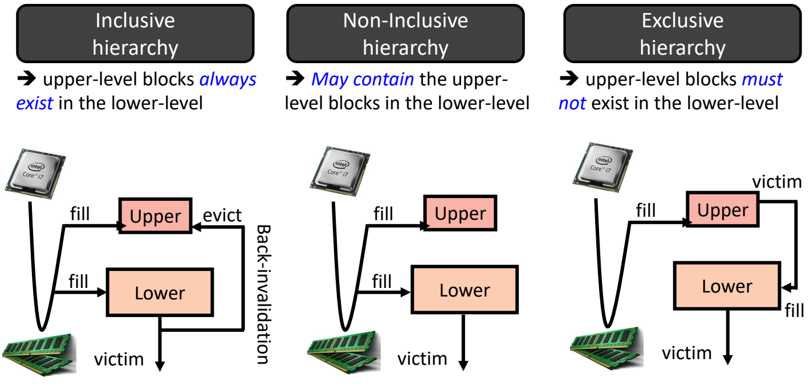

图：包含式层次中上层块必在下层，下层驱逐时需反向失效上层；非包含式下层可能含上层块；互斥式上层块不在下层，上层的牺牲块填入下层。

| 层次类型       | 上层块是否在下层 | 主存数据填入 | 下层驱逐时             | 有效容量       |
| -------------- | ---------------- | ------------ | ---------------------- | -------------- |
| 包含 inclusive | 一定在           | 上下两层     | 需反向无效化上层副本   | 约为下层容量   |
| 非包含 NINE    | 可能在           | 上下两层     | 上层副本可保留         | 介于两者之间   |
| 排他 exclusive | 一定不在         | 只填上层     | 上层 victim 才进入下层 | 上下层容量之和 |

**有效容量**：包含与非包含层次中，同一数据可能在上下两层各存一份，实际可用容量较低；排他层次每个块只存一份，有效容量在三者中最高。这一优势的大小取决于上下层容量之比：

- L1 与 L3 的容量可能相差约 1000 倍，即使合并两者的容量，L1 也只贡献约 $0.1\%$，意义不大；
- 若上下层容量只差 1–2 倍乃至 3–4 倍，合并容量的收益就很明显。典型例子是 DRAM 与 Optane 组成两级，Optane 容量只比 DRAM 大约 4–5 倍；此时包含或非包含层次在 DRAM 中重复占用的空间太大，应采用排他层次以获得最大容量。

> [!info] 可视化资源
> [Wikipedia：Cache inclusion policy](https://en.wikipedia.org/wiki/Cache_inclusion_policy)：用 L1/L2 两级例子分别图示包含（含反向无效化）、排他（L2 作牺牲缓存）与 NINE 策略的填充与驱逐过程，并比较其优缺点。

> [!tip] 课堂强调
> 包含层次因为需要反向无效化，操作麻烦，只在早期 Intel 处理器中使用，现在的 Intel 处理器基本不用；当前大部分 Intel 和 AMD 处理器采用非包含非排他（NINE）层次。排他层次适用于上下层容量相差不大的场合，这一点需要注意。

> [!warning] 易错点
>
> "非包含"不等于"排他"。非包含（NINE）只是**不保证**上层块在下层，平时填充依然两层都放；排他则**保证**两层没有重复。判断方法：看主存数据回来时是否同时填两层，以及下层驱逐时是否要处理上层副本。

### 早启动与关键字优先

缓存按块传输，一块通常 8–32 字节（下层到 L1）甚至 64 字节，而处理器一次只需要一个 4–8 字节的字。若等整块装完才让 CPU 继续，CPU 就白等了块内其余字的传输时间。核心思想：**不要等整块装入再重启 CPU，CPU 只需要那一个字**。

设一块有 4 个字（例如 32 B），编号 0–3，CPU 缺失的是字 2（**关键字**，critical word）：

- **早启动**（early restart）：块仍按顺序 0 → 1 → 2 → 3 传输，但所需的字一到达（这里是传完字 0、1 后到达的字 2）就立即送给 CPU，让 CPU 继续执行，剩余的字 3 在后台继续传完。
- **关键字优先**（critical word first）：更进一步，先向下层请求缺失的那个字，它一到就送给 CPU；即先传字 2，CPU 随即恢复执行，再传其余的字（3、0、1）。这样数据传输与处理器执行正好重叠。

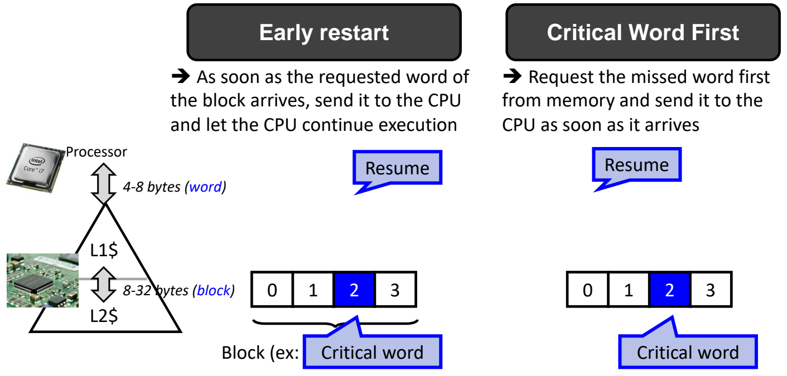

图：块由 0 到 3 四个字组成，CPU 需要的是字 2；提前重启在字 2 按序到达时就让 CPU 继续执行，关键字优先则先从存储器取字 2 并立即送给 CPU。

> [!warning] 易错点
>
> 两者的区别在于**传输顺序**：早启动不改变块内传输顺序，只提前"放行" CPU；关键字优先改变顺序，让关键字第一个到。若关键字恰好是字 0，两者效果相同；关键字越靠后，关键字优先的收益越大。

### 写合并（Combining Writes）

#### 背景：x86 的 MTRR 内存类型

x86 用 **MTRR**（Memory Type Range Register，内存类型范围寄存器）指定 CPU 对各段地址范围的访问如何被缓存；在 Linux 中可以用 `cat /proc/mtrr` 查看各地址段的类型。x86 共有 5 种内存类型：

| 内存类型                                              | 含义                                               |
| ----------------------------------------------------- | -------------------------------------------------- |
| UnCacheable（UC）                                     | 绕过整个缓存子系统，数据直接写到内存               |
| UnCacheable Speculative Write-combining（USWC 或 WC） | 绕过缓存，但会经过写合并缓冲（WCB）                |
| WriteBack（WB）                                       | 只把数据写入缓存块（[写回](#写策略)）              |
| Write-Through（WT）                                   | 总是同时写缓存和下一级存储（[写直达](#写策略)）    |
| Write-Protected（WP）                                 | 讲义写作 "Supervisor-mode access only"，见下方更正 |

```bash
cat /proc/mtrr
```

> [!warning] 易错点
>
> 讲义把 WP 解释为"仅限特权态（supervisor mode）访问"，这一说法不准确。按 Intel SDM，WP（写保护）类型下**读**照常从缓存行读取、读缺失照常填充缓存；**写**则直接送到系统总线，并使所有处理器中对应的缓存行失效。它描述的是缓存行为，而不是特权级别。 参见 [Intel® 64 and IA-32 Architectures Software Developer's Manuals](https://www.intel.com/content/www/us/en/developer/articles/technical/intel-sdm.html) 第 3A 卷"Memory Cache Control"一章。

#### 写合并缓冲（Write Combining Buffer）

UC 内存的每次写都单独访问下层存储，代价很大。**写合并缓冲**（Write Combining Buffer，WCB）的核心思想是：在总线事务或缓存一致性事务这类耗时很长的操作**之前或期间**，先把多次写合并（coalescing）起来。

- 只用于 **USWC**（Uncacheable Speculative Write-Combining）内存。
- 使用 USWC 类型的显式方法是非临时（non-temporal）访存指令：非临时 load `movntdqa` 和非临时 store `movntdq`（讲义误写为 `moventdq`）。

工作过程（对照下图）：

1. 处理器按任意顺序写出 `Mem[100]`、`Mem[400]`、`Mem[108]`、`Mem[900]`、`Mem[116]`、`Mem[124]`，这些写先进入 WC buffer，而不是逐个访问下层。
2. WC buffer 按地址归并：`Mem[100]`、`Mem[108]`、`Mem[116]`、`Mem[124]` 属于同一段连续地址，被放进同一行；`Mem[400]`、`Mem[900]` 各占另一行。
3. 当一行的连续地址都被写满时（图中 `Mem[124]` 是最后一个到达的），这一串连续数据作为一次传输写到下层存储。

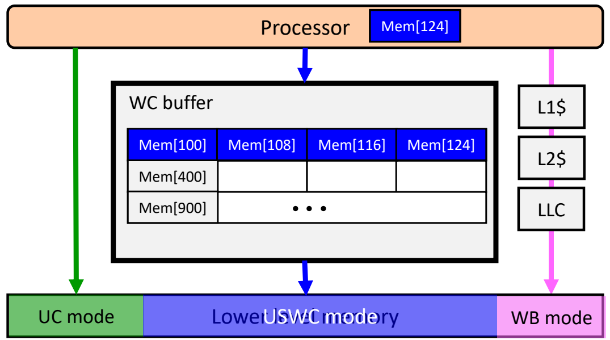

图：USWC 模式下处理器的写先进入 WC buffer，把 Mem[100]、Mem[108]、Mem[116]、Mem[124] 合并成一整行后再一次写往下层存储；UC 模式直接写，WB 模式经 L1$、L2$、LLC。

图中同时画出三条路径：UC 模式直接从处理器写到下层存储；USWC 模式经过 WC buffer；WB 模式经过 L1\$、L2\$、LLC。写合并的好处是减少对内存的频繁访问、降低写延迟，这正是它能降低缺失代价的原因。

> [!note] 补充解释
> 非临时（non-temporal）指令向硬件提示这些数据近期不会再被使用，因此不值得占用缓存；典型用途是向显存帧缓冲或大块输出缓冲区流式写入。写合并缓冲与[写缓冲](#写策略)的区别在于：写缓冲只是让写在后台排队完成，写合并缓冲还会把落在同一段地址内的多次小写拼成一次大写。

### 非阻塞缓存与 MSHR

**问题**：在基本的 RISC-V 流水线中，一次缓存缺失会让流水线停顿（stall）多个周期，后续指令全部等待，直到缺失的数据返回。 乱序执行（见 L05）中，load/store 指令放在一个队列（buffer）里，只要队列不满就能继续塞入新的 load/store，处理器层面可以并发处理多条访存指令；但如果缓存一次只能处理一条请求、做完才处理下一条，一个缺失就会挡住后面所有访存。底层缓存必须也能同时处理多条访存请求。

**非阻塞缓存**（non-blocking cache）是允许在一个缺失尚未完成时继续服务其他访问的缓存。其核心思想是：通过跟踪缓存缺失以及指向该缓存块的待处理 load/store，允许同时存在多个 **未完成缺失**（outstanding miss）。

硬件组织：

1. **分 bank**：把缓存（L1\$、L2\$、LLC 都可以）分成多个 **缓存体**（cache bank），每个 bank 能独立服务请求。
2. **缺失处理结构**：每个 bank 配一个 MSHR File，所有 MSHR File 合称 **缺失处理结构**（Miss Handling Architecture，MHA）。
3. **MSHR 条目**：**缺失状态保持寄存器**（Miss Status Holding Register，MSHR）的每个条目 MSHR1 … MSHRN 记录三项信息：
   - `Valid`：该条目是否有效；
   - `Block addr`：缺失的块地址；
   - `LD/ST info`：等待该块的请求是 load 还是 store 及其相关信息。
4. **比较器**（Comparators）：新请求的地址与所有有效条目的 `Block addr` 并行比较，输出是否"命中"某个已有的 MSHR 条目。

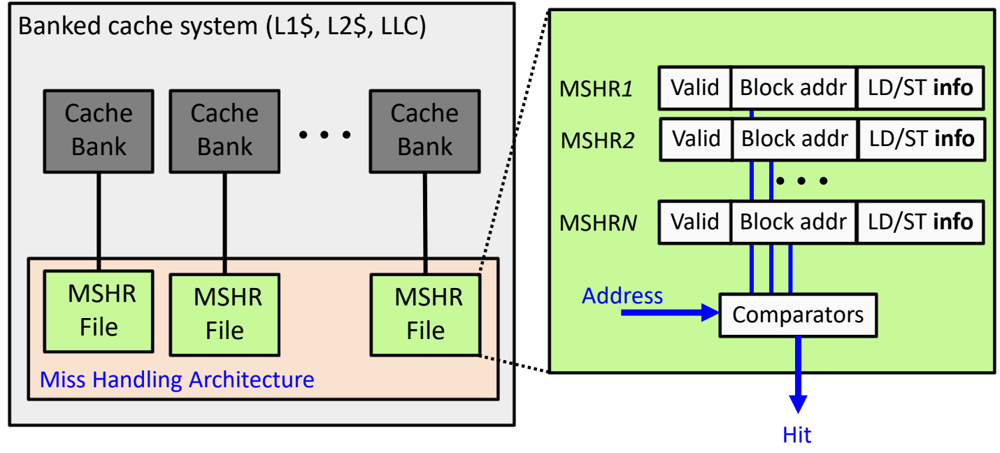

图：分体缓存的每个 Cache Bank 配一个 MSHR File，每个 MSHR 记录 Valid、块地址和 LD/ST 信息，请求地址送入比较器与各 MSHR 的块地址比较并给出 Hit。

请求的处理流程：

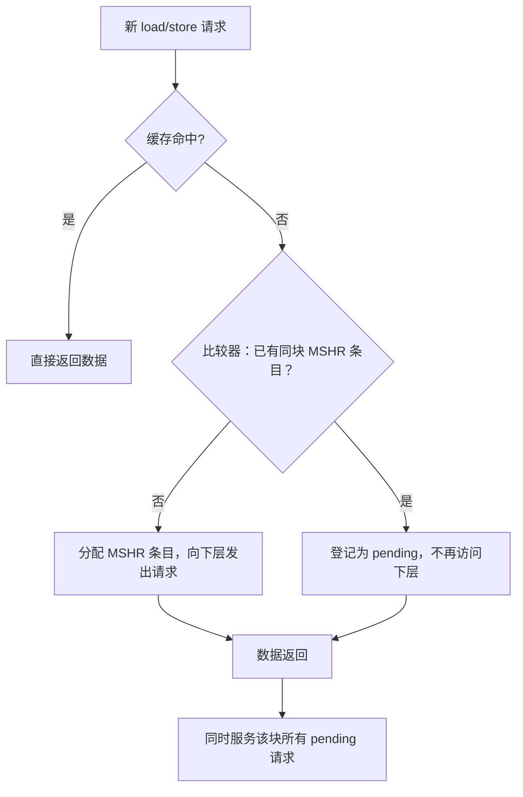

关键在于对**同一块**的多次缺失：第一条访问该块的请求真正去访问下层；之后访问同一块的请求不再重复发出，而是在 MSHR 中记为 pending；第一条请求的数据回来后，同时服务所有 pending 的请求。

> [!tip] 课堂强调
> MSHR 的两个作用：一是记录每个未完成的缺失，使多条访存可以同时进行；二是记录哪些请求在等待同一块，后来的请求先与已有条目比较，若已有请求在访问该块就挂起，等结果回来一起服务。

> [!warning] 易错点
>
> 非阻塞缓存不会让单次缺失的延迟变短，它缩短的是**缺失期间处理器的停顿**：缺失与其他命中、其他缺失重叠进行，并且同一块的重复缺失只付一次下层访问的代价。

> [!question]- 自测：DRAM 128 GB 与 Optane 512 GB 组成两级存储，采用包含层次与排他层次时，可用的有效总容量分别约为多少？应选哪种？
> 包含层次中 DRAM 的内容在 Optane 里都有副本，有效容量约为 512 GB；排他层次两级不重复，有效容量为 $128 + 512 = 640$ GB，多出 25%。两层容量只差 4 倍，重复占用代价大，应选排他层次。

> [!question]- 自测：一块 4 个字，每个字从 L2 传到 L1 需 1 个时间单位，CPU 缺失的是字 3。分别采用早启动与关键字优先时，CPU 最早在第几个时间单位后恢复执行？
> 早启动仍按 0、1、2、3 顺序传，字 3 第 4 个到，CPU 在 4 个单位后恢复；关键字优先先传字 3，1 个单位后即可恢复，其余 3 个字在 CPU 执行期间继续传完。

> [!question]- 自测：非阻塞缓存中依次到来 4 条缺失请求：load A、store A+8、load B、load A+16，其中 A、A+8、A+16 在同一块，B 在另一块。需要占用几个 MSHR 条目，向下层发出几次请求？
> 2 个条目、2 次请求。load A 分配条目并发请求；store A+8 和 load A+16 经比较器发现同块已有条目，只登记为 pending；load B 地址不匹配，分配第二个条目并发请求。块 A 返回时一次服务 3 条请求。

---

## 本讲小结

### 概念脉络

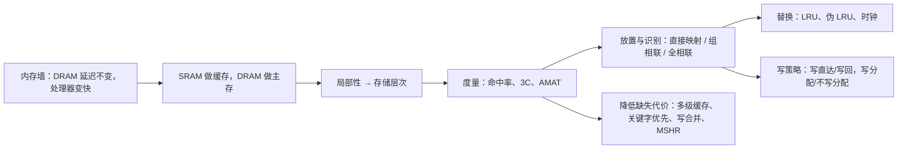

局部性解释了为什么小而快的上层能挡住大部分访问（[局部性与存储层次](#局部性与存储层次)）；AMAT 和 3C 把“挡得好不好”变成可计算、可归因的量（[缓存性能度量](#缓存性能度量)）。后面每一项设计都可以对照这两把尺子来看：提高相联度针对冲突缺失，替换策略决定满组时逐出谁，写策略影响写停顿与下层流量，第 8 章的技术则直接压缩 AMAT 中的缺失代价项。

### 设计决策一览

| 设计问题           | 可选方案                                               | 关键取舍                                                                | 详见                                                             |
| ------------------ | ------------------------------------------------------ | ----------------------------------------------------------------------- | ---------------------------------------------------------------- |
| 块放在哪、怎么找   | 直接映射 / $n$ 路组相联 / 全相联                       | 相联度越高冲突缺失越少，但比较器、选路延迟与面积越大；1 路→2 路收益最大 | [直接映射缓存](#直接映射缓存)、[组相联与全相联](#组相联与全相联) |
| 块多大             | 单字块 / 多字块（常见 64 B）                           | 块大利用空间局部性，过大则块数太少、缺失率回升                          | [直接映射缓存](#直接映射缓存)                                    |
| 缺失时替换谁       | Static / Random / FIFO / LRU / NRU / 树形伪 LRU / 时钟 | 真 LRU 超过 2 路难以在一个周期内实现，伪 LRU 用 $N-1$ 位近似            | [替换策略](#替换策略)                                            |
| 写命中怎么写       | 写直达 + 写缓冲 / 写回 + 脏位                          | 写直达始终一致但写流量大；写回省流量但使缓存一致性更复杂                | [写策略](#写策略)                                                |
| 写缺失要不要调块   | 写分配 / 不写分配                                      | 一次写远小于缓存行，写分配须先读入整行；不写分配多配写直达              | [写策略](#写策略)                                                |
| 多级层次的内容关系 | 包含 / 非包含非排他 / 排他                             | 包含需反向无效化；排他有效容量最大，适合上下层容量相近                  | [降低缺失代价](#降低缺失代价)                                    |

### 核心公式

| 公式                                                                                                                  | 含义                                                         | 详见                                                         |
| --------------------------------------------------------------------------------------------------------------------- | ------------------------------------------------------------ | ------------------------------------------------------------ |
| $N_{\rm DRAM} = t_{\rm DRAM} \times f_{\rm clk}$                                                                      | 固定纳秒延迟折合的周期数随频率增长                           | [内存墙与存储技术](#内存墙与存储技术)                        |
| $\text{Miss rate} = 1 - \text{Hit rate}$                                                                              | 缺失率与命中率互补                                           | [缓存性能度量](#缓存性能度量)                                |
| $\text{CPU time} = IC \times (CPI_{ideal} + \text{Cycles}_{memory\text{-}stall}) \times T_{clk}$                      | 把存储停顿计入 CPI，括号内为 $CPI_{stall}$                   | [缓存性能度量](#缓存性能度量)                                |
| $\text{Cycles}_{memory\text{-}stall} = 1 \times MR_{I\$} \times P_{miss} + f_{LD/ST} \times MR_{D\$} \times P_{miss}$ | 每条指令的平均停顿周期（I\$ 每条指令一次，D\$ 只算访存指令） | [缓存性能度量](#缓存性能度量)                                |
| $AMAT = \text{Hit time} + \text{Miss rate} \times \text{Miss penalty}$                                                | 平均存储访问时间，也是优化框架                               | [缓存性能度量](#缓存性能度量)、[降低缺失代价](#降低缺失代价) |
| $\text{index} = \text{块地址} \bmod \text{缓存块数}$                                                                  | 直接映射的唯一位置                                           | [直接映射缓存](#直接映射缓存)                                |
| $\#\text{sets} = B / n$，$\text{tag} = A - \log_2 \#\text{sets} - \text{offset}$                                      | 容量固定时相联度翻倍，index 少 1 位、tag 多 1 位             | [组相联与全相联](#组相联与全相联)                            |
