大模型推理每生成一个 token 都要把全部模型参数和 KV 缓存从存储器读一遍，因此真正的瓶颈往往是访存带宽而不是算力。本讲先沿模型演进（Transformer、解码器大模型、Scaling Law、MoE、思维链与 Agent）推导出“存储容量 = KV 缓存 + 参数”“访存带宽 = 存储容量 × Tokens/s”，再解剖 DeepSeek-V4.1-Flash 与 Kimi-K3 两个先进架构；随后用带宽公式定位瓶颈，依次讲解并行（推测）解码、MoE 推理和稀疏注意力三条算法路径，最后转到思维树推理的系统优化，以及近存/存内计算、3D DRAM、HBF 等体系结构方案。阅读前需要了解矩阵乘法与 Transformer 的基本结构，以及 L06 的存储层次与内存墙；3D DRAM 部分会用到 L08 的 DRAM 刷新知识。

---

## 大模型演进与访存需求

> [!abstract] 本节要点
>
> - Transformer 由多头注意力和前馈网络（FFN）堆叠而成；注意力对每个 token 计算 $Q$、$K$、$V$，用 $QK^{\top}$ 衡量 token 间相关性，再对 $V$ 加权求和。
> - 解码器大模型自回归地逐 token 生成：新 token 的 $Q$ 要与之前所有 token 的 $K$、$V$ 计算，所以必须保存 **KV 缓存**；而且每生成一个 token，都要把全部模型参数和全部 KV 缓存从存储搬到计算单元。
> - 存储容量 $=$ KV 缓存 $+$ 模型参数量；访存带宽 $=$ 存储容量 $\times$ Tokens/s。批处理时参数被所有请求共享，KV 缓存则按请求分别存储、分别加载。
> - Scaling Law 推动参数量与计算量指数增长，但硬件算力约 $3.0\times$/2 年，DRAM 带宽只有约 $1.6\times$/2 年，模型规模与硬件存储之间的差距形成内存墙。
> - MoE 用稀疏激活解耦参数量与计算量（总参数↑、激活参数↓，存储容量↑、带宽"？"）；思维链、Agent（ReAct 循环、重复 prefill–decode）和 1M 级上下文使 KV 缓存急剧膨胀，进而推动稀疏注意力和线性注意力。

自 2022 年 ChatGPT 发布以来，大模型深刻改变了智能体、智能助手、代码与生产力工具等领域，但它的计算特性使高效部署面临巨大挑战。 本讲关注的是模型训练完成之后的**推理与部署**阶段，而推理的主要难点不在"算得不够快"，而在"数据搬得不够快"。本节沿着 2017 年至 2025 年的模型演进，逐步说明每一步架构变化如何改变**存储容量**和**访存带宽**这两项需求，最终把推理瓶颈推到了内存上。

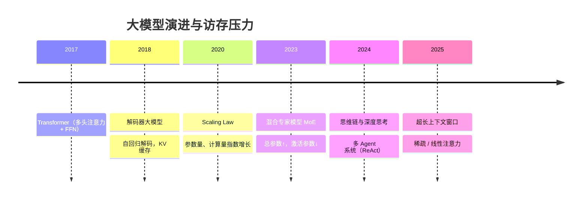

### Transformer 与多头注意力（Multi-Head Attention）

2017 年以前，文本、语音、图像分别由循环网络、卷积网络等不同结构处理。Transformer 出现后取代了卷积和循环网络，用同一种结构统一了文字、语音、视觉等多模态的表征学习，当前大模型的主干网络基本都由 Transformer 模块堆叠而成。

**Transformer** 最初是编码器–解码器（encoder–decoder）结构：编码器处理全部输入，解码器逐个产生输出。每个 Transformer 模块包含两个核心部分：

1. **多头注意力（Multi-Head Attention）**：对每个输入 token 分别计算查询 $Q$（query）、键 $K$（key）和值 $V$（value）三个向量。用 $Q$ 与其他 token 的 $K$ 做点积（即 $QK^{\top}$），得到 token 之间的相关性；再按相关性对各 token 的 $V$ 加权求和，得到该 token 的输出。"多头"指把这一计算分成多组并行做，因为一个 token 与另一个 token 的关系在不同层面上可能不同，每个头可以刻画一种关系。
2. **前馈网络（Feed-Forward Network, FFN）**：也叫 MLP，对每个 token 单独做两层全连接变换。模型参数的绝大部分集中在 FFN 中，这一点是后面 MoE 的出发点。

> [!info] 可视化资源
> [Transformer Explainer：GPT-2 交互式可视化](https://poloclub.github.io/transformer-explainer/)：在浏览器中实时运行 GPT-2，可逐步查看 token 嵌入、$Q$/$K$/$V$ 的计算、带掩码的多头注意力和 MLP，并悬停查看注意力权重。

> [!note] 补充解释
> 注意力的标准写法是 $\mathrm{Attention}(Q,K,V)=\mathrm{softmax}\!\left(\frac{QK^{\top}}{\sqrt{d_k}}\right)V$，其中 $d_k$ 是 $K$ 向量的维度，除以 $\sqrt{d_k}$ 是为了让点积的数值范围稳定。课程只用到"$QK^{\top}$ 求相关性、再对 $V$ 加权"这一层含义。原始论文见 [Attention Is All You Need](https://arxiv.org/abs/1706.03762)。

### 自回归解码与 KV 缓存（KV Cache）

2018 年起出现了只保留解码器的**解码器大模型**（decoder-only），GPT 系列就属于这一类。它的生成方式决定了推理时必须反复访问大量数据。

**自回归解码**（autoregressive decoding）是指模型逐个生成输出令牌（token）：用户输入提示词后，模型产生第一个输出 token；这个 token 在下一时刻作为输入，再产生下一个 token，如此循环直到生成结束。

自回归解码给推理带来两个重要后果：

1. **必须保存 KV 缓存**：生成新 token 时，注意力要计算 $QK^{\top}$，即当前 token 的 $Q$ 要与之前**所有** token 的 $K$ 求相关性，再与之前所有 token 的 $V$ 加权求和。也就是说，每个 token 的生成都依赖之前全部 token。之前 token 的 $K$、$V$ 在后续每一步都会再次用到，如果每次都重新计算就会大量重复，所以把它们存下来，这就是**KV 缓存**（KV cache）。生成的 token 越多，KV 缓存越大。
2. **每个 token 都要加载全部参数与 KV 缓存**：每生成一个输出 token，都要把全部模型参数和全部 KV 缓存从存储器加载到计算单元，每一步都要重复这次加载。

> [!note] 补充解释
> 只缓存 $K$、$V$ 而不缓存 $Q$，是因为旧 token 的 $Q$ 只在生成它那一步使用过一次，后续 token 只需要用自己的新 $Q$ 去查询旧 token 的 $K$、$V$。KV 缓存的具体大小由序列长度、层数、头数和头维度决定，压缩它的各种方法见[KV 缓存的三个维度与压缩方法](#混合专家与稀疏注意力)。

> [!info] 可视化资源
> [Hugging Face：KV 缓存原理详解](https://huggingface.co/blog/kv-cache)：用自回归示意图、注意力矩阵对比图和 prefill/decode 流程图说明为什么要缓存每层的 $K$、$V$、每步只计算新 token，以及它以内存换计算的代价。

#### 存储容量与访存带宽公式

由上面两条后果可以得到单个请求推理时的两个需求：

$$
\text{存储容量} = \text{KV 缓存} + \text{模型参数量}
$$

$$
\text{访存带宽} = \text{存储容量} \times \text{Tokens/s}
$$

第一个式子说明需要存放的数据包括模型参数和 KV 缓存；第二个式子说明，每生成一个 token 都要把这些数据完整读一遍，所以每秒需要的访存量等于存储容量乘以每秒生成的 token 数。存储容量的单位是字节（如 GB），Tokens/s 是生成速度，带宽单位是 GB/s。

**批处理**（batching）时情况会变化（以下批处理公式依据讲解整理，讲义未单独列出）。实际部署中，一台机器不会每次只计算一个用户的请求，而是把多个请求组成一批（batch）一起计算。同一批里的请求共享同一份模型参数，但每个请求有自己的上下文，因此各自拥有一份 KV 缓存。记批大小为 $B$，单个请求的 KV 缓存为 $M_{\rm KV}$，模型参数量为 $M_{\rm param}$（单位均为字节）：

$$
\text{存储容量} = B \times M_{\rm KV} + M_{\rm param}
$$

每做一步解码，模型参数只需加载一次，就能被批内 $B$ 个请求共用；KV 缓存则要按请求分别加载，一共 $B$ 份。设每秒解码步数为 $\text{ITERs/s}$（每步为批内每个请求各生成 1 个 token），则

$$
\text{访存带宽} = (B \times M_{\rm KV} + M_{\rm param}) \times \text{ITERs/s}
$$

所以批处理能摊薄参数的访存开销，却不能摊薄 KV 缓存的访存开销。

> [!example] 例：参数与 KV 缓存的访存量（数值为说明用的假设）
> 设模型有 70 亿参数（Llama-7b 量级），每个参数 2 字节，则 $M_{\rm param}=14$ GB；设每个请求当前的 KV 缓存 $M_{\rm KV}=1$ GB。
>
> 1. **单请求、20 tokens/s**：存储容量 $=14+1=15$ GB，访存带宽 $=15\ \text{GB}\times 20/\text{s}=300$ GB/s。
> 2. **批大小 $B=8$**：存储容量 $=8\times1+14=22$ GB。每步解码加载 22 GB，同时为 8 个请求各产生 1 个 token，平均每个 token 约 $22/8=2.75$ GB，远小于单请求时的 15 GB。
> 3. 被摊薄的只是参数这 14 GB；KV 缓存仍是每个请求 1 GB。上下文越长，$M_{\rm KV}$ 越大，批处理的收益越小。

> [!warning] 易错点
> "批处理能缓解访存瓶颈"只对模型参数成立。KV 缓存随请求数 $B$ 线性增加，也要随每一步解码分别加载；长上下文场景下 KV 缓存成为主体，批处理基本不能降低它带来的带宽压力。

### Scaling Law 与内存墙

2020 年前后，OpenAI 的研究（讲者将其归于 GPT-3 相关工作）总结出**尺寸定律**（Scaling Law）：对解码器大模型而言，模型参数量越大、训练计算量越大、训练数据量越多，模型能力就越强。也就是说，模型能力在一定程度上随参数量、训练计算量和训练数据量的增长而提高。此后业界沿着"堆数据、堆算力、扩大模型"的路线发展，到 2022 年底出现了 ChatGPT。

Scaling Law 带来的直接后果是：大模型规模呈指数级增长，计算需求和存储/访存需求也随之指数级提升，存储容量↑、访存带宽↑。

问题在于硬件跟不上。讲义两张统计图（"AI and Memory Wall" 与峰值算力/带宽缩放图）给出的增长速度如下：

| 指标                           | 增长速度                                       |
| ------------------------------ | ---------------------------------------------- |
| Transformer 模型规模（参数量） | 约 $410\times$ / 2 年                          |
| AI 硬件存储容量（单卡显存）    | 约 $2\times$ / 2 年                            |
| 硬件峰值算力（HW FLOPS）       | $60000\times$ / 20 年（约 $3.0\times$ / 2 年） |
| DRAM 带宽                      | $100\times$ / 20 年（约 $1.6\times$ / 2 年）   |
| 互连带宽（Interconnect BW）    | $30\times$ / 20 年（约 $1.4\times$ / 2 年）    |

从表中可以读出两层差距：

1. **模型规模 vs. 存储容量**：模型参数每两年增长约 410 倍，单卡显存每两年只翻一倍，模型越来越难以放进单卡存储。
2. **算力 vs. 带宽**：算力增长速度远快于存储容量增长、访存带宽增长和通信带宽增长。即使计算单元足够快，数据也送不过来。

这种差距就是大模型推理面临的**内存墙**（memory wall），也就是访存瓶颈。内存墙的一般概念见 L06《01 内存墙与存储技术》，这里是它在大模型上的具体体现。

### 混合专家模型（Mixture of Experts, MoE）

按 Scaling Law 扩大模型时，参数量每增加一点，训练和推理的计算量也会相应增加，计算开销很快变得难以承受。混合专家模型的目的就是让参数量增加时计算量不跟着同比例增加。MoE 的概念出现得更早，但 2023–2024 年才在大模型中被大规模使用。

**混合专家模型**是把 Transformer 中的一个大 FFN 拆成多个较小的"专家"（expert），每个 token 只激活其中一部分专家的模型结构。它通过不同粒度的稀疏激活机制，解耦大模型参数量和计算量的增长。 这一设计借鉴了大脑分区的思路：人做某项特定任务时，并不会同时调动所有脑区。

MoE 层的计算过程：

1. **路由**：token 的表示先送入路由器（Router），由它从全部专家中选出一个子集，例如从 8 个专家中选 2 个。
2. **专家计算**：只有被选中的专家（激活专家）对该 token 做 FFN 计算，其余专家不参与。
3. **聚合**：各被选专家的输出乘以路由器给出的权重后相加，作为该层的输出。

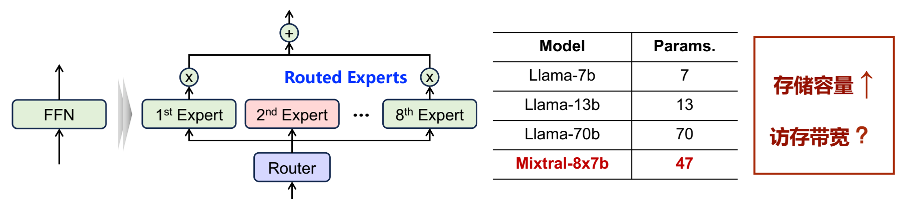

图：左边是把单个 FFN 换成由 Router 选择的 8 个 Routed Experts，加权后求和；中间的表比较参数量（单位：十亿）：Llama-7b 为 7、Llama-13b 为 13、Llama-70b 为 70，MoE 模型 Mixtral-8x7b 为 47；右边的框提示存储容量上升，访存带宽是否随之上升还是问号。

> [!note] 补充解释
> Mixtral-8x7b 的总参数是 47B 而不是 $8\times7=56$B，因为只有 FFN 被拆成 8 个专家，注意力等部分是共享的。它每个 token 激活 8 个专家中的 2 个，实际参与计算的参数约 13B，见 [Mixtral of Experts](https://arxiv.org/abs/2401.04088)。所以它存储上接近 47B 的模型，单 token 计算量却接近 13B 的模型。

近年的发展趋势是专家数量越来越多、激活占比越来越低，即稀疏度越来越高。讲者认为，国内芯片制程落后会限制单位芯片面积上的算力，这也促使国内模型更多选择更稀疏的路线。

MoE 对存储和访存需求的影响需要分开看：

- **存储容量↑**：在相同能力下，稠密模型的总参数量通常更小。MoE 实际上是**用更大的总参数量换取更少的激活参数和计算量**，所以总存储容量会增加。
- **访存带宽"？"**：生成每个 token 时不需要激活全部参数，加载的参数变少，带宽需求看起来可以降低。但讲义在这里打了问号，因为大存储容量可能迫使模型被**卸载**（offload）到更远、更慢的存储中；同时路由形成**动态计算图**，哪些专家被激活要到运行时才知道，只能按需加载专家。

MoE 推理的具体挑战及应对方法见[MoE 推理挑战与专家冷热不均](#混合专家与稀疏注意力)；先进模型中的 Latent MoE、共享专家设计见[先进大模型架构剖析](#先进大模型架构剖析)。

> [!warning] 易错点
> MoE 减少的是**每个 token 的激活参数**，不是**总参数**。判断存储容量时看总参数（Mixtral-8x7b 按 47B 计），判断单 token 计算量时看激活参数。不能因为"只激活 2 个专家"就认为显存需求也变小。

### 思维链、Agent 与超长上下文

MoE 主要改变的是"参数"这一项，而 2024 年之后的发展主要推高的是 KV 缓存。多模态、深度思考等计算范式使大模型的上下文长度指数级增长，并推动了稀疏注意力和线性注意力机制的发展。

#### 思维链与深度思考

思维链（Chain of Thought, CoT）是指不让模型直接输出答案，而是让它一步一步输出推理过程，甚至检验推理是否正确。通过强制模型这样输出，并在训练数据中加入大量这类分步推理样本，模型在 GSM8K 这类数学题上的复杂问题求解能力大幅提升。复杂思维链算法还会引入并行扩展，同时展开多条思路。

它的代价是输出变得很长，即使问"1+1 等于几"，模型也会先分析一大段再给出答案。而每个输出 token 的 $K$、$V$ 都要记入 KV 缓存，所以需要产生、存储和访问的 KV 缓存显著增加，计算、存储和访存需求进一步提升。 在当前多卡大模型服务（serving）场景中，即使模型很大，参数在存储中的占比也不高，**KV 缓存已成为存储占用的主体**。因此出现了各种稀疏化、轻量化 KV 缓存的方法。思维链的正式定义、它的扩展形式思维树及其系统优化见[思维链与思维树](#思维树推理与存算一体)。

#### Agent 与 ReAct 工作流

**Agent**（智能体）系统让大模型通过调用工具与外界交互，不再只输出 token。Agent 系统，特别是多 Agent 系统，通过"推理–工具调用"循环可以显著提升能完成的任务复杂度。 常用的工作流是 **ReAct**（Reasoning + Acting），它是一个循环：

1. **推理**（Reasoning / Thought）：模型输出一段较长的分析，判断当前该做什么决策。
2. **行动**（Action）：从提供的工具中选一个执行。常用工具包括搜索、代码执行、数据库等，也可以是命令行（CLI）、计算器等。
3. **观察**（Observation）：工具执行后返回结果，例如搜索得到的若干 URL 和摘要。
4. **再推理**：观察结果送回模型，模型根据当前状态决定下一步；若问题已解决则输出答案（Answer），否则回到第 2 步。

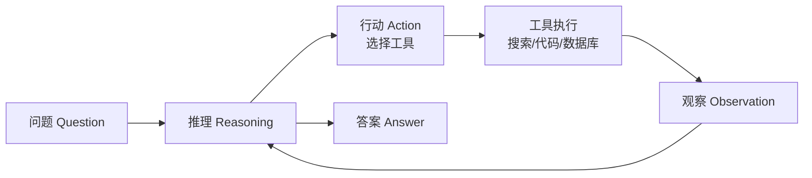

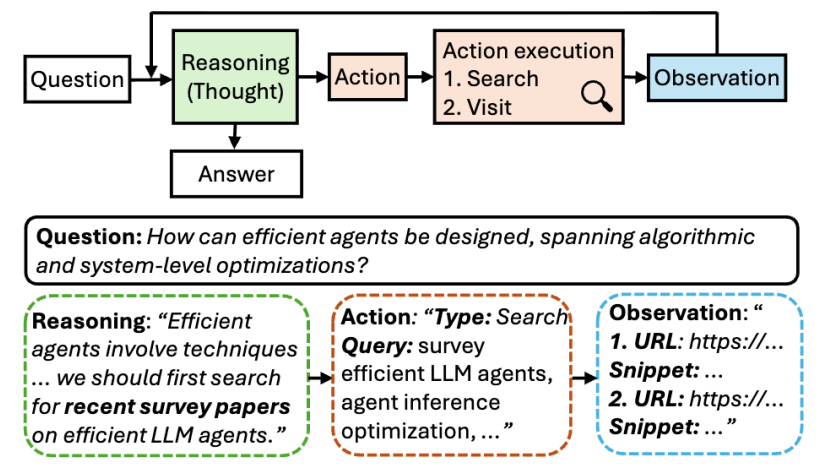

图：ReAct 工作流从 Question 进入 Reasoning，再到 Action、Action execution（Search/Visit）、Observation，然后回到 Reasoning 继续循环，直到输出 Answer。下方示例的问题是"如何设计高效的 Agent"：模型先推理出"应先搜索相关综述"，Action 发起一次 Search，Observation 返回若干 URL 与摘要，再进入下一轮推理。

ReAct 对推理系统有两点影响：

1. **上下文变长**：工具调用（例如从网上抓取大量文字）和复杂推理都会把大量内容放进上下文。
2. **计算范式改变**：传统对话是"一次 prefill、多次 decode"，即先一次性处理输入提示，再逐 token 生成。Agent 中每轮工具返回的观察结果都要作为新输入再处理一次，计算变成重复的"prefill–decode"工作流。

> [!note] 补充解释
> **prefill**（预填充）指一次性并行处理输入提示中的所有 token，建立它们的 KV 缓存；**decode**（解码）指此后按自回归方式每步生成一个 token。prefill 可以并行，decode 每步都要完整读一遍参数和 KV 缓存，是前面带宽公式描述的阶段。

#### 超长上下文与稀疏、线性注意力

到 2025 年，先进大模型都支持 **1M 以上**的上下文窗口，128K 已经显得不够大。长上下文显著增加了存储、访存和计算开销。

稀疏化的直觉是：在此之前几乎所有注意力都是**稠密**的，每个 token 都要考虑之前所有的 KV 缓存。当上下文达到几百 K 甚至 1M 时，并不需要每次都看全部历史。人说话时，影响当前词最多的是邻近的词，几天前说过的话影响不大。据此出现了两类模型架构创新：

- **稀疏注意力**：每个 token 只关注部分重要的历史 token 的 KV。
- **线性注意力**：讲义在"线性注意力模型"名下列举了英伟达采用的 Mamba、千问采用的 GDA、小米提出的 HySparse，以及 DeepSeek 提出的 HCA 和 CSA。

稀疏注意力的具体做法见[滑动窗口与 CSA2](#先进大模型架构剖析)和[稀疏注意力与动态召回](#混合专家与稀疏注意力)。

这一节的演进有一条共同主线：从解码器大模型、Scaling Law、MoE，到思维链、Agent 和超长上下文窗口，新模型结构和新训练方法中相当一部分都在应对模型参数和 KV 缓存的存储与访存问题。前期的压力主要来自参数，现在主要来自 KV 缓存。

> [!question]- 自测：某服务把批大小从 1 提到 16，发现单 token 的平均访存量在短对话下大幅下降，在 200K 长上下文下几乎不变。为什么？
> 批处理只摊薄模型参数：每步解码参数只加载一次、被 16 个请求共用；KV 缓存则每个请求一份、分别加载。短对话时参数占主导，平均到每个 token 的访存量明显下降；200K 长上下文时每个请求的 KV 缓存远大于参数，$16\times M_{\rm KV}$ 占主导，平均访存量几乎不变。

> [!question]- 自测：Mixtral-8x7b 与 Llama-13b 生成每个 token 的计算量相近，二者部署所需的存储容量哪个大？访存带宽一定更小吗？
> Mixtral-8x7b 的存储容量更大：要存 47B 总参数，而 Llama-13b 只有 13B，因为 MoE 是用总参数换激活参数。带宽不一定更小：单 token 只读被激活专家的参数，看起来更少；但总参数大可能导致模型卸载到更远的存储，且专家由路由动态决定、只能按需加载，所以讲义在"访存带宽"后打了问号。

> [!question]- 自测：一个 Agent 完成任务需要 5 轮 ReAct 循环，每轮搜索返回 20K token 的网页内容。与一次性回答相比，它对推理系统的存储和访存需求有什么不同？
> 上下文累计增加约 100K token，每个 token 的 $K$、$V$ 都要进入 KV 缓存，存储容量随之增长；之后每生成一个 token 都要读一遍这份更大的 KV 缓存，访存带宽需求同步升高。同时计算从"一次 prefill、多次 decode"变成 5 轮重复的 prefill–decode，每轮都要先 prefill 新的观察结果。

---

## 先进大模型架构剖析

> [!abstract] 本节要点
>
> - DeepSeek-V4.1-Flash：总参数 552B，MoE 384 选 6，CSA2 稀疏注意力 + 滑动窗口注意力（SWA），相邻层复用 KV 缓存，mHC 取代残差连接，另有 196B 参数的 Engram，原生支持 DSpark 推测解码；每生成 1 个 token 激活 16B 参数、计算约 0.032 TFLOPs、访存约 11 GB、新增 KV 缓存 890 B。
> - Kimi-K3：总参数 2.78T、激活 104.2B；896 个路由专家选 16，另加 2 个所有 token 必经的共享专家；Latent MoE 先把 token 从 5120 维压到 2560 维再分发，以降低 all-to-all 通信；69 层 KDA + 24 层门控 MLA；AttnRes 跨层融合取代残差；每 token 计算约 0.866 TFLOPs、访存约 140 GB、新增 KV 缓存 13.5 KB。
> - 滑动窗口注意力只保留最近若干（如 8K/16K）个 token 的 KV；CSA2 则从全部上下文中挑出最重要的若干 token；KV 复用让多层共用一份 KV 缓存。
> - 短上下文下每 token 计算量 $\approx 2\times$ 激活参数量：$M\times N$ 的矩阵乘向量需要 $MN$ 次乘法和约 $MN$ 次加法，共 $2MN$ FLOPs。
> - 先进模型的每一项结构设计都对应部署芯片的计算、通信或存储约束：MoE 降计算与激活参数，Latent MoE 降通信，稀疏/线性注意力与 MLA 降 KV 存储与访存；看模型维度就能大致推断它面向什么卡。

### 从基线 Transformer 到"非常复杂"的架构

基线 Transformer 的每一层只有多头注意力加 FFN 两个模块（见[Transformer 与多头注意力](#大模型演进与访存需求)）。而思维链、Agent 与百万 token 上下文让 KV 缓存和模型参数的存储、访存压力持续变大，先进模型因此在几乎每个模块上都做了改动。分析这些改动时，关键问题始终是：**它省掉了哪一部分的存储、访存或通信？**

本节用两个先进模型作为解剖样本，都以讲义给出的参数为准：

| 指标（每生成 1 个 token） | DeepSeek-V4.1-Flash      | Kimi-K3                   |
| ------------------------- | ------------------------ | ------------------------- |
| 总参数量                  | 552B（另有 Engram 196B） | 2.78T                     |
| 激活参数量                | 16B                      | 104.2B                    |
| 计算量                    | 约 0.032 TFLOPs          | 约 0.866 TFLOPs           |
| 访存量                    | 约 11 GB                 | 约 140 GB                 |
| 新增 KV 缓存              | 890 Byte                 | 13.5 KB                   |
| MoE 配置                  | 384 选 6                 | 896 选 16 + 2 个共享专家  |
| 注意力                    | CSA2 稀疏注意力 + SWA    | 69 层 KDA + 24 层门控 MLA |
| 残差连接的替代            | mHC                      | AttnRes                   |
| 最长上下文                | 1M token                 | 1M token                  |

两者的激活比例都很低：DeepSeek-V4.1-Flash 为 $\frac{16}{552}\approx 2.9\%$，Kimi-K3 为 $\frac{104.2}{2780}\approx 3.7\%$，即每个 token 只用到不到 $\frac{1}{25}$ 的参数，稀疏度很高。

> [!info] 可视化资源
> [Sebastian Raschka：大模型架构对比](https://magazine.sebastianraschka.com/p/the-big-llm-architecture-comparison)：用大量架构图对比 DeepSeek V3（MLA、含共享专家的 256 专家 MoE）、Kimi K2、Gemma 3 的滑动窗口注意力及其 KV 缓存节省，可作为理解本节各组件的标准图示。

### DeepSeek-V4.1-Flash 架构

DeepSeek-V4.1-Flash 是 552B 参数的混合专家模型，采用稀疏注意力架构，最长上下文 1M token；生成单个 token 激活 16B 参数，计算约 0.032 TFLOPs，访存约 11 GB，生成的 KV 缓存为 890 Byte。 它原生支持文本与视觉（Vision Encoder → Vision Embedding）等多模态输入，整体分为两部分：

1. **20 层 Causal Encoder**：用于 prefill 阶段，处理输入的提示词。输入端由 Engram、Text Embedding、Vision Embedding 经 Single-Pass mHC 汇入 Embedding。底部 2 组为"SWA + MoE"，其上 3 大组，每组为"CSA2(2, Full) + MoE"后接 5 次"CSA2(2, Reuse) + MoE"，共 $2 + 3\times(1+5) = 20$ 层，输出 Enc. Hidden States。
2. **20 层 Decoder**：负责逐 token 解码。首层为 CSA2(1, Full) + MoE，并通过 Hierarchical Sparse Indexer 建立 Candidate Pool；接着 3 次"CSA2(1, Reuse) + MoE"；再往上 4 大组，每组为"CSA2(1, Reindex) + MoE"后接 3 次"CSA2(1, Reuse) + MoE"，共 $1 + 3 + 4\times(1+3) = 20$ 层。顶部接 DSpark 推测解码模块。

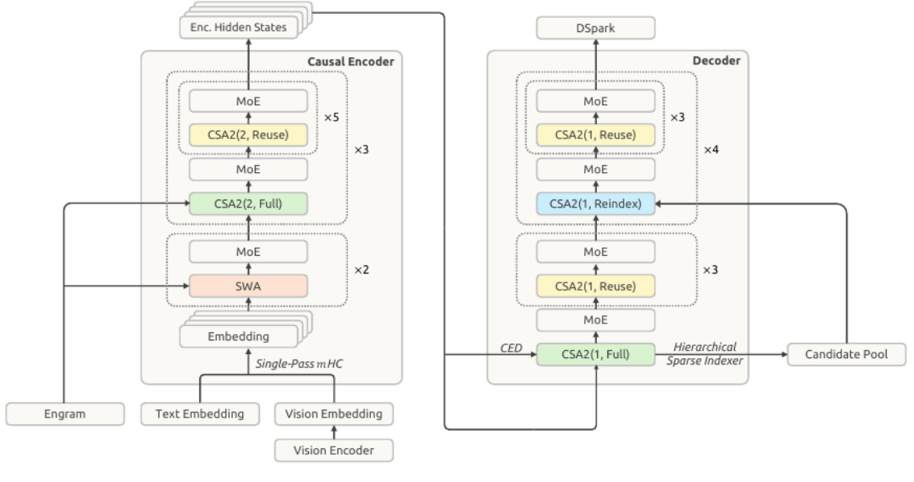

图：左边的 Causal Encoder 由 SWA+MoE 和 CSA2(2, Full/Reuse)+MoE 堆叠而成，输入端接 Engram、文本嵌入和视觉嵌入；右边的 Decoder 由 CSA2(1, Full/Reuse/Reindex)+MoE 组成，经 Hierarchical Sparse Indexer 连到 Candidate Pool，最后输出 DSpark。黄色的 Reuse 层占了绝大多数，说明大部分层不单独生成 KV 缓存。

下面逐个说明各模块。

#### 滑动窗口注意力（Sliding Window Attention, SWA）

即使上下文窗口达到 1M token，生成当前词时影响最大的通常是邻近的词，几天前说过的话影响很小；至少不必在每一层都记住全部历史。

**滑动窗口注意力**（Sliding Window Attention）是指某一层只保存并关注最近固定数量（例如 8K 或 16K）个 token 的 KV，窗口随生成向前滑动，更早的 token 不再参与该层的注意力计算。 这样该层的 KV 缓存大小是常数，不随上下文长度增长。DeepSeek-V4.1-Flash 只在编码器最底部的 2 组层中使用 SWA，其余层用 CSA2 保证仍能"看见"远处的重要 token。SWA 的遗忘问题以及它与 GQA、MLA 在 KV 维度上的比较见[混合专家与稀疏注意力](#混合专家与稀疏注意力)。

#### CSA2 稀疏注意力与跨层 KV 复用

**CSA2** 是 DeepSeek 提出的稀疏注意力结构：面对 1M 的上下文，它在全部历史 token 中挑选出最重要的若干个（例如 16K 或 8K 个）参与注意力计算，而不是对所有 token 做稠密注意力。 与 SWA 按"远近"截断不同，CSA2 按"重要性"挑选，远处的关键 token 也能被选中。

图中 CSA2 有三种标注：

- **Full**：该层完整计算并存储自己的 KV 缓存。
- **Reuse**：该层直接复用前一层的 KV 缓存，不再单独存一份；但各层挑选的 token 索引可以不同，比如前一层认为第 1、2、3 个 token 最重要，这一层可能认为第 5、6、7 个最重要。
- **Reindex**：解码器中从 Candidate Pool 重新挑选索引的层。

**跨层 KV 复用**的目的就是压缩 KV 缓存：原本 20 层的模型每层都要存自己的 KV，现在让相邻层（例如第 2、3 层，第 4、5 层）只存一份 KV 缓存。 结合 CSA2 的稀疏选择，每 token 新增的 KV 缓存降到 890 Byte。

> [!warning] 易错点
> Reuse 复用的是 **KV 缓存本身**，并不意味着两层关注同一批 token。讲解中也没有确定 Reuse 层是沿用上一层的索引还是重新计算索引；能确定的是它只省 KV 的存储与访存，注意力在哪些 token 上计算仍可以逐层不同。

#### 6/384 MoE、mHC、Engram 与 DSpark

- **MoE 384 选 6**：每个 token 只激活 384 个专家中的 6 个，比例 $\frac{6}{384}\approx 1.6\%$，非常稀疏。MoE 的基本思想见[大模型演进与访存需求](#大模型演进与访存需求)。
- **mHC 取代传统 residual 连接**：自 ResNet 以来几乎所有模型都用残差连接，但 DeepSeek-V4.1-Flash 用 mHC 替代了它（图中输入端标为 Single-Pass mHC）。
- **Engram**：额外的 196B 参数模块，在图中作为与 Text/Vision Embedding 并列的输入接入编码器。讲座没有展开它的原理。
- **原生支持 DSpark 推测解码**：解码器顶部直接接 DSpark，推测解码的机制见[带宽瓶颈与并行解码](#带宽瓶颈与并行解码)。

### Kimi-K3 架构

Kimi-K3 与 DeepSeek-V4.1-Flash 有许多相似之处，也是原生支持视觉的多模态模型：图片先经 MoonViT-V2 图片编码器和 MLP 再进入 Embedding。它的核心参数为：总参数 2.78T，激活参数 104.2B，1M 长上下文窗口，896 个专家选 16 个，同时有 2 个共享专家；生成单个 token 计算约 0.866 TFLOPs，访存约 140 GB，生成 KV Cache 13.5 KB。

主干由若干组模块堆叠：每组是 3 次"KDA + Stable LatentMoE"后接 1 次"Gated MLA + Stable LatentMoE"，因此线性注意力层与 MLA 层之比为 3:1，对应全模型 69 层 KDA + 24 层门控 MLA。

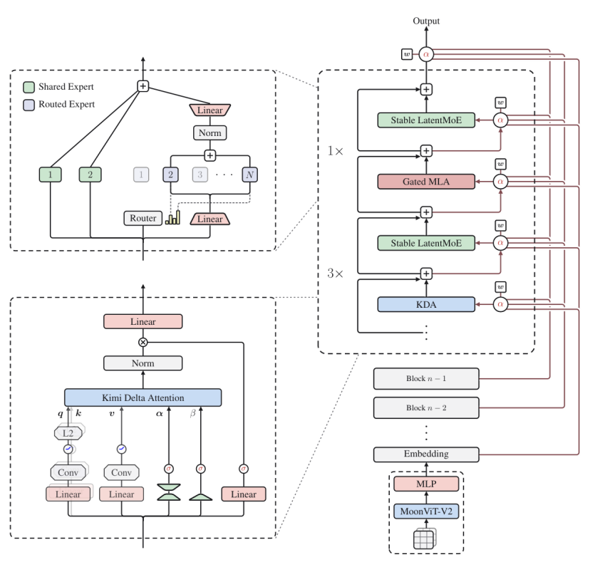

图：右边的主干由 KDA、Stable LatentMoE、Gated MLA 交替堆叠（3× 和 1×），红线表示 AttnRes 把 Embedding 和之前各 Block 的输出经权重 $\alpha$ 融合进当前层；左上方放大了 Stable LatentMoE，绿色为共享专家 1、2，紫色为 Router 选出的路由专家；左下方放大了 Kimi Delta Attention 的 $q$/$k$/$v$/$\alpha$/$\beta$ 分支。

#### 共享专家（Shared Expert）

**共享专家**（Shared Expert）是设置在 MoE 层中、所有 token 都一定会经过的专家，不经过路由器选择。 Kimi-K3 每层有 2 个共享专家，再由路由器从 896 个路由专家中选 16 个；最终输出是共享专家与被选中路由专家的结果相加。

#### Latent MoE

普通 MoE 中，一个 token 进入路由器（Router），被选择发往若干专家，各专家算完后把结果加在一起。在大规模部署中，专家分布在不同芯片上，把 token 发往各专家、再把结果收回是一次 **all-to-all** 通信，其开销与发送的 token 向量维度成正比。

**Latent MoE** 在把 token 送入路由专家之前，先用一个线性层对 token 做压缩，例如把 5120 维压到 2560 维，再进行路由和专家计算，最后用线性层升回原维度。 维度减半，all-to-all 需要传输的数据量也随之减半。Kimi-K3 使用的是 Stable LatentMoE，讲义将其作用概括为"降低 all-to-all 路由"开销。

按图中左上部分的结构，一个 token 在 Stable LatentMoE 中的流程如下：

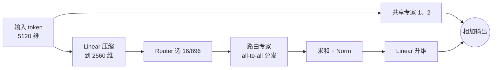

#### KDA 与门控 MLA

69 层 **KDA**（Kimi Delta Attention）与 24 层**门控 MLA**（Gated MLA）组成 Kimi-K3 的稀疏注意力机制。 KDA 中 K 代表 Kimi，D 代表 delta，它是一种线性注意力：图中 $q$、$k$ 经 Linear、Conv、L2 归一化，$v$ 经 Linear、Conv，另有两路门控参数 $\alpha$、$\beta$，输出经 Norm 后再与一路 Linear 门控相乘。MLA 是对多头注意力的 KV 做低秩压缩的方式，具体原理见[混合专家与稀疏注意力](#混合专家与稀疏注意力)。两者的共同目的是降低 KV 缓存的存储和访存开销。

#### AttnRes 跨层融合

Kimi 同样认为普通残差连接已经不够，但没有采用 mHC，而是提出 **AttnRes**（Attention Residual）：对各层的残差输出再做一次注意力，按权重融合 Embedding 与之前各 Block 的输出，作为当前层的输入，取代基线中的简单逐层相加。

> [!question]- 自测：Kimi-K3 一个 token 经过某个 MoE 层时，实际参与计算的专家有几个？若不使用 Latent MoE，all-to-all 每发送一次 token 的数据量是使用后的几倍？
> 共 $16 + 2 = 18$ 个专家：16 个路由专家由路由器选出，2 个共享专家必经。Latent MoE 把 token 从 5120 维压到 2560 维再分发，因此不使用时每次发送的数据量是使用后的 $\frac{5120}{2560} = 2$ 倍。

### 每 token 计算量估算

拿到一个模型的参数后，需要快速判断它每生成一个 token 要做多少计算、搬多少数据，才能判断瓶颈在哪里。

**估算规则**：在上下文不太长时，每 token 的计算量（FLOPs）约等于激活参数量的 2 倍。

推导如下。大模型解码的核心计算是矩阵向量乘法：权重矩阵 $W$ 为 $M\times N$，输入向量 $x$ 为 $N\times 1$，输出 $y = Wx$ 为 $M\times 1$。

1. 需要加载的参数量为 $MN$ 个。
2. 每个输出元素 $y_i = \sum_{j=1}^{N} W_{ij} x_j$ 需要 $N$ 次乘法和约 $N$ 次加法，共 $M$ 个输出，即 $MN$ 次乘法和约 $MN$ 次加法。
3. 一次乘加计为 2 个 FLOP，所以

$$
\text{FLOPs} \approx 2MN = 2 \times (\text{参数量})
$$

推广到整个模型，只统计每个 token 实际用到的参数，即激活参数量 $P_{\rm act}$：

$$
\text{FLOPs/token} \approx 2 P_{\rm act}
$$

**为什么要求短上下文**：上下文不长时，计算主要来自加载模型参数并做矩阵向量乘；上下文很长时，注意力还要与大量历史 KV 相乘，这部分计算和 KV 访存会随上下文长度增长，不能再忽略。

> [!example] 例：验证 DeepSeek-V4.1-Flash 的计算量
> 已知激活参数 $P_{\rm act} = 16\text{B} = 1.6\times 10^{10}$，求每 token 计算量。
>
> 1. $\text{FLOPs/token} \approx 2 \times 1.6\times10^{10} = 3.2\times10^{10}$ FLOPs。
> 2. $1\ \text{TFLOPs} = 10^{12}$ FLOPs，因此约为 $0.032$ TFLOPs，与讲义给出的数值一致。

> [!example] 例：用每 token 访存量估算带宽需求（据课程内容整理）
> 访存带宽 $\approx$ 每 token 访存量 $\times$ 每秒生成 token 数（公式见[大模型演进与访存需求](#大模型演进与访存需求)）。若要求每秒生成 50 个 token：
>
> 1. DeepSeek-V4.1-Flash：$11\ \text{GB} \times 50/\text{s} = 550\ \text{GB/s}$。
> 2. Kimi-K3：$140\ \text{GB} \times 50/\text{s} = 7000\ \text{GB/s} = 7\ \text{TB/s}$。
> 3. 每 token 的计算访存比：DeepSeek 约 $\frac{0.032\times10^{12}}{11\times10^{9}} \approx 2.9$ FLOP/Byte，Kimi 约 $\frac{0.866\times10^{12}}{140\times10^{9}} \approx 6.2$ FLOP/Byte。每搬 1 字节只做几次运算，解码阶段明显受访存带宽限制，而不是受算力限制。

> [!warning] 易错点
> 讲义数值与估算规则存在不一致：按 $2P_{\rm act}$ 估算，Kimi-K3 应约为 $2\times104.2\text{B} \approx 0.208$ TFLOPs，而讲义标注为约 0.866 TFLOPs，讲义没有给出 0.866 的计算口径（可能计入了长上下文注意力等其他开销）。 用 $2P_{\rm act}$ 估算时，要注明这是短上下文条件下的结果。另外，"访存量"取决于参数的存储精度：16B 参数对应约 11 GB，说明每个参数平均不到 1 字节，不能默认 FP16 下的 2 字节/参数。

### 架构设计与部署芯片

把上面的设计放在一起看，先进模型的每一项结构改动都对应底层芯片的某种约束：

| 设计                         | 针对的开销                  | 对应的硬件约束     |
| ---------------------------- | --------------------------- | ------------------ |
| MoE（384 选 6、896 选 16）   | 每 token 的计算量与参数访存 | 算力与访存带宽     |
| Latent MoE                   | 专家分发的 all-to-all 通信  | 芯片间互连带宽     |
| CSA2、SWA、KDA、MLA、KV 复用 | KV 缓存的存储容量与访存     | 显存容量与访存带宽 |

因此看一个模型的各项维度，就能大致推测它是面向什么卡设计、在什么卡上训练的：维度的选择都要充分适配训练和部署所用的芯片。训练一个大模型动辄 3 到 6 个月，训练效率越高，就能跑更多实验、获得更多经验，所以模型结构也会为训练所用的硬件做优化。

> [!tip] 课堂强调
> 这些创新未必都是必要的，但每一项背后都有其硬件上的原因。理解时要追问两点：它背后的硬件原因是什么，以及它能否推广到不同代的 GPU（如从 A 卡到 H 卡、B 卡及更新一代）；在国内长期面临先进 GPU 禁运的情况下，这一点尤其重要。

如何沿"参数、KV 缓存、每秒 token 数"三个方向系统地降低带宽需求，见[带宽瓶颈与并行解码](#带宽瓶颈与并行解码)。

> [!question]- 自测：某模型总参数 1T，激活参数 32B，用于短上下文对话。估算每 token 计算量；若参数平均按 1 字节存储，以每秒 20 个 token 生成需要多少参数访存带宽？
> 计算量 $\approx 2\times 32\times10^9 = 6.4\times10^{10}$ FLOPs $= 0.064$ TFLOPs。每 token 至少加载激活参数约 32 GB，带宽 $\approx 32\ \text{GB}\times 20/\text{s} = 640\ \text{GB/s}$（尚未计入 KV 缓存的访存）。总参数 1T 只影响存储容量，不进入每 token 的计算量。

> [!question]- 自测：DeepSeek-V4.1-Flash 每 token 新增 KV 仅 890 B，Kimi-K3 为 13.5 KB。在 1M token 上下文下，二者单个请求的 KV 缓存各约多大？哪些设计让 DeepSeek 的数值小得多？
> DeepSeek：$890\ \text{B}\times10^6 \approx 0.89$ GB；Kimi：$13.5\ \text{KB}\times10^6 \approx 13.5$ GB。DeepSeek 的 KV 小，主要来自相邻层共用一份 KV 缓存的跨层复用，以及底层使用的滑动窗口注意力；CSA2 的稀疏选择进一步减少了每步需要加载的 KV。

---

## 带宽瓶颈与并行解码

> [!abstract] 本节要点
>
> - 访存带宽 $=$（KV 缓存量 $+$ 参数量）$\times$ Tokens/s；更精确地写成（稀疏 KV 缓存量 $+$ 激活参数量）$\times$ ITERs/s，三个因子分别对应稀疏注意力、MoE 和并行解码三条降带宽路径。
> - 端侧例：Qwen3-14B VLM、32K 上下文、50 tokens/s 约需 1200 GB/s，而 NVIDIA Thor / Orin 的峰值带宽只有约 273 / 200 GB/s，相差 5–6 倍；能力越强的 VLM 带宽需求越高。
> - 后摩尔时代芯片迭代慢（仅流片的物理时间就约 6 个月），算法每几个月就有显著变化，“算法快速迭代—芯片通用适配”的路径难以为继，必须软硬件协同。
> - 推测解码：小草稿模型自回归生成 $k$ 个候选 token，大目标模型一次并行验证并接受匹配的前缀，大模型参数加载一次就能产出多个 token；代价是被拒绝的候选浪费了计算。
> - 三个挑战：验证开销大（大批量时从访存瓶颈变成计算瓶颈）、草稿生成本身是自回归的、与 MoE 和线性注意力等新架构不匹配；SpecMamba 用 FPGA 数据流架构解决 Mamba 的状态回溯问题，较 GPU 实现 2.3 倍吞吐和 3 倍能效提升。

### 端侧推理的带宽瓶颈

要判断一个模型能否在某块芯片上“跑得动”，最直接的办法是把生成速度目标代入带宽公式，再与芯片的峰值带宽比较。带宽公式本身（每生成一个 token 都要把参数和 KV 缓存完整读一遍）见[存储容量与访存带宽公式](#大模型演进与访存需求)，这里用它做定量分析。

带宽公式有两种写法：

$$
\text{访存带宽} = (\#\,\text{KV 缓存} + \#\,\text{参数}) \times \text{Tokens/s}
$$

$$
\text{Memory Bandwidth} = (\#\,\text{Sparse KV Cache} + \#\,\text{Active Param}) \times \text{ITERs/s}
$$

第二个式子是把三条优化手段放进去之后的一般形式：

- $\#\,\text{Sparse KV Cache}$：每次解码迭代实际需要读取的 KV 缓存量（字节）。用了稀疏注意力后，不必读全部历史 token 的 KV。
- $\#\,\text{Active Param}$：每次迭代实际需要读取的参数量（字节）。MoE 模型只读被激活的专家。
- $\text{ITERs/s}$：每秒解码迭代次数。传统自回归解码一次迭代生成一个 token，所以 $\text{ITERs/s} = \text{Tokens/s}$；并行解码一次迭代生成多个 token，迭代次数就少于 token 数。

带宽单位为 GB/s，前两项单位为 GB，后一项单位为 1/s。

#### 端侧例：Qwen3-14B VLM

考虑一个偏端侧的场景：模型为 Qwen3-14B 视觉语言模型（VLM），上下文长度 32K，目标生成速度 50 tokens/s。50 tokens/s 并不高，让模型写一道代码题都会觉得慢。但按上式计算，带宽需求约为 **1200 GB/s**（约 1.2 TB/s）。

端侧设备能用的 DRAM 一般是 LPDDR（Low Power DDR），带宽有限：

| 平台        | 用途                                     | 峰值带宽（约） | 与 1200 GB/s 的差距       |
| ----------- | ---------------------------------------- | -------------- | ------------------------- |
| NVIDIA Thor | 智能驾驶常用的高端 GPU（单颗约四五万元） | 273 GB/s       | $1200/273 \approx 4.4$ 倍 |
| NVIDIA Orin | 智能驾驶常用 GPU                         | 200 GB/s       | $1200/200 = 6$ 倍         |

因此需求与供给之间有 **5–6 倍**的缺口。

> [!example] 例：从带宽需求反推每个 token 读多少数据
> 已知 50 tokens/s 需要约 1200 GB/s，求每生成一个 token 要读多少数据；若改用 Orin（约 200 GB/s），最多能跑多快？
>
> 1. 每 token 读取量 $= 1200\ \text{GB/s} \div 50\ \text{/s} = 24$ GB，这就是“参数 $+$ 32K 上下文 KV 缓存”的总量。
> 2. 读取量不变时，Orin 上的生成速度上限 $= 200\ \text{GB/s} \div 24\ \text{GB} \approx 8.3$ tokens/s，远低于 50 tokens/s 的目标。
> 3. 要在 Orin 上达到 50 tokens/s，必须把每 token 的读取量降到 $200/50 = 4$ GB，或让一次迭代产出多个 token。

下图横轴是 2024–2025 年各 VLM 的发布时间，纵轴是带宽需求（GB/s），颜色表示 OpenVLM Score（越亮能力越强），红、蓝虚线分别是 Thor 和 Orin 的峰值带宽。图中有两个趋势：一是在给定带宽下，VLM 的智能不断增强（同一带宽水平上点的颜色越来越亮）；二是高智力 VLM 面临高带宽挑战，能力越强的模型带宽需求越大，大量点远高于两条虚线。

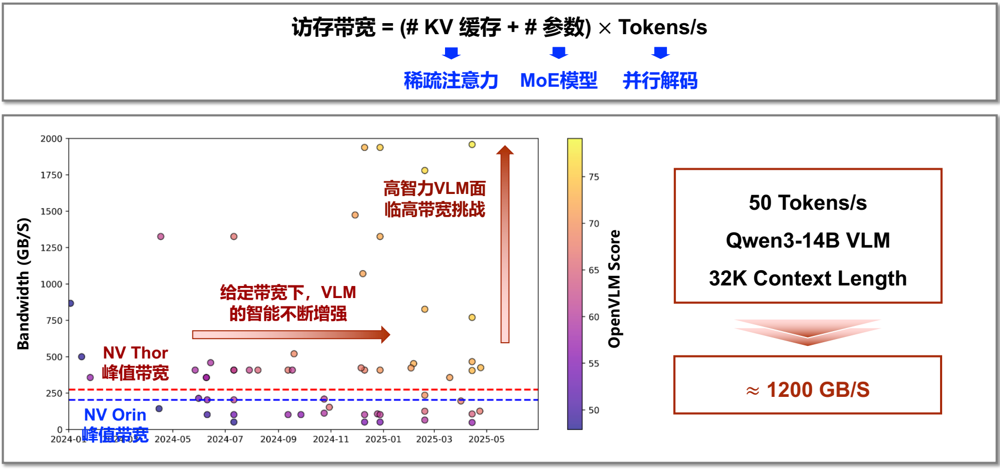

图：顶部公式“访存带宽 =（KV 缓存 + 参数）× Tokens/s”的三项分别对应稀疏注意力、MoE 和并行解码三条优化路径；散点图显示 2024–2025 年各 VLM 所需带宽大多高于 NV Thor 与 NV Orin 的峰值带宽虚线，而且分数越高的模型需要的带宽越大；右边举例 Qwen3-14B VLM 在 32K 上下文、50 tokens/s 下约需 1200 GB/s。

#### 降低带宽的三条路径

带宽公式是三个因子的乘积，所以降低带宽需求也就有三个着力点，各自对应一类算法技术：

| 公式中的因子         | 技术       | 降低带宽的方式                                 | 详见                                          |
| -------------------- | ---------- | ---------------------------------------------- | --------------------------------------------- |
| KV 缓存量            | 稀疏注意力 | 每个 token 不再读取全部历史 KV，只读取相关部分 | [稀疏注意力与动态召回](#混合专家与稀疏注意力) |
| 参数量               | MoE 模型   | 每个 token 只激活部分专家，只读这些专家的参数  | [粗粒度与细粒度 MoE](#混合专家与稀疏注意力)   |
| Tokens/s（迭代次数） | 并行解码   | 一次解码迭代生成多个 token，减少模型加载次数   | 本节下文                                      |

并行解码的收益可以直接从公式读出：原本一次解码生成一个 token，如果一次解码能生成 10 个 token，模型需要加载的次数就变成原来的 $\frac{1}{10}$，带宽需求也降为原来的 $\frac{1}{10}$。

> [!warning] 易错点
> 并行解码并不减少每次迭代读取的数据量，它减少的是迭代次数，即公式中的 $\text{ITERs/s}$。在相同 Tokens/s 目标下，每次迭代产出 $m$ 个 token，则 $\text{ITERs/s} = \text{Tokens/s} / m$。稀疏注意力和 MoE 则相反：迭代次数不变，减少的是每次迭代的读取量。

### 软硬件协同的必要性

带宽缺口可以从芯片和算法两头去补，但两头的迭代速度差得很远，单靠一方追赶另一方行不通。

**后摩尔时代**（post-Moore era）指摩尔定律已明显放缓的阶段：先进工艺节点的可获得性、成本、良率都比较差。在这一阶段，原有的“算法快速迭代—芯片通用适配”路径已无法满足 AI 发展的需求。 原因在于两层的迭代周期严重不对称：

- **芯片层：迭代周期长。** 即使一切顺利，一次流片在物理上就需要约 **6 个月**（要一层一层曝光，谁都无法压缩）；回片后还要测试，测出问题就得修改设计、再流片一次，而芯片 fail 是经常会发生的事。
- **算法层：快速迭代。** 算法几乎每天都有进展，每过几个月就会出现能显著影响芯片设计的新东西（前两节的 MoE、各种注意力变体都是例子）。

指望芯片“通用地”跟上快速变化的算法是不可能的，智能芯片的计算效率和安全挑战需要从算法到芯片的软硬件协同解决方案，形成闭环。 协同包含两个方向的问题：

1. **芯片层**：如何设计**算法感知**的智能芯片架构，即芯片设计时要考虑上层算法的需求。
2. **算法层**：如何桥接“相对固定的”智能芯片与“快速迭代的”智能算法，即设计算法时要考虑底层芯片的能力。

第二个方向在先进模型中已能看到：MoE、Latent MoE、KDA 与 MLA 等设计都在迁就底层芯片的计算、通信与存储约束，见[架构设计与部署芯片](#先进大模型架构剖析)。

### 并行解码与推测解码（Speculative Decoding）

自回归解码每生成一个 token 都要把整个大模型加载一遍，带宽需求与 Tokens/s 成正比，这是解码阶段带宽瓶颈的根源。 自回归解码本身的定义见[自回归解码](#大模型演进与访存需求)。

**并行解码**（parallel decoding）是指在每次解码迭代中生成多个 token，从而缓解带宽瓶颈的一类方法。它由两步组成：

1. **预测**：通过并行预测，或使用小的草稿模型，生成一段候选 token 序列。
2. **验证**：用大模型验证草稿序列，确定实际可接受的 token。

三种解码方式的对比如下（对应下图）：

- **自回归解码**：LLM 输入 $t$ 时刻的 token，输出 $t+1$；再把 $t+1$ 作为输入，输出 $t+2$，依此类推，一次迭代一个 token。
- **并行解码（并行预测）**：同一个 LLM 在一次迭代中同时预测 $t+1, t+2, t+3$；下一次迭代把这些预测作为输入，一边验证 $t+2, t+3$ 是否成立，一边并行预测 $t+4, t+5, t+6$。
- **推测解码**：由一个小的 Draft LLM 自回归生成 $t+1, t+2, t+3$，再交给大的 Target LLM 一次性并行验证；图中目标模型输出的 $t+1, t+2$ 与草稿一致（被接受），$t+3$ 不一致（被拒绝）。

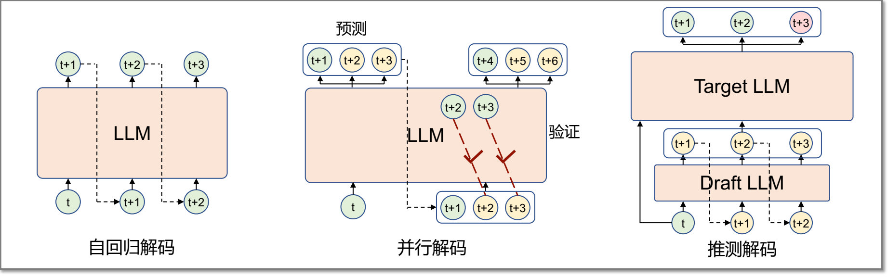

图：自回归解码每次只生成一个 token；并行解码一次预测 t+1 到 t+3，经验证后接受其中一部分；推测解码先由 Draft LLM 逐个生成草稿，再由 Target LLM 一次并行验证，图中 t+3 被标红表示未被接受。

#### 推测解码的思想

模型家族里既有巨大的旗舰模型，也有几亿到一两百亿参数的小模型。生成每个 token 并不都需要大模型的全部能力：有的问题很简单；即使是很难的数学题，其中也有容易的步骤，比如开头先写一个“解”字，用不着大模型来生成。

**推测解码**（speculative decoding）是并行解码的一种：用一个小的**草稿模型**（draft model）自回归地生成候选序列，再把整段候选并行送进大的**目标模型**（target model）验证，接受与目标模型输出一致的部分。草稿模型仍然逐 token 自回归，但它比目标模型小很多，带宽需求很低。

#### 验证与接受的过程

设当前已确定的 token 为 $t$，草稿模型生成了候选 $\hat{t}_{t+1}, \hat{t}_{t+2}, \hat{t}_{t+3}$（hat 表示“猜测值”）。目标模型把 $t, \hat{t}_{t+1}, \hat{t}_{t+2}, \hat{t}_{t+3}$ 一起并行输入，在每个位置各输出一个它自己认为正确的下一个 token，然后从前往后逐位比较：

1. **第 1 位**：$t$ 是已确定的，所以目标模型在 $t$ 位置的输出就是正确的 $t+1$。把它与草稿的 $\hat{t}_{t+1}$ 比较。
2. **第 2 位**：若第 1 位匹配，说明 $\hat{t}_{t+1}$ 正确，那么目标模型在 $\hat{t}_{t+1}$ 位置上的输出就是正确的 $t+2$，再与 $\hat{t}_{t+2}$ 比较。
3. **继续向后**：只要前面全部匹配，后一位目标模型的输出就可信，可以继续比对。
4. **遇到第一个不匹配就停止**：此后的草稿 token 依赖了错误的前缀，全部丢弃；该位置改用目标模型自己的输出。
5. **全部匹配**时，目标模型在最后一个候选位置上的输出还额外给出了下一个正确 token。所以运气好时，一次验证就同时确定了 $t+1$ 之后的多个 token（例中可得到 $t+1, t+2, t+3$ 以及再下一个 token）。

关键在于这些位置的验证是**并行计算**：它们共享同一份模型参数，参数只需加载一次。原本每个 token 加载一次大模型，现在加载一次就能产出多个 token，带宽需求按产出的 token 数成比例下降。

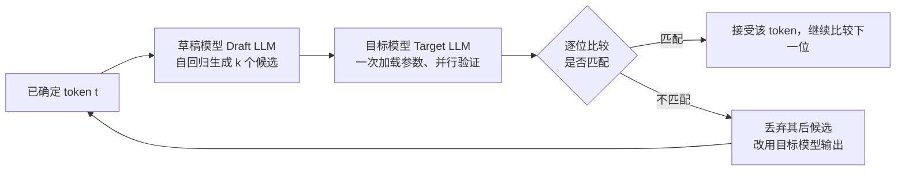

> [!note] 补充解释
> 按上面"逐位精确匹配"的验证方式推广到一般情况：草稿长度为 $k$，若前 $n$ 个候选被接受（$0 \le n \le k$），一次目标模型迭代就产出 $n+1$ 个 token（$n$ 个被接受的候选，加上目标模型在第一个不匹配位置给出的修正 token，或全部匹配时额外给出的下一个 token）。因此即使最差情况 $n=0$，每次迭代也至少产出 1 个 token，与自回归解码持平；并且最终输出与只用目标模型解码时的输出一致，因为每个被接受的 token 都经过了目标模型的确认。

#### 代价：额外的计算

推测解码用计算换带宽。实际中草稿序列不可能每次都全对：例如预测了 8 个 token，最后可能只接受其中 2 到 3 个。验证时目标模型为 8 个位置都做了计算，却只产出约 3 个 token，即付出 8 份计算量、得到 3 份结果。

这在多数情况下可以接受：大模型推理的核心瓶颈在访存，只要访存开销降下来，多花一些计算影响不大。 但这个前提并不总成立，见下文的挑战一。

> [!example] 例：推测解码对带宽的影响
> 某模型自回归解码时每 token 读取 24 GB，目标 50 tokens/s。改用推测解码后，平均每次目标模型迭代产出 3 个 token，草稿模型的读取量忽略不计。求目标模型所需带宽。
>
> 1. 迭代次数 $\text{ITERs/s} = 50 / 3 \approx 16.7$ 次/s。
> 2. 带宽 $= 24\ \text{GB} \times 16.7\ \text{/s} \approx 400$ GB/s，约为原来 1200 GB/s 的 $\frac{1}{3}$。
> 3. 若每次验证 8 个候选，则目标模型每次迭代处理 8 个位置的计算，而只得到 3 个 token：计算量约为自回归解码的 $8/3 \approx 2.7$ 倍。

### 并行解码的挑战

推测解码的收益依赖两个前提：计算资源有富余、每个 token 的访存量与其他 token 能共享。这两个前提在实际部署和新型模型架构下都可能被打破，于是有三个挑战。

#### 挑战一：验证开销过大

草稿序列验证的计算开销会随序列长度显著上升，对混合专家模型尤其严重，使并行解码的效果受限。

云端服务时这一点特别明显。假设已有 512 个请求在批处理，每个请求再预测 8 个草稿 token，那么目标模型每次前向要处理

$$
512 \times 8 = 4096\ \text{tokens}
$$

计算强度大大提高，大模型推理可能从原本的**访存瓶颈**变成**计算瓶颈**。此时“多花计算换带宽”不再划算，被拒绝的候选所浪费的计算会直接变成延迟。

> [!info] 可视化资源
> [Wikipedia：Roofline 模型](https://en.wikipedia.org/wiki/Roofline_model)：以对数坐标的屋顶线图展示算力上限、带宽斜线与拐点，可用来理解逐 token 解码为何算术强度低、受访存带宽限制，以及批量验证 token 增多后为何会越过拐点变成计算受限。

#### 挑战二：草稿生成本身是自回归的

草稿序列（draft sequence）仍由小模型一个一个 token 自回归生成。草稿模型虽小，这个串行过程仍可能占据可观的开销，成为延迟瓶颈。

#### 挑战三：与先进模型架构不匹配

现有推测解码算法与线性注意力、扩散语言模型等先进大模型不匹配，无法直接应用。 两个典型例子：

**与 MoE 不匹配。** MoE 中每个 token 只激活一个专家子集，但不同 token 激活的专家未必相同。设每个 token 固定激活 8 个专家，草稿中有 4 个 token 要验证：

1. **最坏情况**：4 个 token 激活的专家两两不同，验证时要加载 $4 \times 8 = 32$ 个专家。
2. **全部接受时**：自回归逐个生成这 4 个 token 本来也要加载 32 个专家，所以即使 4 个全部预测正确，访存一点也没省。
3. **部分拒绝时**：例如只接受 2 个，相当于为 2 个 token 加载了 32 个专家，平均每 token 16 个，比自回归的 8 个还多，访存需求不降反升。

也就是说，推测解码“参数加载一次、多个 token 共享”的前提，在 MoE 中被“不同 token 读不同参数”打破了。

**与线性注意力不匹配。** 线性注意力模型（如 Mamba）不支持计算回溯，下面的 SpecMamba 详细说明这一点。

> [!warning] 易错点
> 推测解码“即使全部接受也可能不省访存”只在 MoE 等每个 token 读取不同参数的模型中出现。对稠密模型，所有候选共享全部参数，验证只加载一次参数，全部接受时访存节省最大。判断方法：看并行验证的多个 token 读取的数据是否重叠。

#### 针对三个挑战的研究

讲者所在课题组针对三个挑战做了一系列工作，列出如下供了解：

| 挑战                     | 工作                  | 方法                                 | 效果                |
| ------------------------ | --------------------- | ------------------------------------ | ------------------- |
| 一：草稿序列验证开销大   | ProPD（ICCAD'24）     | 自适应草稿序列生成和剪枝             | 1.5 倍吞吐提升      |
| 一：草稿序列验证开销大   | S2-MoE（Arxiv'26）    | 自推测草稿序列生成，共享 KV 缓存     | 最高 5.3 倍吞吐提升 |
| 二：草稿序列生成开销大   | SpecASR（DAC'25）     | 草稿序列复用和两阶段稀疏树生成       | 3.79 倍吞吐提升     |
| 二：草稿序列生成开销大   | RecGuide（Arxiv'26）  | 融合草稿生成和验证阶段               | 1.8 倍吞吐提升      |
| 三：先进大模型兼容性不足 | SpecMamba（ICCAD'25） | 解决线性注意力与推测解码的兼容性问题 | 2.3 倍吞吐提升      |
| 三：先进大模型兼容性不足 | ODB-dLLM（DAC'26）    | 利用推测解码加速扩散语言模型         | 2.6 倍以上吞吐提升  |

### SpecMamba：线性 Transformer 的推测解码

Mamba 是一种线性 Transformer（状态空间模型，State-Space Model），用线性注意力代替标准注意力，曾经影响很大。它与推测解码难以配合，SpecMamba（ICCAD 2025）就是为解决这一兼容性问题而提出的框架。

#### 核心观察一：隐藏状态难以回溯

线性 Transformer 的**隐藏状态更新机制**阻碍了推测解码时的**状态回溯**（traceback）。

- **Transformer**：每个 token 的 KV 都保存在 KV 缓存中（“all stored”），新 token 只是追加新的缓存。验证后若某些候选被拒绝，把它们对应的 KV 删掉即可回到被接受的位置。
- **状态空间模型**：只保留一个固定大小的状态。处理新 token 时旧状态被更新覆盖（如由 $h_2$ 更新到 $h_7$，“previous state discarded”，“only one state retained”）。

验证过程是从初始状态依次处理候选，一路更新状态直到最终状态。如果中途某个候选被拒绝，就需要回到“最后一个被接受 token 处”的状态，但这个中间状态已经被覆盖，无法直接取回。

#### 核心观察二：树形验证进一步加剧不匹配

Mamba 的顺序处理特性与**树形推测解码**的并行验证需求不兼容。 树形推测解码一次验证多个分支的候选，讲义例中的 token 树为：根 0，子节点 1、2、3，节点 1 的子节点为 4、5。

1. 若直接把树按顺序展开成 `0 1 2 3 4 5` 送进 Mamba，节点 2 会以节点 1 的状态为前驱，形成**错误依赖**（incorrect dependency），而 2 实际上只依赖 0。
2. 若按深度优先展开为 `0 1 4 5 2 3`，处理每个分支前都要**取回**（retrieve）正确的父节点状态：处理 4 前取回节点 1 的状态，处理 2 和 3 前都要取回节点 0 的状态。

Transformer 可以用注意力掩码让每个 token 只看自己的祖先，而 Mamba 的状态是顺序累积的，必须显式管理这些分支状态。

#### 解决方案与效果

SpecMamba 设计了**基于 FPGA 的数据流架构**（实现平台为 VHK158 FPGA，片上布局包括 HBM、Memory Controller、SSM Unit、SSM State Controller、SSM State Buffer、Linear Unit、Conv Unit 等模块），解决 Mamba 与推测解码的兼容性问题，较 GPU 实现 **2.3 倍吞吐**和 **3 倍能效**提升。

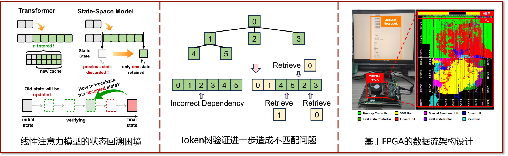

图：左栏说明 Transformer 会保存全部 KV，而状态空间模型只保留一个隐藏状态，所以验证失败后无法回溯到被接受时的状态；中栏说明 token 树按顺序展开后会产生错误的依赖关系，需要按位置取回对应状态；右栏是基于 FPGA 的数据流架构实现和片上布局。

三种配置的实测结果如下（均为实测，不是仿真）：

| 配置                             | 吞吐         | 功耗     |
| -------------------------------- | ------------ | -------- |
| Mamba 直接运行在 RTX 4090 GPU 上 | 138 Tokens/s | 约 300 W |
| FPGA 专用加速器                  | 220 Tokens/s | 约 100 W |
| FPGA 专用加速器 $+$ 推测解码     | 313 Tokens/s | 约 100 W |

从表中可以算出：加上推测解码后吞吐由 220 提高到 313 Tokens/s，约 $1.4$ 倍（讲者口述约 1.5 倍）；相对 GPU 吞吐为 $313/138 \approx 2.3$ 倍，与讲义标称一致（讲者口述约 2.5 倍）；功耗约为 GPU 的 $\frac{1}{3}$。若按每瓦吞吐估算能效，$\frac{313/100}{138/300} \approx 6.8$，讲者口述“整体能效大概是 GPU 的 7 到 8 倍”，与讲义标称的 3 倍能效是不同口径的数字。

> [!question]- 自测：某端侧芯片带宽 250 GB/s，模型每 token 需读取 20 GB（参数 $+$ KV 缓存）。自回归解码最快多少 tokens/s？若用推测解码平均每次迭代接受 3 个草稿 token（另加 1 个目标模型给出的 token），又能达到多少？
> 自回归：$250/20 = 12.5$ tokens/s。推测解码每次目标模型迭代产出 $3+1=4$ 个 token，迭代次数上限仍是 12.5 次/s（忽略草稿模型的访存），所以约 $12.5 \times 4 = 50$ tokens/s。前提是计算资源足够，没有变成计算瓶颈。

> [!question]- 自测：一个 MoE 模型每 token 激活 8 个专家。推测解码验证 4 个草稿 token，它们激活的专家完全相同，最终接受 2 个。与逐个自回归生成这 2 个 token 相比，专家加载量如何变化？换成最坏情况（4 个 token 专家互不相同）呢？
> 专家完全相同时，验证只需加载 8 个专家，一次得到 2 个被接受的 token；自回归生成这 2 个 token 要加载 $2 \times 8 = 16$ 次专家，所以省了一半。最坏情况下验证要加载 $4\times 8 = 32$ 个专家，只换来 2 个 token，平均每 token 16 个，是自回归（8 个）的 2 倍，访存反而增加。

> [!question]- 自测：为什么 Transformer 做推测解码时拒绝候选很容易，而 Mamba 很难？
> Transformer 把每个 token 的 KV 分别存在 KV 缓存中，拒绝候选只需丢弃这些 token 对应的 KV，被接受前缀的状态仍完整保留。Mamba 只维护一个不断被覆盖更新的隐藏状态，处理完候选后，最后一个被接受 token 处的中间状态已经丢失，无法回溯；树形验证时还要为每个分支取回正确的父节点状态，与其顺序处理特性冲突。

---

## 混合专家与稀疏注意力

> [!abstract] 本节要点
>
> - 粗粒度 MoE 专家少而大（Mixtral-8x7B：8 选 2，总 47B、激活 13B）；细粒度 MoE 专家多而小（Qwen3-30B-A3B：128 选 8，总 30B、激活 3B），总参数/激活参数比例更高，激活比例下限是 $\frac{1}{N}$（$N$ 为专家数）。
> - MoE 推理挑战一：总参数放不进 HBM，只能卸载到主机 DRAM（Host2Device 仅约 16 GB/s）；专家由路由按 token 动态选择，无法提前预取，"加载专家—计算专家"被迫串行，拷贝时间可占 GPU 时间的 86.2%。
> - MoE 推理挑战二：细粒度专家激活频率冷热分化，热专家偏计算瓶颈、冷专家偏访存瓶颈，分布式执行时冷专家等热专家，硬件利用率下降。
> - MHA 的 KV 缓存访存开销 $\propto T \times d \times H$；GQA 压缩头数到 $\frac{H}{g}$，滑动窗口把 $T$ 截成常数窗口 $T_c$（会遗忘历史），MLA 把 $H \times d$ 低秩投影到 $d_c$。
> - 稀疏注意力（MoBA、DSA）保留全部 KV，但每个 token 只动态召回最相关的部分；KV 压缩的核心维度已从头数 $H$ 转向 token 维度 $T$。

### 粗粒度与细粒度 MoE

带宽公式中每生成一个 token 都要加载"模型参数 + KV 缓存"；并行解码减少的是每秒迭代次数（见[降低带宽的三条路径](#带宽瓶颈与并行解码)），而混合专家模型（MoE）降低的是每次迭代需要加载的参数量：只加载真正被激活的专家。MoE 把 FFN 拆成专家、由路由器选择子集的基本思想见[MoE 基本思想](#大模型演进与访存需求)。MoE 能有效减少计算量和激活参数，已成为先进大模型的必选架构。

从系统角度，MoE 按专家的切分粒度分为两类：

- **粗粒度 MoE**（coarse-grained MoE）：专家数少、每个专家仍然很大，路由器（Router）从中选少数几个。典型是 Mixtral-8x7B：8 个专家中 2 个活跃，总参数 47B，活跃参数 13B。
- **细粒度 MoE**（fine-grained MoE）：把专家切得更小、数量更多，每个 token 选择更多个专家；另外常带有**共享专家**（Shared Experts），每个 token 都必经。典型是 Qwen3-30B-A3B：128 个专家中 8 个活跃，总参数 30B，激活参数仅 3B；DeepSeek、Qwen 系列都属于此类。共享专家的定义见[共享专家](#先进大模型架构剖析)。

粗粒度 MoE 的根本限制在于稀疏度：设共有 $N$ 个专家、每个 token 激活 $k$ 个，则路由专家部分的激活比例为 $\frac{k}{N} \ge \frac{1}{N}$。专家数少时，这个比例无论如何都降不下去，稀疏度不可能很高。 细粒度 MoE 专家数更多，总参数/激活参数的比例更高，能更有效地提升训练效率。

两种结构的路由流程与第 01 节相同（路由器选出 top-$k$ 个路由专家，输出乘以路由权重后相加）；区别在于细粒度结构中 token 还会同时经过共享专家（下图中粉色的 1st），不经路由器选择。

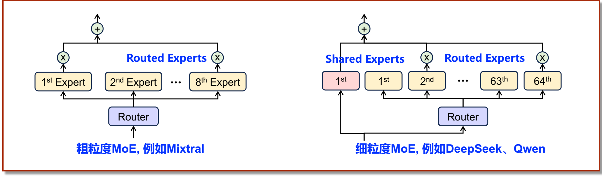

图：左边的粗粒度 MoE（如 Mixtral）由 Router 从 8 个专家中选择；右边的细粒度 MoE（如 DeepSeek、Qwen）在 64 个路由专家之外，还有一个所有 token 都会经过的共享专家。

> [!info] 可视化资源
>
> - [Hugging Face：混合专家（MoE）详解](https://huggingface.co/blog/moe)：给出 Switch Transformer、GShard 等 MoE 层的路由示意图，讲解 Mixtral 8x7B 总参数约 47B、top-2 路由以及负载均衡与专家容量。
> - [Wikipedia：混合专家](https://en.wikipedia.org/wiki/Mixture_of_experts)：包含取自 DeepSeek-V2 论文的 DeepSeekMoE 架构图（共享专家加路由专家），并介绍 top-$k$ 路由和负载均衡损失。

> [!example] 例：比较两种 MoE 的"总参数/激活参数"比例
>
> 1. Mixtral-8x7B：$\frac{47\text{B}}{13\text{B}} \approx 3.6$，每个 token 只用到约 28% 的参数。
> 2. Qwen3-30B-A3B：$\frac{30\text{B}}{3\text{B}} = 10$，每个 token 只用到约 10% 的参数。
> 3. 路由专家激活比例：前者 $\frac{2}{8} = 25\%$，后者 $\frac{8}{128} = 6.25\%$。因此细粒度 MoE 每个 token 需要加载的参数在比例上少得多——但下面会看到，"要加载的少"不等于"推理快"。

### MoE 推理挑战

MoE 在部署时面临两个挑战：总参数放不下导致的卸载与按需加载，以及细粒度专家的冷热不均。

#### 挑战一：参数卸载与按需加载

MoE 让每个 token 的激活参数变少，但在同等能力下，MoE 模型的**总参数量**仍比稠密模型大。总参数要全部存下，于是 GPU 最近的 HBM 放不下，模型被迫存到更远端的存储上。

**挑战一**：总参数量大迫使模型卸载到远端存储，而动态计算图导致必须按需加载被激活专家的参数，延迟很高。（讲义原文作"写在到远端存储"，应为"卸载到远端存储"。）

讲义给出的存储层次参数（GPU SRAM ↔ GPU HBM ↔ CPU DRAM；讲义把显存统称为 HBM，4090 实际使用的是 GDDR6X 显存）：

| 指标             | A100                | 4090                |
| ---------------- | ------------------- | ------------------- |
| SRAM 容量        | $108 \times 164$ KB | $128 \times 128$ KB |
| HBM 带宽         | 2 TB/s              | 1 TB/s              |
| HBM 容量         | 80 GB               | 24 GB               |
| Host2Device 带宽 | 16 GB/s             | 16 GB/s             |
| 主机 DRAM 容量   | ~1 TB               | ~128 GB             |

主机 DRAM 容量够大，但到 GPU 的链路只有 16 GB/s，比 HBM 带宽低两个数量级（A100 上 $\frac{2\ \text{TB/s}}{16\ \text{GB/s}} = 125$ 倍）。一旦参数放在主机侧，这条链路上的流量就成为系统瓶颈。讲义中的 GPU 时间分布显示：主机到设备的拷贝（Memcpy HtoD）占 86.2%，真正的核函数执行（Kernel Execute）只占 7.9%，核函数启动（Kernel Launch）占 5.9%。

为什么不用预取把加载和计算重叠起来？CPU 上的常规思路是：在某块参数被需要之前就把它搬进 HBM，GPU 一边计算当前专家，一边把下一个专家搬进来，形成计算与通信的重叠。但 MoE 的专家是**每个 token 动态选择**的——在路由器算出结果之前，并不知道要用哪个专家。 于是执行过程变成：

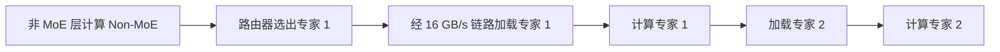

计算单元在加载期间空等，加载与计算**串行化**，而加载时间远高于计算时间。结论是：MoE 看起来需要加载的参数变少了，但带宽利用率也变低了，甚至被迫使用更远、更慢的存储，形成新的访存瓶颈。

> [!example] 例：从主机加载与从 HBM 加载的时间差
> 设某个 token 需要的专家参数中有 1 GB 不在 HBM 中（假设值，用于量级比较）。
>
> 1. 经 Host2Device 链路：$\frac{1\ \text{GB}}{16\ \text{GB/s}} = 62.5\ \text{ms}$。
> 2. 若已在 A100 的 HBM 中：$\frac{1\ \text{GB}}{2\ \text{TB/s}} = 0.5\ \text{ms}$。
> 3. 两者相差 125 倍；由于无法预取，这 62.5 ms 直接叠加到每个 token 的延迟上。

#### 挑战二：专家冷热不均

**挑战二**：细粒度专家负载不均衡，使专家参数出现"冷热"之分，造成计算/访存比例变化。

以各专家的激活频率（横轴为专家 ID，纵轴为激活频率）对比两类模型：粗粒度的 Mixtral-8x7B 中，8 个专家的激活频率都在约 0.10–0.155 之间，相当均匀；细粒度的 Qwen2-57B-A14B 中，64 个专家的激活频率从接近 0 到约 0.068 不等，分布极不均匀。

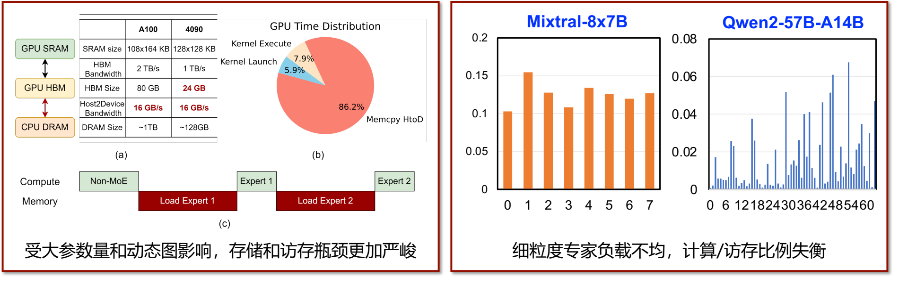

图：左栏对比 A100 与 4090 的存储规格（4090 只有 24 GB HBM，Host2Device 只有 16 GB/s），饼图显示 86.2% 的 GPU 时间花在 Memcpy HtoD 上，时序图显示专家加载与计算是串行进行的；右栏的柱状图显示 Mixtral-8x7B 的 8 个专家负载比较均匀，而 Qwen2-57B-A14B 的 64 个专家冷热差异很大。

**冷热专家**（hot/cold experts）的不均衡带来三个问题：

1. **参数利用率低**：模型可能有上 T 的参数，但经常被用到的热专家只占其中一小部分（例如 10%），其余参数仍然要存储、要训练。
2. **瓶颈类型分化**：被激活越多的专家，攒到的 token 越多、计算越多，越倾向于计算瓶颈；激活越少的专家，为少量 token 加载整份参数，越倾向于访存瓶颈。系统同时面临计算瓶颈和访存瓶颈。
3. **分布式下互相等待**：专家分布在不同设备上时，热专家计算量大、耗时长，冷专家先算完，只能等待热专家，硬件利用率随之下降。

> [!warning] 易错点
> "激活少的专家负担小"只对计算量成立。从计算/访存比看，冷专家每加载一次参数只服务很少的 token，算术强度低，反而是典型的访存受限；热专家才是计算受限。优化冷专家要减少它的参数搬运，而不是增加算力。

针对这两个挑战，讲者团队的工作（作为研究案例了解即可）：

- **AdapMoE**（ICCAD'2024）：GPU 计算卸载场景，通过动态门控、预取、缓存等自适应调度，降低主机内存访问开销，延迟降低 1.35×。
- **HybriMoE**（DAC'2025）：GPU/CPU 异构计算场景，通过异构计算、动态调度做自适应计算分配，降低主机内存访问开销，延迟降低 1.3×。
- **MatMoE**（ICCAD'2026）：适用于 GPU 和 CPU 推理场景，利用 Matryoshka 专家动态量化和比特动态分配，动态降低专家加载和计算开销，延迟最高降低 3.7×。

#### MatMoE：按 token 动态选择专家位宽

同一份权重可以用 8 比特、4 比特或 2 比特存储，位宽不同，存储、访存和计算开销都不同。MatMoE 的出发点有两条观察：

- 专家重要性随解码过程中不同 token 动态变化，**静态**混合精度量化（预先给每个专家固定位宽）会造成精度损失。
- MoE 部署需要同时满足严格的内存约束和动态时延需求，现有多尺度量化方法缺乏适用性。

其机制：

1. **单一嵌套模型**：用 Matryoshka（套娃式）量化把专家权重按比特平面嵌套存储，高位（MSB）在前；同一份存储可以只取高几位作为低精度版本，也可以取更多位作为高精度版本。讲义示例中专家 0、1、2 的最高精度分别为 2、4、3 比特。
2. **路由分数驱动位宽**：设阈值为 $T$，某专家的路由分数 $r_1 > T$ 时以高精度参与计算，$r_2 < T$ 时只取低比特。
3. **低比特计算引擎**：为 CPU（查找表 LUT 预计算、累加）和 GPU（比特转置）分别实现低比特计算。

效果：TPOT（每输出 token 时间）加速 1.3–3.7×，准确率提升 4.0–18.3%。 目的是在带宽消耗与模型准确率之间做动态平衡。

### KV 缓存的三个维度

参数问题用 MoE 处理之后，剩下的就是 KV 缓存（KV 缓存的来历见[KV 缓存](#大模型演进与访存需求)）。大模型上下文长度指数级增长，使 KV 缓存的计算、访存和存储开销成为整体推理瓶颈。 讲义中的内存占用对比显示：模型参数约 15 GB 保持不变，而 KV 缓存随序列长度从 0.5k 增长到 32k 时迅速膨胀，在 32k 时超过 120 GB，远超参数本身。

对基础的**多头注意力**（Multi-Head Attention, MHA），KV 缓存有三个维度：

- **token 维度** $T$：序列长度，序列越长 KV 越多；
- **隐藏层维度** $d$：每个头的特征维度，越大 KV 越大；
- **注意力头数** $H$：多头注意力的头数，越多 KV 越大。

$$
\text{MHA 访存开销} \propto T \times d \times H
$$

这一比例关系出自讲义。 市面上所有 KV 缓存压缩方法都可以理解为在压缩这三个维度中的某一个或两个。

### GQA、滑动窗口与 MLA

早期人们发现 KV 缓存大的主要原因是多头注意力的头数，于是先从头数下手，再逐步转向其他维度。

**分组查询注意力**（Grouped-Query Attention, GQA）：把 $H$ 个头分成若干组，组内多个头共享同一份 KV。设每 $g$ 个头共享一份，KV 只需存 $\frac{H}{g}$ 份，压缩率为 $g$。例如 8 个头、每 4 个头共享一份 KV，就只需要存 2 份来供给 8 个头。 代表模型如 Qwen2.5。

**滑动窗口注意力**（定义见[滑动窗口注意力](#先进大模型架构剖析)）压缩的是 token 维度：只保存最近一个窗口 $T_c$ 内的 KV，窗口随序列增长向右移动。好处是 KV 大小变成常数，不再随序列长度线性增长；代价是**遗忘历史**：窗口之外的内容彻底丢失。 例如用户前一天花很多功夫"调教"聊天陪伴类模型如何回答，第二天这些内容已滑出窗口，模型又从头开始，用户会觉得模型"突然不认识我了"。代表模型如 GPT-OSS。

**多头潜注意力**（Multi-head Latent Attention, MLA）：DeepSeek-V2/V3 采用的方案。它在 token 维度不做压缩，而是把 $H \times d$ 展开后的高维向量通过**低秩投影**（low-rank projection）映射到低维空间 $d_c$ 再存储。好处是每个 token 都仍然被"记住"，只是记得没那么清晰。

| 方法       | 代表模型    | 被压缩的维度             | KV 规模                                                        | 代价                            |
| ---------- | ----------- | ------------------------ | -------------------------------------------------------------- | ------------------------------- |
| MHA        | Llama2      | 无                       | $T \times d \times H$                                          | 基线                            |
| GQA        | Qwen2.5     | 头数 $H$                 | $T \times d \times \frac{H}{g}$                                | 组内头共享 KV，表达能力下降     |
| 滑动窗口   | GPT-OSS     | token 数 $T$             | $T_c \times d \times \frac{H}{g}$，与 $T$ 无关                 | 窗口外历史被遗忘                |
| MLA        | DeepSeek-V3 | $H \times d$             | $T \times d_c$                                                 | 低秩近似，每个 token 记得较模糊 |
| 稀疏注意力 | MoBA、DSA   | token 数 $T$（按需召回） | 存储 $T \times d \times \frac{H}{g}$，每步只加载被选中的 token | 需要判断哪些 token 相关         |

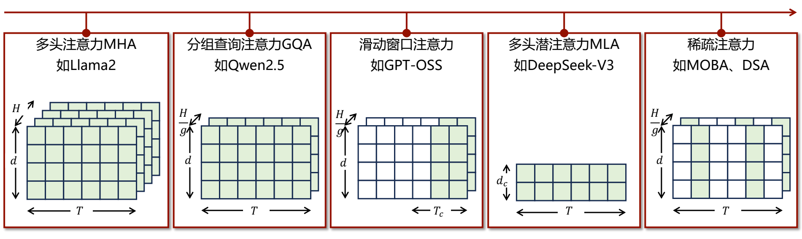

图：沿时间轴依次是 MHA、GQA、滑动窗口注意力、MLA 和稀疏注意力；看每种方法在头数 $H$ 或 $H/g$、维度 $d$ 或 $d_c$、token 数 $T$ 或 $T_c$ 这几个方向上缩小了哪一维，绿色格子表示实际保存或加载的 KV：滑动窗口只保留最右侧 $T_c$ 列，稀疏注意力则是散落在整个 $T$ 上的若干列。表中各方法的代表模型与压缩维度依据这张演进图整理。

> [!example] 例：GQA 与 MLA 的压缩比
> 设 $H = 32$，$d = 128$，GQA 取 $g = 4$，MLA 取 $d_c = 512$（假设值）。每个 token、每层的 K（或 V）元素数：
>
> 1. MHA：$d \times H = 128 \times 32 = 4096$。
> 2. GQA：$d \times \frac{H}{g} = 128 \times 8 = 1024$，压缩 4 倍。
> 3. MLA：$d_c = 512$，相对 MHA 压缩 8 倍。
> 4. 三者都仍随 $T$ 线性增长；上下文从 8k 增长到 1M 时，KV 依然增长 128 倍。这正是后续方法转向 token 维度的原因。

### 稀疏注意力与动态召回

GQA、MLA 压缩的是单个 token 的 KV 大小，但无法阻止 KV 随上下文长度线性增长；滑动窗口截断了 $T$，却按时间远近一刀切地丢掉历史。稀疏注意力正是为了在 token 维度上既省开销又不遗忘。

针对长上下文，**稀疏性是注意力机制的本征属性**：只有部分历史 KV 缓存会对当前 token 的解码产生影响。核心挑战是如何利用注意力稀疏性，降低 KV 缓存的存储和加载开销。

**稀疏注意力**（Sparse Attention）不再仅按时间上的远近决定保留哪些 KV，而是按其对当前 token 的重要性来选择。代表作是 MoBA（Kimi）和 DSA（DeepSeek）。当前常用的做法是：

1. **全部保存**：所有历史 token 的 KV 仍然存下来；
2. **按相关性选择**：生成当前 token 时，先判断哪些历史 token 与它最相关；
3. **动态召回**：只把这部分 KV 加载进来参与注意力计算。

从 MHA 到稀疏注意力的演进可以看出，KV 缓存压缩的核心维度已经从头数 $H$ 逐步转到 token 维度 $T$，各种方法都在降低 token 维度上的存储或访存需求。

> [!warning] 易错点
> "全部保存、动态召回"的稀疏注意力减少的是每步的 KV **加载量和计算量**，并不减少 KV 的**存储容量**；滑动窗口才是直接把存储截成常数。要同时降低存储，需要在召回之外再配合压缩（如下面的 MPCache）。

讲者团队在稀疏注意力方向的工作（研究案例）：

- **ArkVale**（NeurIPS'2024）：动态识别并召回关键 token，并适配 Page Attention，平均速度提升 1.7×。它是较早做动态召回的工作。
- **MPCache**（NeurIPS'2025）：静态与动态结合的 KV 缓存压缩机制，实现 70% 以上的存储容量和带宽优化。
- ICML'2026 的工作探索大模型的注意力汇聚（attention sink）问题及其与 MoE 的相似性：注意力同样存在负载不均衡，类似 MoE 的专家冷热不均；据此提升了模型准确率。

> [!question]- 自测：某 MoE 模型有 64 个路由专家、每 token 激活 4 个，部署在 24 GB HBM 的 4090 上，大部分专家放在主机 DRAM。为什么即使用双缓冲预取也很难把加载时间藏起来？
> 很难藏住。要预取就得提前知道下一个要用哪个专家，而专家由路由器根据当前 token 的隐藏状态动态选出，算出路由结果之前无法确定；所以只能"路由 → 经 16 GB/s 链路加载 → 计算"串行执行。链路带宽比 HBM（1 TB/s）低约 60 倍，加载时间远大于计算时间。

> [!question]- 自测：分布式部署细粒度 MoE 时，设备 A 上的专家每批收到 200 个 token，设备 B 上的专家只收到 2 个 token。两台设备各自偏向哪种瓶颈？整体会出现什么现象？
> A 上的是热专家：加载一次参数服务 200 个 token，算术强度高，偏计算瓶颈。B 上的是冷专家：为 2 个 token 加载整份参数，偏访存瓶颈。B 很快算完，只能等 A，整体速度由热专家决定，B 的硬件处于空闲。

> [!question]- 自测：一个陪伴聊天产品需要支持数十万 token 的历史，并且不能遗忘早期对话细节。在 GQA、滑动窗口、MLA、稀疏注意力中，哪种最直接满足"不遗忘且每步加载量不随 $T$ 线性增长"？
> 稀疏注意力。滑动窗口会丢掉窗口外的历史；GQA 和 MLA 虽保留全部 token，但每步仍要加载全部 $T$ 个 token 的（压缩后）KV，加载量仍随 $T$ 线性增长；稀疏注意力保留全部 KV，每步只召回相关的少量 token，代价是存储容量仍随 $T$ 增长。

---

## 思维树推理与存算一体

> [!abstract] 本节要点
>
> - **思维链**把推理过程逐步输出；**思维树**让模型并行生成多条思路，再逐步筛选（粗粒度）或整体投票（细粒度），以更大的探索范围换取复杂任务的准确率。
> - 思维树推理的三大系统挑战：思维链之间的**同步等待**降低硬件利用率、思维链**长度长尾**拉长整体延迟、**重复探索**使扩展思维链数量后准确率饱和；SPEX 用推测执行把延迟最多降低 4.1 倍，Hyper 平衡探索与利用把准确率提升 8% 以上。
> - 冯·诺依曼架构存算分离、易编程易扩展，但面临延迟墙与功耗墙：7 nm 下一次运算不到约 1 pJ，一次 DRAM 访问约 70–90 pJ，相差约 50–100 倍。
> - **近存计算**把计算放到存储器外围（尤其借助先进封装/集成工艺），**存内计算**让存储单元本身参与计算；AI 计算规则、控制流简单，使分布式存储和软件管理的 scratchpad 变得可行。存储层次的每一级（SRAM/RRAM 约 10 TB/s、DRAM/HBM 约 100 GB/s 到 TB/s、Flash 约 10 GB/s）都有对应方案。
> - 3D DRAM 用混合键合直接堆叠，连线数正比于面积，带宽大幅提升；但单层 800 $\text{mm}^2$ 约 20 GB、目前最多约 4 层（约 80 GB），层数增加还会升温、缩短保持时间、增加刷新、降低有效带宽。HBF（高带宽闪存）用 3D NAND 换取容量，但要处理大读写粒度、高写延迟和不灵活擦除。

### 思维链与思维树（Chain-of-Thought / Tree-of-Thought）

大模型直接给出答案时，复杂的代码、智能体或数学任务质量往往不高；让模型"边想边写"、甚至"同时想多条路"，是推理大模型提升能力的主要手段。

**思维链**（Chain-of-Thought，CoT）是让大模型把思考过程逐步输出、一步一步产生解题过程，而不是直接输出结果的推理方式，代表模型是 GPT-o1。 它的问题是：面对难题时模型可能走错一步、再走错一步、不断推翻自己，单条链会变得很长，延迟也很长。思维链导致输出变长、KV 缓存随之增长的影响见[思维链与 Agent 对上下文的影响](#大模型演进与访存需求)。

**思维树**（Tree-of-Thought，ToT）进一步让大模型**并行思考**：同时生成多种可能的思路并加以探索，以扩大探索范围。它有两种粒度：

1. **粗粒度思维树**：以"一步解题"为节点逐层扩展，过程类似蒙特卡洛树搜索（MCTS）。
   1. 第一步并行生成例如 10 个可能的第一步；
   2. 评估这些第一步中哪些更有可能（更 promising）通向正确答案，从中选出例如 5 个；
   3. 对选中的每个节点再生成多种可能的第二步，再评估、筛选；
   4. 如此逐步展开，最终形成一棵树。
2. **细粒度并行思维树**：粗粒度方案的难点在于"一步"很难定义——解一道难的数学题，切得太细或太粗都不好。于是干脆不划分步骤，直接**并行生成**例如 64 条完整思维链，各自得到一个结果后再**聚合**。最常用的聚合是**多数投票**（majority voting）：比如一道四选一的选择题，64 条思路有的答 A、有的答 B……哪个答案出现最多就选哪个。

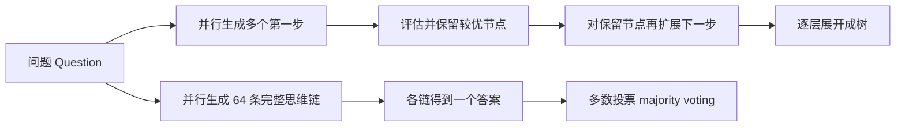

上半支是粗粒度思维树，下半支是细粒度并行思维树。如今求解非常复杂的问题，基本都会用思维树或在其上叠加多智能体（multi-agent）的变种。

> [!info] 可视化资源
> [Prompting Guide：思维树（ToT）](https://www.promptingguide.ai/techniques/tot)：展示 Yao 等人的思维树框架图，以及 24 点游戏中 BFS 搜索与思路评估的过程，可直观对比思维树与思维链在并行生成、筛选思路上的差别。

> [!warning] 易错点
> 粗粒度与细粒度的区别不在于"并行条数多少"，而在于**是否按步骤做中间评估与剪枝**：粗粒度每一步都要评估并筛选节点（因而需要在各链之间同步）；细粒度各链独立跑到底，只在最后做一次聚合。

### 思维树推理的系统挑战与优化

并行生成多条思维链看起来是天然的并行任务，但各条链在步数、长度和内容上的差异会直接转化为硬件空闲和延迟。

1. **挑战一：同步开销**。粗粒度思维树需要在不同思维链之间进行**同步**：同一步（例如 step 2）在不同思路下的长度不一样，有的很长、有的很短，评估筛选又必须等这一步全部完成，于是短的要等长的，造成计算等待和空闲，显著降低硬件利用率。
2. **挑战二：长度长尾**。思维树中不同思维链的总长度差异显著，存在**长尾效应**（long tail）：整体结果要等最长的那条链完成，短链也得等长链，思维树的整体推理延迟显著提升。
3. **挑战三：重复探索**。并行生成例如 64 种解时，可能有 32 种非常相似、只有细微改动。并行"宽度"虽大，实际探索的空间却不够——理想情况是 64 条链探索 64 个尽量不同的方向。结果是探索广度不足，继续扩展思维树数量，准确率趋于**饱和**。

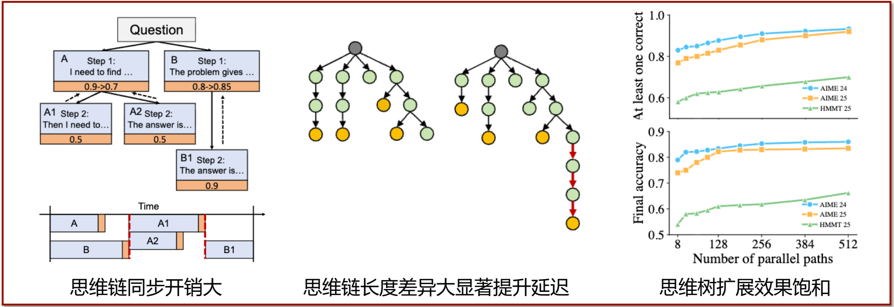

图：左栏的思维树与时间线显示，各分支要在每一步同步：节点 A、B 是两种第一步，A 很快结束，却要在红色虚线（同步点）处等待更长的 B 才能进入下一步，A1、A2 与 B1 之间同理；中栏两棵树显示，多数分支较短，个别特别长的思维链（红色箭头）决定了整体延迟；右栏曲线显示，并行路径从 8 增加到 512 时，AIME 24、AIME 25、HMMT 25 上的"至少一条正确"率和最终准确率都只缓慢上升并趋于饱和。

针对这些挑战，讲者团队的两项工作：

| 工作               | 针对对象                       | 方法                                                                                                    | 效果                |
| ------------------ | ------------------------------ | ------------------------------------------------------------------------------------------------------- | ------------------- |
| SPEX（OSDI 2026）  | 粗粒度思维树调度（挑战一、二） | 在不同思维链之间和单条思维链内部做**推测执行**（speculative exploration），不再串行地一次只生成一个节点 | 延迟最高降低 4.1 倍 |
| Hyper（ICML 2026） | 细粒度思维树生成（挑战三）     | 平衡不同思维链之间的**探索**（exploration）与**利用**（exploitation）                                   | 准确率提升 8% 以上  |

SPEX 的思路与推测解码一脉相承（推测解码见[推测解码](#带宽瓶颈与并行解码)）：原方法每次串行生成一个节点（一个步骤），SPEX 则推测地同时生成多个 step；最终得到的结果与原方法完全一样，不牺牲准确率或模型能力，只是更快。

> [!question]- 自测：粗粒度思维树中 4 条思路的第 2 步分别需要生成 100、120、150、600 个 token，必须全部完成才能评估筛选。若每条链占用相同的计算资源，这一步的平均硬件利用率约为多少？哪个挑战在起作用？
> 约 40%。这一步耗时由最长的 600 个 token 决定，总有效工作为 $100+120+150+600=970$，可用容量为 $4\times600=2400$，利用率 $970/2400\approx 40\%$。这是挑战一（同步等待），若放大到整条链的总长度差异就是挑战二（长尾）。

### 冯·诺依曼瓶颈与存算一体（Processing-in/near-Memory）

前面所有关于带宽的计算和优化，根源都在于存储与计算是分离的。除了"芯片感知"的模型与调度优化，另一条路是做"大模型感知"的芯片架构设计，直接缩短存储与计算之间的距离。

**冯·诺依曼架构**（von Neumann architecture）是**存算分离**的架构：计算在处理器上进行，数据存放在存储器中。现在的 CPU、GPU 基本都采用它。

- **优势**：编程模型简单，容易扩展，不必处理各种一致性（coherence）问题。
- **劣势**：面临**存储墙**（memory wall），它有两种表现：
  1. **延迟墙**：访问越远端的存储，延迟越大；
  2. **功耗墙**：在 7 nm 工艺节点，一次运算的能耗不到约 1 pJ，而一次 DRAM 访存约 70–90 pJ，相差约 50–100 倍。

存储层次"离处理器越近带宽越高、越远容量越大"的规律见 L06 的存储层次内容。

> [!info] 可视化资源
> [Wikipedia：冯·诺依曼结构](https://en.wikipedia.org/wiki/Von_Neumann_architecture)：给出冯·诺依曼结构框图，并在"冯·诺依曼瓶颈"一节说明 CPU 与存储共享总线、数据搬运吞吐跟不上处理器速度，以及缓存、scratchpad 等缓解手段。

**存算一体**是缩短存储与计算距离的新型计算方式，分为两大类：

- **近存计算**（Near-Memory Computing / Processing）：将计算移至存储器外围电路附近，特别是利用**先进集成工艺**（如先进封装），兼顾计算效率与准确率。形态上是高度分布式的：每块存储旁边都有自己的计算单元。
- **存内计算**（In-Memory Computing）：将计算移至存储器附近或内部，存储单元本身也是计算单元，"数据存在哪就在哪算"，利用高内部带宽降低数据搬运的功耗与延迟。它是更极端的方案。

#### 为什么 AI 让分布式存算可行

近存计算的分布式结构带来一个老难题：同一份数据可能存在多块存储中，任何一个核修改它都要通知其他所有核，维护一致性非常困难。对于通用计算，这使近存架构长期难以推广。

AI 计算则不同：

1. **计算极其规则**：一颗 800 $\text{mm}^2$ 的芯片，乃至上万颗这样的芯片，绝大部分时间只在做矩阵乘法，可以把计算规则地切分到各个单元上；
2. **通信也是规则的**：核与核之间是大家一起进行的集体通信，不会出现"某个数据被某个核改了、要逐一通知其他核"的不规则情况；
3. **控制流极其简单**：在控制数据流图（CDFG，control data flow graph）中，控制部分极少，绝大部分是数据流。

因此神经网络加速器甚至可以把片上存储设计成**暂存器**（scratchpad memory）：完全由软件管理，不要任何硬件来管理，即不需要 LRU 这类缓存替换策略。在通用场景下用软件管理缓存过于麻烦，在 AI 场景下却很简单——这正是各种激进架构在 AI 场景变得可能的原因。

> [!warning] 易错点
> 近存计算与存内计算的界线：近存计算的计算单元仍在存储阵列**之外**（外围电路、同一封装或堆叠的逻辑层），数据只需短距离搬运；存内计算让**存储单元本身**完成运算，数据不离开存储阵列。

#### 存储层次上的存算方案

数据本来就分布在各个存储层级，每一级只要存有数据，就可能有就地计算的需求，因此几乎每一层都有对应的近存或存内方案。

| 存储层级      | 典型带宽              | 存内计算           | 近存计算                   |
| ------------- | --------------------- | ------------------ | -------------------------- |
| 寄存器        | —                     | —                  | —                          |
| SRAM/RRAM     | 约 10 TB/s            | SRAM/RRAM 存内计算 | SRAM/RRAM 近存计算         |
| DRAM 主存/HBM | 约 100 GB/s 到约 TB/s | —                  | DRAM/HBM 近存计算、3D DRAM |
| Flash         | 约 10 GB/s            | Flash 存内计算     | HBF                        |

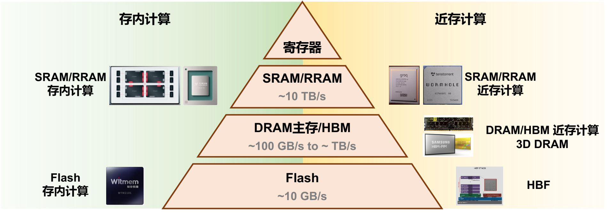

图：金字塔从上到下依次是寄存器、SRAM/RRAM（约 10 TB/s）、DRAM/HBM（约 100 GB/s 到 TB/s）和 Flash（约 10 GB/s），从上到下容量越来越大、从下到上带宽越来越高；左侧列出各层的存内计算方案，右侧列出各层的近存计算方案（含 3D DRAM 和 HBF）。

从 SRAM 近存走向 DRAM 近存的好处是**存储密度更高**：SRAM 单元需要 6 到 8 个晶体管，DRAM 密度高得多，单位面积能放更多存储，更适合大模型。

#### 例：冷专家在 DRAM 旁就地计算

MoE 模型总参数量大，HBM 往往放不下，许多参数只能放在 host DRAM，而 host DRAM 到计算单元的访问带宽很低（专家冷热不均的背景见[专家冷热不均](#混合专家与稀疏注意力)）。

> [!example] 例：为什么冷专家适合近存计算
> 冷专家每次只分到很少的 token，其计算接近矩阵向量乘：$M\times N$ 的权重只产生约 $2MN$ 次运算（每 token 计算量估算见[每 token 计算量估算](#先进大模型架构剖析)），每个权重几乎只用一次。
>
> 1. **传统方式**：把冷专家参数从 host DRAM 一路搬到寄存器再计算，搬运 $MN$ 个参数只换来 $2MN$ 次运算，完全受带宽限制；按上面的能耗比，每个参数一次 DRAM 访问约 70–90 pJ，而用它做的两次运算总共不到约 2 pJ，能耗几乎全花在搬运上。
> 2. **近存方式**：在 DRAM 旁边直接完成矩阵向量乘，只把长度为 $M$ 的结果向量发回。参数原本存在哪就在哪算，避免大量参数在层级之间移动，从而缓解访存瓶颈。

#### 存内计算的研究示例

讲者团队在存内计算方向的工作（讲座只列出结论）：

- **UniCAIM**（DAC 2025）：利用新型铁电存储器，实现原位的动态/静态稀疏注意力计算，计算能效提高 8 倍；
- **NASiC**（DAC 2026）：利用 3D NAND 存内计算实现高效 MoE 推理，能效最高提升 70 倍；
- **NICE**（ISEDA 2026）：面向 3D NAND 存内计算的纠错算法，降低存内计算误差，准确率提升 30% 以上。

### 3D DRAM 与混合键合（Hybrid Bonding）

带宽取决于存储与计算芯片之间能连多少根线、每个周期能送多少数据。封装方式决定了连线数量的上限。

以 NPU 与 DRAM 的连接为例，三种封装方式：

1. **PCB 走线**：最朴素的方式，两颗芯片通过 PCB 连接，只能沿芯片边缘连出很少几根线，带宽很低。
2. **HBM**：芯片之间的连线不再只走边缘，而是可以从 NPU 底部引出、经中介层连到存储，连线数不再被芯片的一条边所限，多出的线让每个周期能发送更多数据，带宽更大。
3. **3D DRAM（直接堆叠）**：把 DRAM 与逻辑芯片（NPU）通过**混合键合**（hybrid bonding）直接上下堆叠，连线根数**正比于面积**，可以显著提升带宽。

早年 AMD 已经把 SRAM 缓存堆叠到逻辑芯片上；近两年流行的是堆叠 DRAM，因为 SRAM 容量远小于 DRAM。堆叠之后形成分布式存储：每个 DRAM bank 下方有自己的逻辑单元，各 bank 负责自己那部分数据的"加载 & 计算"。

#### 3D DRAM 的挑战

1. **容量有限**：一颗 800 $\text{mm}^2$ 的 DRAM 芯片一层约 20 GB；要支撑 100B 参数的模型（按每参数 1 字节计约 100 GB）需要叠 5 层。
2. **成本与良率**：DRAM 本身很贵，3D 封装还会进一步降低良率，能否叠到 5 层本身就是问题。
3. **散热与刷新**：层数越多芯片越厚，计算产生的热量向上传导，叠得越多 DRAM 越热。DRAM 电容中电荷的**保持时间**（retention time）随温度升高而缩短，需要更频繁地刷新；刷新期间无法访问 DRAM，于是有效带宽下降。DRAM 读出具有破坏性、本身就需要刷新，见 L08 的 DRAM 内容。

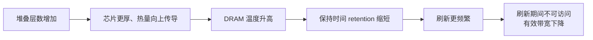

因此即使很先进的 3D DRAM，800 $\text{mm}^2$ 的芯片目前最多做到约 4 层，即约 80 GB，对当前的大模型并不够用。

> [!warning] 易错点
> 3D DRAM 的带宽优势来自"连线数正比于面积"，而不是 DRAM 单元本身更快；它不能同时解决容量问题，层数受成本、良率和散热—刷新的约束。

#### 3D DRAM 近存计算的调度：HD-MoE 与 H2EAL

3D DRAM 把计算切成许多块分布在各个 bank 上，带来片上集体通信、MoE 调度、稀疏注意力调度等新问题。讲者团队的两项工作：

**HD-MoE**（ICCAD 2025）：基于混合键合的 DRAM 近存计算能显著提升访存带宽，但面临分布式存储和计算的挑战；现有的**专家并行**（EP）负载不均衡，**张量并行**（TP）通信开销高。HD-MoE 通过混合并行与动态调度，实现 1.4–1.8 倍加速。

**H2EAL**（ICCAD 2025）的思路：

1. **核心观察一**：堆叠 DRAM 容量有限、面临存储瓶颈，可用稀疏注意力压缩 KV 缓存的存储（稀疏注意力见[稀疏注意力与动态召回](#混合专家与稀疏注意力)）。
2. **核心观察二**：不同注意力头的稀疏度差异很大——全注意力头稀疏度为 0%，动态注意力头约 50%，静态注意力头高于 95%（Llama2-7B 各层各头的稀疏度热力图上 dense 与 sparse 交错分布）。叠加分布式存储后，负责稀疏度 >95% 头的 bank 延迟约为 $t_0$，负责稀疏度约 50% 头的 bank 延迟约为 $6.43\,t_0$，造成严重负载不均。
3. **方法**：混合静态—动态稀疏注意力与硬件协同设计。存储单元按页面存放 KV 并附带元数据，逻辑单元根据元数据计算分数、挑选页面交给 PE 计算，另设 sink tokens 与滑动窗口 local tokens 的专用存储；再用**交错式计算存储共置**把页面交错分布到各 bank，每个 bank 都"加载 & 计算"，实现负载均衡。
4. **效果**：均衡前 Bank4、5 需要 4278 个周期，其余 bank 早早完成后空闲约 3613 个周期；均衡后整体只需 2131 个周期。整体最高约 48 倍加速、73 倍能效提升（LLaMA2-7B 上 5.20–48.21 倍加速、6.22–73.48 倍能效；Mistral-7B 上 3.14–28.09 倍加速、5.81–69.20 倍能效）。

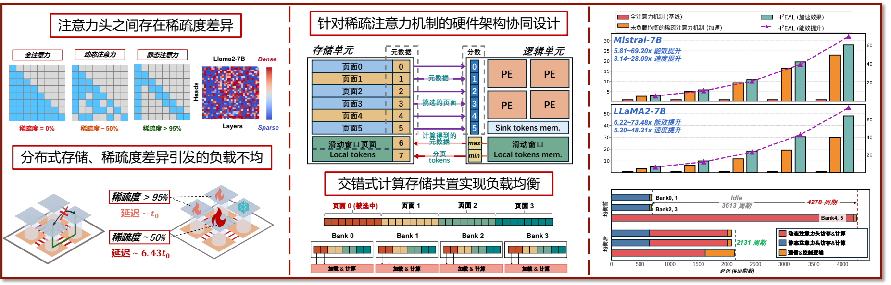

图：左栏显示不同注意力头的稀疏度差异很大（0%、约 50%、超过 95%），分布式存储后各处延迟不同（约 $t_0$ 与约 $6.43\,t_0$）；中栏是存储单元按页面元数据挑选页面交给 PE 计算，并把页面交错放到各 Bank 上来均衡负载；右栏显示在 Mistral-7B 和 LLaMA2-7B 上的加速比与能效提升，以及均衡前后延迟从 4278 周期降到 2131 周期。

> [!question]- 自测：一颗 800 $\text{mm}^2$ 的 3D DRAM 每层约 20 GB。要把一个 60B 参数、按 FP16 存储的模型全部放进去，需要几层？以当前技术能否实现？
> 需要 6 层，目前做不到。60B 参数 × 2 字节 = 120 GB，$120/20=6$ 层；而受成本、良率和散热—刷新限制，目前最多约 4 层（约 80 GB），只能放下约 2/3 的权重，这还没算 KV 缓存。

### 高带宽闪存（High Bandwidth Flash）

3D DRAM 容量不够，于是转向存储密度高得多的 Flash：商用 Flash 是三维堆叠的 3D NAND，已有两百多层，存储密度极高。

**高带宽闪存**（High Bandwidth Flash, HBF）是面向 AI 应用调整设计的 Flash：牺牲一部分容量，换取更高的带宽和更低的访问延迟，从而兼具高容量和高带宽，有潜力成为 LLM 推理的主要存储介质。

HBF 仍保留 Flash 的固有特点：**大读写粒度、高写入延迟、不灵活的擦除**，难以应对 KV 缓存频繁、细粒度的读写。讲者团队的 **HBFlex** 框架针对 KV 缓存的读、写、回收做硬件—调度协同设计，实现 1.58–3.30 倍加速。 它针对的两个问题与对策：

1. **读**：对话完成、新对话激活会使 KV 缓存在 HBF 的各个 plane 之间分布不均，增加读取 KV 的轮次。对策是均匀的 KV 数据布局：每个对话的 KV 存放在一个 plane 组中，并复制公共前缀的 KV。
2. **写**：GPU 频繁读取 HBF，而写 KV 缓存的高延迟会干扰调度。对策是把生成的 KV 缓存放在 HBF 底部逻辑芯片（base die）的 SRAM 中，并在 prefill 计算时完成写入。

> [!question]- 自测：同样是为大模型推理提供"高带宽、大容量"，3D DRAM 和 HBF 分别卡在哪里？HBFlex 为什么要专门处理 KV 缓存而不是模型权重？
> 3D DRAM 带宽高但卡在容量（约 20 GB/层、最多约 4 层）和散热—刷新；HBF 容量大，但卡在大粒度读写、高写延迟和不灵活擦除。权重只读、粒度大，天然适合 Flash；KV 缓存在解码过程中逐 token 频繁、细粒度地写入和回收，恰好撞上 Flash 的弱点，所以需要专门的布局和写入缓冲设计。

这些专用架构的代价是底层硬件越来越难编程。讲者的看法是，AI 辅助编程有望缓解专用架构"难编程"的问题，这也是业界愿意接受这类架构的原因之一。

---

## 本讲小结

### 概念地图

整讲围绕一条公式展开：带宽需求是“每次迭代读取的数据量 × 每秒迭代次数”。模型演进不断推高公式中的各项，算法与体系结构则分别从不同方向把它压下来。

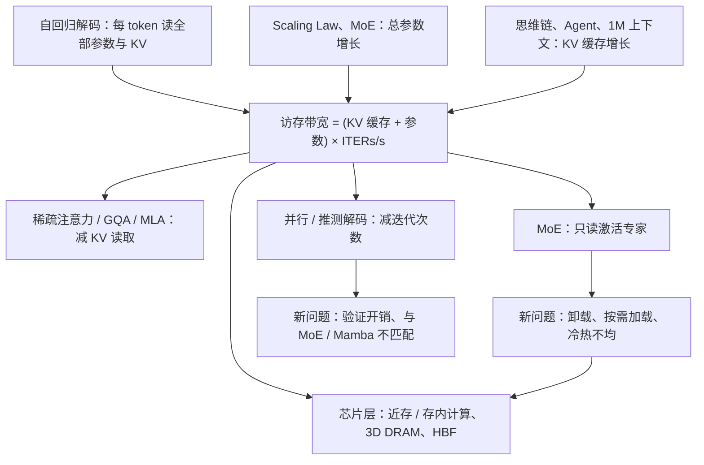

### 选择优化手段

| 瓶颈来源                            | 算法侧手段                                                     | 主要代价或限制                                           | 体系结构侧手段                                         |
| ----------------------------------- | -------------------------------------------------------------- | -------------------------------------------------------- | ------------------------------------------------------ |
| 参数量大（总参数放不进 HBM）        | MoE 只读激活专家；MatMoE 等动态位宽                            | 总参数更大、需卸载；专家动态选择无法预取；冷热不均       | 冷专家在 DRAM 旁近存计算；3D DRAM（HD-MoE）            |
| KV 缓存大（长上下文、长输出）       | GQA、MLA 压缩单 token KV；滑动窗口截断 $T$；稀疏注意力动态召回 | 滑动窗口遗忘历史；稀疏注意力不减存储                     | 3D DRAM 上的稀疏注意力（H2EAL）；HBF 存放 KV（HBFlex） |
| 迭代次数多（每 token 一次全量加载） | 并行 / 推测解码                                                | 额外计算，大批量时转为计算瓶颈；与 MoE、线性注意力不匹配 | 专用加速器（SpecMamba on FPGA）                        |
| 多条思维链并行（思维树）            | SPEX 推测执行、Hyper 平衡探索与利用                            | 同步等待、长尾、重复探索                                 | —                                                      |

讲者对全讲的总结是：摩尔定律放缓后，“算法快速迭代—芯片通用适配”的解耦路径已不能满足 AI 发展的需求，需要两层协同：算法层做芯片感知的智能算法，通过算法优化降低大模型的计算开销；芯片层做异构智能芯片架构，通过专用架构设计提升有效算力供给（讲义第 41 页）。

### 核心公式

| 公式                                                                                   | 含义                                             | 所在章节 |
| -------------------------------------------------------------------------------------- | ------------------------------------------------ | -------- |
| $\text{存储容量} = \text{KV 缓存} + \text{模型参数量}$                                 | 单请求推理需要存放的数据                         | 01       |
| $\text{访存带宽} = \text{存储容量} \times \text{Tokens/s}$                             | 每生成一个 token 都要把上述数据读一遍            | 01       |
| $\text{存储容量} = B \times M_{\rm KV} + M_{\rm param}$                                | 批处理：参数共享，KV 按请求各一份                | 01       |
| $\text{FLOPs/token} \approx 2 P_{\rm act}$                                             | 短上下文下，每 token 计算量约为激活参数量的 2 倍 | 02       |
| $\text{带宽} = (\#\,\text{Sparse KV} + \#\,\text{Active Param}) \times \text{ITERs/s}$ | 三条降带宽路径分别作用于三个因子                 | 03       |
| $\text{MHA 访存开销} \propto T \times d \times H$                                      | KV 缓存的三个维度：token 数、头维度、头数        | 04       |
