本讲解决两个问题：如何进一步降低缓存的缺失率与命中时间，以及作为主存唯一介质的 DRAM 如何存储、组织和访问数据。先补完缓存优化（硬件预取、编译器优化、VIPT、踪迹缓存），再自底向上讲 DRAM：单元与破坏性读 → MAT/Bank/Chip/Rank/Channel 组织 → 接口演进与时序参数；最后沿三条技术趋势展开：提容量（堆叠与缓冲型模组）、提速度（内存控制器、行缓冲管理、地址映射、多通道）、提数据率（预取与信号完整性）。阅读前应掌握 L06 的 AMAT、多级缓存、虚拟内存的基本概念，以及 SRAM/DRAM 单元的初步比较。

---

## 降低缺失率与命中时间

> [!abstract] 本节要点
> - 按 $\text{AMAT} = \text{Hit time} + \text{Miss rate} \times \text{Miss penalty}$ 拆开看：硬件预取和编译器优化降低缺失率，虚拟索引缓存和踪迹缓存降低命中时间。
> - 硬件预取靠监视访存模式来猜下一步要访问的数据，越靠近核越容易识别模式。LLC 分 bank 又做了哈希，很难做预取。流缓冲把顺序预取的后续块放在一个 FIFO 里，不直接放进 L1：命中就补取下一块，缺失就清空，从新地址重新开始。
> - 编译器有三种手段：合并数组提升空间局部性，循环融合提升时间局部性，循环交换让访问顺序和存储顺序一致，从而提升空间局部性。
> - VIVT 最快，但有同名问题（靠清空缓存或加 PID/ASID 解决）和别名（同义）问题。PIPT 最稳但最慢，PIVT 几乎不用。主流 L1 用 VIPT，前提是 index 位数加块内偏移位数不超过页内偏移位数：4 KiB 页时，缓存容量不超过 $4\,\text{KiB} \times$ 相联度。
> - 踪迹缓存把多个不连续的基本块按执行顺序打包进一行，取指从 5 个周期降到 1 个。优化总结表里，"+"表示改善某项指标，"−"表示恶化，硬件复杂度从 0 到 3 分级。

### 从 AMAT 看缓存优化的三个方向

平均访存时间由三项决定：

$$
\text{AMAT} = \text{Hit time} + \text{Miss rate} \times \text{Miss penalty}
$$

其中 Hit time 是命中时间，Miss rate 是缺失率，Miss penalty 是缺失代价。降低缺失代价的方法在 L06 缓存一讲中已经讲过。本节补完另外两个方向：

- **降低缺失率**：硬件预取，编译器优化。
- **降低命中时间**：在缓存索引阶段避开地址翻译（虚拟索引缓存），以及踪迹缓存。

### 硬件预取（Hardware Prefetching）

如果等到缺失发生才去下一级取数据，缺失代价就躲不开。数据如果能在访问前就取回来，原本会缺失的访问就变成了命中。软件里也有同样的思路，比如 AI 推理时预取 KV、让它和 GPU 计算重叠。硬件预取的区别在于复杂度很受限，所以策略要比软件方案简单得多。

**硬件预取**（hardware prefetching）的核心是由硬件监视访存序列，识别出其中的模式，并提前把预计要访问的块取到缓存附近。

**预取器放在哪里**：真实 CPU 里有多个预取器，规律如下：

1. **越靠近核越容易做**：L1、L2 看到的访存流还没有被打乱，模式容易识别。
2. **LLC 很难做**：L3（LLC）容量大，又被多个核共享。为了负载均衡，LLC 被分成多个独立工作的 bank，请求按地址哈希分到不同的 bank 上。这样每个 bank 看到的访问序列已经被打散，很难找出原来的访问模式。

各级缓存里常见的预取器：

| 位置 | 预取器 | 工作方式 |
| --- | --- | --- |
| L1D | 按 PC 的步长预测器（PC-localized stride predictor） | 以访存指令的 PC 为索引，记录这条指令每次访问之间的地址步长。步长稳定后，按"当前地址 + 步长"提前取下一个数据 |
| L1D | 块内短步长预测器（short-stride predictor within block） | 发现同一块内的访问步长很小（顺序访问或隔一个访问），就直接预取下一块 |
| L1I | 预测未来 PC | 根据控制流预测接下来要执行的指令地址，提前取指 |
| L2 | 流缓冲（stream buffer） | 顺序预取后续若干块，放进一个独立缓冲（见下一节） |
| L2 | 相邻行预取（adjacent-line prefetch） | 访问某一行时，顺带取出相邻的缓存行 |

按 PC 的步长预测器和分支预测器的组织方式很像：两者都以 PC 为索引记录每条指令的历史行为，只是这里记的是访存步长，不是跳转方向。L1I 预测未来 PC，靠的就是前面讲过的分支预测机制。

> [!info] 可视化资源
> [Wikipedia：缓存预取](https://en.wikipedia.org/wiki/Cache_prefetching)：页面附有 Jouppi 1990 年提出的典型流缓冲结构示意图，并分类说明顺序预取与规则/不规则步长预取，可配合理解流缓冲 FIFO 与按 PC 步长预测器。

### 流缓冲（Stream Buffer）

最简单的访存模式是依次访问连续的块。按这种模式提前取后续块的做法，叫**顺序预取**（sequential prefetching）。直接把预取的块塞进 L1 可能会挤掉有用的数据，所以流缓冲在 L1 和下一级存储之间单独加了一个缓冲来存放它们。

**流缓冲**（stream buffer）是位于 L1\$ 和下一级存储之间的一个 FIFO 队列，每个表项存一个 tag 和一整条缓存行的数据，缓冲里始终保持后续 $N$ 块可用（keeps next-$N$ available）。

工作过程：

1. **启动**：访问某个地址缺失后，流缓冲从下一块开始，依次预取后续 $N$ 块，放进 FIFO，不放进 L1。
2. **命中流缓冲**：之后 L1 缺失、而所需块正好在流缓冲队头时，把这块交给 L1 并移出队列。同时把队尾表项的地址 +1，再预取下一块补到队尾，所以缓冲里总有后续 $N$ 块。
3. **未命中流缓冲**：访问的块不在流缓冲里，说明顺序流断了。这时清空整个缓冲，以新的缺失地址为基准，从它的 +1 块开始重新预取。

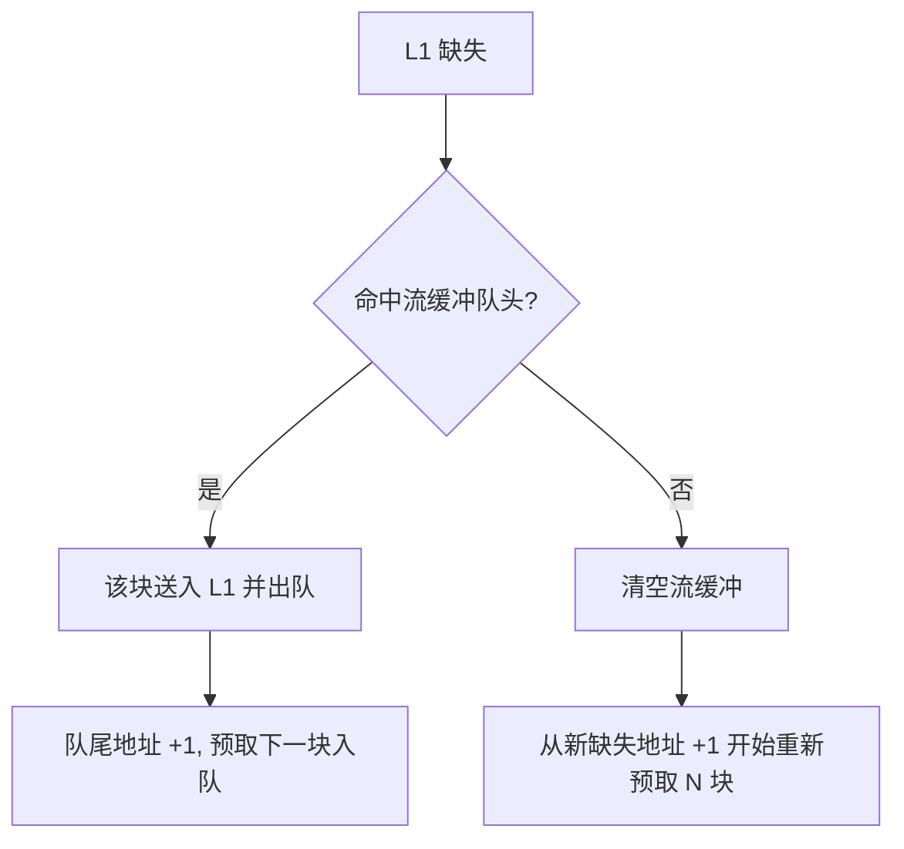

流缓冲的设计这么简单，是因为硬件里很难实现复杂的预取策略，只能用"+1、命中就续、缺失就清"这种逻辑来覆盖最常见的顺序访问。

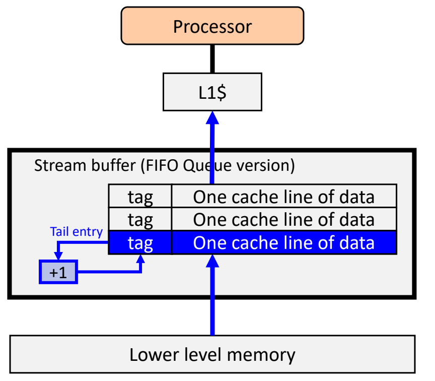

图：流缓冲区以 FIFO 队列形式位于 L1$ 与下层存储之间，每项保存 tag 与一整个缓存行，队尾地址经 +1 生成下一块地址实现顺序预取，队头数据可直接送往 L1$。

> [!example] 例：流缓冲对访问序列的反应
> 设 $N=3$，块号依次访问 10, 11, 12, 13, 40, 41（假设这些块都不在 L1 中）。
>
> 1. 访问 10 缺失，流缓冲清空后预取 11, 12, 13。
> 2. 访问 11、12、13 时依次命中队头，每次出队一块，并在队尾补上 14、15、16。
> 3. 访问 40 不在流缓冲里，清空缓冲，改为预取 41, 42, 43。
> 4. 访问 41 命中流缓冲。所以只有 10 和 40 两次访问需要等下一级存储。

### 编译器缓存优化（Cache-friendly Compiler）

硬件只能被动猜测访问模式，编译器却能看到整个程序。**编译器缓存优化**的关键思路是：修改数据结构布局或循环结构，让程序以对缓存更友好的方式访问数据，在不增加硬件的前提下降低缺失率。

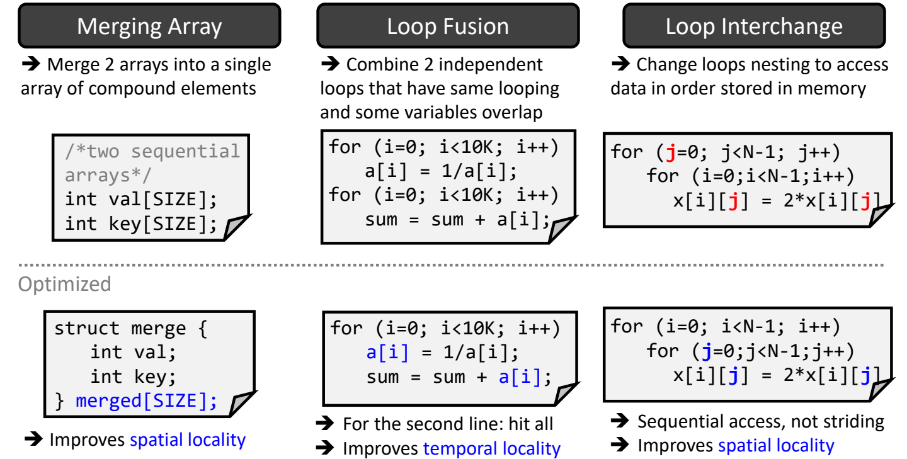

图：上下两行对比 Merging Array、Loop Fusion、Loop Interchange 优化前后的代码，注意合并数组与交换循环改善空间局部性，融合循环使第二条语句全部命中、改善时间局部性。

#### 合并数组（Merging Arrays）

key 和对应的 value 通常一起访问。存成两个独立数组时，`key[i]` 和 `val[i]` 位于两个相距很远的块，一次访问要碰两个块。把两个数组合并成一个复合元素数组后，同一个 `i` 的 key 和 val 落在同一块里：

```c
/* 优化前：两个顺序数组 */
int val[SIZE];
int key[SIZE];

/* 优化后：复合元素数组 */
struct merge {
    int val;
    int key;
} merged[SIZE];
```

**效果**：提升空间局部性（spatial locality）。

#### 循环融合（Loop Fusion）

两个独立循环如果循环范围相同、访问的变量有重叠，就可以合并成一个循环：

```c
/* 优化前 */
for (i = 0; i < 10K; i++)
    a[i] = 1/a[i];
for (i = 0; i < 10K; i++)
    sum = sum + a[i];

/* 优化后 */
for (i = 0; i < 10K; i++) {
    a[i] = 1/a[i];
    sum = sum + a[i];
}
```

优化前，第二个循环要从头再扫一遍 `a`。如果数组大于缓存，前面的块早已被替换，`a[i]` 会再缺失一次。融合后，第一行刚访问过 `a[i]`，第二行再访问它时全部命中（hit all）。**效果**：提升时间局部性（temporal locality）。

#### 循环交换（Loop Interchange）

```c
/* 优化前：内层循环变 i */
for (j = 0; j < N-1; j++)
    for (i = 0; i < N-1; i++)
        x[i][j] = 2*x[i][j];

/* 优化后：内层循环变 j */
for (i = 0; i < N-1; i++)
    for (j = 0; j < N-1; j++)
        x[i][j] = 2*x[i][j];
```

交换嵌套顺序，让访问按数据在内存中的存储顺序进行。优化后内层按 `j` 顺序访问，不再按大步长跨行。**效果**：提升空间局部性。

> [!info] 可视化资源
> [Wikipedia：循环交换](https://en.wikipedia.org/wiki/Loop_interchange)：给出交换嵌套循环前后的代码示例和行优先/列优先存储示意图，直观说明为何按存储顺序访问能减少缓存缺失。

> [!note] 补充解释
> C 语言的二维数组按行主序（row-major）存储，`x[i][j]` 和 `x[i][j+1]` 相邻，`x[i][j]` 和 `x[i+1][j]` 相隔一整行（$N$ 个元素）。所以内层变 `i` 时每次访问跨一行，几乎每次都落在不同的块上。内层变 `j` 时，一个块里的多个元素会被连续用完。

> [!warning] 易错点
> 三种手段改善的局部性类型不同：合并数组和循环交换改善**空间**局部性（让相邻访问落在同一块），循环融合改善**时间**局部性（让同一数据在被替换前被重复使用）。判断方法是看优化后"再次命中"的是同一个数据，还是同一块里的相邻数据。

### 虚拟索引缓存（Virtually Indexed Cache）

程序发出的是虚拟地址（VA），缓存通常按物理地址（PA）组织。所以每次访存都要先经过 MMU/TLB 把 VA 翻译成 PA，才能查缓存。即使数据就在缓存里，地址翻译也在关键路径上，直接拉长了命中时间。地址翻译、TLB、页表的细节属于操作系统课程，这里只用它"把虚拟页号换成物理页号、页内偏移不变"这一性质。

**虚拟缓存**（virtual cache）的想法是直接用虚拟地址索引缓存（以及比较 tag），只在缺失、要访问主存时才做地址翻译，从而把翻译移出命中路径。

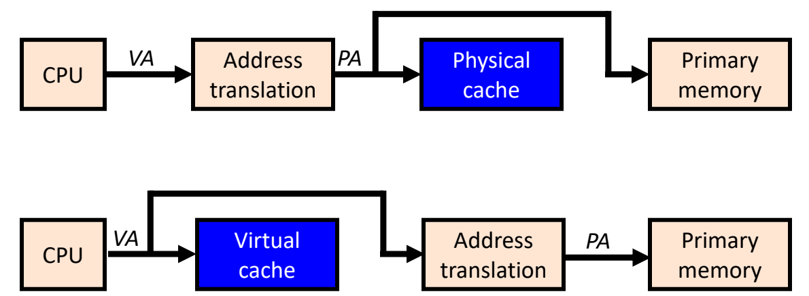

图：上方物理缓存需先把 VA 经地址转换得到 PA 再访问缓存，下方虚拟缓存直接用 VA 访问，仅在缺失时才经地址转换得到 PA 访问主存。

这张图对比了两种结构。物理缓存放在地址翻译之后（CPU → 地址翻译 → 物理缓存 → 主存）。虚拟缓存放在地址翻译之前（CPU → 虚拟缓存 → 地址翻译 → 主存）。

#### 两个挑战

**同名问题**（homonym）：不同进程用相同的虚拟地址访问各自不同的物理数据。上下文切换后，缓存里留下的是上一个进程的数据，新进程用同一个 VA 会读到别人的数据。

- 最直接的办法是每次进程切换时清空（purge）缓存。但进程每几十毫秒就切换一次，清空本身要花时间，脏数据还要写回内存，代价很大。
- 更好的办法是在 tag 上附加**进程标识**（PID tags），现代处理器用的是**地址空间标识符**（ASID）。这样虚拟 tag 对每个进程唯一，缓存就能同时存放多个进程的数据。

**别名问题**（aliasing）：两个不同的虚拟地址映射到同一个物理地址，这样的地址称为**同义词**（synonym），典型例子是进程间共享的数据。它们可能被放进不同的缓存行，一个进程通过自己的 VA 写入后，另一个进程用另一个 VA 读到的仍是旧值。只加 PID 解决不了这个问题。可选的方案有反别名硬件（anti-aliasing hardware，比如探测其他组、反向查找表）、页着色（page coloring，一种软件方案），以及只用页内偏移做索引。

#### 四种索引/标记组合

缓存访问分两步：先用 index 找到组，再比较 tag。两步分别可以用 VA 或 PA，于是有四种组合：

| 组合 | 索引 | 标记 | 速度 | 问题 | 使用情况 |
| --- | --- | --- | --- | --- | --- |
| PIPT（物理索引物理标记） | PA | PA | 最慢：翻译延迟全部叠加到每次访问上 | 无同名、别名问题，最稳健 | 不适合要求和核同速的 L1 |
| VIVT（虚拟索引虚拟标记） | VA | VA | 理论上最快：命中不需要 PA | 同名问题和别名问题 | 问题太棘手，基本不用 |
| PIVT（物理索引虚拟标记） | PA | VA | 慢：要先翻译才能索引 | 同时带有 VIVT 的不一致问题 | 最差，几乎从不使用 |
| VIPT（虚拟索引物理标记） | VA 的页内偏移部分 | PA | 翻译和找组并行 | 满足位数约束时无别名问题 | 主流 L1 的做法 |

#### VIPT 的机制与约束

VIPT 好在地址翻译和组查找可以**并行**进行：

1. **高位送 MMU**：VA 中代表虚拟页号（VPN）的高位送到 MMU，由 TLB 加速翻译成物理页号（PPN）。
2. **低位送缓存**：VA 的低位（页内偏移）同时送到缓存，用来选出对应的组，读出组内所有 tag。
3. **比较 tag**：PPN 得到后，与这一组所有 tag（物理 tag）比较。命中就把数据送回寄存器或执行单元，缺失就转到下一级缓存。

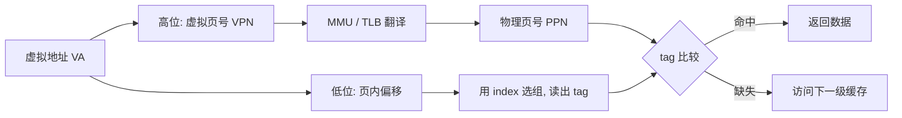

这样做成立的根本原因是：地址翻译只改变虚拟页号，**页内偏移在翻译前后完全相同**。比如页大小为 4 KB 时，最低 12 位是页内偏移，翻译不改变这 12 位。

并行有两个限制：

1. **翻译要比组查找快**：地址翻译花的时间必须短于在缓存中找到对应组的时间，否则多出的翻译周期会加到 tag 比较之前。
2. **索引位不能越出页内偏移**：

$$
b_{\text{index}} + b_{\text{offset}} \le b_{\text{page}}
$$

其中 $b_{\text{index}}$ 是组索引位数，$b_{\text{offset}}$ 是块内（行内）偏移位数，$b_{\text{page}}$ 是页内偏移位数（4 KiB 页时为 12）。一旦越界，索引就会用到虚拟页号的某些位，而这些位翻译后可能改变，于是又落回同义词的别名问题，缓存一致性协议也会复杂得多。

由约束可以直接推出容量上限。缓存容量 $= 2^{b_{\text{index}}} \times 2^{b_{\text{offset}}} \times$ 相联度 $\le 2^{b_{\text{page}}} \times$ 相联度，即

$$
\text{Cache size} \le \text{Page size} \times \text{Associativity}
$$

> [!example] 例：32 KiB 8 路 L1 为什么没有别名问题
> 设块大小 64 B，页大小 4 KiB（$b_{\text{page}}=12$）。
>
> 1. 组数 $= \frac{32\,\text{KiB}}{8 \times 64\,\text{B}} = 64$，所以 $b_{\text{index}} = 6$。
> 2. 块内偏移 $b_{\text{offset}} = \log_2 64 = 6$。
> 3. $6 + 6 = 12 \le 12$，满足约束，索引位全部在页内偏移里，VIPT 可以无别名地并行查找。
> 4. 若改成 64 KiB 8 路：组数 128，$7 + 6 = 13 > 12$，越界。要保持不越界，只能把相联度提高到 16 路、增大页，或者加硬件处理别名。

这个约束就是 L1 缓存容量大多停在 32–64 KB 的原因。想继续增大容量，要么改变页大小，要么提高相联度，要么增加组数并处理别名问题，每种做法都有代价。AMD 一些较老的微架构曾让 VIPT 的 L1 指令缓存越过页偏移边界，因此必须用额外硬件处理别名；较新的 AMD 处理器和 Intel 一样，采用没有别名问题的标准 32 KB 8 路设计。

> [!warning] 易错点
> 同名和别名方向相反，不要混淆。**同名**是同一个 VA 对应不同的 PA（不同进程），靠清空缓存或加 PID/ASID 解决。**别名（同义）**是不同的 VA 对应同一个 PA（共享数据），加 PID 解决不了，要靠反别名硬件、页着色，或者把索引限制在页内偏移内（VIPT 约束）。

### 踪迹缓存（Trace Cache）

普通指令缓存按地址存放指令。程序一旦有分支，实际执行的指令序列就分散在多条不连续的缓存行里，每遇到一次跳转就要再取一行，取指带宽被分支切碎。

**踪迹缓存**（trace cache）通过把多个不连续的基本块（basic block）打包进一条连续的踪迹缓存行，来加速指令缓存。

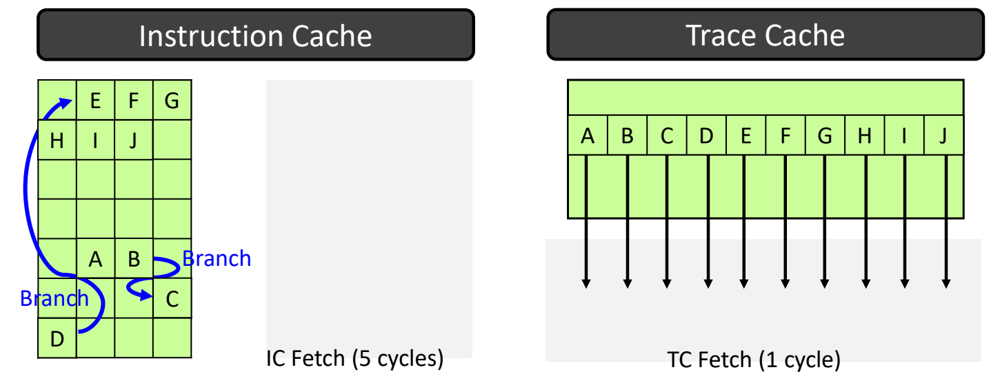

图：左侧普通指令缓存中基本块 A–J 因分支分散在多行，取指需 5 个周期；右侧踪迹缓存把 A–J 按执行顺序放进同一行，1 个周期即可取出。

图中指令按执行顺序是 A → J：

1. **普通指令缓存**：A、B 在同一行。B 之后分支跳到 C，C 之后再跳到 D，D 之后分支跳到 E、F、G 所在行，接着是 H、I、J 那一行。每段要单独取一次：(A B)、(C)、(D)、(E F G)、(H I J)，共 **5 个周期**。
2. **踪迹缓存**：A B C D E F G H I J 按执行顺序存在同一条踪迹行里，**1 个周期**就能取出。

**实例**：Pentium 4（NetBurst）的踪迹缓存存的不是原始指令，而是已经**译码并拆分**（decoded and cracked）好的微操作（uops），每隔一个周期返回 6 个 uops。这样命中时连译码都省掉了。

> [!note] 补充解释
> 通过 profile 或静态分析得到的跳转信息，可以说明"为什么能知道该把哪些块拼在一起"。但实际硬件里的踪迹缓存（如 Pentium 4）是在运行时，由硬件沿着动态执行（含分支预测）的路径把取到的指令拼成 trace，不依赖事先 profile。

### 缓存优化总结表

把 L06 和本节的各种优化放在一起比较。"+"表示改善该项指标，"−"表示恶化该项指标，空白表示基本无影响。硬件复杂度从 0（最简单）到 3（最复杂）。

| 技术 | 缺失率 | 缺失代价 | 命中时间 | 硬件复杂度 |
| --- | --- | --- | --- | --- |
| 增大块（Larger Block Size） | + | − |  | 0 |
| 提高相联度（Higher Associativity） | + |  | − | 1 |
| 受害者缓存（Victim Caches） | + |  |  | 2 |
| 伪相联（Pseudo-associative） | + |  |  | 2 |
| 硬件预取（Hardware Prefetching） | + |  |  | 2 |
| 编译器控制的预取（Compiler-controlled Prefetch） | + |  |  | 3 |
| 编译器技术（Compiler Techniques） | + |  |  | 0 |
| 读缺失优先（Giving Read Misses Priority） |  | + |  | 1 |
| 子块放置（Subblock Placement） |  | + |  | 1 |
| 提前重启 / 关键字优先（Early Restart / Critical Word First） |  | + |  | 2 |
| 非阻塞缓存（Nonblocking Caches） |  | + |  | 3 |
| 二级缓存（Second-Level Caches） |  | + |  | 2 |
| 小而简单的缓存（Small and Simple Caches） | − |  | + | 0 |
| 避免地址翻译（Avoiding Address Trans.） |  |  | + | 2 |
| 流水化写（Pipelining Writes） |  |  | + | 1 |

以第一行为例：增大块（最佳块大小在前面的课上讨论过，约 64 B）利用空间局部性降低缺失率，记"+"。但一次缺失要搬多个字，缺失代价变大，记"−"。它几乎不需要改硬件，只要调整 index、tag 的划分，所以复杂度为 0。

> [!question]- 自测：页大小 4 KiB，块大小 64 B，L1D 设计为 48 KiB、12 路组相联，能否用无别名的 VIPT？若改为 64 KiB、4 路呢？
> 48 KiB 12 路可以：组数 $= \frac{48\,\text{KiB}}{12 \times 64\,\text{B}} = 64$，$b_{\text{index}}=6$，$6+6=12 \le 12$。64 KiB 4 路不行：组数 $=256$，$8+6=14>12$，有 2 位索引来自虚拟页号，会产生同义词别名问题（容量上限 $4\,\text{KiB} \times 4 = 16\,\text{KiB}$）。

> [!question]- 自测：下面的代码对 `b` 的访问应使用哪种编译器优化？改善的是哪种局部性？
> ```c
> for (j = 0; j < N; j++)
>     for (i = 0; i < N; i++)
>         b[i][j] += 1;
> ```
> 用循环交换，把 `i` 放到外层、`j` 放到内层。C 按行主序存储，内层变 `j` 才是顺序访问，同一块里的相邻元素被连续用到，改善的是空间局部性。

> [!question]- 自测：两个进程共享一页物理内存，并分别映射到不同的虚拟地址。在 VIVT 缓存里只给 tag 加上 PID，能否保证两个进程看到一致的数据？
> 不能。这是别名（同义词）问题，不是同名问题：两个 VA 可能落在不同的缓存行里，PID 只能区分同一 VA 属于哪个进程，无法让对同一 PA 的两份副本保持一致。要靠反别名硬件、页着色，或改用满足位数约束的 VIPT。

---

## DRAM 单元与破坏性读

> [!abstract] 本节要点
> - DRAM 单元是 1T1C：一个晶体管作开关、一个电容存电荷；写 1 给电容充电，写 0 让电容放电；每个单元只连一条字线和一条位线，比 6 管 SRAM 简单、便宜，但更慢。
> - 电容 $C$ 随极板面积增大、介电常数增大、极板距离减小而增大；工艺下只有面积可调，所以 DRAM 用三维**沟槽电容**在很小的横截面上获得很大的极板面积。
> - **MAT** 是 DRAM 单元阵列：行地址经行译码器打开一整条字线，整行数据进入灵敏放大器（即**行缓冲**），再由列地址经列译码器选出所需数据送上数据总线。
> - **破坏性读**：位线预充到 $V_{dd}/2$，且位线寄生电容大于单元电容；读时位线电压只小幅升/降，单元电压却大幅变化，灵敏放大器把小摆幅放大到 $V_{dd}$ 或 0；读完后单元接近 $V_{dd}/2$，数据只“安全地”留在行缓冲里，必须写回。
> - **栅漏电**让未被访问的单元也会丢数据，因此所有行必须周期性读出并重写（典型周期 64 ms），这就是 Dynamic 的由来；把行读入行缓冲慢、读行缓冲快，所以要争取**行缓冲命中**。

### DRAM 在存储层次中的位置

存储层次利用程序的局部性，让用户既能用到最便宜技术所能提供的容量，又能获得最快技术所提供的速度。 层次呈金字塔形：越靠近处理器，容量越小、访问粒度越小；越远离处理器，容量越大、粒度越大。

各层之间的传输粒度：

- 处理器 ↔ L1\$：4–8 bytes（一个字 word）；
- L1\$ ↔ L2\$：8–32 bytes（一个块 block）；
- L2\$ ↔ 主存：1 到 4 个块；
- 主存 ↔ 二级存储：1,024+ bytes（磁盘扇区 = 页）。

本讲关注的是**主存**（main memory）这一层。目前主存的介质只有 DRAM 一种：它比 SRAM 便宜，但内部逻辑复杂，速度比 SRAM 慢得多。 分析 DRAM 时自底向上：先看单个单元，再看单元如何组成阵列（本节），然后看阵列如何组成 Bank、Chip、Rank、Channel（见[DRAM 组织层次](#dram-组织层次)）。

### DRAM 单元（1T1C Cell）

SRAM 每个单元要 6 个晶体管、两条位线；若主存也这样做，单位面积能放的比特太少、成本太高。DRAM 用最少的器件存 1 bit，换取密度和价格。

**DRAM**（Dynamic Random Access Memory，动态随机存取存储器）的单元由 **1T1C**（1 Transistor 1 Capacitor，一个晶体管加一个电容）构成：

- **字线**（wordline）接在晶体管栅极上，用来**选中单元**：字线有效时开关导通，电容与位线相连；字线无效时开关断开，电容被隔离。
- **位线**（bitline，记作 $b$）用来**读写单元**：所有读写都经过这条线进行。
- **数据存放在电容里**：电容中的电荷量代表存储的比特。

写操作的过程：

1. **写 1**：打开字线，通过位线向电容充电，使电容处于高电压（电量最高），表示数字 1。
2. **写 0**：打开字线，让电容中的电荷经位线放掉，电容中没有电荷，表示数字 0。

与 SRAM 相比，DRAM 单元只需 1 个晶体管（SRAM 需要 6 个），每个单元只连 1 条字线、1 条位线（SRAM 有两条位线），器件和连线都更简单，这正是它便宜、密度高的原因。L06 已对 SRAM 与 DRAM 单元做过基本比较，此处不再展开。

### 沟槽电容（Trench Cell）

想在同样大小的芯片上放更多 DRAM 单元，就要把每个单元做小；但电路课里那种两块平行极板的电容“尺寸太大”，缩小它又会减少能存的电荷。 问题因此变成：如何在单元占地变小的同时，保持电容量不变。

平行板电容的电容量由三个因素决定：

$$
C \propto \frac{\varepsilon A}{d}
$$

其中 $C$ 是电容量，$\varepsilon$ 是两极板间介质的介电常数，$A$ 是极板面积，$d$ 是两极板间的距离。逐个分析可调的“旋钮”：

1. **介电常数 $\varepsilon$**：半导体工艺使用固定的 CMOS 材料体系，不允许随意更换极板间的介质，$\varepsilon$ 无法改变。
2. **极板距离 $d$**：受工艺限制，同样不能随意减小。
3. **电压**：提高电压可以多存电荷，但电压升高会增加功耗，而现在的趋势是电压越低越好。
4. **面积 $A$**：唯一可以改变的因素。

于是矛盾变成“截面要小、面积要大”。解决办法是把电容做成三维结构：把平板电容向下“按”进硅衬底，弯折成一个深沟槽。这种实际使用的电容称为**沟槽电容**（Trench Cell）。 从芯片表面看它的横截面积很小，但沟槽侧壁和底部展开后的实际极板面积很大。

沟槽电容的剖面由内到外包括：填充多晶硅（Refilling Poly）、单元极板硅（Cell Plate Si）、电容绝缘层（Cap Insulator）、存储节点多晶硅（Storage Node Poly）、场氧化层（Field Oxide），整体嵌在硅衬底（Si Substrate）中。幻灯片中的口号是 “Keep pushing to reduce the cap size”：沿着这条路一直压缩电容的占地面积。

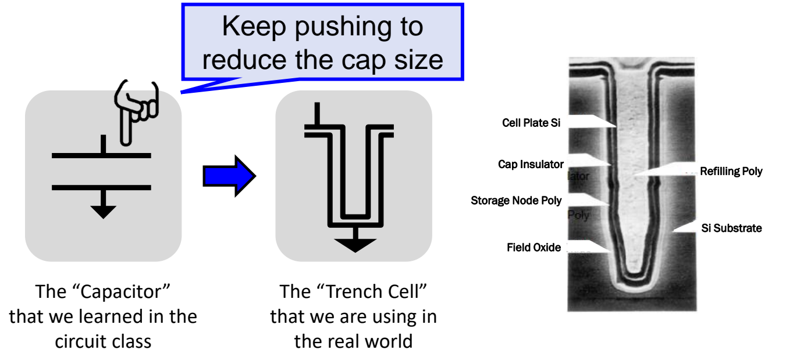

图：从电路课中的平板电容符号到实际使用的沟槽电容（Trench Cell），右侧剖面照片标出 Cell Plate Si、Cap Insulator、Storage Node Poly 等层，体现为缩小面积而向下挖槽的结构；中间是弯折成 U 形的沟槽电容示意。

> [!info] 可视化资源
> [Wikimedia Commons：DRAM 单元图集](https://commons.wikimedia.org/wiki/Category:DRAM_cell)：收录平面、堆叠（stack）与沟槽（trench）电容 DRAM 单元剖面图及 1T1C、3T 单元示意图，可对比理解三维沟槽电容如何在小截面上获得大面积。

如今大部分 DRAM 都采用这类三维电容设计，靠单元工艺本身进一步提升容量已经非常困难；另一条提容量的路是堆叠，见[容量扩展与内存模组](#容量扩展与内存模组)。

### DRAM 阵列 MAT 与行缓冲（Row Buffer）

单个单元只存 1 bit，需要把大量单元组织起来，并用尽量少的地址线和数据线访问它们。

**MAT** 是由大量 DRAM 单元排成的二维阵列，是 DRAM 内部组织的最小单元。 因为 DRAM 单元可以分**行**（Row）和**列**（Column）两步访问，所以可以把同一列上的多个单元连接到同一条位线上。 MAT 的组成部分：

- 阵列：每个交叉点是一个 DRAM 单元；
- **行译码器**（Row Decoder）：驱动各条横向的字线，即单元晶体管栅极接的线；
- **灵敏放大器**（Sense Amps），也就是**行缓冲**（Row Buffer）：接在各条纵向位线的末端；
- **列译码器**（Column Decoder）：从行缓冲中选出所需的数据送上数据总线（Data Bus）。

一次读访问分两步：

1. **行访问**：输入行地址（Row Address），行译码器选中一条字线；这条字线上**所有**单元的数据都经各自的位线读入灵敏放大器，即整行进入行缓冲。
2. **列访问**：输入列地址（Column Address），列译码器根据列地址从行缓冲中选出某一个（或某一组）数据，读到数据总线上。

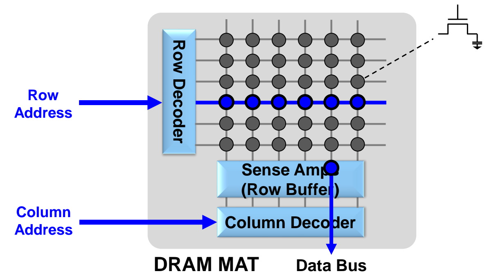

图：行地址经 Row Decoder 选中一整行（蓝色）送入 Sense Amps 即行缓冲，再由列地址经 Column Decoder 选出一位送到 Data Bus，体现两步（行、列）访问。

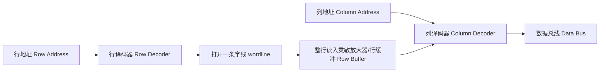

> [!warning] 易错点
> DRAM 与 SRAM 的阵列访问方式不同。SRAM 阵列选中一条字线后，可以直接由列选择读出所需单元；DRAM 必须先把**整条字线上所有单元**读进行缓冲，再由列地址从行缓冲中选数据。为什么 DRAM 必须多这一层行缓冲，原因就是下面的破坏性读。

> [!info] 可视化资源
> [Wikipedia：DRAM](https://en.wikipedia.org/wiki/Dynamic_random-access_memory)：含 1T1C 单元剖面图、$4 \times 4$ 阵列读出与写入示意图，并逐步解释行打开后灵敏放大器锁存整行及破坏性读后的回写，补充 MAT 读写过程。

多个 MAT 如何组成 Bank、以及为什么不直接做一个大阵列，见[DRAM 组织层次](#dram-组织层次)。

### 破坏性读（Destructive Read）

读 DRAM 单元时，电容里只有极少的电荷，这些电荷要先分给位线，才能被检测出来；代价是单元本身的内容在读的过程中被“用掉”。

**破坏性读**指 DRAM 单元的内容在读出后即被擦除：无论原来存的是 0 还是 1，读完后单元中的电压都接近 $\frac{1}{2}V_{dd}$。

理解它的关键是：位线看起来只是一根导线，本质上也是一个小电容；而且因为位线很长、连着很多单元，它的**寄生电容比单元电容还大**。这一点有些反直觉，但确实如此。

#### 读 1 的过程

1. **预充**：读之前把位线电压设为 $V_{dd}/2$，即 0 与 $V_{dd}$ 的中间值；单元电容处于 $V_{dd}$。
2. **打开字线**（Wordline Enabled）：电容与位线连通。因为位线电压低于电容电压，电容向位线充电（电子从位线流向单元，图中标为 Electron leakage）。
3. **电荷分享**：位线电容大，所以位线电压只**小幅上升**；单元电容小，所以电容电压**大幅下降**，直到两者电压相等、不再有充放电。
4. **灵敏放大**（Sense Amp Enabled）：灵敏放大器检测到位线比 $V_{dd}/2$ 略高，把这个微小变化放大到 $V_{dd}$，于是识别出单元存的是 1。
5. **结果**：单元电容的电压已降到接近 $V_{dd}/2$。

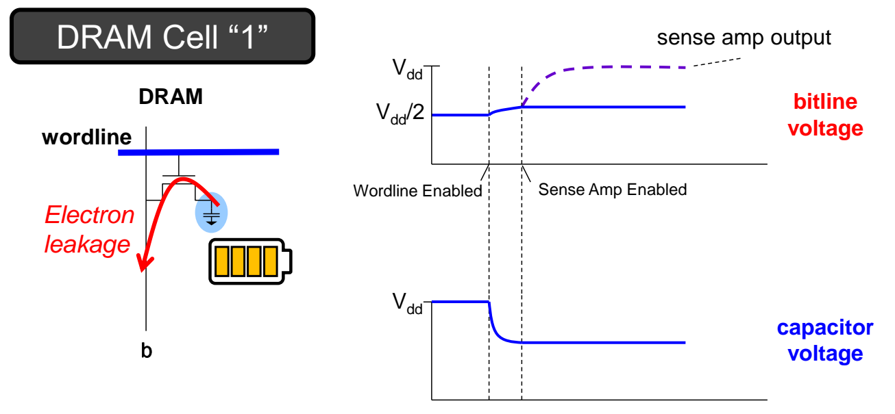

图：存 1 的单元在字线打开后电荷分享，位线从 $V_{dd}/2$ 略升、电容电压从 $V_{dd}$ 降到中间值，灵敏放大器使能后输出被放大到 $V_{dd}$，说明读出会破坏单元内容。

#### 读 0 的过程

1. **预充**：位线为 $V_{dd}/2$，单元电容为 0。
2. **打开字线**：位线电压高于电容，位线向电容充电（讲义标为 Electron injection）。
3. **电荷分享**：位线电压**小幅下降**，电容电压**大幅上升**，直到两者平衡。
4. **灵敏放大**：灵敏放大器把位线比 $V_{dd}/2$ 略低的变化放大到 0 V，识别出单元存的是 0。
5. **结果**：单元电容的电压已升到接近 $V_{dd}/2$。

> [!note] 补充解释
> 用电荷守恒可以定量看出“位线小动、单元大动”。设单元电容为 $C_s$、位线电容为 $C_b$，单元电压为 $V_s$（读 1 时为 $V_{dd}$，读 0 时为 0），位线预充为 $V_{dd}/2$。字线打开后两者达到共同电压 $V$：
> $$
> V = \frac{C_s V_s + C_b \cdot \frac{V_{dd}}{2}}{C_s + C_b}, \qquad \Delta V_{\rm bitline} = V - \frac{V_{dd}}{2} = \pm\frac{V_{dd}}{2}\cdot\frac{C_s}{C_s + C_b}
> $$
> 当 $C_b > C_s$ 时，$|\Delta V_{\rm bitline}| < V_{dd}/4$，位线只有小摆幅，必须靠灵敏放大器放大；而单元电压从 $V_{dd}$ 或 0 一路被拉到与位线相同的 $V$（接近 $V_{dd}/2$），原有信息随之消失。

破坏性读带来两个后果：

1. **无法分辨原值**：读完后单元无论原来是 0 还是 1 都接近 $V_{dd}/2$，单看单元已分不清原来存的是什么。
2. **不能再读一次**：再次读时，单元和预充后的位线电压几乎相同，上面依赖的充放电过程不再发生，读不出任何信号。所以一次读出只允许读一次，想再读必须先把数据重新写回单元。

这就是 DRAM 需要行缓冲的根本原因：整行数据读出后，单元里的内容已经没了，必须先把这些数据存放在行缓冲里，之后再写回单元。

> [!warning] 易错点
> 不要以为位线电容比单元电容小、读时位线电压会被拉到 $V_{dd}$ 或 0。实际是位线电容**更大**：位线只产生很小的电压变化，摆到 $V_{dd}$ 或 0 的是**灵敏放大器的输出**，而被大幅改变的是**单元电容**的电压。

### 栅漏电与刷新（Gate Leakage & Refresh）

即使从不去读，单元电容也存不住电荷：开关关上后，电容并不是理想的断路。

**栅漏电**（Gate Leakage）指 DRAM 单元即使没有被访问，也会逐渐向周围泄漏电荷、丢失内容。 超过一定时间后，单元里无论原来存的是 0 还是 1，最终都会变成 0。正因为内容会随时间自行流失，这种存储器才叫“**动态**”（dynamic）RAM。为此，**所有 DRAM 行都必须周期性地读出并重新写入**，典型周期为 **64 ms**。

**刷新**（Refresh）是同时解决破坏性读和栅漏电的机制，核心是利用行缓冲：

1. **读出时保存**：一次读之后，单元里的内容已经没了，但数据仍“安全地”保存在行缓冲中。
2. **写回**：在不再需要这些数据时，把行缓冲中的数据写回该行的单元。
3. **先写回再读下一次**：在进行下一次读之前，必须保证写回已经完成。
4. **周期性刷新**：对每一行按上述“读入行缓冲 → 写回”的方式处理，并在 64 ms 内覆盖所有行，补上漏掉的电荷。

一行中的每个单元对应一个灵敏放大器，所有灵敏放大器合起来就是行缓冲；数据先从单元读入行缓冲，再从行缓冲写回单元。

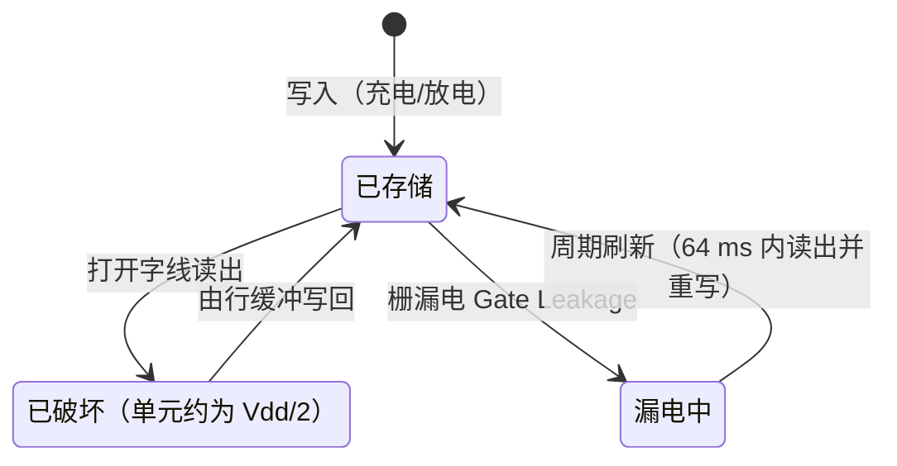

这些写回与刷新的约束都会体现在 DRAM 的命令和时序参数中，例如写回在感测完成后进行、必须在下一次访问前完成，见[DRAM 接口与时序](#dram-接口与时序)。

### 行缓冲命中（Row-Buffer Hit）

把数据从单元读入行缓冲、以及从行缓冲写回单元都比较慢；但如果数据已经在行缓冲里，直接从行缓冲读就很快。

**行缓冲命中**（row-buffer hit）指要访问的数据所在的行已经在行缓冲中，只需做列访问即可读出；优化方向是**尽量从同一个行缓冲中连续读出多段数据**，摊薄读入整行的代价。 由此产生了许多优化手段：内存控制器优先调度命中行缓冲的请求、开页/闭页策略、以及把连续地址映射到同一行的地址映射方式，分别见[内存控制器与行缓冲管理](#内存控制器与行缓冲管理)和[地址映射与多通道](#地址映射与多通道)。

> [!example] 例：同一行与不同行的访问
> 某 MAT 依次收到三个读请求：(行 5, 列 2)、(行 5, 列 9)、(行 8, 列 2)。
>
> 1. 第一个请求：行 5 不在行缓冲中，需先打开行 5 的字线，把整行读入行缓冲（慢），再按列 2 选出数据。
> 2. 第二个请求：行 5 已在行缓冲中，属于行缓冲命中，只需按列 9 从行缓冲中选数据（快）。
> 3. 第三个请求：要访问行 8，行缓冲中是行 5。行 5 的单元在读出时已被破坏，必须先把行缓冲中的数据写回行 5，再把行 8 读入行缓冲，最后选出列 2——这是最慢的情况。
>
> 因此，把对同一行的访问集中在一起，能显著减少慢速的“读入行缓冲 / 写回”操作。

> [!question]- 自测：某单元存 1，刚被读出一次且尚未写回。此时若直接对它再执行一次“预充位线到 $V_{dd}/2$ → 打开字线 → 灵敏放大”，会读到什么？
> 读不出可靠的值。第一次读后单元电压已接近 $V_{dd}/2$，与预充后的位线几乎相等，打开字线时几乎没有电荷流动，位线没有可供灵敏放大器放大的偏移。所以必须先从行缓冲把 1 写回单元，才能再次读它。

> [!question]- 自测：如果工程师把位线做得很短，使位线电容远小于单元电容，读 1 时位线和单元电压会怎样变化？这与实际 DRAM 有何不同？
> 由电荷分享，共同电压会接近单元原电压：位线会被大幅拉向 $V_{dd}$，单元电压只略微下降。实际 DRAM 恰好相反——位线很长、电容大于单元电容，位线只小幅上升、单元电压大幅下降到接近 $V_{dd}/2$，所以既需要灵敏放大器放大小摆幅，又会产生破坏性读。

> [!question]- 自测：一块 DRAM 长时间没有任何读写访问，它的数据还安全吗？需要做什么？
> 不安全。栅漏电会让未被访问的单元逐渐漏掉电荷，最终 0 和 1 都变成 0。必须周期性（典型 64 ms 内覆盖所有行）把每一行读入行缓冲再写回，即刷新；“动态”RAM 之名正来源于此。

---

## DRAM 组织层次

> [!abstract] 本节要点
> - DRAM 子系统自底向上分层：单元（cell）→ MAT → Bank → Chip → Rank → Channel；每一层由多个下一层单元组成。
> - Bank 由多个 MAT 加上全局行译码器和全局灵敏放大器组成，是**能独立服务一个访存请求**的基本操作单元。一颗 Chip 常含 8 个 Bank，它们共享外围逻辑与 I/O 接口，因此往外送数据时只能串行。
> - 之所以切成许多小阵列：大阵列里远端单元的字线、位线又长又慢（RC 大），时间偏斜大、感测裕量小，整个阵列只能按最慢的单元定时序。小阵列快、省功耗，代价是面积利用率低。
> - 芯片容量可逐级分解：$512\,\text{Mb} = 4 \times 128\,\text{Mb} = 4 \times (26 \times 30\ \text{MAT}) \times 176\,\text{kb} = 4 \times (26 \times 30\ \text{MAT}) \times 352\ \text{WL} \times 500\ \text{BL}$。
> - Rank 内的多颗 Chip **同步协作**服务同一个请求，Chip 数由系统总线宽度决定（如 8 颗 $\times 8$ 芯片拼成 64 位，第 9 颗存 ECC）；Bank 之间则**彼此独立**。Channel 是内存模组与内存控制器之间的内存总线，一个 Channel 可以挂多个 Rank。

### 分层总览

一颗 DRAM 芯片的容量是数十亿个 1T1C 单元。如果把它们排成一个整体阵列，延迟、功耗和可靠性都不可接受（原因见下文"分层组织的原因"）。所以 DRAM 从单元开始逐级组织成越来越大的单元，每一级都有自己的角色：

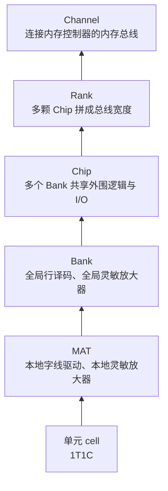

单元与 MAT 的内部结构（字线、位线、行缓冲与灵敏放大器、破坏性读）见[DRAM 单元与破坏性读](#dram-单元与破坏性读)。本节从 MAT 往上讲。

### Bank 与 Chip

单个 MAT 很小，只实现了一个基本的读写框架，容量不够。所以要把许多 MAT 组合成更大的、能独立对外工作的单元。

**存储体（Bank）**由多个 MAT 组成，是 DRAM 中可以独立服务访存请求的基本操作单元（operating basic unit）。 它的结构分两级：

1. **全局一级**：一个 Bank 有全局行译码器（Row Decoder）、全局字线（global wordline）、全局位线（global bitline）和全局灵敏放大器（Global Sense Amps）。全局行译码器负责选中某个 MAT 中的某一行。
2. **本地一级**：每个 MAT 内部还有自己的字线驱动器（WL Drivers）、本地灵敏放大器（Local Sense Amps，即行缓冲 Row Buffer）和列译码器（Column Decoder）。数据先在 MAT 内被本地灵敏放大器读出，再经全局位线送到全局灵敏放大器。

Bank 内部再分 MAT 的设计长期不为外界所知：2012 年三星的一篇论文公开了其内部设计确实是"一个 Bank 由许多 MAT 组成"，此前人们普遍以为一个 Bank 就是一个大阵列。 这引出了"为什么要这样一层套一层"的问题，见下文"分层组织的原因"。

**芯片（Chip）**由多个 Bank 集成而成，常见为 8 个 Bank。这些 Bank 共享一套外围逻辑与 I/O 接口（Peripheral logic & IO interface）。 两点性质要同时记住：

- **Bank 之间独立工作**：每个 Bank 都可以独立服务一个请求，因此 Chip 内部存在 Bank 级的并行性。
- **I/O 接口共享，必须串行化**：数据要送出芯片时，各 Bank 必须争用同一个 I/O 接口。一个 Bank 在传数据时，其他 Bank 只能等。所以需要调度，避免多个 Bank 同时争用 I/O，并尽量利用 Bank 之间的并行。这是 DRAM 硬件优化的重要方向，具体见[内存控制器与行缓冲管理](#内存控制器与行缓冲管理)中的 Bank 级并行。

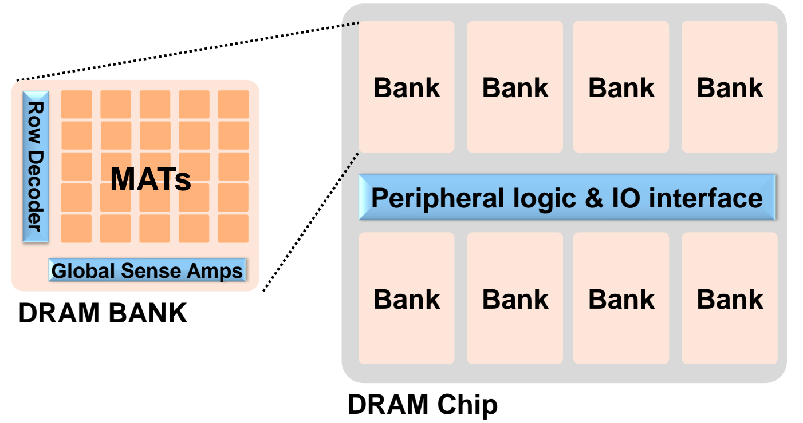

图：一个 DRAM Chip 包含上下两排共 8 个 Bank 和中间的 Peripheral logic & IO interface，放大的单个 Bank 由多个 MAT、Row Decoder 与 Global Sense Amps 组成。

> [!warning] 易错点
> "Bank 独立"指的是阵列操作（激活、读出、预充电）可以各自进行，不是说各 Bank 有各自的对外数据通路。数据输出口只有一套，多个 Bank 的数据仍要排队送出。

### 分层组织的原因

既然 MAT、Bank 看起来是"套娃"，为什么不把整个 Bank 直接做成一个大阵列？两种方案的对比如下。

**方案 A：一个大单元阵列（large cell array，如 4 Mb）**，是面积高效（area efficient）的方案：外围电路（行译码、字线驱动、灵敏放大器）尽可能共享，芯片面积主要用来放存储单元。但它有两个问题：

1. **远端单元慢，时间偏斜大**。
   - **字线**：要打开某一行，字线必须被驱动到足够高的电压才能导通该行的晶体管。离行译码器（字线驱动器）近的单元（图中蓝色 Fast 点）电压上升快；远端单元（红色 Slow 点）要等整条长字线及其上所有晶体管栅极都充上电，所以慢。
   - **位线**：读写本质上是给位线充放电。位线越长，寄生电容越大，充放电越慢。远端单元连的是很长的位线。
   - **后果**：同一阵列内不同单元的访问时间差别很大，即**时间偏斜**（time skew）。为了让所有单元都能正确读出，电路只能按最慢单元的时间来定时序。无论单元快慢，最终都迁就慢的。
2. **感测裕量问题（sensing margin issue）**：判断读出 0 还是 1，靠的是位线上电压变化的幅度。近端单元的电压变化大，容易检测；远端单元的电压变化小，灵敏放大器可能判错，可靠性下降。

**方案 B：许多小单元阵列（many sub-cell array，如 4 个 1 Mb）**，是速度与功耗高效（speed & power efficient）的方案：每个小阵列都有自己的字线驱动器（WL Driver）、位线灵敏放大器（BLSA）和外围电路（PERI），尽量减小同一阵列内的时间偏斜。字线和位线都变短，访问更快、充放电功耗更低，各单元的速度差别不大。代价是**面积利用率低**：芯片上要留出大量空间放本地行译码器、本地列译码器和本地灵敏放大器，这些都不存数据。

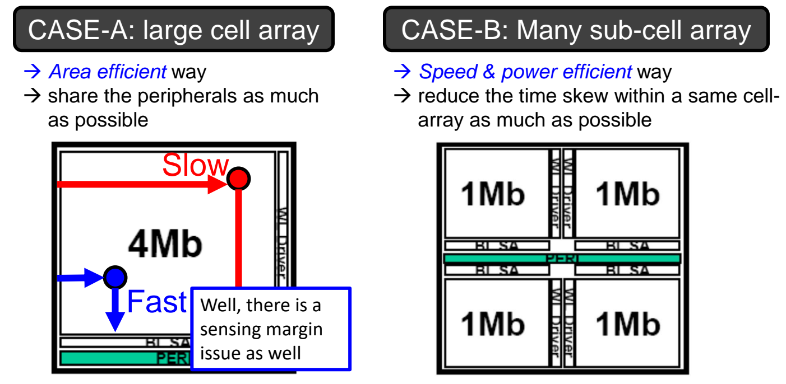

图：CASE-A 用一个 4Mb 大阵列共享外围电路、面积高效但远近单元延迟差大（Slow/Fast），CASE-B 拆成四个 1Mb 子阵列各配 WL Driver 与 BLSA，速度与功耗更优。

| 方案 | 优势 | 问题 |
| --- | --- | --- |
| A：一个大阵列 | 面积高效，外围电路最大限度共享 | 远端单元 RC 大、时间偏斜大，必须按最慢单元定时序；感测裕量小 |
| B：许多小阵列 | 速度和功耗高效，阵列内时间偏斜小 | 本地外围电路多，面积利用率低 |

实际 DRAM 选择方案 B，并一级级叠加：为了性能，阵列要做小；为了容量，就把许多小阵列层层组织起来。MAT、Bank、Chip 以及后面的 Rank、Channel 都源于这一取舍。

eDRAM（embedded DRAM）沿同一方向走得更远：存储材料与普通 DRAM 相同，但阵列做得更小，以面积换速度，过去曾被用作 CPU 的 L3 或 L4 缓存。

### 芯片容量分解

芯片标称的容量对应一套具体的层次结构。以 512 Mb DRAM 芯片为例：

$$
\begin{aligned}
512\,\text{Mb} &= 4\ \text{Banks} \times 128\,\text{Mb} \\
&= 4\ \text{Banks} \times (26 \times 30\ \text{MATs}) \times 176\,\text{kb} \\
&= 4\ \text{Banks} \times (26 \times 30\ \text{MATs}) \times 352\ \text{WL} \times 500\ \text{BL}
\end{aligned}
$$

各项含义如下：

1. **Chip（Die）**：一颗芯片含 4 个 Bank，Bank 之间是外围电路（Periphery Circuit），每个 Bank 128 Mb。
2. **Bank**：每个 Bank 内排着 $26 \times 30 = 780$ 个 MAT，MAT 周围是核心电路（Core Circuit，即本地译码、驱动和灵敏放大器）。
3. **MAT**：每个 MAT 是一个单元阵列（Cell Array），有 352 条字线（WL）和 500 条位线（BL）。每个字线与位线的交叉点是一个单元，所以一个 MAT 有 $352 \times 500 = 176{,}000$ 位，约 176 kb。

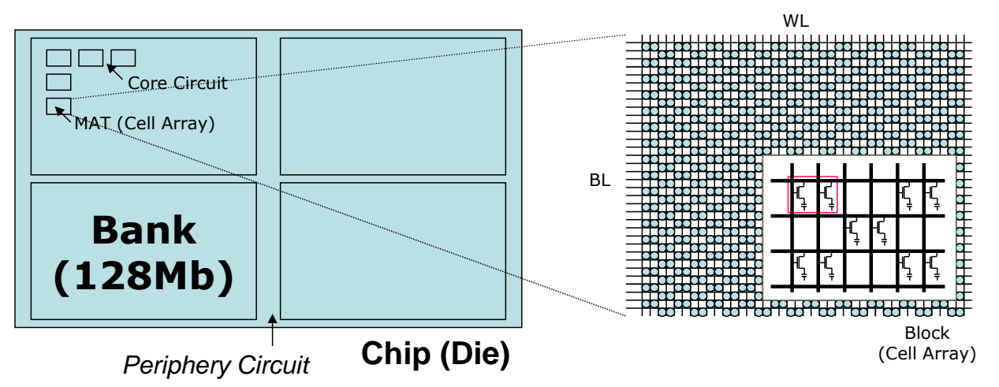

图：以 512Mb 芯片为例，芯片分为 4 个 128Mb Bank 与外围电路，Bank 内有许多 MAT，MAT 放大后是 WL 与 BL 交叉的单元阵列，对应 $4 \times (26 \times 30) \times 352\,\text{WL} \times 500\,\text{BL}$ 的分解。

> [!warning] 易错点
> 这串等式是近似分解，逐项相乘对不上精确值。$780 \times 176\,\text{kb} = 137{,}280\,\text{kb}$，而 $128\,\text{Mb} = 2^{17}\,\text{kb} = 131{,}072\,\text{kb}$；176 kb 本身也是按十进制把 176,000 位记作 176 kb。看这类例子时要关注层次关系和数量级，不要拿它校验精确容量。

> [!example] 例：一个 Bank 一共有多少条字线
> 已知上例中每个 Bank 为 $26 \times 30$ 个 MAT，每个 MAT 有 352 条本地字线，求一个 Bank 内的本地字线总数和单元总数。
>
> 1. MAT 数：$26 \times 30 = 780$。
> 2. 本地字线总数：$780 \times 352 = 274{,}560$ 条。
> 3. 单元总数：$780 \times 352 \times 500 = 137{,}280{,}000$ 位，约 $1.3 \times 10^8$ 位，与 128 Mb 同一量级。

### Rank 与 ECC 芯片

一颗 DRAM 芯片的数据引脚很窄（如 8 位），而 CPU 的内存总线通常是 64 位。要填满总线，就需要多颗芯片一起工作。

**列（Rank）**由多颗 Chip 组成，Chip 的数量由系统内存的总线宽度决定（slide 原文为 burst width）。Rank 内的所有 Chip 合起来构成完整的总线宽度（Full bus width）。 Rank 是看得见的实体：一根内存条上通常有一组 8 或 9 颗芯片构成一个 Rank。每个 Rank 的芯片数一般是 2 的幂（8 颗最常见，也有 4 颗或 16 颗），有时会多出 1 颗。

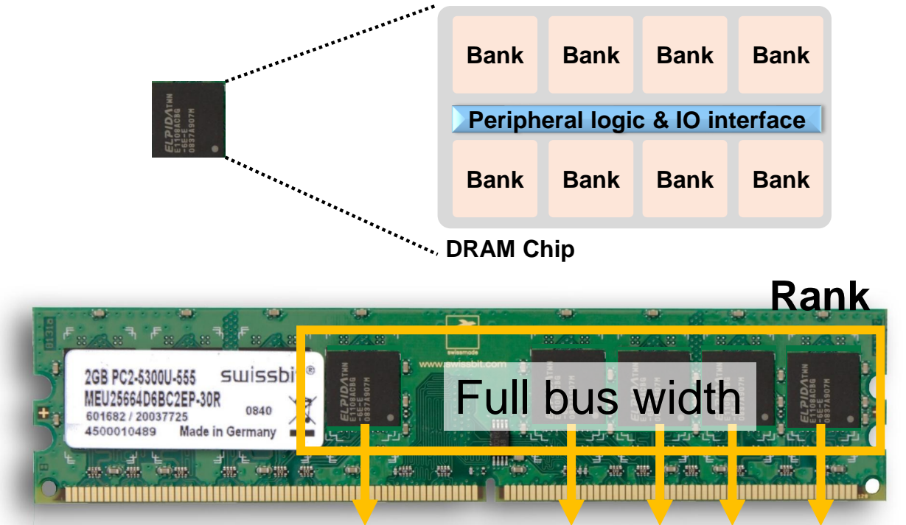

图：单颗 DRAM 芯片内含 8 个 Bank，内存条上的一组芯片共同构成 Rank，并行拼出 Full bus width 的数据宽度。

**Rank 内 Chip 同步协作，Bank 之间彼此独立**。两者数量上可能都是 8，但工作机制完全不同：

| 层级 | 8 个单元如何分工 | 来了一个请求时 |
| --- | --- | --- |
| Chip 内的 8 个 Bank | 彼此独立，各自服务不同请求 | 由其中一个 Bank 服务；8 个请求可由 8 个 Bank 分别服务 |
| Rank 内的 8 颗 Chip | 锁步（lockstep）协作，共同服务同一请求 | 8 颗 Chip 同时动作，每颗贡献一部分数据位 |

> [!example] 例：8 颗 $\times 8$ 芯片如何拼成 64 位
> 一个 Rank 由 8 颗 $\times 8$ 芯片组成（每颗芯片有 8 根数据线 DQ），内存总线宽 64 位。
>
> 1. 每颗芯片的 8 根 DQ 接到内存条金手指上各自的 8 个触点。
> 2. 一次传输（beat）中，8 颗芯片同时各送出 8 位：$8 \times 8 = 64$ 位，正好填满总线。
> 3. 若突发长度为 8，一次突发共传 $64\,\text{bit} \times 8 = 512\,\text{bit} = 64\,\text{B}$，恰为一个常见缓存行大小。

> [!warning] 易错点
> 课上口述为"每个 chip 服务 8 个数据"，准确说法是：每颗 $\times 8$ 芯片在**每次传输**中驱动 8 个数据位，8 颗合起来是 64 位总线宽度，而不是"每颗芯片存 8 字节"。

**ECC 芯片**：Rank 有时会多出第 9 颗芯片，专门存放**纠错码（Error-Correcting Code, ECC）**。DRAM 很容易出错：电容为了增大面积做成沟槽之类的复杂形状，又会漏电、读出时还会被破坏。多存一份冗余校验信息，就能发现某个数据出错并纠正回来。所以带 ECC 的 Rank 是 8 颗数据芯片加 1 颗 ECC 芯片，共 9 颗，总线宽度为 $64 + 8 = 72$ 位。

> [!note] 补充解释
> 72 位总线中额外的 8 位由第 9 颗 $\times 8$ 芯片提供。服务器常用的 SECDED（单错纠正、双错检测）码正是对 64 位数据配 8 位校验。

### Channel

Rank 之上还要解决"内存模组怎么连到内存控制器"的问题。

**通道（Channel）**严格说指 DRAM 模组（DIMM）与内存控制器之间相连的内存总线（memory bus）。 每个 Channel 是一条独立的总线，连到 CPU 中的内存控制器；两个 Channel（Channel 0、Channel 1）就是两条总线。

一个 Channel 通常不止连一个 Rank：

- 桌面机：一个 Channel 一般连 2 个 Rank；
- 服务器：一个 Channel 可连 4 到 8 个甚至 16 个 Rank。服务器能挂这么多 Rank 依赖带缓冲的模组，见[容量扩展与内存模组](#容量扩展与内存模组)。

主板上的内存插槽用颜色标示通道归属：**同色插槽属于不同的 Channel**。只有两根内存条时，应插在两个同色插槽里，让两条内存分属两个 Channel、组成双通道。如果两根都插在同一个 Channel 上，另一个 Channel 的带宽就浪费了。多通道如何提升带宽、地址如何在通道间分布，见[地址映射与多通道](#地址映射与多通道)。

> [!warning] 易错点
> 课上口述时把颜色规则说反过一次。以课件为准：要用双通道，就把内存条插在**同色**插槽（同色 = 不同通道）。不同主板的配色习惯可能不同，装机时以主板说明书为准。

> [!question]- 自测：某 Chip 有 8 个 Bank，同时来了两个分别落在 Bank 2 和 Bank 5 的读请求。两者能完全并行吗？
> 不能完全并行。两个 Bank 的阵列操作（激活、感测）可以重叠进行，因为 Bank 彼此独立；但它们共享芯片的同一套外围逻辑与 I/O 接口，数据输出时必须串行，一个 Bank 在送数据时另一个只能等。

> [!question]- 自测：同样容量的 DRAM，为什么做成 4 个 1 Mb 小阵列比一个 4 Mb 大阵列快？代价是什么？
> 大阵列中远端单元的字线、位线很长，RC 大，时间偏斜大，整个阵列只能按最慢的单元定时序，而且远端单元的感测裕量小。切成小阵列后线变短，最慢单元也变快，偏斜和功耗都降低。代价是每个小阵列都要配本地字线驱动器、灵敏放大器等外围电路，面积利用率下降。

> [!question]- 自测：一个带 ECC 的 Rank 由 $\times 8$ 芯片组成，共有几颗芯片？读 64 B 数据时，各芯片如何参与？
> 9 颗：8 颗数据芯片加 1 颗 ECC 芯片，总线宽 72 位。读请求到来时 9 颗芯片锁步工作：每次传输各送 8 位，8 颗数据芯片拼成 64 位数据，ECC 芯片送 8 位校验；突发长度为 8 时共传 8 次，得到 64 B 数据。这与 Bank 不同，Rank 内的芯片不能各自服务不同请求。

---

## DRAM 接口与时序

> [!abstract] 本节要点
> - 异步 DRAM 没有时钟，靠 RAS/CAS 选通信号的下降沿告诉芯片何时锁存行/列地址；之后依次出现三种改进：快速页模式复用已打开的行，EDO 让下一个列地址与当前数据输出重叠，Burst EDO 只送首个列地址，由片内计数器自动 +1。
> - SDRAM 引入系统时钟，命令、地址、数据都在时钟上升沿动作；DDR 在上升沿和下降沿都传数据，同样的时钟频率下数据总线吞吐翻倍。
> - 一个 DDR3 芯片内部包含：多个各有行/列译码器的 Bank、CS#（多 Rank 时选片）、CKE（使能内部时钟）、只产生行/Bank 地址的刷新计数器、支持突发的列地址计数器、全局缓冲与 I/O gating、读写 FIFO（并串转换）以及 Termination。
> - 读一次分三步 ACT → RD → PRE；$t_{RCD}$ 是行激活到数据进入灵敏放大器的时间，$t_{RAS}$ 是激活到数据恢复回单元的最短时间，$t_{CAS}$（$t_{CL}$）是列读命令到数据上总线的时间，$t_{CCD}$ 是相邻列命令最小间隔，$t_{BURST}$ 是一次突发占用数据总线的时间。
> - $t_{RP}$ 只是把位线恢复到 $V_{dd}/2$ 的时间；$t_{RC}=t_{RAS}+t_{RP}$ 是同一 Bank 访问不同行的最小间隔，也是这些参数里唯一的等式。所有时序参数都是控制器与芯片在开机时协商好的约定值，DRAM 不会回报“完成”。

### 异步 DRAM 与选通信号（Asynchronous DRAM）

要读写一个 DRAM 单元，控制器必须先后告诉芯片两件事：**行地址**，由行译码器选中 MAT 中的一行并读入灵敏放大器（行缓冲）；**列地址**，由列译码器从行缓冲里选出目标数据送上数据总线。 MAT、行缓冲与破坏性读的电路原理见[DRAM 单元与破坏性读](#dram-单元与破坏性读)；行/列地址复用同一组地址引脚的做法见 L06《01 内存墙与存储技术》。于是问题变成——**什么时候**送地址、什么时候取数据？

一次完整的访问在芯片内部经历四个阶段：

1. 传入行地址和列地址；
2. 把数据从单元读到灵敏放大器；
3. 把数据送上总线传输；
4. 把数据写回单元，再做预充电（precharge），为下一次访问做准备。

**异步 DRAM**（Asynchronous DRAM）是最早的接口形式：接口协议里**没有时钟信号**用来同步，而是用一组**选通信号**（strobe）来告诉芯片“现在可以锁存了”。

- **RAS**（Row Address Strobe，行地址选通）：芯片在 RAS 的**下降沿**锁存地址线上的行地址；
- **CAS**（Column Address Strobe，列地址选通）：芯片在 CAS 的**下降沿**锁存列地址，随后把数据放到数据线上。

一次读的时序是：地址线上放行地址 → RAS 下降（锁存行）→ 地址线上换成列地址 → CAS 下降（锁存列）→ 数据出现在数据线上。读下一个数据时，整个过程从头再来。

**局限**：每输出一个数据都要重新发送行地址和列地址，即使两次访问落在同一行。

### 快速页模式、EDO 与 Burst EDO

这三种改进都利用了访存的局部性，各自去掉异步接口中一处多余的等待或传输。


#### 快速页模式（Fast Page Mode, FPM）

**动机**：观察实际访存模式会发现，相邻几次访问的行地址通常不变——数据要么连续读，要么相距不远。

**机制**：只发一次行地址并保持 RAS 为低（这一行保持打开），之后每次只需拉低 CAS、送一个新的列地址，就读出同一行中的另一个数据。为此芯片要把已送入的行地址锁存住，后续访问复用这一行，不再重复发送行地址。

**局限**：每次“锁存列地址”和“输出数据”仍是**串行**的——必须等上一个数据输出完，才能送下一个列地址。

#### 扩展数据输出（Extended Data Out, EDO）

**动机**：既然列地址锁存与数据输出串行，就让它们像流水线一样重叠。

**机制**：在**灵敏放大器与数据线之间加一个缓冲**（buffer）。数据进入这个缓冲后在数据线上保持有效，CAS 可以提前抬起并为下一个列地址再次拉低；于是“锁存第 $k+1$ 个列地址”与“输出第 $k$ 个数据”同时进行，节省时间。 这个缓冲在真实芯片框图中也能找到，就是下文的全局缓冲 / I/O gating。

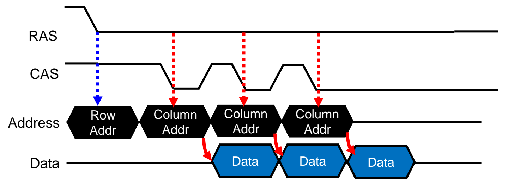

图：RAS 下降锁存行地址后，CAS 多次下降依次锁存列地址，每个列地址对应的数据在下一个列地址期间输出，体现列地址捕获与数据输出的重叠。

#### 突发 EDO（Burst EDO, BEDO）

**动机**：空间局部性很强时，一次常常连续访问多个数据（例如一次取 64 B），列地址通常就是依次 **+1**，没有必要一个个重复发送。

**机制**：控制器只发**第一个列地址**，芯片内部用一个**列地址计数器**每次把列地址加 1，用它驱动列译码器选出下一个数据，随后连续输出一串数据。

**好处**：表面上只是少发了几个列地址，真正的收益在于**地址总线被空出来了**。一个芯片有多个 Bank，每个 Bank 工作都需要接收自己的行、列地址；当前 Bank 突发输出期间，空闲的地址总线可以用来给其他 Bank 发行地址和列地址，提高 Bank 间的并行度。Bank 的概念见[DRAM 组织层次](#dram-组织层次)，Bank 级并行的调度见[内存控制器与行缓冲管理](#内存控制器与行缓冲管理)。

> [!warning] 易错点
> 三种改进各自省掉的东西不同。FPM 省掉**重复的行地址**；EDO 不减少要发送的地址，而是让列地址锁存与数据输出**在时间上重叠**；Burst EDO 省掉**后续的列地址**，并空出地址总线给其他 Bank 用。判断时问自己：这次改进是少发了某种地址，还是让两件事同时做？

### 同步 DRAM 与双倍数据率（SDRAM / DDR）

#### 同步 DRAM（Synchronous DRAM, SDRAM）

**动机**：速度越来越高以后，异步方式在一定程度上**无法保证时序正确**——芯片内所有模块必须按同一个步调做事，仅靠几根选通信号的边沿已经跟不上。

**同步 DRAM**（SDRAM）引入**系统时钟** CK 来管理存储器时序，所有动作都在**时钟上升沿**进行：

- 在上升沿采样命令（如 READ，判断是读还是写）以及行地址、列地址，不再使用 RAS/CAS 的边沿锁存；
- 数据传输也按时钟上升沿进行。

这样芯片内部各模块都由同一个时钟同步驱动，内部可以做得更快。

#### 双倍数据率（Double Data Rate, DDR）

**动机**：时钟周期在相当程度上决定了 DRAM 的性能，而 SDRAM 只用了时钟的上升沿。

**DDR**（Double Data Rate）在时钟的**上升沿和下降沿都传送数据**，一个时钟周期传两次数据，于是在同样的时钟频率下**内存总线吞吐直接翻倍**。 设总线时钟频率为 $f$，则 SDRAM 每秒传输 $f$ 次，DDR 每秒传输 $2f$ 次。GPU 使用的 GDDR 更进一步，可以在一个时钟周期内传四组数据（借助差分信号）。

DRAM 用的时钟来自**内存控制器**：控制器在 CPU 内，DRAM 在 CPU 外。时钟频率足够高时，片外长导线上的时钟和数据很容易出错，因此现代 DRAM 还加入了额外设计，减小外部时钟对内部时序的影响。各代 DDR 的数据率、预取以及时钟偏斜与 DQS 见[高速接口与信号完整性](#高速接口与信号完整性)。

DDR 型号后缀（如 DDR4-1600）表示的是数据率（MT/s）而非时钟频率，见[高速接口与信号完整性](#高速接口与信号完整性)。

### DRAM 内部功能框图（Functional Block Diagram）

厂商的 DRAM 规格书（datasheet，例如 Micron 的 DDR3/DDR4 规格书，约 200 页）会给出芯片的特性、$t_{RCD}$ / $t_{RP}$ / $t_{CL}$ 等关键时序数值、容量与 Bank 数、引脚定义（哪些是数据、哪些是片选）等。理解了下面这张框图，就能读懂规格书的核心部分。

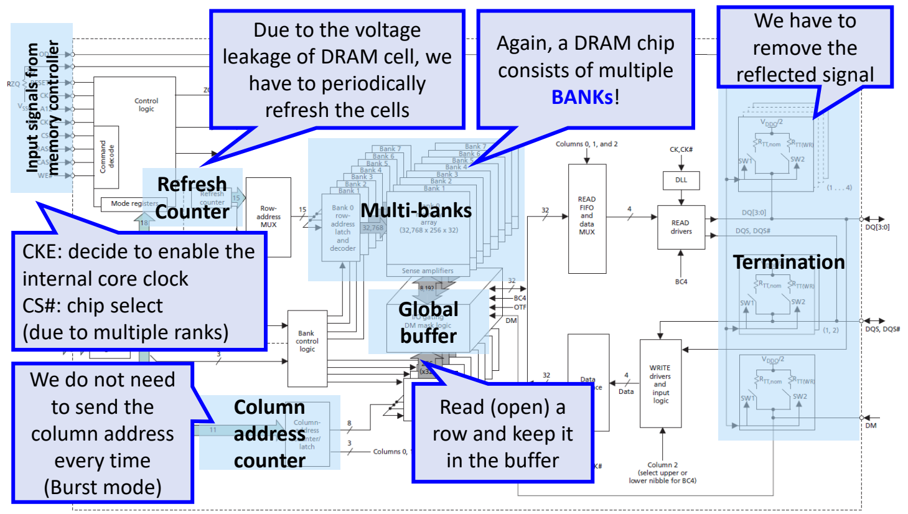

图：Micron DDR3L 内部框图上标注了来自控制器的输入信号、Refresh Counter、多 Bank 阵列、全局缓冲、列地址计数器（突发模式）与 Termination，注意 CKE 与 CS# 的作用说明。

按信号从左（控制器一侧）到右（数据引脚一侧）的顺序：

1. **来自内存控制器的输入信号**：命令、地址、控制信号进入控制逻辑（command decode）。其中两个控制信号：
   - **CS#**（Chip Select，片选）：一个通道上可以挂多个 Rank，每次只访问其中一个，控制器用 CS# 选出这次工作的 Rank；
   - **CKE**（Clock Enable，时钟使能）：决定是否使能芯片的**内部核心时钟**；不使能时芯片内部不工作。
2. **刷新计数器**（Refresh Counter）：DRAM 单元会漏电，必须定期刷新。计数器每隔一段时间给出一个地址，把对应**整行**读出再写回。它**只连到行地址和 Bank 地址**，不连列地址，因为刷新以整行为单位，不需要列地址。 刷新的原因与周期见[DRAM 单元与破坏性读](#dram-单元与破坏性读)。
3. **多 Bank**（Multi-banks）：中间重复的 8 个 Bank，每个都有自己的行地址锁存与译码器、灵敏放大器和列译码器，因此能**各自独立工作**；除了这 8 份重复的部分，其余电路都由所有 Bank **共享**。输入地址会拆出 Bank ID，由 Bank 控制逻辑决定哪个 Bank 参与这次 I/O。
4. **列地址计数器**（Column address counter）：默认工作在**突发模式**，列地址不必每次都发送，计数器连续 +1 即可，这就是 Burst EDO 思想的延续。
5. **全局缓冲 / I/O gating**（Global buffer）：位于灵敏放大器与数据通路之间，“打开”的行保存在灵敏放大器中，I/O gating 再把选中的数据取出。它让“从灵敏放大器读数据”和“向外传数据”能同时进行，这正是 EDO 所需的那层缓冲。
6. **读/写 FIFO 与数据复用**（READ FIFO and data MUX）：位于 Bank 与 I/O 之间，负责**并行 ↔ 串行转换**，并匹配芯片内核频率与总线频率之间的差异。细节见[高速接口与信号完整性](#高速接口与信号完整性)中的 DDR 预取与并串转换。
7. **端接**（Termination）：位于数据引脚一侧，用来**消除反射信号**，对信号质量影响很大，原理见[高速接口与信号完整性](#高速接口与信号完整性)。

> [!info] 可视化资源
> [Wikipedia：SDRAM](https://en.wikipedia.org/wiki/Synchronous_dynamic_random-access_memory)：提供 SDR SDRAM 命令真值表（CS/RAS/CAS/WE/BA/A10 对应激活、读写、预充电、刷新等）并说明 CKE 作用与 tRCD/tRP/CL 时序，帮助读懂 DDR3 框图中的控制信号。

> [!info] 依据讲义整理
> 讲义附录把一次访问中命令与数据在通用 SDRAM 芯片内的流动分成四段：
>
> 1. **命令传输与译码**（command transport and decode）：CS#、WE#、CAS#、RAS# 等控制信号进入控制逻辑译码；地址经地址寄存器送往行地址复用器、行地址锁存与译码器、Bank 控制逻辑和列译码器；
> 2. **Bank 内数据移动**（in bank data movement）：数据在 DRAM 阵列与灵敏放大器阵列之间移动；
> 3. **芯片内数据移动**（in device data movement）：数据在灵敏放大器与 I/O gating / 读数据锁存 / 写驱动器之间移动；
> 4. **系统数据传输**（system data transport）：数据经数据输出 / 输入寄存器与数据 I/O 引脚在芯片与外部总线之间传输。
>
> 该流程图中刷新计数器同样只接到行地址复用器，列地址计数器接到列译码器，与上面 DDR3 框图一致。下文时序图中的 bank utilization、device utilization、data bus 三行，分别对应第 2、3、4 段占用的资源。

### DRAM 命令与时序约定

控制器访问 DRAM 时发出一系列**命令**，最基本的是**行激活**（row activation，ACT，打开某一行）、**列读/列写**（column read / write，RD / WR，从打开的行中选列）和**预充电**（precharge，PRE，关闭该行）。

DRAM 接口的设计前提是**尽量减少内存控制器与芯片之间的通信**。因此芯片执行完一条命令后**不会回报“我完成了”**；双方事先约定好每条命令需要等待多久，控制器只要等够这段时间，就认为命令已经完成，可以发下一条。这些等待时间就是**时序参数**（timing parameters），例如 $t_{RCD}$、$t_{RAS}$。

这些参数不是物理常数，而是一份**协商出来的约定**：

1. **开机训练**：开机时 CPU（内存控制器）与 DRAM 要先同步、确定 $t_{RCD}$、$t_{RAS}$ 等参数的取值；多数参数是**下限约束**，控制器发命令的间隔必须**不小于**它。
2. **超频调参**：高端玩家会把默认参数（如 $t_{RCD}$、$t_{CL}$、$t_{RAS}$）调小；开机时先测试，能正常通信就用，失败就重启回退，所以开机会变慢。
3. **服务器开机慢**：服务器插的内存条多，控制器要逐条与之确认参数，开机可能超过一分钟。

> [!tip] 课堂强调
> 学 DRAM 时序最重要的一点是理解它**为什么存在**：时序参数是控制器与内存之间为了**省掉通信**而做的折中，只要等够约定时间就保证命令完成。可调的是 $t_{CL}$、$t_{CCD}$、$t_{RCD}$、$t_{RAS}$ 这类参数；$t_{BURST}$ 由传输数据量和总线时钟决定，是固定的。

下面按读操作的三步 ACT → RD → PRE 逐一介绍参数。时序图分四行资源：命令/地址总线（cmd & addr bus）、Bank 占用（bank utilization）、芯片外围电路占用（device utilization）和数据总线（data bus）。

#### 第一步：行激活（ACT）

- **$t_{RCD}$**（Row-to-Column command Delay，行到列命令延迟）：从行激活命令发出，到该行数据从 DRAM 单元阵列**移动到灵敏放大器**所需的时间，也就是时序图中 data sense 阶段。 过了 $t_{RCD}$ 才能发列读命令。它决定发出 ACT 后数据多久能到行缓冲，是影响 DRAM 性能最核心的参数之一，也是规格书首页明确列出的参数。
- **$t_{RAS}$**（Row Access Strobe latency，行访问选通延迟）：从行激活命令发出，到这一行数据**放电读出并恢复回 DRAM 单元**（data restored to DRAM cells）所需的时间。 它是一个**最小值**：同一 Bank 激活后至少等 $t_{RAS}$ 才能预充电。

#### 第二步：列读（RD）

行已经在灵敏放大器里之后，控制器发列读命令（同时带上列地址），数据从行缓冲经 I/O gating 送上数据总线，开始一次数据突发（data burst）。

- **$t_{CAS}$**（Column Access Strobe latency，列访问选通延迟），也称 **$t_{CL}$**：从发出列读命令，到 DRAM 把请求的数据**放到数据总线上**的时间。
- **$t_{CCD}$**（Column-to-Column Delay，列到列延迟）：连续发多个列命令时，两条列命令之间的**最小间隔**，保证它们不冲突。 物理上它对应 **I/O gating** 的时间，要求 $t_{CCD}$ 不小于 I/O gating 时间。讲义表格补充：$t_{CCD}$ 由芯片内部突发（预取）长度决定，DDR SDRAM 为 2 拍（1 个时钟周期），DDR2 SDRAM 为 4 拍（2 个时钟周期）。
- **$t_{BURST}$**（数据突发时长）：一条列读命令的数据突发**占用数据总线的时间**。 典型突发为 4 或 8 拍；DDR SDRAM 中 4 拍数据占 2 个完整时钟周期。 传输的数据量和总线时钟确定后，$t_{BURST}$ 就是固定的。

讲义（引自 Bruce Jacob《Memory Systems: Cache, DRAM, Disk》）还定义了两类资源占用：**Bank 占用**指数据在灵敏放大器与 I/O gating 之间移动的时间；**I/O gating** 是数据预取的时间。 列读的四个环节是：① 地址与命令经命令总线进入芯片译码；② Bank 内 data read；③ I/O gating；④ data burst 上数据总线。

#### 第三步：预充电（PRE）

- **$t_{RP}$**（Row Precharge，行预充电）：一个 DRAM 阵列完成预充电、能够接受下一次行访问所需的时间。 读完一行后位线电压已经改变，下一次读之前必须对位线充电或放电，使其回到 $V_{dd}/2$。$t_{RP}$ **只包含**把位线拉回 $V_{dd}/2$ 的时间，**不包含**把数据写回单元的时间。
- 数据写回单元在哪里发生？物理上，数据一被读入行缓冲（灵敏放大器），写回单元的过程就**立刻自动开始**；写操作把数据写进行缓冲后，也会立刻更新到单元。所以恢复数据算在 $t_{RAS}$ 里，不在 $t_{RP}$ 里。
- **$t_{RC}$**（Row Cycle，行周期）：同一 Bank 内**访问不同行**的时间间隔，即从激活一行到预充电完成、可以激活另一行的整个周期：

$$
t_{RC} = t_{RAS} + t_{RP}
$$

它是 DRAM 把数据**读入灵敏放大器、恢复回单元、再把位线预充电**以迎接下一次行访问所需的**最短**时间。访问了 Bank 中的行 A 之后要访问同一 Bank 的行 B，必须等满 $t_{RC}$ 才能发出行 B 的激活命令。在这些参数中，$t_{RC}$ 是**唯一的等式**，其余都是不等式（下限约束）。

**源错误更正**：课堂口述把 $t_{RC}$ 说成"最长时间"，按讲义定义（Minimum amount of time）它是同一 Bank 换行所需的**最短**时间。

> [!warning] 易错点
> - $t_{RP}$ 不含“数据写回单元”：写回发生在感知之后、包含在 $t_{RAS}$ 内；$t_{RP}$ 只负责把位线恢复到 $V_{dd}/2$。
> - $t_{RC}$ 是同一 Bank 换行的**最小**间隔，不是上限；不同 Bank 的行激活不受 $t_{RC}$ 约束（但受 $t_{FAW}$ 等约束，见下文）。
> - $t_{CAS}$ 从列读**命令**算到数据**开始**上总线，不包含数据突发本身的 $t_{BURST}$。

#### 完整读周期与命令重叠

把三步串起来就是一次完整的读周期：

1. **row acc**：发 ACT，等 $t_{RCD}$（data sense）；
2. **col read**：发 RD，等 $t_{CAS}$（$t_{CL}$），然后数据突发占用总线 $t_{BURST}$；
3. **prec.**：从 ACT 起至少等满 $t_{RAS}$（期间完成 data restore）才发 PRE，再等 $t_{RP}$（array precharge）；
4. 之后才能对同一 Bank 发下一条 **row act**（图中虚线框，属于下一次访问）。

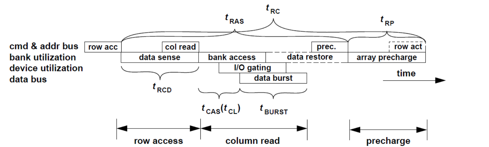

图：一次读周期按命令总线、Bank、器件与数据总线分行展示，行访问到列读为 $t_{RCD}$，列读到数据为 $t_{CAS}$，数据突发为 $t_{BURST}$，$t_{RAS}$ 与 $t_{RP}$ 之和构成 $t_{RC}$（图取自 Bruce Jacob《Memory Systems》）。

这张图有两处重叠值得注意：

- **命令与周期重叠**：下一条行激活命令可以在 $t_{RC}$ 末尾就发出，与本周期的最后一段重叠。
- **资源之间重叠**：bank access、I/O gating、data burst 三行并不是前一个完全结束后一个才开始，而是部分重叠同时进行，这样效率最高。

DRAM 对时序要求非常严格，只有时序卡得紧，才能把利用率提上来。

> [!example] 例：同一 Bank 连续访问两个不同行（据课程内容整理）
> 设某 DRAM 以时钟周期为单位：$t_{RCD}=11$，$t_{CL}=11$，$t_{RAS}=28$，$t_{RP}=11$，$t_{BURST}=4$（数值为假设）。控制器在第 0 周期对 Bank 0 的行 A 发 ACT，读一次后要读同一 Bank 的行 B。
>
> 1. 最早在第 $t_{RCD}=11$ 周期发 RD；数据在第 $11+t_{CL}=22$ 周期开始上总线，到第 $22+t_{BURST}=26$ 周期突发结束。
> 2. PRE 最早只能在第 $t_{RAS}=28$ 周期发出（虽然数据第 26 周期就传完了，行数据的恢复还没完成）。
> 3. 预充电在第 $28+t_{RP}=39$ 周期完成，正好等于 $t_{RC}=t_{RAS}+t_{RP}=39$。
> 4. 行 B 的 ACT 最早在第 39 周期发出，它的数据最早在第 $39+11+11=61$ 周期开始上总线。
>
> 如果行 B 在另一个 Bank，就不必等 Bank 0 的 $t_{RC}$，这正是多 Bank 并行的意义。

### 其他时序约束（Many Parameters）

上面只覆盖了一次读的基本流程，真实时序还有许多约束。讲义列出的参数表（Jacob《Memory Systems》Table 11.1）如下：

| 参数 | 含义 |
| --- | --- |
| $t_{AL}$ | Added Latency，DDRx SDRAM 为 posted CAS 命令附加的列访问延迟 |
| $t_{BURST}$ | 数据突发占用数据总线的时长，典型为 4 或 8 拍；DDR 中 4 拍占 2 个时钟周期 |
| $t_{CAS}$ | 列访问命令到 DRAM 开始返回数据的间隔，又称 $t_{CL}$ |
| $t_{CCD}$ | 列命令的最小间隔，由内部突发（预取）长度决定；DDR 为 2 拍（1 周期），DDR2 为 4 拍（2 周期） |
| $t_{CMD}$ | 命令从控制器传到 DRAM 时占用命令总线的时长 |
| $t_{CWD}$ | 列写命令发出到控制器把数据放上数据总线的间隔 |
| $t_{FAW}$ | 四 Bank 激活窗口：任一滚动时间窗内最多激活 4 个 Bank，限制多于 4 Bank 的 DDR2/DDR3 的峰值电流 |
| $t_{OST}$ | ODT 在 Rank 之间切换的时间 |
| $t_{RAS}$ | 行访问命令到数据恢复回阵列的间隔；Bank 激活后至少 $t_{RAS}$ 才能预充电 |
| $t_{RC}$ | 同一 Bank 访问不同行的间隔，$t_{RC}=t_{RAS}+t_{RP}$ |
| $t_{RCD}$ | 行访问到数据在灵敏放大器就绪的间隔 |
| $t_{RFC}$ | 刷新命令到激活命令之间的刷新周期时间 |
| $t_{RP}$ | 阵列预充电以迎接另一次行访问所需的时间 |
| $t_{RRD}$ | 同一芯片两次行激活命令的最小间隔，限制峰值电流 |
| $t_{RTP}$ | 读命令到预充电命令的间隔 |
| $t_{RTRS}$ | Rank 间切换时间，用于 DDR/DDR2（DDR SDRAM 中为 1 个周期） |
| $t_{WR}$ | 写恢复时间：写数据突发结束到预充电命令的最小间隔，让灵敏放大器把数据写回单元 |
| $t_{WTR}$ | 写到读延迟：写数据突发结束到列读命令的最小间隔，让 I/O gating 在读命令前完成对灵敏放大器的改写 |

其中三个约束值得说明其来由：

- **$t_{FAW}$**：大容量 DRAM 要有更多 Bank（如 16 个）。如果 16 个 Bank 同时做 I/O，瞬时电流需求太高，难以保证电压稳定。做法是把 Bank 分组（例如 4 个 Bank 一组，即 bank group），不同组错开工作；$t_{FAW}$ 保证激活之间有间隔，不能同时开始。
- **$t_{WTR}$**：先写后读时，读命令要额外等待的时间。
- **$t_{WR}$**（write recovery）：写入的数据还要写回 DRAM 单元，预充电必须与这个写回过程错开，因此写之后要等 $t_{WR}$ 才能预充电。

> [!question]- 自测：某 DRAM 的 $t_{RAS}=32$ ns，$t_{RP}=14$ ns，$t_{RCD}=14$ ns。控制器在 $t=0$ 激活 Bank 2 的第 100 行，之后要读同一 Bank 的第 200 行，第 200 行的激活命令最早何时发出？如果第 200 行在 Bank 3 呢？
> 同一 Bank：最早在 $t=t_{RC}=t_{RAS}+t_{RP}=46$ ns，因为必须先等满 $t_{RAS}$ 才能预充电，再等 $t_{RP}$ 让位线回到 $V_{dd}/2$；$t_{RCD}$ 不影响这个答案。换到 Bank 3 时不受 Bank 2 的 $t_{RC}$ 约束，只需满足 $t_{RRD}$、$t_{FAW}$ 等跨 Bank 激活约束，可以早得多。

> [!question]- 自测：一个 Burst EDO 芯片和一个快速页模式芯片都从同一已打开的行连续读 8 个数据。两者在地址线上各要发送几个地址？Burst EDO 多出来的好处体现在哪里？
> 快速页模式：1 个行地址 + 8 个列地址；Burst EDO：1 个行地址 + 1 个列地址，其余由片内列地址计数器 +1 产生。好处不只是少发 7 个地址，更在于突发期间地址总线空闲，可以给其他 Bank 发行/列地址，让多个 Bank 并行工作。

> [!question]- 自测：同学说“$t_{RP}$ 很长是因为预充电要把行缓冲里的数据写回电容”，并且“刷新计数器要像普通访问一样给出行、列地址”。分别指出错误。
> 两句都不对。数据写回单元在读入灵敏放大器后立即自动进行，计入 $t_{RAS}$，$t_{RP}$ 只是把位线恢复到 $V_{dd}/2$ 的时间。刷新以整行为单位，刷新计数器只产生行地址和 Bank 地址，不需要列地址。

---

## 容量扩展与内存模组

> [!abstract] 本节要点
> - 在通道数和芯片面积都有限的条件下提高内存容量有三条宏观途径：内存堆叠、一个通道挂多条 DIMM、在模组上加缓冲（RDIMM 及其后继）。
> - 堆叠（裸片叠裸片或 PCB 叠 PCB）提高单位面积容量，代价是良率随层数下降，以及散热困难、热胀冷缩导致接触不良。
> - 多 DIMM 共享一个通道时，每根数据线只连每条 DIMM 上的一颗芯片（3 条 DIMM 时负载为 3 颗），而地址/命令线要连所有芯片（$3\times 8=24$ 颗）。
> - 负载越多、距离越不一致，信号衰减和波形畸变越严重；解决思路是在模组上放缓冲器，减少每根信号线的“目的地”数量。
> - RDIMM 只缓冲地址/命令；FB-DIMM 用 AMB 缓冲全部信号并加控制逻辑，可串接 8 条，但 AMB 发热、需散热片、成本高；LR-DIMM 用多颗缓冲芯片分散负载，不加额外控制逻辑。

### 提高容量的三条途径

DRAM 容量的提升，最基本的办法是把每个单元做小（单元结构见[DRAM 单元与破坏性读](#dram-单元与破坏性读)）。但单元微缩之外，系统还受到两个宏观限制：芯片面积不能随意变大，处理器能提供的内存通道数也有限。在这两个限制下，提高内存容量（Increase the memory capacity）有三种更宏观的方法：

1. **内存堆叠**（Memory Stacking）：在同样的面积上叠更多芯片或电路板。
2. **单通道多 DIMM**（Multiple DIMMs per Channel）：让多条内存条共享同一个通道。
3. **寄存式 DIMM**（Registered DIMM）及其后续的缓冲型模组：解决多 DIMM 带来的信号负载问题。

这三种方法并不是彼此独立的：第 2 种是最常用的扩容手段，而第 3 种正是为了让第 2 种在挂更多 DIMM 时还能可靠工作。Channel、Rank、DIMM 等层次的定义见[DRAM 组织层次](#dram-组织层次)。

### 内存堆叠（Memory Stacking）

如果平面面积固定，就往第三个维度要容量。

**内存堆叠**是把裸片叠在裸片上（die on die）或把 PCB 叠在 PCB 上（PCB on PCB），从而提高单位面积上的存储密度。

讲义给出的两个实例：裸片堆叠的例子是在厚 1.4 mm 的多芯片封装（MCP）里叠 20 层裸片（Elpida Memory）；PCB 堆叠的例子是把主板（primary board）和副板（secondary board）两块内存 PCB 叠在一起。

> [!info] 可视化资源
> [Wikipedia：高带宽内存 HBM](https://en.wikipedia.org/wiki/High_Bandwidth_Memory)：含 HBM 显卡剖面示意图（堆叠 DRAM 裸片、TSV 硅通孔、中介层）和 HBM 封装实物照片，直观展示裸片堆叠扩容的结构。

#### 裸片堆叠：良率与散热

以 HBM 为代表的裸片堆叠，每层芯片上有大量用于通信的金属接触点，堆叠时必须让所有层的接触点**同时对齐**才能连通，任何一处没对齐整颗堆叠就报废。因此：

1. **良率随层数下降**：每多叠一层，就多一次“全部接触点同时对齐”的要求，成功概率连乘下去。课堂上的示意数字是：叠 4 层时，每片上一千多个接触点同时对齐的概率约为 80%，再往上叠良率会更低。
2. **散热与热胀冷缩**：芯片叠在一起后热量难以散出，尤其是中间几层；中间热、两侧冷，热胀冷缩不均会让层间接触点接触不良，器件随之失效。

> [!note] 补充解释
> 若每层堆叠成功的概率为 $p$，且各层相互独立，则 $n$ 层全部成功的概率是 $p^n$。例如 $p=0.95$ 时，$n=4$ 约为 $0.81$，$n=8$ 约为 $0.66$。这就是“层数越多良率越低”的数学含义。课堂上的 4 层、80% 是示意，不是 HBM 规格；实际 HBM 产品可堆叠 8～12 层裸片。

更激进的工艺是**混合键合**（Hybrid Bonding）：不再用占面积较大的金属凸点，而是直接把裸片与裸片结合在一起，从而大幅增加层间连接数。课堂举例：HBM 一层约有 1024 个接触点，每个接触点就是一条数据通道；混合键合宣称可以再多 8 倍，达到 8192 个。 但它同样受上述两个问题制约，良率可能远低于 HBM 的堆叠。

#### PCB 堆叠：廉价但受厚度限制

比裸片堆叠便宜得多的做法是在电路板层面堆叠：

- 把两块 PCB 叠在一起，共享同一组金手指、插在同一个通道上；
- 在一块 PCB 的正反两面都贴芯片。

它的限制是物理尺寸：叠得越多越厚，最终插不进服务器的插槽。因此常见的是两块 PCB 合在一起，再多就不现实了。

> [!warning] 易错点
> 堆叠提高的是**单位面积的容量**，并不解决通道上的电气问题。PCB 堆叠后，两块板仍挂在同一个通道上，等于给通道增加了更多芯片负载，下面讲的信号负载问题同样存在。

### 单通道多 DIMM 与信号负载

处理器引出的内存引脚数存在设计上限，因为**引脚数就是成本**（# pins = cost），通道数也就无法随意增加。 在通道数有限的情况下，想往系统里放更多内存模组，最直接的回答是——**让多条 DIMM 共享一个通道**。

**单通道多 DIMM**（Multiple DIMMs per Channel）是把通道的 64 根数据线 D0～D63 以及地址/命令线同时连到该通道上的每一条 DIMM。每条 DIMM 上有 8 颗芯片，每颗芯片负责 8 根数据线（D0～D7、D8～D15……D56～D63），8 颗合起来构成 64 位数据通路。

#### 数据线与地址/命令线的负载差异

共享看似简单，但两类信号线的负担差别很大。设一个通道上插 3 条 DIMM，每条 8 颗芯片：

| 信号线 | 每根线需要连接的芯片 | 负载数 |
| --- | --- | --- |
| 数据线（如 D0～D7） | 每条 DIMM 上负责这 8 位的那一颗芯片 | $3$ 颗 |
| 地址/命令线（Address/Command） | 所有 DIMM 上的所有芯片 | $3\times 8=24$ 颗 |

原因在于：数据线按位划分，D0～D7 只属于每条 DIMM 的第一颗芯片；而地址和命令必须同时送到每一颗芯片，因为同一 Rank 的芯片锁步工作、都要收到同样的命令和地址。于是一根地址/命令线的负担是一根数据线的 8 倍。

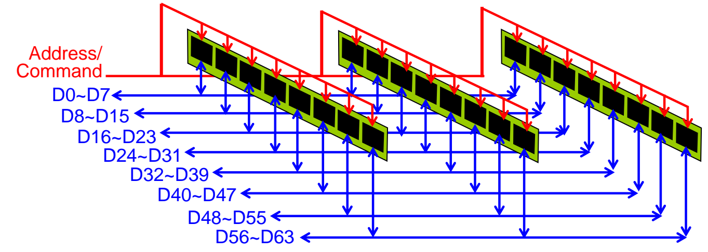

图：同一通道上三条 DIMM 各 8 颗芯片，每组数据线（如 D0~D7）只连 3 颗芯片，而红色地址/命令线要驱动全部 $3 \times 8 = 24$ 颗芯片。

一般地，若通道上有 $N_{\rm DIMM}$ 条 DIMM、每条 DIMM 有 $N_{\rm chip}$ 颗芯片，则

$$
L_{\rm data} = N_{\rm DIMM}, \qquad L_{\rm addr/cmd} = N_{\rm DIMM} \times N_{\rm chip}
$$

其中 $L$ 表示一根信号线需要驱动的芯片数（负载数）。

#### 信号波形衰减（Signal Waveform Attenuation）

负载数多为什么是问题？这是一个电气问题。

1. **电容负载**：PCB 上每条 DIMM（以及其上的每颗芯片）都有自己的电容，每多挂一个负载，信号就被多削弱一些。
2. **距离不一致**：多条 DIMM 离内存控制器的距离各不相同，信号到达各处的时间和形状也不同。

控制器发出的本是一个干净的方波；到达 DIMM0 时已经衰减变形，到达更远的 DIMM1 时更差。挂的 DIMM 越多，越远处的波形越差；而地址/命令信号还要在每条 DIMM 上再分给每颗芯片，衰减就更严重，最终影响信号可靠性。

信号反射、端接和拓扑等更细的信号完整性问题见[高速接口与信号完整性](#高速接口与信号完整性)。

### 寄存式 DIMM（RDIMM）

既然地址/命令线的问题是“目的地太多”，那就减少它的目的地。

**寄存式 DIMM**（Registered DIMM，RDIMM）在每条 DIMM 上放一个小缓冲器（寄存器），控制器的地址/命令信号只送到这个缓冲器，由它**记录**信号后再**重新分发**给本条 DIMM 上的多颗芯片。

工作过程：

1. 控制器发出地址/命令，通道上的地址/命令线只连接每条 DIMM 的缓冲器；
2. 缓冲器接收并整形（重新驱动）信号；
3. 缓冲器把整形后的信号转发给本条 DIMM 上的每一颗芯片。

这样，3 条 DIMM 的通道上，一根地址/命令线的负载从 24 颗芯片降为 3 个缓冲器，与数据线的负载数相同，信号因此更稳定。 数据线则仍然直接连到芯片，不经过缓冲。

> [!tip] 课堂强调
> 服务器内存至少是 RDIMM，而台式机用的是传统（无缓冲）DIMM，两者**不能混用**。购买服务器内存时一定要先确认它是普通 DIMM 还是 RDIMM，否则可能插不上。

### 全缓冲 DIMM（FB-DIMM）与 AMB

RDIMM 只缓冲地址/命令线。课堂上举的示意是：普通 DIMM 一个通道大约只能挂 2 条，RDIMM 可以挂到 4 条；若想挂到 8 条，数据线本身的负载也会成为问题。

**全缓冲 DIMM**（Fully Buffered DIMM，FB-DIMM）的思路是把数据线信号也缓冲起来：每条 FB-DIMM 上有一颗**高级内存缓冲器**（Advanced Memory Buffer，AMB），它不仅缓冲地址/命令，也缓冲数据，并带有额外的控制逻辑来控制这些信号。

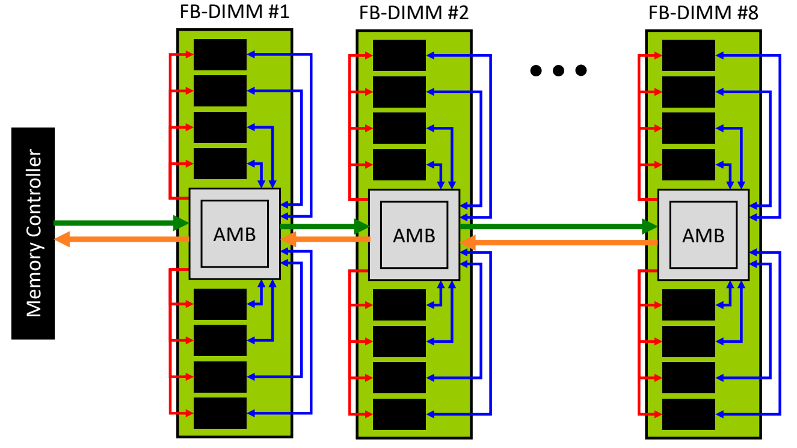

图：内存控制器只与第一条 FB-DIMM 的 AMB 相连，各 FB-DIMM 的 AMB 串成链逐级转发命令与数据，AMB 再分别驱动本条 DIMM 上的芯片。

每条 FB-DIMM 上芯片的地址/命令线和数据线都只连到本条的 AMB。数据线的衰减也被 AMB 隔离，所以一个通道可以串接 8 条内存（FB-DIMM #1 到 #8）。

> [!note] 补充解释
> 图中绿色和橙色箭头代表两个方向的链路：控制器经 AMB 逐级向下传命令和写数据，读数据再逐级传回控制器。FB-DIMM 中控制器与 AMB、AMB 与 AMB 之间是点对点的串行链路，每个 AMB 只驱动一个下游，因此单根线的负载不随 DIMM 数量增加。

#### FB-DIMM 的问题：发热

AMB 把一条 DIMM 的全部信号和数据都集中到一颗芯片上暂存和处理，于是它成了发热大户。内存频率越高，AMB 温度越高。加装散热片（heatsink）可以降温，但成本随之上升。

### 低负载 DIMM（LR-DIMM）

FB-DIMM 的问题在于“一颗集中的、带控制逻辑的缓冲芯片”。**低负载 DIMM**（Load Reduced DIMM，LR-DIMM）的思路是：不加 AMB 那样的额外控制逻辑，而是放**多颗缓冲芯片**来分担负载，尽量降低每根信号线的负载（minimize loading）。

具体做法是把原来的单颗集中缓冲拆成许多小缓冲芯片，放在靠近金手指的位置，每颗只处理一部分信号。这样既分散了发热，又因为缓冲点离金手指近而进一步减小了信号衰减。 需要在一个通道上挂很多内存条（例如 8 条、16 条）的服务器，通常使用 RDIMM 或 LR-DIMM。

### 三种缓冲型模组的对比

> [!info] 依据讲义整理
> 讲义附录对“技术趋势 1：提高容量”做了如下复习。
>
> - **目标**：在有限的环境（通道数有限、裸片面积不变）下提高内存密度。
> - **朴素做法**：在同一裸片上加更多芯片 / 每个通道挂更多 DIMM。
> - **挑战**：信号要经过、驱动更多电路，因而被衰减。
> - **解决办法**：在模组里加入缓冲器，减少信号的目的地数量。

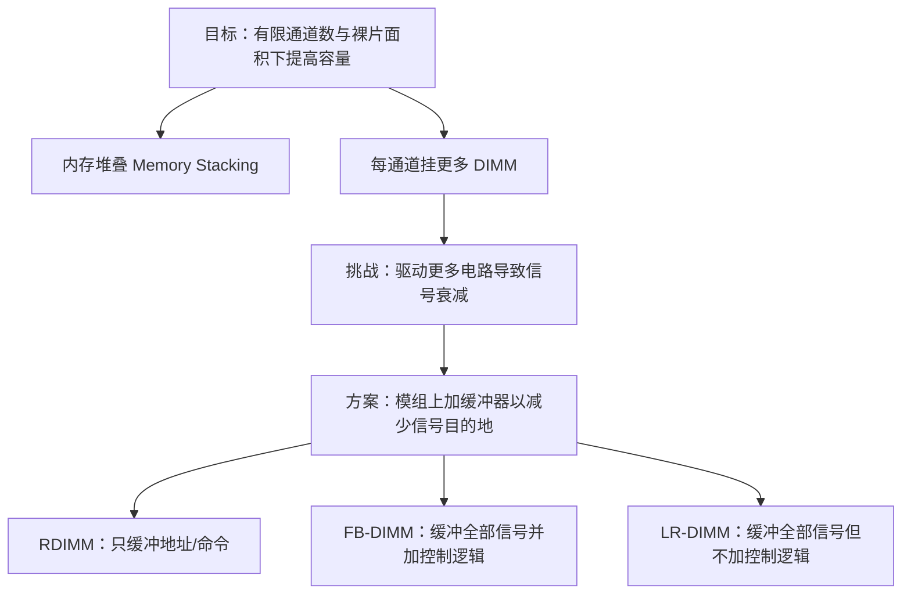

| 模组 | 缓冲哪些信号 | 是否有额外控制逻辑 | 主要特点 |
| --- | --- | --- | --- |
| RDIMM | 仅地址/命令 | 否 | 地址/命令线负载降为每条 DIMM 一个寄存器；数据线不变 |
| FB-DIMM | 全部信号（含数据） | 是（AMB） | 可串接 8 条；AMB 随频率升高而发热，需散热片，成本高 |
| LR-DIMM | 全部信号 | 否 | 用多颗缓冲芯片分散负载，靠近金手指，减小衰减和集中发热 |

> [!warning] 易错点
> RDIMM 与 LR-DIMM 的区别不在“有没有缓冲”，而在**缓冲的范围**：RDIMM 只缓冲地址/命令，LR-DIMM 连数据也缓冲。FB-DIMM 与 LR-DIMM 都缓冲全部信号，区别在于 FB-DIMM 的 AMB 带额外控制逻辑、集中在一颗芯片上，而 LR-DIMM 不加控制逻辑、分散成多颗缓冲芯片。

> [!question]- 自测：一个通道插 4 条带 ECC 的普通 DIMM，每条 9 颗 $\times 8$ 芯片。一根地址线和一根数据线各要驱动多少颗芯片？换成 RDIMM 后呢？
> 普通 DIMM：数据线只连每条 DIMM 上对应的那一颗芯片，负载 $4$ 颗；地址线连所有芯片，负载 $4\times 9=36$ 颗。换成 RDIMM 后，地址线只连每条 DIMM 的寄存器，负载降为 $4$ 个；数据线不经缓冲，仍为 $4$ 颗。

> [!question]- 自测：某厂商想用裸片堆叠把每颗内存的层数从 4 层加到 8 层，同时保持原来的接触点工艺。会遇到哪两类主要风险？
> 一是良率：每层都要求上千个接触点同时对齐，成功概率随层数连乘下降，8 层的良率明显低于 4 层；二是散热：中间层热量散不出去，热胀冷缩不均会造成层间接触点接触不良而失效。

> [!question]- 自测：FB-DIMM 已经能在一个通道上串接 8 条内存，为什么还要发展 LR-DIMM？
> 因为 FB-DIMM 把全部信号集中到一颗带控制逻辑的 AMB 上，频率越高 AMB 越热，需要散热片，成本上升。LR-DIMM 同样缓冲全部信号，但不加额外控制逻辑，并把缓冲拆成多颗小芯片分散负载，避免了集中发热。

---

## 内存控制器与行缓冲管理

> [!abstract] 本节要点
> - 第二个技术趋势“提速度”不靠单纯拉高频率，而是**利用内存组织结构做资源感知的调度**：提高行缓冲命中率、挖掘 Rank/Bank 级并行。
> - 片外控制器（北桥）经 FSB（例：128 位、100 MHz）与 CPU 相连，线延迟大、速度受 FSB 时钟限制，但 CPU 与控制器分开设计更灵活；片上控制器以 CPU 速度运行，但内存类型被 CPU 绑定（CPU 支持 DDR2 就只能插 DDR2）。
> - 内存控制器是被动的从设备，服务 CPU 与 I/O（DMA 引擎）的请求，内部流水为：请求流 → 仲裁 → 地址翻译为 {Bank, Row, Col, …} → 按 Bank/Rank 排队 → 命令调度 → 电气信号接口 → DRAM 访问，全程遵守时序约束。
> - DRAM 访问三步：Activate → Read/Write → Precharge。开页策略让行一直打开，命中只需列访问，但行缓冲缺失（bank conflict）时预充电落在关键路径上；闭页策略访问后立即预充电，适合低局部性、随机访问。
> - Bank 级并行：所有 Bank 共享数据引脚、同一时刻只能传一份数据，但可以在一个 Bank 传数据时给其他 Bank 发 PRE/RAS/CAS，以流水线方式填满数据总线。

### 内存控制器的位置：片外与片内

DRAM 本身不会“自己工作”，每一次激活、读写、预充电、刷新都要由外部按严格时序发出命令。第二个技术趋势的思路是：与其费力把频率再往上调，不如**利用内存的组织结构**（Rank、Bank、行缓冲）做资源感知的调度来提速，而承担这件事的部件就是内存控制器。

**内存控制器**（Memory Controller, MC）是管理 DRAM 全部操作的部件。 按它放在哪里，分为两种系统结构：

- **片外内存控制器**（Off-chip Memory Controller）：控制器位于**北桥**（North Bridge）芯片中，与 CPU 分离；CPU 经**前端总线**（Front-Side Bus, FSB）连到北桥，北桥再连南桥和内存。
- **片上内存控制器**（On-chip Memory Controller）：控制器集成在 CPU 芯片内部，CPU 直接与内存通信，系统中只剩南桥负责其他外设。

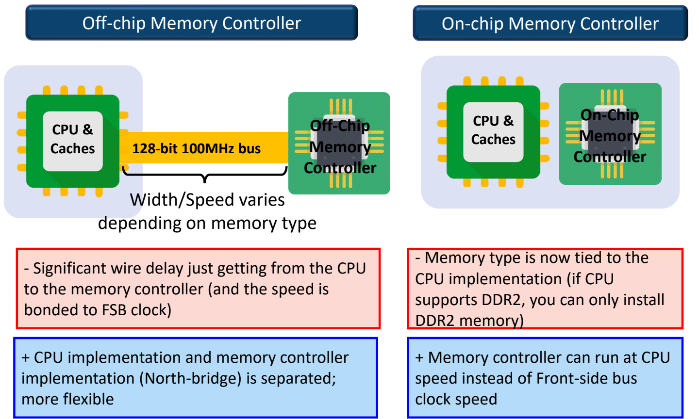

图：左侧片外控制器经 128-bit 100MHz 总线与 CPU 相连，有线延迟但实现灵活；右侧控制器集成进 CPU，可按 CPU 频率运行但内存类型受 CPU 限制。

两者的取舍如下：

| 维度 | 片外控制器（北桥） | 片上控制器 |
| --- | --- | --- |
| CPU→控制器路径 | 经 FSB，例如 128 位、100 MHz 总线；宽度/速度随内存类型变化 | 芯片内部互连 |
| 速度 | 线延迟显著，控制器速度被 FSB 时钟束缚（缺点） | 控制器以 CPU 速度运行，而非 FSB 时钟速度（优点） |
| 设计灵活性 | CPU 实现与控制器（北桥）实现相互分离，更灵活（优点） | 内存类型与 CPU 实现绑定：CPU 支持 DDR2 就只能装 DDR2（缺点） |

核心区别在带宽来源：片外方案受限于 FSB 这条外部总线，以 $128\,\text{bit} \times 100\,\text{MHz}$ 这样的带宽，相对今天 CPU 与内存的性能已经很慢；片上方案直接用芯片级的内部带宽，因此速度快。代价是每一代 CPU 的设计决定了它能用什么内存。

> [!tip] 课堂强调
> 现在的 CPU 基本都把内存控制器集成在内部，买 CPU 就等于一起买了控制器；它带来的“内存类型不灵活”是用户必须接受的代价。

### 内存控制器的职责流水

CPU 发出的只是一个“逻辑内存地址 + 读/写”请求，而 DRAM 需要的是一串按时序排列、指向具体 Bank/行/列的命令；同时还有多个请求者同时争抢。内存控制器负责把前者变成后者，并在其中尽量提高吞吐。

首先要明确它服务的对象和角色：

- 请求流不仅来自各个 CPU 核，也来自**I/O 外设**。外设一般不是 CPU 替它搬数据，而是由网卡、SSD 等设备内部的**DMA 引擎**（Direct Memory Access）负责在 DRAM 与设备内存之间搬运数据。
- 内存控制器是**被动的从设备**（slave）：它从不主动发起访存，只是收到 CPU 或外设 I/O 的请求后去服务；“搬什么数据”由 CPU 或外设决定。

控制器内部按以下流水处理每个请求：

1. **接收请求流**（Request streams）：把来自 CPU 和 I/O 的请求（携带逻辑内存地址）传往主存方向。
2. **事务调度 / 仲裁**（Transaction scheduling）：到达的请求先缓冲，再经**仲裁器**（Arbiter）裁决。多个请求者同时争抢时，仲裁器按优先级决定谁先被服务。
3. **地址翻译**（Address translation）：把地址拆解成 {BankID, RowAddr, ColAddr, …}，即决定这个地址落在哪个 Rank、哪个 Bank、哪一行哪一列。这里的“翻译”不是改写物理地址的值（不同于虚实地址转换），而是**决定地址到 DRAM 资源的映射**。 具体的映射方式见[地址映射](#地址映射与多通道)。
4. **按 Bank/Rank 排队**：翻译后的事务进入**每 Bank 队列**（per-bank queue）；命令队列也可以按**每 Rank**（per-rank）组织。因为同一 Channel 上的不同 Rank、Rank 内的不同 Bank 都能独立工作，为它们分别建队列，就能各自独立地发起请求。
5. **命令调度**（Command scheduling）：在各队列内调整请求顺序。主要原则是尽量把能命中同一行缓冲的请求放在一起，以提高行缓冲命中率。
6. **电气信号**（Electrical signaling）：经**信号接口**（Signaling interface）把命令和地址（cmd, addr）以及数据（data）通过物理导线送到内存模组上的 DRAM 芯片。
7. **DRAM 访问**（DRAM access）：DRAM 按收到的命令执行并返回数据。整个过程中控制器必须**遵守时序约束**来服务请求。

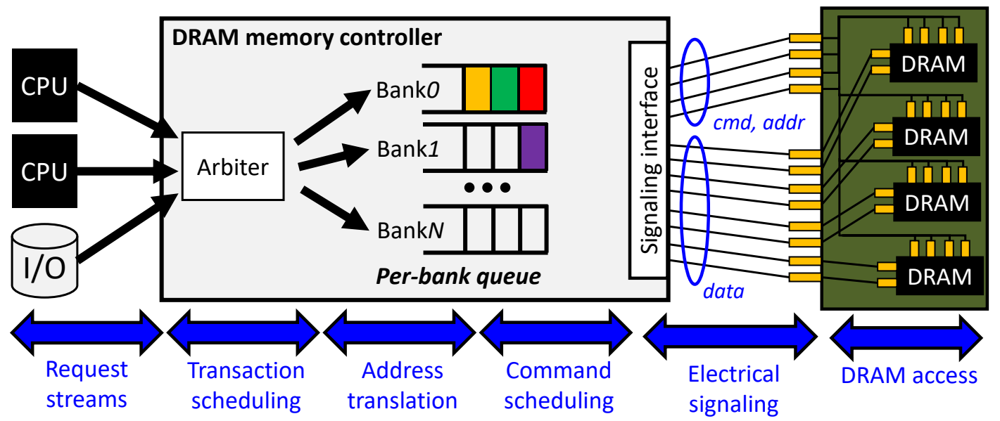

图：CPU 与 I/O 的请求经 Arbiter 进入各 Bank 的队列，再通过信号接口向 DRAM 发出 cmd/addr 与 data，底部依次标出请求流、事务调度、地址转换、命令调度、电气信号与 DRAM 访问各阶段。

控制器要遵守的具体时序参数（$t_{RCD}$、$t_{RP}$、$t_{RAS}$ 等）及“时序是控制器与 DRAM 之间的约定”这一点，见[DRAM 时序参数](#dram-接口与时序)。

> [!warning] 易错点
> - 内存控制器不只服务 CPU：DMA 引擎发起的 I/O 访问也经过它，并参与仲裁。
> - “地址翻译”在这里指把地址映射到 Bank/Rank/Row/Col，不是 TLB 那种虚拟地址到物理地址的转换。

### 等长布线：为什么主板走线弯弯曲曲

DRAM 接口同时并行传送很多位的数据和命令信号。若各条导线长短不一，信号到达各芯片的时间就不同，接收端就必须额外同步，甚至直接采样出错。

主板 PCB 上的信号走线（trace）看起来绕得很复杂，原因是要**保证所有信号线的时序一致**：设计时把所有导线做成**相同长度**，让信号同时到达不同芯片，从而能同时处理这些数据信号，减少额外的同步开销。 时钟偏斜等更深入的信号完整性问题见[时钟偏斜与 DQS](#高速接口与信号完整性)。

### 调度的两大抓手

有了排队，控制器就可以“挑着发”。内存控制器缓冲内存请求，并尝试调度它们以获得更高吞吐；关键思想是**感知 DRAM 资源与组织结构的调度**（DRAM resource / organization-aware scheduling）。 可以利用的资源有两类：

- **并行性**：同一 Channel 上不同 Rank 之间可以并行；每个 Bank 都有自己的字线驱动器（WL Drivers）、列译码器和本地灵敏放大器（即行缓冲），也能并行，这就是 **Bank 级并行**（Bank-level Parallelism）。
- **行缓冲局部性**：连续请求尽量访问同一个已打开的行缓冲，即**行缓冲感知的调度**（Row-buffer aware scheduling）。

下面两小节分别讲行缓冲管理策略和 Bank 级并行；把多条调度规则组织起来的“内存调度三原则”见[内存调度三原则](#地址映射与多通道)。

### 行缓冲管理：开页与闭页策略

#### DRAM 访问三步回顾

一个 **DRAM 行**（DRAM row）也称为 **DRAM 页**（DRAM page），每个地址是一个 $\langle$row, column$\rangle$ 对。一次 DRAM 访问分三步：

1. **Activate（激活）**：按行地址（例：Row 2）打开该行，把整行数据放入行缓冲。
2. **Read/Write（列读写）**：按列地址（例：Column 0），经列多路选择器（column mux）读写行缓冲中的某一列。
3. **Precharge（预充电）**：关闭该行，把 Bank 准备好以迎接下一次访问。

行缓冲、灵敏放大器与行缓冲命中的物理原理见[行缓冲与灵敏放大器](#dram-单元与破坏性读)。这三步留下一个选择：第 2 步做完后，什么时候做第 3 步？这就是**行缓冲管理**（Row Buffer Management）要回答的问题。

#### 开页策略（Open-page policy）

**开页策略**：访问完成后**不立即预充电**，让行缓冲保持打开，赌后续请求还会访问这一行。

- **适用条件**：访问流具有局部性。
- **收益**：后续访问同一行时是**行缓冲命中**（row buffer hit），只需做列访问，省去激活和预充电。
- **代价**：直到发现要访问的数据不在当前打开的行中，才关闭它。这次**行缓冲缺失**（row buffer miss）引入一次 **Bank 冲突**（bank conflict），此时要先预充电关闭旧行，再激活新行，最后列访问。代价高的原因是**预充电落在关键路径上**。

下图左侧：Row 2 被打开后连续 5 次 Hit，随后访问 Row 0 时 Miss，引发 bank conflict。

#### 闭页策略（Closed-page policy）

**闭页策略**：每次访问之后**立即对位线预充电**，不管未来可能出现的行缓冲命中。

- **适用条件**：访问流局部性低。
- **收益**：下一个请求到来时 Bank 已经预充电完毕，即便它访问的是另一行，也不必在关键路径上再做预充电。
- **代价**：放弃了行缓冲命中的机会，即使下一个请求恰好访问同一行，也要重新激活。

下图右侧：每次 Read 之后行缓冲立即关闭。

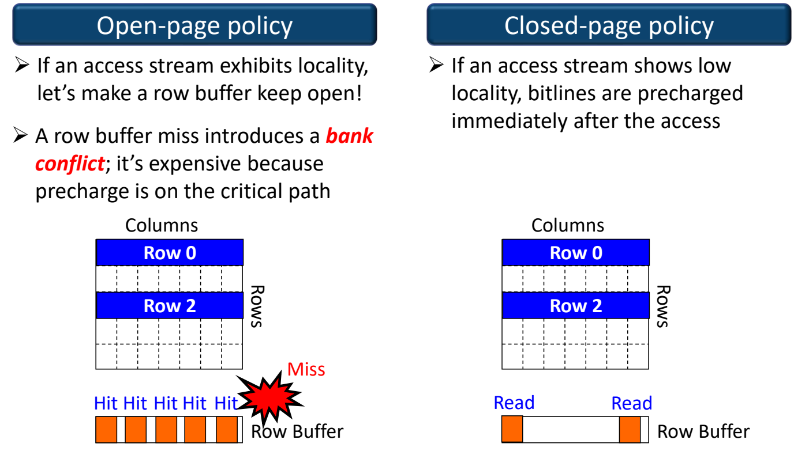

图：开页策略让行缓冲保持打开，连续访问同一行得到多次 Hit，换行时出现 Miss；关页策略在每次访问后立即预充电，行缓冲只保留单次 Read。

| 维度 | 开页策略 | 闭页策略 |
| --- | --- | --- |
| 访问后是否预充电 | 否，保持行打开 | 是，立即预充电 |
| 下次访问同一行 | 命中：只需列访问 | 需重新激活 + 列访问 |
| 下次访问不同行 | Bank 冲突：预充电 + 激活 + 列访问 | 激活 + 列访问 |
| 适合的访问模式 | 局部性高 | 局部性低、纯随机、重用距离很远 |

> [!tip] 课堂强调
> 开页与闭页应对的是不同的访问模式：局部性很高时开页效果好；如果访问纯随机、重用距离特别远，闭页更合适，因为它省去了缺失时额外的预充电延迟。

#### 用时序参数量化两种策略

> [!note] 补充解释
> 下面用[DRAM 时序参数](#dram-接口与时序)中的 $t_{RP}$（预充电时间）、$t_{RCD}$（激活到列命令的延迟）、$t_{CAS}$（列命令到数据输出的延迟）估算一次访问在关键路径上的延迟，只计这三项，忽略数据突发传输和排队。

| 情形 | 开页策略 | 闭页策略 |
| --- | --- | --- |
| 访问刚才打开的那一行 | $t_{CAS}$（命中） | $t_{RCD}+t_{CAS}$ |
| 访问另一行 | $t_{RP}+t_{RCD}+t_{CAS}$（Bank 冲突） | $t_{RCD}+t_{CAS}$ |

闭页策略也要做预充电，只是放在上一次访问之后、下一次请求到来之前，因此不在下一次访问的关键路径上。

> [!example] 例：命中率多高时开页更划算（据课程内容整理）
> 设 $t_{RP}=t_{RCD}=t_{CAS}=15\ {\rm ns}$（假设值），访问同一行的概率为 $h$。
>
> 1. 开页平均延迟：$h\cdot t_{CAS}+(1-h)(t_{RP}+t_{RCD}+t_{CAS}) = 15h+45(1-h)=45-30h\ {\rm ns}$。
> 2. 闭页延迟恒为 $t_{RCD}+t_{CAS}=30\ {\rm ns}$。
> 3. 令 $45-30h<30$，得 $h>0.5$。
>
> 因此在这组参数下，行缓冲命中率超过 50% 时开页策略的平均延迟更低；访问越随机（$h$ 越小），闭页越占优。

### Bank 级并行（Bank-level Parallelism）

一个芯片内有多个 Bank（例：8 个），每个 Bank 能独立完成预充电、激活和列访问；但把数据从 Bank 搬到芯片外的总线上这一步是串行的。Bank 内部结构见[Bank](#dram-组织层次)。

每个 Bank 有自己的 <0:7> 数据通路，经一个多路选择器汇到芯片唯一的 <0:7> 数据引脚上。 由此得到 **Bank 级并行**的规则：

- 所有 Bank **共享同一组引脚**，同一时刻只能进行一次数据传输；
- 但可以**在一个 Bank 传输数据时，向其他 Bank 发送预充电、行激活、列地址命令**。

于是 Bank 可以把内存请求**流水化**（pipelining）：

1. Bank0 依次做 PRE、RAS；
2. Bank0 做 RAS 时，Bank1 开始 PRE；
3. Bank0 进入 CAS（占用数据总线）时，Bank1 做 RAS，Bank2 开始 PRE；
4. 依此类推，每个时间片里总有一个 Bank 在 CAS 阶段使用数据总线，其余 Bank 在准备。

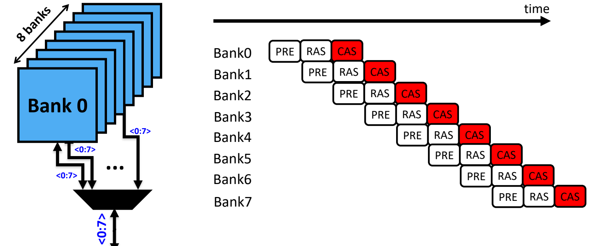

图：8 个 Bank 共享同一组数据引脚，时间轴上各 Bank 的 PRE、RAS、CAS 错开一拍依次执行，使命令与数据传输重叠形成流水；各 Bank 的 CAS 阶段首尾相接、互不重叠，对应“共享引脚一次只能传一份数据”的约束。

这种并行与“多个部件同时各干各的”不同：它的目的在于用流水线把**数据总线的时间**填满，把各 Bank 的预充电、激活延迟隐藏在其他 Bank 的数据传输背后。

> [!example] 例：流水化前后的数据总线利用率（据课程内容整理）
> 设 PRE、RAS、CAS 各占 1 个时间片，只有 CAS 片使用数据总线，要服务 8 个分别落在 Bank0–Bank7 的请求（各访问一个未打开的行）。
>
> 1. 串行（一个做完再做下一个）：共 $8\times 3=24$ 片，总线只在 8 片中有数据，利用率 $8/24\approx 33\%$。
> 2. 按上图流水：第一个 CAS 出现在第 3 片，之后每片一个 CAS，共 $2+8=10$ 片，利用率 $8/10=80\%$；请求越多，越接近 100%。
> 3. 若 8 个请求都落在**同一个** Bank 的不同行，就无法流水，只能回到串行。这也是地址映射要把连续请求分散到不同 Bank 的动机。

> [!warning] 易错点
> Bank 级并行不等于多份数据同时从引脚输出。Bank 之间并行的是“准备工作”（PRE/RAS），数据传输在共享引脚上仍是一个接一个。

> [!question]- 自测：某服务器负载是大量随机的指针追踪访问，几乎不会连续访问同一行。控制器应选开页还是闭页？为什么？
> 选闭页。局部性低时开页几乎每次都是 Bank 冲突，预充电落在关键路径上，延迟为 $t_{RP}+t_{RCD}+t_{CAS}$；闭页在访问后立即预充电，下次访问只需 $t_{RCD}+t_{CAS}$。

> [!question]- 自测：某老式平台的 FSB 为 128 位、100 MHz，每周期传一次。它的 CPU 到控制器峰值带宽是多少？把控制器移入 CPU 后，主要解决了什么问题、又引入了什么限制？
> 峰值带宽 $128\ {\rm bit}\times 100\ {\rm MHz}=12.8\ {\rm Gbit/s}=1.6\ {\rm GB/s}$。片上控制器免去了 FSB 的线延迟，并以 CPU 速度运行；代价是内存类型被 CPU 绑定（例如只支持 DDR2 的 CPU 只能装 DDR2）。

> [!question]- 自测：一个芯片有 8 个 Bank。控制器队列里有 4 个请求：A、B 访问 Bank0 的 Row 5，C 访问 Bank0 的 Row 9，D 访问 Bank3。若采用开页策略且 Bank0 当前打开 Row 5，怎样排序较好？
> 先发 A、B（都命中 Bank0 已打开的 Row 5，只需列访问），同时可向 Bank3 为 D 发 PRE/RAS，利用 Bank 级并行与 A、B 的数据传输重叠；C 与 Row 5 冲突，放到 A、B 之后再对 Bank0 预充电、激活 Row 9。这样同时利用了行缓冲命中和 Bank 级并行。

---

## 地址映射与多通道

> [!abstract] 本节要点
> - 内存控制器必须把 CPU 发来的物理地址拆成 Rank ID、Bank ID、Row ID、Column ID；哪些位给谁由设计者决定，而这个划分会显著影响性能。RaBaRoCo 表示从高位到低位依次是 Rank、Bank、Row、Column。
> - 理论最优映射可以建模为访问图 $G_s$ 上的最小 C 有界 R 割（minimum C-bounded R-cut），但它是 NP 难问题，而且要求预先知道整个访问序列，所以实际不用。
> - 常用映射（Bank-Row-Column、Row-Bank-Column、位反转、基于置换的 XOR）都可以统一写成二进制可逆矩阵（BIM）：只要矩阵可逆，映射就是一一对应的。
> - 基于熵的映射先计算每个地址位的香农熵，把低熵位用作 Row ID 以保留局部性，把高熵位用作 Bank ID 以增加并行性。
> - 调度三原则：优先服务行缓冲命中的请求（带宽）、优先服务延迟敏感的应用（系统吞吐）、保证没有应用饥饿（公平）。多通道有两种做法：锁步通道（一个控制器，合成 128 位接口）和独立通道（每个通道一个控制器）。多 CPU 各自连接本地内存，彼此经 UPI 互联，这就构成 NUMA，访问远端内存时性能会下降。

### 地址映射（Address Mapping）

CPU 发给内存的是一个 32 位或 64 位的线性物理地址，但 DRAM 的访问位置是按层次给出的：先选 Rank，再选 Bank，打开某一行（Row），最后选列（Column）。这些层次的含义见[DRAM 组织层次](#dram-组织层次)。因此内存控制器需要一套规则，把线性地址翻译成这几个坐标。

**地址映射**（address mapping）是指从物理地址中解码出 DRAM 位置（Rank ID、Bank ID、Row ID、Column ID）的规则，也就是规定物理地址的哪几位是哪个 ID。 位的划分由设计者决定，不同的划分会让同一串访问落到不同的 Bank 和行上。行缓冲是否命中、Bank 之间能否并行，都取决于这个划分，所以它对最终性能影响很大。

讲义给出了一个 32 位地址的划分例子：

| 地址位 | 位数 | 用途 | 可寻址数量 |
|---|---|---|---|
| 31–30 | 2 | Rank ID | $2^2 = 4$ 个 Rank |
| 29–27 | 3 | Bank ID | $2^3 = 8$ 个 Bank |
| 26–13 | 14 | Row ID | $2^{14} = 16384$ 行 |
| 12–3 | 10 | Column ID | $2^{10} = 1024$ 列 |
| 2–0 | 3 | Invalid（不参与 DRAM 寻址） | — |

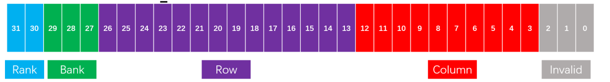

图：32 位物理地址自高到低划分为 Rank（31–30）、Bank（29–27）、Row（26–13）、Column（12–3）与无效位（2–0），即 RaBaRoCo 映射。

> [!note] 补充解释
> 最低 3 位标为 Invalid，原因是一个 Rank 的数据总线宽 64 位，每次传输 $64/8 = 8$ 字节。地址的低 $\log_2 8 = 3$ 位只用来选择这 8 字节中的哪一个字节，DRAM 不需要用它们寻址。

**RaBaRoCo** 是上面这种划分的缩写，表示从地址高位到低位依次分配给 **Ra**nk、**Ba**nk、**Ro**w、**Co**lumn。这是最经典的划分方式。也可以采用其他顺序，例如 CoRoBaRa 之类的排列；缩写中字母的顺序始终对应从高位到低位的顺序。

> [!example] 例：按 RaBaRoCo 解码地址 `0xA3C41238`
> 1. 先写成二进制：`10 100 01111000100000 1001000111 000`，各段依次对应位 31–30、29–27、26–13、12–3、2–0。
> 2. Rank ID $= 10_2 = 2$，Bank ID $= 100_2 = 4$。
> 3. Row ID $= 01111000100000_2 = 7712$，Column ID $= 1001000111_2 = 583$，最低 3 位为 0，表示 8 字节中的第 0 字节。
> 4. 下一个 8 字节 `0xA3C41240` 只让 Column 加 1，变为 584。它与上一次访问同 Bank、同行，所以是行缓冲命中。
> 5. 地址 `0xA3C43238` 等于原地址加 $2^{13}$，只让 Row 加 1，变为 7713，Bank 仍是 4。它落在同一 Bank 的另一行，会引发行冲突，需要先预充电再激活新行。

上例说明，一种映射一旦固定，就决定了哪些访问模式会命中行缓冲、哪些会互相冲突。行缓冲命中的概念见[DRAM 单元与破坏性读](#dram-单元与破坏性读)，开页/闭页策略和 Bank 级并行见[内存控制器与行缓冲管理](#内存控制器与行缓冲管理)。

### 最优地址映射与访问图

既然映射影响性能，一个自然的问题是：能不能从数学上找到最优映射？做法是把访问序列转成一张图，再把映射问题变成图划分问题。

**访问图**（access graph）的构造方法如下。设 $s = (s_1, \dots, s_T)$ 是一个非空的内存地址序列，输出多重图 $G_s = (V, E)$：

```text
1: V := {s_1}, E := ∅
2: for i = 2, ..., T do
3:     V := V ∪ {s_i}
4:     add a new edge e_i to E_s with endpoints s_{i-1} and s_i
5: end for
6: return G_s = (V, E)
```

也就是说，每个出现过的地址是一个顶点；每对相邻的两次访问 $s_{i-1}, s_i$ 连一条边。同一对地址如果多次相邻出现，就会连出多条边，所以 $G_s$ 是多重图。共有 $T-1$ 条边。

符号含义：$V$ 是应用的地址空间，$S$（即 $s$）是访问序列。一次分配（allocation）把地址空间划分为
$$
V = V_1 \cup V_2 \cup \dots \cup V_R,\qquad |V_i| \le C
$$
即最多分成 $R$ 组，每组最多容纳 $C$ 个地址。 如果两组之间有边，就说明某两次相邻访问落在了不同组里。最优映射要让组间的边数最少，这个问题叫做 **最小 C 有界 R 割**（minimum C-bounded R-cut），它是 **NP 难**（NP-hard）问题。

> [!note] 补充解释
> 可以把每组 $V_i$ 理解为“放进同一行的数据”，$C$ 就是一行的容量。这样，一条组内边表示相邻两次访问落在同一行，可以命中行缓冲；一条割边表示访问跨行，需要换行。所以“割边最少”就等价于“换行次数最少”。

> [!example] 例：讲义中的访问序列（据课程内容整理）
> 序列为 $(0; 1; 2; 3; 4; 5; 6; 7; 0; 4; 1; 5; 2; 6; 3; 7)$，其中 $T=16$，所以有 15 条边：前半段是 $0\!-\!1, 1\!-\!2, \dots, 6\!-\!7$，共 7 条；之后是 $7\!-\!0, 0\!-\!4, 4\!-\!1, 1\!-\!5, 5\!-\!2, 2\!-\!6, 6\!-\!3, 3\!-\!7$，共 8 条。取 $C=4, R=2$：
>
> 1. 按地址连续划分 $\{0,1,2,3\}, \{4,5,6,7\}$：只有 $0\!-\!1, 1\!-\!2, 2\!-\!3$ 和 $4\!-\!5, 5\!-\!6, 6\!-\!7$ 这 6 条在组内，割边为 $15-6=9$ 条。
> 2. 换成 $\{0,1,4,5\}, \{2,3,6,7\}$：割边只剩 $1\!-\!2, 3\!-\!4, 5\!-\!6, 7\!-\!0, 5\!-\!2$，共 5 条。穷举所有划分可知这是最小值。
>
> 可见，最优分组和地址顺序并不一致，它取决于整个访问序列。

这种方法在实际中不用，原因有两个：

1. **需要预知整个访问序列**：这相当于预测未来的访问，做不到。
2. **求最优解是 NP 难问题**：即使知道序列，也很难求出最优解。

所以它只是理论上的最优，不是重点。实际系统使用的是下面这些固定的、可以用矩阵描述的映射。

### BIM 地址映射（Binary Invertible Matrix）

实际使用的映射方式各不相同，看上去像是凭经验调出来的。但它们其实有统一的数学形式：都可以看作在地址位上做线性变换（模 2 运算）。

**BIM 地址映射**把“物理地址位 → Bank/Row/Column 位”的映射写成一个**二进制可逆矩阵**（binary invertible matrix, BIM）与地址位向量的乘积，运算在模 2 下进行，乘法是与、加法是异或 $\oplus$。只要矩阵可逆，映射就是**一一对应**（one-to-one）的：每个物理地址对应唯一的 DRAM 位置，不同地址不会冲突到同一个存储单元。

讲义列出的四种常见映射都是 BIM 的特例：

1. **(a) Bank-Row-Column**：地址位从高到低直接依次分给 Bank、Row、Column，矩阵是单位阵。普通 CPU 一般采用这种映射。
2. **(b) Row-Bank-Column**：把原地址中的若干位交叉连线，使高位成为 Row，中间几位成为 Bank，矩阵是置换阵。
3. **(c) Bit Reversal（位反转）**：把高位段的位顺序整体反转后，再分给 Bank 和 Row。
4. **(d) Permutation-based（基于置换）**：用若干个地址位做异或（XOR），结果作为某一位输出，典型用法是让 Bank 位与 Row 位异或。NVIDIA GPU 采用的就是这种做法，把几个位异或合在一起。这样做与 GPU 的访存模式匹配，能显著提高行缓冲命中率和内存利用率。

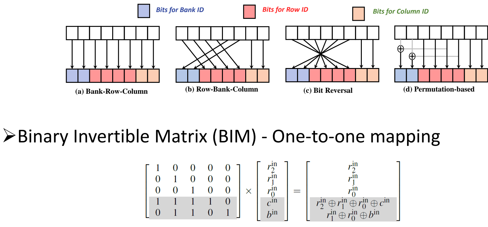

图：上方对比 Bank-Row-Column、Row-Bank-Column、位反转与基于置换（异或）四种映射，下方用二进制可逆矩阵把 Bank 位与列位改写为与行位的异或，保证一一映射。

讲义中基于置换的映射可以写成矩阵形式。设输入为三个 Row 位 $r_2^{\rm in}, r_1^{\rm in}, r_0^{\rm in}$、一个 Column 位 $c^{\rm in}$ 和一个 Bank 位 $b^{\rm in}$：

$$
\begin{bmatrix}
1&0&0&0&0\\
0&1&0&0&0\\
0&0&1&0&0\\
1&1&1&1&0\\
0&1&1&0&1
\end{bmatrix}
\times
\begin{bmatrix}
r_2^{\rm in}\\ r_1^{\rm in}\\ r_0^{\rm in}\\ c^{\rm in}\\ b^{\rm in}
\end{bmatrix}
=
\begin{bmatrix}
r_2^{\rm in}\\ r_1^{\rm in}\\ r_0^{\rm in}\\ r_2^{\rm in}\oplus r_1^{\rm in}\oplus r_0^{\rm in}\oplus c^{\rm in}\\ r_1^{\rm in}\oplus r_0^{\rm in}\oplus b^{\rm in}
\end{bmatrix}
$$

前三行是单位行，三个 Row 位保持不变。第四行把三个 Row 位与 Column 位异或，第五行把 $r_1, r_0$ 与 Bank 位异或。

> [!info] 可视化资源
> [MEMSYS 2025 论文：基于 XOR 的 DRAM 地址映射数学模型](https://www.memsys.io/wp-content/uploads/ninja-forms/5/a_mathematical_model_for_xor_based_application_specific_dram_address_mapping_schemes.pdf)：论文以 GF(2) 上的二进制矩阵（BIM）统一描述线性、位置换与基于 XOR 置换的地址映射并以最小化行缺失为目标，是理解 BIM 映射框架的原始文献与图示来源。

> [!example] 例：验证可逆性并体会 XOR 的作用（据课程内容整理）
> 1. **可逆性**：这个矩阵是下三角阵，且对角线全为 1，所以在模 2 下可逆。逆变换也可以直接写出：$c^{\rm in} = y_4 \oplus r_2 \oplus r_1 \oplus r_0$，$b^{\rm in} = y_5 \oplus r_1 \oplus r_0$，其中 $y_4, y_5$ 是输出的第 4、5 位。因此不同地址一定映射到不同位置。
> 2. **代入数值**：取 $(r_2, r_1, r_0, c, b) = (1,0,1,1,0)$，输出为 $(1, 0, 1, 1\oplus0\oplus1\oplus1, 0\oplus1\oplus0) = (1,0,1,1,1)$。
> 3. **避免 Bank 冲突**：两个地址的 Bank 位都是 $b=0$，但 Row 不同，例如 $(r_1, r_0)=(0,0)$ 和 $(0,1)$。直接映射时它们同 Bank 不同行，会发生行冲突。经过 XOR 后，输出的 Bank 位分别为 $0$ 和 $1$，两次访问被分到不同 Bank，可以并行服务。

> [!warning] 易错点
> 不是任意一种“位重排加异或”都合法。如果矩阵不可逆，就会有两个不同的物理地址映射到同一个 DRAM 位置，数据会互相覆盖。判断一种映射是否可行，就看它对应的二进制矩阵是否可逆，同时还要看它是否适合实际负载。

### 基于熵的地址映射（Entropy-based Address Mapping）

BIM 回答了“哪些映射是合法的”，但没有回答“针对某个负载该选哪一种”。基于熵的映射用信息论给出一个选择依据：先测量每个地址位在实际访问流中的随机程度，再据此决定它的用途。

**香农熵**（Shannon's entropy）函数为
$$
H(p_1, p_2, \dots, p_v) = -\sum_{i=1}^{v} p_i \log_v p_i
$$
其中 $v$ 是可能取值的个数，$p_i$ 是取第 $i$ 个值的概率。对数以 $v$ 为底，所以 $H \in [0, 1]$。 对单个地址位有 $v=2$，$p_1, p_2$ 分别是该位在访问流中取 0 和取 1 的频率。

方法如下：

1. **统计**：分析应用的访存模式，对每一个地址位计算熵 $H$。
2. **低熵位作 Row ID，保局部性**：熵低说明这一位很少变化。把它们用作 Row ID，连续的访问大多落在同一行，行缓冲容易命中。
3. **高熵位作 Bank ID，增并行**：熵高说明这一位变化频繁、接近随机。把它们用作 Bank ID，相邻请求会分散到不同 Bank，可以并行服务。
4. 熵介于两者之间的位用作 Column ID。

讲义的示意图中，横轴是地址位，纵轴是熵。低熵区划给 Row，中间爬升的一段划给 Column，高熵区划给 Bank。

> [!example] 例：两个地址位的熵
> 某位在访问流中始终为 0，即 $p_1=1, p_2=0$，则 $H = -(1\cdot\log_2 1) = 0$（约定 $0\log 0 = 0$），适合作 Row ID。另一位取 0 和 1 各占一半，则 $H = -2\times\frac{1}{2}\log_2\frac{1}{2} = 1$，适合作 Bank ID。

这种方法本质上是一种数学建模：用一个固定的理论（熵）来指导位的划分。它的效果依赖于对具体应用访存模式的分析。

### 内存调度三原则

地址映射决定了请求落在哪里。之后，内存控制器还要决定先服务哪个请求。多年的研究给出了三条基本原则，每条对应一个不同的优化目标：

| 原则 | 目标 | 出处 | 理由 |
|---|---|---|---|
| 1. 优先服务行缓冲命中（row-buffer-hit）的请求 | 最大化内存带宽 | Rixner+, ISCA'00 | 命中请求不需要预充电和激活，可以立即读写，单位时间完成的访问更多 |
| 2. 优先服务延迟敏感（latency-sensitive）的应用 | 最大化系统吞吐 | Kim+, HPCA'10 | 许多 CPU 程序的访存是串行依赖的，一个请求不返回，后续工作就卡住；先服务它们能让整个系统前进得更快 |
| 3. 保证没有应用被饿死（starved） | 最小化不公平（unfairness） | Mutlu+, MICRO'07 | 多个应用同时发出请求时，要让每个应用都得到服务，不能只照顾某些应用 |

第 1 条从内存利用率出发，第 2 条从应用自身的串行特性出发，第 3 条从多应用并发出发。三者可能冲突：如果一味优先服务行命中，访问局部性好的应用会一直占用 Bank，其他应用就可能饥饿。所以第 3 条是必须保证的底线。

> [!warning] 易错点
> “优先服务行缓冲命中”提高的是带宽，不等于提高系统吞吐或公平性。第 2、3 条正是为了弥补只看行命中带来的问题而提出的。

### 多通道与 NUMA

通道（Channel）的定义见[DRAM 组织层次](#dram-组织层次)。在一个通道上，所有 DIMM 收到相同的命令，由其中一个 Rank 应答，数据经同一条 64 位总线返回。 同一通道上的多个 Rank 可以各自工作，但数据传输都依赖这一条通道，所以单通道的带宽会成为瓶颈。增加通道数是提高内存速度的另一种方法。

**多通道**（multiple channels）的做法是让控制器连接多条相互独立的 64 位通道。台式机一般是 2 个通道（双通道），Intel 服务器可以有 6 或 8 个通道。通道越多，能插的内存条也越多。主板上要让双通道生效，必须把 DIMM 插在**同色**插槽里，因为同色插槽分属 Channel A 和 Channel B。

#### 锁步通道与独立通道

多通道有两种组织方式：

| 方式 | 控制器数量 | 接口 | 一次访问如何完成 | 代价 |
|---|---|---|---|---|
| 方法 1：锁步通道（lock-step） | 1 个 MC | 两条 64 位通道合成一个 128 位宽的“单通道” | 一个请求拆成两半，分别由两条通道上的 DIMM 服务，两边同步传输数据 | 只是加宽了一个接口，并发请求数没有增加 |
| 方法 2：独立通道（independent） | 每条通道 1 个 MC | 各自 64 位 | 每条通道独立接收、服务不同的请求 | 需要多个控制器，硬件更复杂 |

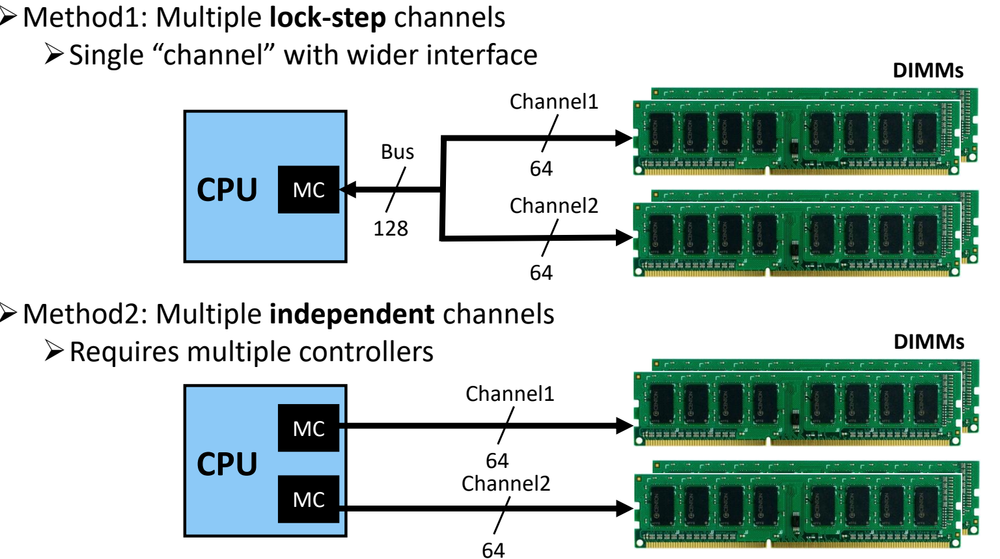

图：方法一由一个 MC 通过 128 位总线同时驱动两个 64 位通道（锁步），方法二由两个 MC 各自驱动一个 64 位通道，可独立访问。

现代系统最常见的是独立通道，一个控制器对应一个通道。

#### 多 CPU：从锁步到 NUMA

当系统中有多个 CPU 时，两种方式的差别更明显：

1. **多 CPU + 锁步（旧式）**：多个 CPU 共享一个片外内存控制器和 128 位总线。好处是每个 CPU 访问内存的延迟相同。缺点有两个：外置 MC 会拉长延迟，而且多个 CPU 要竞争同一份内存带宽。
2. **多 CPU + 独立通道（现代）**：每个 CPU 内置自己的 MC 和通道，内存容量和带宽都随 CPU 数量增长。代价是每个 MC 只属于一个 CPU。CPU0 要访问挂在 CPU1 上的内存时，必须经过 CPU 之间的互联 **UPI**（UltraPath Interconnect），请求先到 CPU1，再由 CPU1 的 MC 访问。

**NUMA**（Non-uniform Memory Access，非一致内存访问）指的是这种情况：同一个 CPU 访问不同物理内存，延迟和带宽不一样。访问本地内存最快，访问其他 CPU 的内存要额外经过互联。

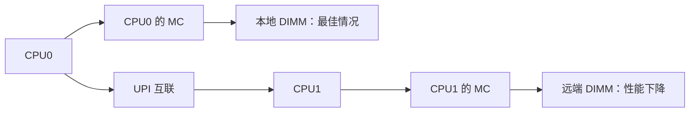

- **最佳情况**：CPU0 访问直接连在 CPU0 上的内存。
- **远端访问**：如果数据在另一个 CPU 的内存里，CPU 之间的通信会导致性能下降。

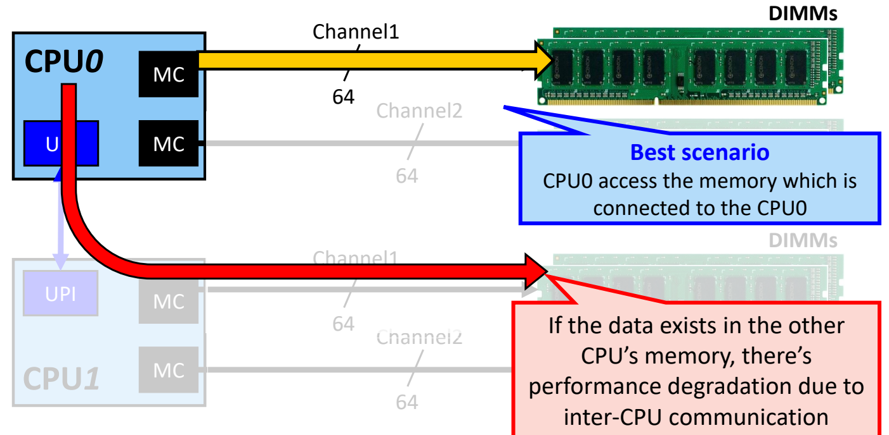

图：CPU0 经自身 MC 访问本地 DIMM 是最佳情况（黄色箭头），若数据在 CPU1 的内存中则需经 UPI 跨 CPU 访问（红色箭头），带来性能下降。

性能下降的根源在于互联带宽远低于本地内存通道带宽。课上举的数字是：AMD 早期的 CPU 间互联只有约 6 GB/s，而一个 DDR5 通道约有 50 GB/s。Intel 的 UPI 带宽较高，可以达到几十到上百 GB/s。因此，做系统优化时的原则是：把数据放在处理它的那个 CPU 的本地内存上。NUMA 问题不只出现在 DRAM 上，CPU 访问外设时也会遇到。例如数据在 CPU0 的内存里，却要发往挂在另一个 CPU 上的网卡或 SSD，同样要跨越互联。

> [!example] 例：一个通道的峰值带宽（据课程内容整理）
> 一条通道宽 64 位，每次传输 $64/8 = 8$ 字节。以 DDR5-6400 为例，数据率是 6400 MT/s，单通道峰值带宽为
> $$
> 8\ \text{B} \times 6400 \times 10^6\ \text{/s} = 51.2\ \text{GB/s}
> $$
> 这与课上“一个 DDR5 通道约 50 GB/s”一致。双独立通道的总峰值约为 102.4 GB/s。如果走一条约 6 GB/s 的互联去访问远端内存，可用带宽不到本地单通道的八分之一。

> [!warning] 易错点
> NUMA 指内存访问的延迟和带宽因位置而异，不是指内存容量分配不均。另有一个名字只差一个字的概念：NUCA（Non-Uniform Cache Access），说的是容量很大的缓存内部也有远近快慢之分。它和 NUMA 是两回事。

> [!question]- 自测：某系统按 RaBaRoCo 划分 32 位地址（Rank 31–30、Bank 29–27、Row 26–13、Column 12–3）。程序以 $2^{13}$ 字节为步长连续访问，会出现什么情况？如果改用 Row-Bank-Column，并把 Bank 放在 15–13 位，又会怎样？
> 在 RaBaRoCo 下，每一步都只让 Row 加 1，所有访问落在同一个 Bank 的不同行，每次都是行冲突，完全无法利用 Bank 级并行。改用 Row-Bank-Column 后，步长 $2^{13}$ 每次让 Bank 位加 1，连续 8 次访问轮流落在 8 个 Bank 上，可以流水并行。这正说明映射方式直接决定性能。

> [!question]- 自测：二进制矩阵的第 4 行改成 $[1\ 1\ 1\ 0\ 0]$，即 Column 位输出为 $r_2\oplus r_1\oplus r_0$，其余不变。这个映射还可用吗？
> 不可用。此时第 4 列全为 0，输入 $c^{\rm in}$ 对任何输出都没有影响，矩阵不可逆。$c^{\rm in}=0$ 和 $c^{\rm in}=1$ 的两个地址会映射到同一个 DRAM 位置，违反一一对应。

> [!question]- 自测：双路服务器上，一个线程在 CPU0 上运行，但它的数据都被分配在 CPU1 的 DIMM 上。它的访存路径是什么？性能为什么会下降？
> 请求要从 CPU0 经 UPI 到 CPU1，再由 CPU1 的 MC 访问 DIMM，数据沿原路返回。这是 NUMA 的远端访问：多了一段互联延迟，而且互联带宽通常远低于本地通道带宽（课上举例约 6 GB/s 对 50 GB/s）。应该把线程和数据放在同一个 CPU 节点上。

---

## 高速接口与信号完整性

> [!abstract] 本节要点
> - DDR1→DDR4 的数据率从 200 MT/s 级提升到 1600 MT/s 以上（DDR5 约 6400 MT/s），但存储单元阵列的内核频率受电容充放电速度限制，只能停留在约 100–200 MHz。
> - 解决办法是**预取**（并转串）：内部宽总线一次并行取出 $2^n$ 份数据，经并串转换后在外部 DQ 口以 $2^n$ 倍速率串行输出；DDR1/2/3 分别为 2:1、4:1、8:1，200 MHz 内核对应 400/800/1600 MT/s。
> - 高速接口有四个挑战：功耗、时钟偏斜、信号反射、噪声；对策依次是降电压、源同步（DQS）、端接、延迟可预测的拓扑。
> - 功耗 $P \propto V^2 f$：数据率上升时靠降低工作电压（SDR 约 3.3 V → DDR4 约 1.2 V）抵消；电压不同使各代 DIMM 的引脚数和防呆缺口位置都不同，不能混插。
> - DDR2 用对称 T 形拓扑，各芯片延迟相近但路径长、偏斜大；DDR3 用 Fly-by 拓扑，路径短而简单，各芯片延迟不同但可预测、可校正，末端再加端接。

### 数据率需求与内核频率瓶颈

SDR 只在时钟上升沿传数据，DDR 在上升沿和下降沿都传，数据率因此翻倍（双沿传输的机制见[DRAM 接口与时序](#dram-接口与时序)）。问题是：双沿只能带来一次性的 2 倍，处理器从单核走向双核、四核，对内存带宽的需求仍在持续增长，还要靠什么继续提高数据率？

**DDR 代际数据率**：DDR 每一代都在提速，型号后缀就是数据率，单位是 MT/s（每秒百万次传输）。JEDEC 规范中的演进为：DDR1-200/266/333/400 → DDR2-400/533/667/800 → DDR3-800/1066/1333/1600 → DDR4-1600……，对应带宽（GB/s）随之逐级上升，与多核处理器的普及同步。

> [!warning] 易错点
> “DDR4-1600”中的 1600 是数据率 1600 MT/s，不是 1600 MHz 时钟。因为双沿传输，它的 I/O 时钟只有 800 MHz。课上口头说“近似等效为 1600 兆赫兹”，指的是“每秒传 1600 兆次”。DDR5 约 6400 MT/s 同理。

要看清瓶颈，先把主存拆成两部分：**存储单元阵列**（memory cell array）和 **I/O 缓冲**（I/O buffer）。

1. 存储单元阵列按**内部时钟**工作，每个周期经内部总线向 I/O 缓冲送出 $n$ 位数据；
2. I/O 缓冲按**外部时钟**工作，每个周期向内存控制器送出 $n$ 位数据。

早期两者频率相同。例如内部总线工作频率 133 MHz、外部时钟 133 MHz，每根数据线的传输速率就是 133 Mbps。 想提高外部数据率，最直接的办法是同时提高内核频率，但这条路走不通。

**内核频率限制**：内核频率受 DRAM 单元电容的物理特性限制。电容充放电的快慢由电路本身决定，基本固定，随工艺缩小甚至变得更差，所以内部总线频率无法跟着外部接口一起提高。 由此产生核心矛盾：内部频率基本不变，外部频率不断提高，两者必须用某种结构匹配起来。

### 预取与并串转换（Prefetch）

内核慢、接口快，那就让内核每个周期多取一些数据，再由接口分几次快速送出。

**预取**（prefetch）在 DDR 中指**并转串**（parallel to serial）：内核频率保持在较低的 100–200 MHz，内部数据总线一次并行取出多份数据，经并串转换电路从同一个 DQ 端口按更高频率串行输出，从而只提高外部数据率。

以 200 MHz 内核为例：

| 代际 | 预取深度 | 并串比 | 内核频率 | 外部数据率 |
| --- | --- | --- | --- | --- |
| DDR1 | Prefetch-2 | 2:1 | 200 MHz | 400 MT/s |
| DDR2 | Prefetch-4 | 4:1 | 200 MHz | 800 MT/s |
| DDR3 | Prefetch-8 | 8:1 | 200 MHz | 1600 MT/s |

一般关系是：

$$
R_{\rm ext} = k \times f_{\rm core}
$$

其中 $f_{\rm core}$ 是内核（内部总线）频率，单位 MHz；$k$ 是预取深度（并串比 $k:1$）；$R_{\rm ext}$ 是每根 DQ 线的外部数据率，单位 MT/s。以 DDR1 为例：内部用两路同时送出两份数据，外部以两倍速率逐个传出，频率就匹配上了。DDR2 内部仍是 200 MHz，外部 800 MT/s，比例 4:1；DDR3 内部 8 路并行，外部数据率提高到 8 倍。

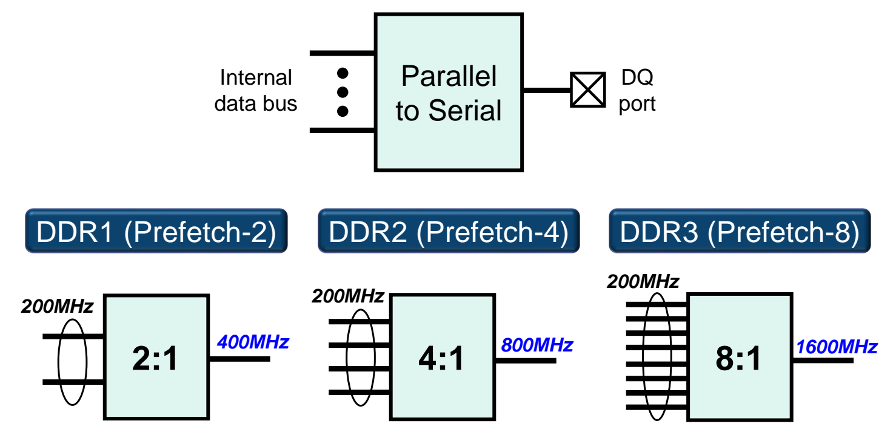

图：内部数据总线经 Parallel to Serial 送到 DQ 端口，核心频率保持 200MHz，DDR1/2/3 分别用 2:1、4:1、8:1 并串比得到 400、800、1600 MT/s 的外部数据率。

讲义把输出侧的 400、800、1600 标作 MHz，它们实为每根 DQ 线的数据率，单位应为 MT/s。

> [!info] 可视化资源
> [Wikipedia：DDR SDRAM](https://en.wikipedia.org/wiki/DDR_SDRAM)：“DDR 各代对比”表列出各代内核频率、预取位数（2n/4n/8n/16n）、传输率、电压与 DIMM 引脚数，并附桌面 DIMM 模组对比图，正好对应预取并转串与降压演进。

> [!note] 补充解释
> 按 JEDEC 实际规格，DDR 系列的 I/O 时钟是数据率的一半（双沿各传一次）：DDR-400 的 I/O 时钟 200 MHz，DDR2-800 为 400 MHz，DDR3-1600 为 800 MHz。所以预取深度 $k$ 等于“I/O 时钟相对内核的倍频”乘以双沿带来的 2。

#### 2n 预取结构（2n-prefetch Architecture）

**2n 预取结构**：内部数据总线宽度是外部数据总线的 $2^n$ 倍；接口每个时钟周期采集两次数据，时钟上升沿取总线的低半部分，下降沿取高半部分。

> [!warning] 易错点
> 幻灯片原文写作“external data bus width is greater than that of the internal data bus by $2^n$ times”，方向写反了。按同页 DDR3 结构图和上一页的并转串原理，应当是**内部**总线比**外部**宽 $2^n$ 倍：内部 8 组 $n$ 位，外部只有 1 组 $n$ 位。

以 DDR3 为例，数据通路是：

1. **并行读出**：DRAM 单元阵列（DRAM CELL）一次送出 8 组 $n$ 位数据；
2. **寄存**：每组进入一个数据寄存器（Data Register），暂存这批并行数据；
3. **选择输出**：8 个寄存器接到多路选择器（MUX）的 D0–D7 输入，MUX 在 Read DQS 的节拍下依次选出一组，输出 $n$ 位数据；
4. **驱动**：输出驱动器把 $n$ 位数据送上外部 DQ 线，串行速率是内部速率的 8 倍。

这套并串逻辑就位于 Bank 和接口端接之间，对应 DRAM 内部框图中读写 FIFO 那一段（框图本身见[DRAM 接口与时序](#dram-接口与时序)）。MUX 的节拍信号就是后面讲的数据选通 DQS。

> [!tip] 课堂强调
> DDR 里的“prefetch”只是“并转串”，与缓存的硬件预取（提前把将来要用的数据取进缓存）是两回事，只是工程师沿用了同一个名字。缓存预取见[降低缺失率与命中时间](#降低缺失率与命中时间)。

> [!example] 例：用预取深度反推内核频率
> DDR3-1333 的外部数据率是 1333 MT/s，预取深度 $k=8$，内核频率是多少？
>
> 1. 由 $R_{\rm ext} = k \times f_{\rm core}$ 得 $f_{\rm core} = R_{\rm ext}/k$；
> 2. $f_{\rm core} = 1333/8 \approx 167$ MHz，落在 100–200 MHz 区间内，说明内核频率不必提高，提速完全来自更深的预取。

### 高速接口的四个挑战

预取解决了“内核跟不上”，但外部接口本身越来越快，最新的 DDR5（约 2020 年发布）已达约 6400 MT/s。 高速接口面临四个挑战：

1. **功耗高**（High Power Consumption）
2. **时钟偏斜**（Clock Skew）
3. **信号反射**（Signal Reflection）
4. **噪声信号**（Noise Signal）

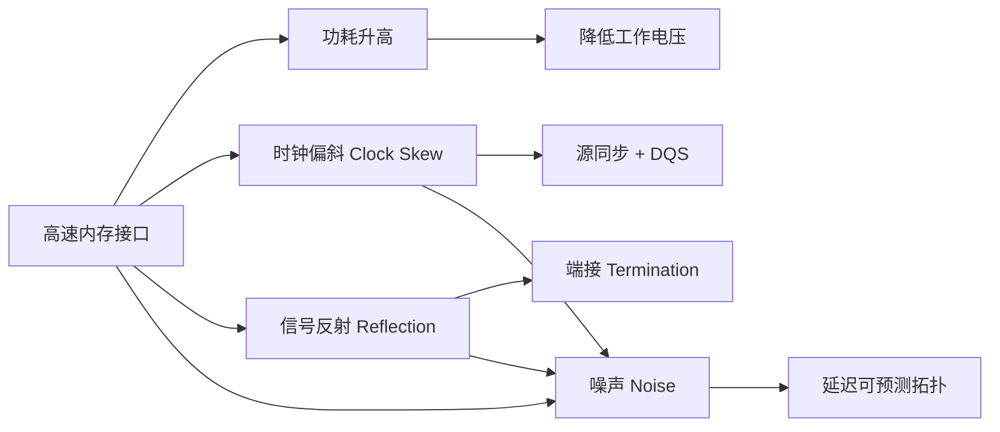

噪声由时钟偏斜和信号反射共同造成，所以图中这两项也指向噪声。

### 功耗与降压

**DRAM 功耗与降压**：DRAM 功耗同时取决于电源电压和工作时钟频率：

$$
P \propto V^2 \times f
$$

其中 $P$ 是功耗，$V$ 是工作电压，$f$ 是工作频率。电压不变时，功耗随频率线性增长，数据率越高功耗越大。功耗对电压是平方关系，所以降压最有效，DDR 的设计目标之一就是通过降低工作电压实现低功耗。

| 代际 | 工作电压（约） | 最大数据率（约） |
| --- | --- | --- |
| SDR | 3.3 V | 200 MT/s |
| DDR | 2.5 V | 400 MT/s |
| DDR2 | 1.8 V | 800 MT/s |
| DDR3 | 1.35–1.5 V | 1600 MT/s |
| DDR4 | 1.2 V | 3200 MT/s |

数据率几乎每代翻倍，电压则逐代下降，从而压住功耗的增长。

> [!note] 补充解释
> s2p90 柱状图中 DDR3 一栏约为 1.35 V。JEDEC 标准 DDR3 是 1.5 V，低压版 DDR3L 是 1.35 V，所以表中写作区间。DDR5 进一步降到 1.1 V。课上口头说“现在只有零点几伏”不准确，应以图中数值为准。

**模组设计差异**：工作电压逐代降低、数据率逐代提高，如果把某一代内存插进另一代的系统，可能因电压不匹配损坏器件。因此每代 DIMM 的设计都不同：

- DDR1：184-pin DIMM
- DDR2：240-pin DIMM
- DDR3：240-pin DIMM
- DDR4：288-pin DIMM（讲义写作 284-pin，属笔误；DDR4 台式机 DIMM 为 288 针）

DDR2 和 DDR3 引脚数相同，靠金手指上**防呆缺口**的位置不同来区分，缺口逐代向左移，保证插错时根本插不进去。

> [!info] 可视化资源
> [Wikipedia：DIMM](https://en.wikipedia.org/wiki/DIMM)：有 SDR 与 DDR 模组、DDR 与 DDR2 防呆缺口位置对比图，并列出各代 168/184/240/288 针引脚数，直观说明电压不同导致缺口与引脚各异。

### 时钟偏斜与数据选通（Clock Skew & DQS）

数据率越高，留给每一位的采样窗口越窄，信号边沿上一点时间偏差就可能让接收端读错数据。

**时钟偏斜**（clock skew）是信号边沿的时间偏移。数据率升高后，DQ（数据线）上的信号不稳定，就会出现偏斜。 理想时钟是标准方波；偏斜后波形边沿变缓、扭曲，接收端要等信号越过某个电压阈值才判定为上升沿，判定时刻因此后移。后移太多，采样点就落到错误的位置。传输距离越长，延迟和偏斜越大。

SDR 采用**中心时钟同步**（central clock synchronous）：系统时钟 CLK 由内存控制器产生，经较长走线送到 DRAM，DQ 的收发都以这个时钟为准。这个时钟本身就有偏斜，不稳定也不可靠，DRAM 内部的时序逻辑会受影响。

**源同步**（source-synchronous）是 DDR1、DDR2、DDR3 的解决方案：发送端在发数据的同时发出**数据选通**（data strobe，DQS）信号，与数据走同样的路径；接收端按 DQS 的边沿采样数据，不再依赖外部中心时钟。 由于 DQS 与 DQ 一起传播、经历相近的延迟，两者的相对时序得以保持。

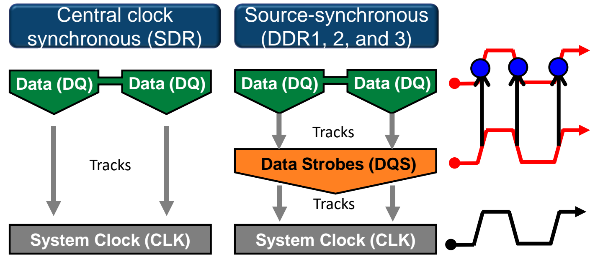

图：SDR 中数据直接跟随系统时钟，DDR1–3 中数据跟随与其同源发送的数据选通信号 DQS，DQS 再跟随系统时钟，右侧波形示意在 DQS 边沿采样数据。

> [!tip] 课堂强调
> 选通信号在 DRAM 历史上出现过两次：异步 DRAM 用 RAS/CAS 选通地址，SDRAM 引入时钟后选通信号消失；到了 DDR，为了对抗高速下的时钟偏斜，又以 DQS 的形式回来，专门辅助接收端读数据。

### 信号反射与端接（Reflection & Termination）

总线上的信号传到末端并不会自然消失，处理不好，它会反弹回来叠加到后续信号上。

**信号反射**（signal reflection）：信号从最后一个 DIMM 处反射回来，干扰后续信号。 设内存控制器在 A 点，DIMM #1 接在 B 点，DIMM #2 接在 C 点（总线末端）：

1. $T=0$：控制器在 A 发出 signal1；
2. $T=1$：signal1 到达 B（DIMM #1）；
3. $T=2$：signal1 到达 C（DIMM #2）；与此同时控制器在 A 发出 signal2；
4. $T=3$：signal1 在 C 端被反射回 B，正好与刚到 B 的 signal2 交汇叠加，DIMM #1 收到的已不是想要的 signal2。

**端接**（termination）：在总线末端加端接电阻（幻灯片写作 terminator/register，指电阻 resistor），把到达末端的信号吸收掉，消除反射。 加了端接后，signal1 经 B、C 后被吸收，$T=3$ 时 B 点只有 signal2，不再受干扰。

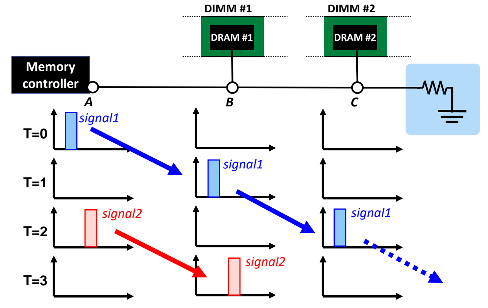

图：内存控制器发出的 signal1 随 T=0 到 T=2 依次经过 A、B、C 点，末端接终端电阻到地，使信号在 C 之后被吸收而不反射干扰随后的 signal2。

**端接的实际形态**：端接遍布内存子系统：

- **主板端接**（motherboard termination）：主板上靠近内存插槽一排排的电阻；
- **模组端接**（module termination）：DIMM / DRAM 芯片内部专门的端接电路，即 DRAM 内部框图中的 ODT（On-Die Termination）模块。信号进入某个 DIMM 后要在那里被消掉，在整条总线上流动时也要被消掉，所以芯片内、模组内、总线末端都需要端接。

DRAM 模组中的端接可以选择性开启或关闭。用示波器对比，关闭端接时波形杂乱，开启后信号明显清晰。

> [!warning] 易错点
> 反射干扰的不是“同一个信号自己”，而是**后续**信号：signal1 的反射波在时间上与 signal2 重叠，破坏的是 signal2。所以信号间隔越短（数据率越高），反射越容易和下一个信号撞上。

### 噪声与延迟可预测拓扑（Noise & Topology）

**噪声信号**（noise signal）：时钟偏斜和信号反射共同产生噪声。即使是 DDR1，噪声也已很明显，更快的 DDR2、DDR3、DDR4 更严重。 噪声无法完全消除，所以除了减少信号错误，**预测**信号误差同样关键：如果能预测每个芯片的信号何时到达、何时最稳定，就能选在受影响最小的时刻采样。

**信号噪声与拓扑**：内存控制器到模组上各芯片的布线拓扑决定了延迟能否预测。课程比较了两种方案。

**对称 T 形拓扑**（symmetrical T-branch topology，DDR2）：控制器的信号线进入模组中央后逐级对称二分叉（扇形分支），每个分支末端恰好连到一颗芯片。各 DRAM 芯片的信号到达时间相近，可以用同一个时刻采样；但分支逐级展开，信号路径很长，长路径本身又造成时序偏斜。

**Fly-by 拓扑**（fly-by topology，DDR3）：控制器的信号线从模组一端起，沿一条线依次经过各芯片，到末端接端接电阻。它不保证各芯片延迟相同，但路径简化、缩短（Simplified Stub Design with Reduced Length），每颗芯片的延迟更可预测，容易校正：控制器预先得知相邻芯片之间的延迟差，把它计入各自的采样时刻即可。 路径简单之后，偏斜和噪声也更小。

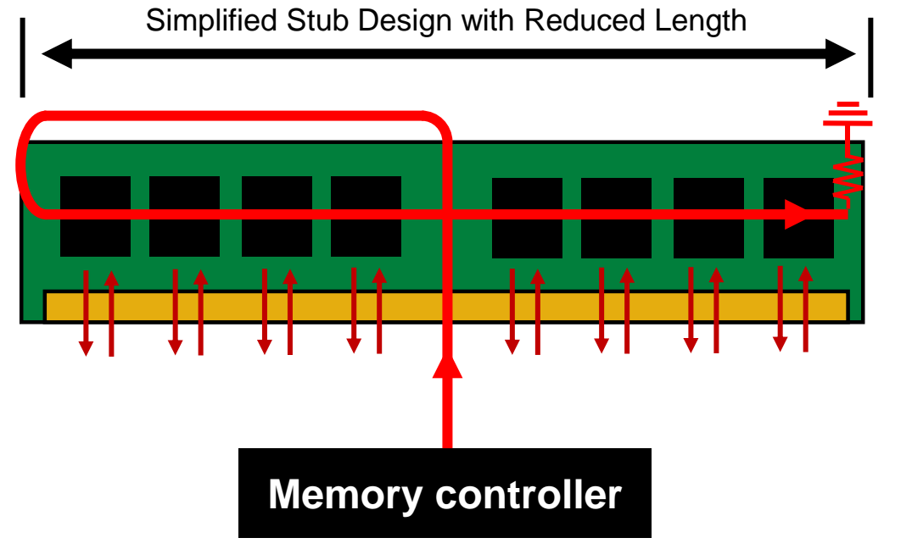

图：DDR3 的地址/命令线从内存控制器进入模组后依次串过各颗芯片，末端接终端电阻，缩短并简化分支走线，使各芯片的信号延迟可预测。

| 拓扑 | 代际 | 各芯片延迟 | 路径 | 处理偏斜的方式 |
| --- | --- | --- | --- | --- |
| 对称 T 形 | DDR2 | 近似相同 | 长，逐级分叉 | 统一时刻采样，但长路径带来偏斜 |
| Fly-by | DDR3 | 各不相同但可预测 | 短，单条直线 + 末端端接 | 按预测的延迟逐芯片校正采样时刻 |

> [!warning] 易错点
> Fly-by 的优点不是“延迟相等”，恰恰相反，它放弃了等延迟，换来的是**可预测**。判断方法：看设计追求的是“对齐”（T 形）还是“可校正”（Fly-by）。

> [!question]- 自测：某 DDR 器件内核频率 166 MHz、预取深度 8，外部数据率是多少？若要在内核频率不变时数据率再翻倍，应怎么做？
> 外部数据率 $R_{\rm ext} = 8 \times 166 \approx 1333$ MT/s（即 DDR3-1333）。内核频率受电容充放电限制无法提高，要翻倍只能把预取深度加倍到 16，让内部总线一次并行取出 16 份数据，再以 16:1 并串转换输出。

> [!question]- 自测：数据率从 DDR2-800 提到 DDR3-1600，若电压从 1.8 V 降到 1.5 V，按 $P \propto V^2 f$ 估算功耗变为原来的多少倍？
> $\frac{P_2}{P_1} = \left(\frac{1.5}{1.8}\right)^2 \times \frac{1600}{800} \approx 0.694 \times 2 \approx 1.39$。频率翻倍本应使功耗翻倍，降压把增幅压到约 1.39 倍，这说明降压是 DDR 控制功耗的主要手段。

> [!question]- 自测：一条两 DIMM 的总线上，控制器连续发出两个信号后，近端 DIMM 收到的第二个信号波形畸变，而在总线末端加上电阻后问题消失。原因是什么？
> 是信号反射：第一个信号到达总线末端后被反弹回来，正好与刚到近端 DIMM 的第二个信号叠加。末端端接电阻吸收了到达末端的信号，反射消失，第二个信号就完整了。

---

## 本讲小结

### 概念地图

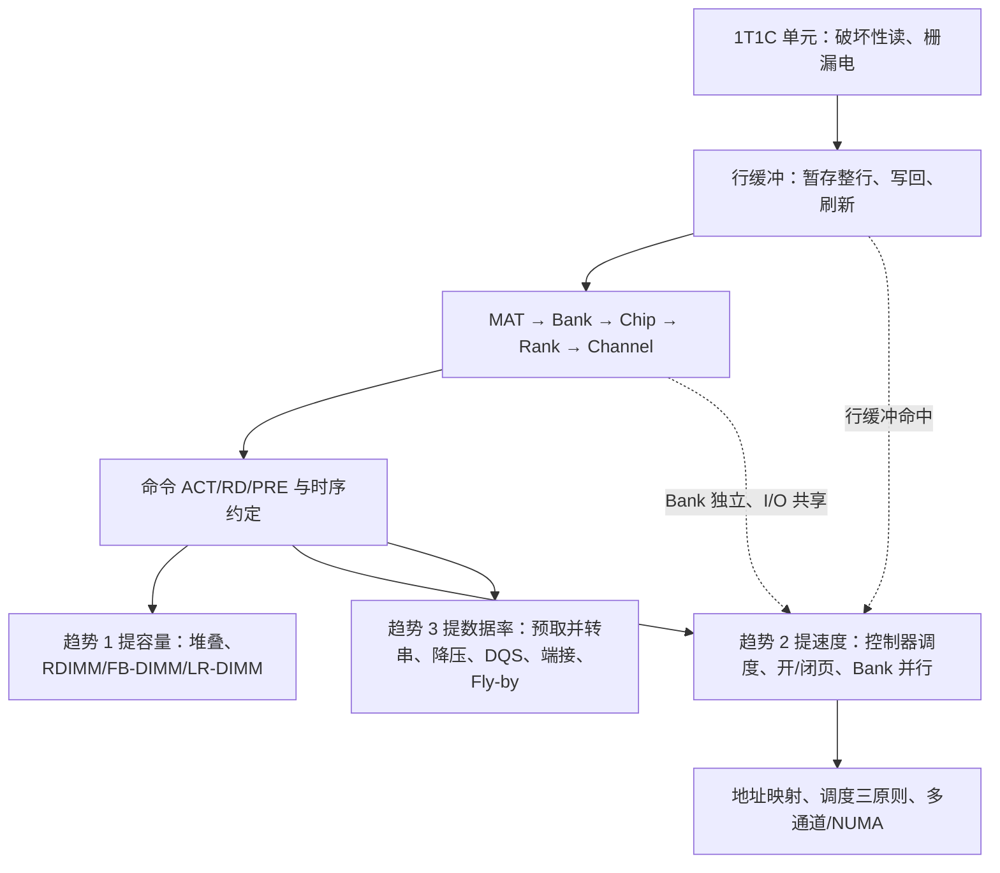

一条主线贯穿全讲：破坏性读迫使 DRAM 必须整行读入行缓冲，于是"行缓冲命中快、换行慢"成为性能的核心，时序参数（$t_{RCD}$、$t_{RAS}$、$t_{RP}$）量化了换行代价，控制器的开页/闭页策略、调度原则和地址映射都在设法提高命中率或把换行代价藏到其他 Bank 的数据传输背后。

### 判断表

| 场景 | 选择 | 依据 |
| --- | --- | --- |
| 访问局部性高 | 开页策略 | 命中只需 $t_{CAS}$ |
| 访问随机、重用距离远 | 闭页策略 | 预充电移出关键路径 |
| 连续请求落在同一 Bank 不同行 | 改地址映射（XOR / 高熵位作 Bank） | 分散到不同 Bank 以流水并行 |
| 一个通道要挂很多 DIMM | RDIMM / LR-DIMM | 缓冲减少信号目的地 |
| 内核频率无法提高但要更高数据率 | 加深预取（并转串） | $R_{\rm ext} = k \times f_{\rm core}$ |
| L1 想用无别名 VIPT | 容量 $\le$ 页大小 $\times$ 相联度 | 索引位不越出页内偏移 |

### 核心公式

| 公式 | 含义 |
| --- | --- |
| $\text{AMAT} = \text{Hit time} + \text{Miss rate} \times \text{Miss penalty}$ | 缓存优化的三个方向 |
| $b_{\text{index}} + b_{\text{offset}} \le b_{\text{page}}$ | VIPT 无别名条件 |
| $C \propto \varepsilon A / d$ | 电容只能靠增大面积 $A$（沟槽电容） |
| $t_{RC} = t_{RAS} + t_{RP}$ | 同一 Bank 换行的最小间隔，唯一等式 |
| $R_{\rm ext} = k \times f_{\rm core}$ | 预取深度 $k$ 决定外部数据率 |
| $P \propto V^2 f$ | 降压是控制 DRAM 功耗的主要手段 |
