调度机制已经决定了何时选人、如何切换，本讲回答“选谁”：单处理器上各种调度算法如何在公平、饥饿、响应时间、周转时间、开销和对 I/O 型进程的偏好之间折中。路线是先讲批处理系统的 FCFS、SJF/SRTN 与 HRRN，再讲交互式系统的时间片轮转与虚拟轮转，用一个 CPU 型与 I/O 型混合负载比较各算法，随后讲优先级调度与优先级反转、多级队列与多级反馈队列，以算法比较表和机制与策略分离收束，最后以 Windows 线程调度作为综合实例。需要先掌握 L06「03 调度时机」「05 调度目标与衡量指标」，以及 L04、L05 中的进程状态与队列模型。

---

## 批处理系统的调度算法

> [!abstract] 本节要点
>
> - 调度算法总体偏好 I/O 密集型进程：它用一会儿 CPU 就去访问设备，CPU 与设备能同时忙起来。
> - 批处理系统看重吞吐量、周转时间 $T_{\rm turnaround}=T_{\rm completion}-T_{\rm arrival}$、CPU 利用率，以及公平。
> - FCFS 非抢占、简单公平，但长进程后的短进程等待很久：P1=24、P2=P3=3 时平均周转 27 s，改为 P2、P3、P1 后降到 13 s。
> - SJF（非抢占）与 SRTN（抢占）优先运行短作业；所有进程同时可运行时 SJF 的平均周转时间最短，代价是不公平、长作业可能饥饿、需要预知运行时间。
> - HRRN 选响应比 $R=1+\frac{W}{S}$ 最大者，是 FCFS 与 SJF 的折中，能避免饥饿，但每次调度都要为每个进程计算 $R$，开销大。

### 调度算法的出发点

调度算法回答“下一个上 CPU 的是谁”；何时调度、如何切换已在 L06「03 调度时机」「04 进程切换与上下文切换」讲过：进程经中断、异常或系统调用进内核，出内核前统一调度，抢占只需在这一点比较优先级（例如 `fork` 出新进程、读盘完成唤醒等待进程），不需要额外机制。

按行为可以把进程分成两类：**I/O 密集型**（I/O-bound）进程频繁地打印、读写，每次只用一点 CPU；**CPU 密集型**（CPU-bound）进程需要大量计算。调度算法通常偏好前者：它用一会儿 CPU 就去访问各种设备，把 CPU 让给别人，CPU 与设备能同时忙起来。

> [!tip] 课堂强调
> 偏好 I/O 密集型进程——“不能老占着 CPU，最好出去溜达到各个部件”——是调度算法最重要的思路，后面的 RR、虚拟轮转、多级反馈队列都在不同程度上体现它。

调度算法要按应用场景来选。**批处理系统**常用的算法有 FCFS、SJF、SRTN 和 HRRN，追求的指标是吞吐量、周转时间、CPU 利用率，此外还有公平与平衡。 交互式系统的算法见 [时间片轮转与虚拟轮转](#时间片轮转与虚拟轮转)。

吞吐量、周转时间等指标的定义见 L06「05 调度目标与衡量指标」；下面的例子按 $T_{\rm turnaround} = T_{\rm completion} - T_{\rm arrival}$ 计算周转时间，平均周转时间取算术平均。

### 先来先服务（FCFS）

最朴素的想法是“谁先来谁先用”。**先来先服务**（First Come First Serve, FCFS）按进程就绪的先后顺序使用 CPU，**没有抢占**：进程一旦上 CPU，就运行到结束或因自身原因（如 I/O）阻塞。

- **优点**：公平、简单。
- **缺点一**：长进程之后的短进程要等很长时间，交互体验差（周转时间、响应时间长）。
- **缺点二**：I/O 资源和 CPU 资源的利用率都较低。进程只要占着 CPU 就不会被抢占，系统格局无法改变，CPU 密集型进程运行时 I/O 设备只能空等。

> [!example] 例：同一队列，不同顺序
> 三个进程按 P1、P2、P3 的顺序就绪，同时到达（$T_{\rm arrival}=0$），P1 需要 24 s，P2、P3 各需 3 s。
>
> 1. **FCFS 顺序 P1→P2→P3**：P1 在 24 s 完成，P2 在 27 s，P3 在 30 s。
>    吞吐量 $= 3\ \text{jobs}/30\ \text{s} = 0.1\ \text{jobs/s}$；周转时间 24、27、30；平均周转时间 $\frac{24+27+30}{3}=27$ s。
> 2. **改为 P2→P3→P1**：完成时刻 P2=3、P3=6、P1=30。吞吐量仍是 0.1 jobs/s，平均周转时间 $\frac{3+6+30}{3}=13$ s。
>
> 总时间没变、吞吐量没变，但平均周转时间从 27 s 降到 13 s。同一个队列换一种调度顺序，就能改善某些指标；“短的先跑”正是下一个算法的思路。

### 短作业优先（SJF）与最短剩余时间优先（SRTN）

FCFS 的问题在于短作业被长作业挡在后面。既然先跑短的能降低平均周转时间，就让短作业先跑。

> [!info] 可视化资源
>
> - [OSTEP 第 7 章 调度：介绍（PDF）](https://pages.cs.wisc.edu/~remzi/OSTEP/cpu-sched.pdf)：看图 7.1–7.5：FIFO 被长作业拖累、SJF 与迟到作业、STCF 抢占的时间线对比。

**短作业优先**（Shortest Job First, SJF）让完成时间最短的进程优先执行，是**非抢占式**的：选中运行时间最短的进程后，一直运行到它结束或被 I/O 阻塞。**最短剩余时间优先**（Shortest Remaining Time Next, SRTN）是 SJF 的**抢占版本**：当一个新就绪进程的完成时间比当前运行进程的剩余时间更短时，抢占当前进程，改为运行新就绪进程。两者的共同思路是先完成短作业，从而改善短作业的周转时间。

SRTN 的抢占完全靠调度机制完成：新进程到达，无论是新创建的还是从别处来的，都一定伴随一次中断/异常进内核；出内核前格局变了，调度程序重新比较所有就绪进程的剩余时间。

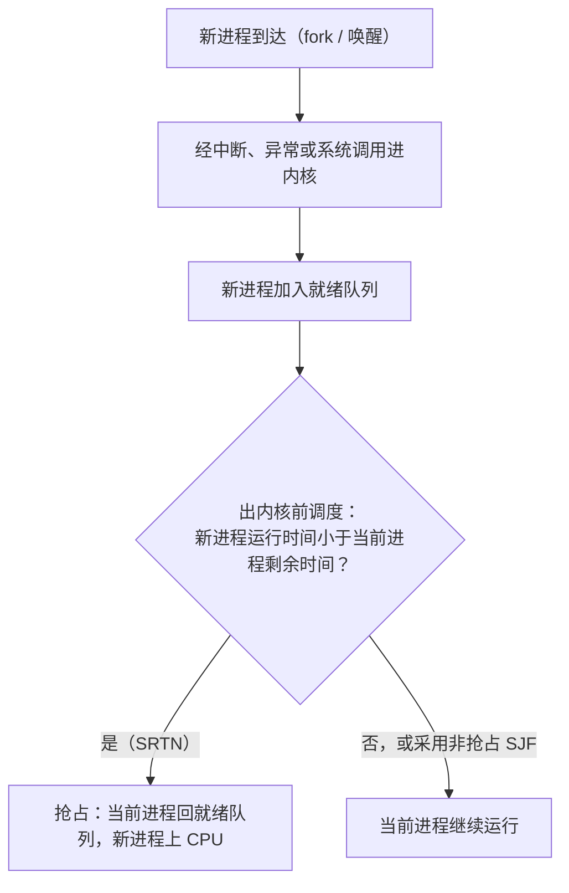

> [!example] 例：SJF 与 SRTN 的甘特图
> 四个进程的到达时刻与运行时间如下。
>
> | 进程 | 到达时刻 | 运行时间 |
> | --- | --- | --- |
> | P1 | 0 | 7 |
> | P2 | 2 | 4 |
> | P3 | 4 | 1 |
> | P4 | 5 | 4 |
>
> **非抢占式 SJF**：时刻 0 只有 P1，P1 上 CPU 并运行到 7。时刻 7 就绪的有 P2(4)、P3(1)、P4(4)，选最短的 P3（7–8），再选 P2（8–12；与 P4 同为 4，按先到者），最后 P4（12–16）。
> 顺序 P1(0–7)、P3(7–8)、P2(8–12)、P4(12–16)。
>
> **抢占式 SRTN**：
> 1. 时刻 0：只有 P1，运行。
> 2. 时刻 2：P2 到达，P1 剩 5，P2 需 4，$4<5$，P2 抢占。
> 3. 时刻 4：P3 到达，P2 剩 2，P3 需 1，P3 再次抢占。
> 4. 时刻 5：P3 完成，P4 到达；就绪的有 P1(5)、P2(2)、P4(4)，选 P2。
> 5. 时刻 7：P2 完成；P1(5)、P4(4)，选 P4（7–11），最后 P1（11–16）。
>
> 顺序 P1(0–2)、P2(2–4)、P3(4–5)、P2(5–7)、P4(7–11)、P1(11–16)。
>
> 平均周转时间：非抢占 $\frac{7+10+4+11}{4}=8$；抢占 $\frac{16+5+1+6}{4}=7$。

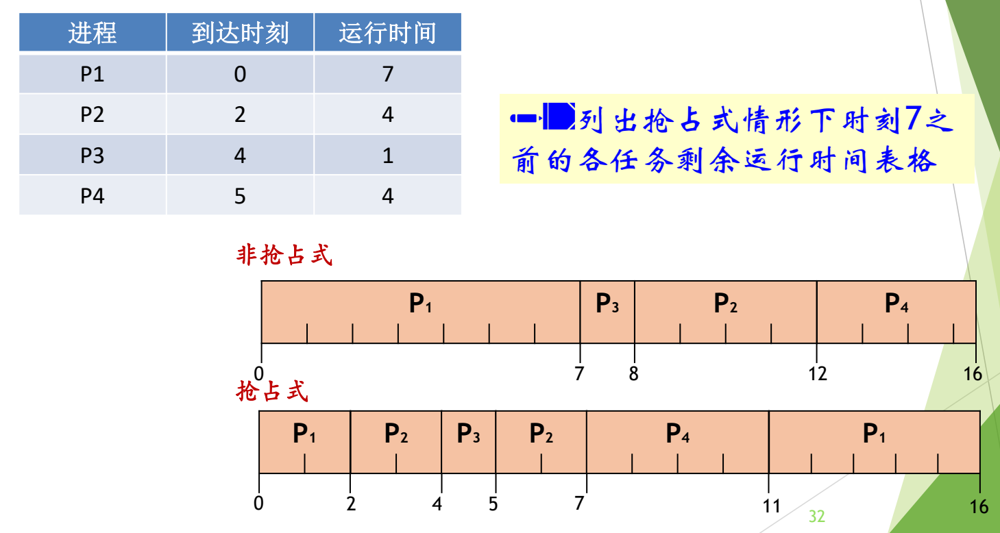

图：P1–P4 的到达时刻与运行时间表，下方对比非抢占式 SJF（P1、P3、P2、P4，完成于 7/8/12/16）与抢占式 SRTN（P1、P2、P3、P2、P4、P1，切换点 2/4/5/7/11/16）的甘特图，注意 P2、P3 到达时如何抢占 P1。

#### 抢占式情形下各时刻的剩余时间

> [!info] 拓展内容
> 这张表是课件留下的练习，留作课后自行核对。

课件要求列出抢占式情形下时刻 7 之前每个时刻的就绪作业及其剩余运行时间，以及该时刻选择运行的作业。由上例数据逐时刻推算如下（括号内为剩余运行时间）：

| 时刻 | 就绪作业及剩余时间        | 选择运行 |
| ---- | ------------------------- | -------- |
| 0    | (P1, 7)                   | P1       |
| 1    | (P1, 6)                   | P1       |
| 2    | (P1, 5), (P2, 4)          | P2       |
| 3    | (P1, 5), (P2, 3)          | P2       |
| 4    | (P1, 5), (P2, 2), (P3, 1) | P3       |
| 5    | (P1, 5), (P2, 2), (P4, 4) | P2       |
| 6    | (P1, 5), (P2, 1), (P4, 4) | P2       |
| 7    | (P1, 5), (P4, 4)          | P4       |

只有到达事件（时刻 2、4、5）和完成事件（时刻 5、7）会改变选择，其余时刻只是剩余时间减 1。这也说明调度决策只需要在事件发生时做。

#### SJF 的最优性

**结论**：在所有进程同时可运行的前提下，SJF 得到最短的平均周转时间。 这里的前提指一个固定的就绪队列，所有进程都在时刻 0 就绪，不会陆续到来。

> [!tip] 课堂强调
> 这是操作系统的经典证明题，以往的习题里一定会有。

证明思路是交换论证：先按某个顺序排好 $J_1, J_2, \dots, J_n$，任意交换其中两个作业后重新计算平均周转时间，说明“短的在前”的顺序无法再被改进。

> [!note] 补充解释
> 下面把交换论证写完整。设各作业运行时间为 $t_1, \dots, t_n$，到达时刻都是 0，第 $k$ 个作业的周转时间就是完成时刻 $C_k=\sum_{i=1}^{k} t_i$，于是
> $$
> \sum_{k=1}^{n} C_k = \sum_{k=1}^{n} (n-k+1)\, t_k ,
> $$
> 排在第 $k$ 位的作业时长被计入 $n-k+1$ 次，越靠前权重越大。若某顺序中相邻两作业满足 $t_j > t_{j+1}$，记 $S$ 为前 $j-1$ 个作业的时间和：交换前 $C_j + C_{j+1} = 2S + 2t_j + t_{j+1}$，交换后为 $2S + 2t_{j+1} + t_j$，其余作业的完成时刻不变，总周转时间变化 $t_{j+1}-t_j<0$。
>
> 因此只要存在“长在前、短在后”的相邻对，交换后平均周转时间就严格减小；反复交换，最终得到从短到长的 SJF 顺序，它的平均周转时间最小。

#### SJF 的代价

- **不公平，会导致饥饿**：如果源源不断地有短作业到来，它们就像“加塞儿”一样排到长作业前面，长作业可能一直得不到处理器时间。这种现象称为**饥饿**（starvation）。判断一个调度算法时，要考虑它会不会产生饥饿。
- **需要预测未来**：系统事先并不知道作业要运行多久，只能由用户提供估计值。用户可能虚报，比如声称运行 5 分钟、实际运行 1 小时，以便被优先调度。系统会记录实际运行过程，按实际用量记账、多收费用，所以虚报并不划算。对每天固定运行的程序，运行时间可以预估：例如全球连锁餐饮企业每天定时汇总各门店销售数据，每次的计算时间大致相同。

> [!warning] 易错点
> “SJF 平均周转时间最短”有前提：所有进程同时可运行。进程陆续到达时，非抢占 SJF 不一定最优（上例中 SRTN 的平均周转时间为 7，比非抢占 SJF 的 8 更短）。另外，SJF 优化的是平均值，不是每个作业的周转时间：长作业反而被推得更晚。

### 最高响应比优先（HRRN）

SJF 只看作业长短，FCFS 只看先来后到，各有极端。选车、选房都不会只看一个指标，调度也一样。**最高响应比优先**（Highest Response Ratio Next, HRRN）是第一个综合多个因素的调度算法。

HRRN 为每个进程计算**响应比**（response ratio）$R$，每次选 $R$ 最高的进程：
$$
R = \frac{\text{作业周转时间}}{\text{作业处理时间}}
  = \frac{S + W}{S}
  = 1 + \frac{W}{S}
$$
其中 $W$ 是作业到目前为止的等待时间，$S$ 是作业处理时间（需要的 CPU 时间）。两者单位相同，$R$ 无量纲，且 $R \ge 1$。

- **短作业**：$S$ 小，相同等待时间下 $R$ 更大，更容易被调度，类似 SJF，能降低平均周转时间。
- **长作业**：$S$ 大，但 $W$ 随等待持续增长；等得足够久后，它的 $R$ 会超过后来的短作业，得到执行机会，因此**不会饥饿**。这一项体现了 FCFS 的思想。

> [!example] 例：长作业等到了机会
> 某长作业 $S=20$，已等待 $W=30$；一个刚到的短作业 $S=2$，已等待 $W=2$。
>
> 1. 长作业 $R = 1 + \frac{30}{20} = 2.5$。
> 2. 短作业 $R = 1 + \frac{2}{2} = 2$。
> 3. $2.5 > 2$，长作业先运行。在 SJF 下长作业会再次被这个短作业插队。
>
> 用上面 SJF 例的四进程数据做非抢占 HRRN：时刻 7 时 P2、P3、P4 的响应比分别为 $1+\frac{5}{4}=2.25$、$1+\frac{3}{1}=4$、$1+\frac{2}{4}=1.5$，选 P3；时刻 8 时 P2 为 $1+\frac{6}{4}=2.5$，P4 为 $1+\frac{3}{4}=1.75$，选 P2，最后 P4。这组数据中 HRRN 的结果恰好与 SJF 相同。

**代价**：每次调度都要为每个就绪进程重新计算响应比，开销大。若做成抢占式 HRRN，还需要频繁计算各进程的响应比并重新排序，资源开销更大。 因此 HRRN 没有在实际系统中延续下来。它说明的是：调度需要在多个指标之间**折中权衡**（tradeoff），而不是追求单一指标。

> [!question]- 自测：三个作业同时到达，运行时间分别为 6、2、4。FCFS（按 6、2、4 的顺序）与 SJF 的平均周转时间各是多少？
> FCFS：完成时刻 6、8、12，平均 $\frac{26}{3}\approx 8.67$。SJF 顺序 2、4、6：完成时刻 2、6、12，平均 $\frac{20}{3}\approx 6.67$。三者同时到达，满足 SJF 最优的前提。

> [!question]- 自测：CPU 正忙时到达一个运行时间为 100 的长作业，此后每隔 3 个时间单位到达一个运行时间为 3 的短作业。采用非抢占 SJF，长作业会怎样？换成非抢占 HRRN 呢？
> SJF 下每次 CPU 空出来时，就绪队列里总有一个运行时间为 3 的短作业，它比 100 短，长作业永远选不上，发生饥饿。HRRN 下长作业的响应比 $1+\frac{W}{100}$ 随等待时间 $W$ 不断增大，而刚到的短作业响应比接近 1，长作业最迟在 $W$ 足够大时一定会被选中，不会饥饿。

> [!question]- 自测：为什么说 SRTN 的“抢占”不需要额外的硬件或机制？
> 新进程变为就绪（`fork` 创建或 I/O 完成被唤醒）必然经过一次中断、异常或系统调用进入内核；出内核前本来就有统一的调度点，SRTN 只需在这里比较剩余时间并决定是否换人。

---

## 时间片轮转与虚拟轮转

> [!abstract] 本节要点
>
> - 交互式系统看重响应时间、公平与均衡，常用 RR、最高优先级、多级（反馈）队列；最短进程优先（SPN）与 SJF 思想相同。
> - 时间片由定时器实现：进程上 CPU 时时间片转化为定时器挂入定时器队列，每次时钟中断减 1，减到 0 即“到点”，进程排到就绪队尾。
> - 时间片太长（大于典型交互时间）退化为 FCFS；太短则切换的直接与间接开销（TLB、Cache）浪费 CPU；经验上时间片 10 ms、切换 0.1 ms 时开销约 1%。
> - RR 对长短混合的进程有利，对大小相同的进程不利：A、B 各 100 ms、$q=1$ ms 时完成于 199/200 ms，FCFS 为 100/200 ms。
> - 虚拟轮转让 I/O 完成的进程进入优先调度的辅助队列，而不是重新排到就绪队尾，以照顾 I/O 密集型进程。

### 交互式系统的调度算法

交互式系统中有用户在等待结果，首要指标是**响应时间**，另外还要兼顾公平、平衡与均衡性。常用算法包括：

- 时间片轮转（Round Robin, RR），本节内容；
- 最高优先级调度（Highest Priority First, HPF），以及与之相关的抢占和优先级反转，见 [优先级调度与优先级反转](#优先级调度与优先级反转)；
- 多级队列（Multiple queues）与多级反馈队列（Multiple feedback queue），见 [多级队列与多级反馈队列](#多级队列与多级反馈队列)；
- 最短进程优先（Shortest Process Next, SPN）。

SPN 与 SJF 的思想完全相同，只是批处理系统中称“作业”、交互式系统中称“进程”，不再重复讲解，见 [批处理系统的调度算法](#批处理系统的调度算法)。每种算法都可能有抢占与非抢占两个版本，是否抢占本身也是一个考量维度。

### 时间片轮转（RR）

FCFS 让一个进程一直占着 CPU，短进程只能干等。RR 的思路是**周期性地切换任务**：给每个进程分配一个**时间片**（time slice / quantum），时钟中断到来、时间片用完时轮换到下一个进程。目标是改善短任务的平均响应时间：短进程轮一圈或两圈就能完成。

> [!info] 可视化资源
>
> - [OSTEP 第 7 章 7.6–7.7 节 响应时间与轮转（PDF）](https://pages.cs.wisc.edu/~remzi/OSTEP/cpu-sched.pdf)：对照图 7.6 与图 7.7：同一组作业下 SJF 与 RR 的响应时间差异，以及时间片长短的摊销讨论。

**时间片轮转**（Round Robin, RR）调度：就绪进程排成一个队列，队首进程上 CPU 运行一个时间片。若在时间片内结束或阻塞，就让出 CPU；若时间片用完仍未结束，就排到就绪队尾，由下一个进程运行。

#### 时间片“到点”是怎么实现的

“时间片到”依靠时钟中断实现：

1. 进程被调度上 CPU 时，系统把它的时间片转化为一个**定时器**，挂到系统的定时器队列里（系统中同时有许多定时器）。
2. 计算机有晶体振荡器，像石英表一样稳定地产生节拍，定时定点触发**时钟中断**。
3. 每次时钟中断，定时器的值减 1（定时器做减法）。
4. 定时器减到 0，表示时间片到点。此时正处在内核中，出内核前调度程序把当前进程放到就绪队尾，选下一个进程，完成轮转。

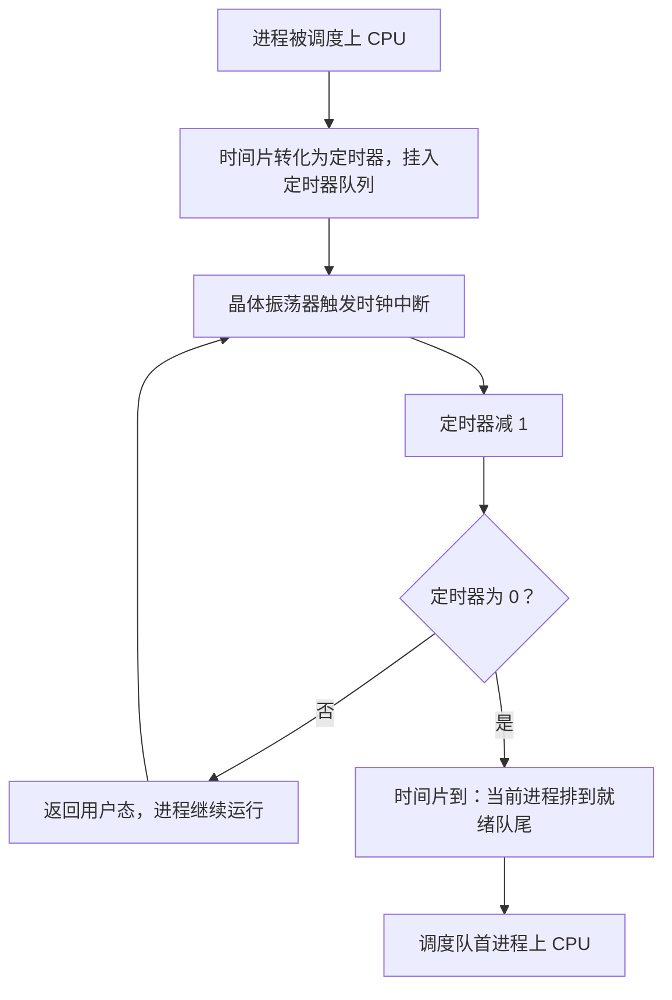

> [!example] 例：时间片 $q=20$ 的 RR
> 四个进程同时就绪，执行时间 P1=53、P2=8、P3=68、P4=24，按 P1、P2、P3、P4 的顺序排队，不计切换时间。
>
> 执行序列（区间为时刻）：
> P1(0–20) → P2(20–28) → P3(28–48) → P4(48–68) → P1(68–88) → P3(88–108) → P4(108–112) → P1(112–125) → P3(125–145) → P3(145–153)
>
> P2 只需 8，一个时间片没用完就结束；P4 在第二轮用 4 就结束；P1 在 125 结束；最后只剩 P3，连续运行两个时间片到 153。
>
> 等待时间 = 各段开始时刻减去上一段结束时刻，再求和：
> - P1 $=(68-20)+(112-88)=72$
> - P2 $=20-0=20$
> - P3 $=(28-0)+(88-48)+(125-108)=85$
> - P4 $=(48-0)+(108-68)=88$
>
> 平均等待时间 $=\frac{72+20+85+88}{4}=66.25$。

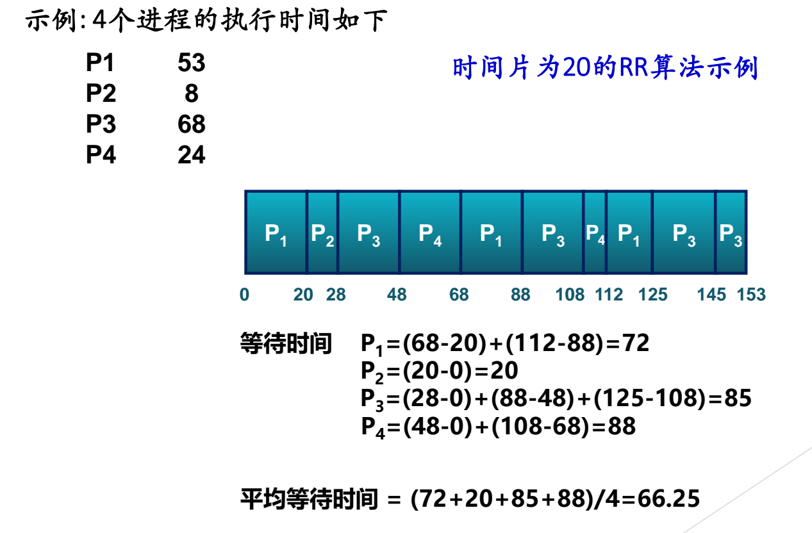

图：P1=53、P2=8、P3=68、P4=24 在 $q=20$ 下的 RR 甘特图及各进程等待时间计算，平均等待时间 $(72+20+85+88)/4=66.25$。

#### 时间片大小的选择

时间片的取值决定 RR 的表现，判断标准是**典型交互时间**，即一次交互需要的 CPU 时间 $s$。

- **$q$ 太长（大于典型交互时间）**：大多数交互在一个时间片内就能完成，轮转形同虚设，RR **退化为 FCFS**，排在后面的短进程响应时间被拉长。
- **$q$ 太短（小于典型交互时间）**：一次交互要被切成好几段。进程运行 $q$ 后被切换，其他进程各运行一个时间片，再回来运行剩下的 $s-q$，响应时间为 $s$ 加上其间其他进程的运行时间和切换时间。频繁的进程切换浪费 CPU 时间。

切换不只有**直接开销**（保存与恢复上下文、执行调度程序的时间），还有**间接开销**：切换后 TLB、Cache 中原进程的内容失效，新进程开始运行时命中率下降。

> [!tip] 课堂强调
> 上下文切换除了直接开销，一定要记住还有间接开销（TLB、Cache），所以时间片不宜太小，必须取折中点。

切换次数随时间片减小而增加。一个运行时间为 10 的进程：

| 进程运行时间 | 时间片 | 上下文切换次数 |
| ------------ | ------ | -------------- |
| 10           | 12     | 0              |
| 10           | 6      | 1              |
| 10           | 1      | 9              |

经验估算：时间片 10 ms、一次进程切换 0.1 ms 时，切换的 CPU 开销约为 $\frac{0.1}{10}=1\%$，比较合适。 实际设计系统时，一般先参考 Linux、Windows 等系统的取值，再针对应用场景测试、调整。

#### RR 的优缺点

- **优点**：公平，大家排队轮流；有利于交互式计算，短进程响应快。
- **缺点**：进程切换带来较高开销。 没有哪个调度算法没有缺点。

RR 对长短不一的进程组合有利，但**对大小相同的进程不利**。设 A、B 两个进程运行时间都是 100 ms，同时就绪，时间片 1 ms，上下文切换不耗时：

- **RR**：ABABAB……交替运行。A 的最后 1 ms 在第 199 个时间片，B 在第 200 个，因此 A 在 199 ms、B 在 200 ms 完成，平均完成时间 $\frac{199+200}{2}=199.5$ ms。
- **FCFS**：A 先运行到 100 ms 完成，B 接着运行到 200 ms 完成，平均完成时间 $\frac{100+200}{2}=150$ ms。

两者都在 200 ms 时全部完成，但 RR 让 A 白白推迟了 99 ms，平均完成时间更差。即使不计切换开销也是如此，计入切换后差距更大。

> [!note] 补充解释
> 讲授录音中 FCFS 的结果被说成“一共 300 毫秒”。300 ms 只是两者完成时刻之和 $100+200$（RR 下为 $199+200=399$），不是完成时间：FCFS 下 A 在 100 ms、B 在 200 ms 完成，平均 150 ms，结论“FCFS 优于 RR”不变。

#### FCFS 与 RR 的平均等待时间对比

> [!info] 拓展内容
> 这组对比数据课上留作课后自行查看。

仍用 P1=53、P2=8、P3=68、P4=24 四个进程，假设上下文切换时间为零，比较不同时间片的 RR 与最好、最坏顺序的 FCFS。各进程等待时间如下：

| 算法       | P1  | P2  | P3  | P4  | 平均等待时间 |
| ---------- | --- | --- | --- | --- | ------------ |
| RR($q=1$)  | 84  | 22  | 85  | 57  | 62           |
| RR($q=5$)  | 82  | 20  | 85  | 58  | 61.25        |
| RR($q=8$)  | 80  | 8   | 85  | 56  | 57.25        |
| RR($q=10$) | 82  | 10  | 85  | 68  | 61.25        |
| RR($q=20$) | 72  | 20  | 85  | 88  | 66.25        |
| Best FCFS  | 32  | 0   | 85  | 8   | 31.25        |
| Worst FCFS | 68  | 145 | 0   | 121 | 83.5         |

- **Best FCFS** 就是按短到长的顺序 P2(8)、P4(24)、P1(53)、P3(68) 运行，即 SJF 顺序：等待时间 0、8、32、85，平均 31.25，是所有方案中最好的。
- **Worst FCFS** 按长到短的顺序 P3、P1、P4、P2：等待时间 0、68、121、145，平均 83.5。
- 各种 $q$ 的 RR 都在两者之间，且平均等待时间不随 $q$ 单调变化（$q=8$ 时最好，恰好让 P2 一个时间片跑完）。RR 不是为了最小化平均等待时间而设计的，它保证的是每个进程都能较快得到 CPU。
- P3 是最长的进程，无论 $q$ 取多少，它的最后一段都要等其他三个全部结束，所以 RR 下等待时间总是 85。

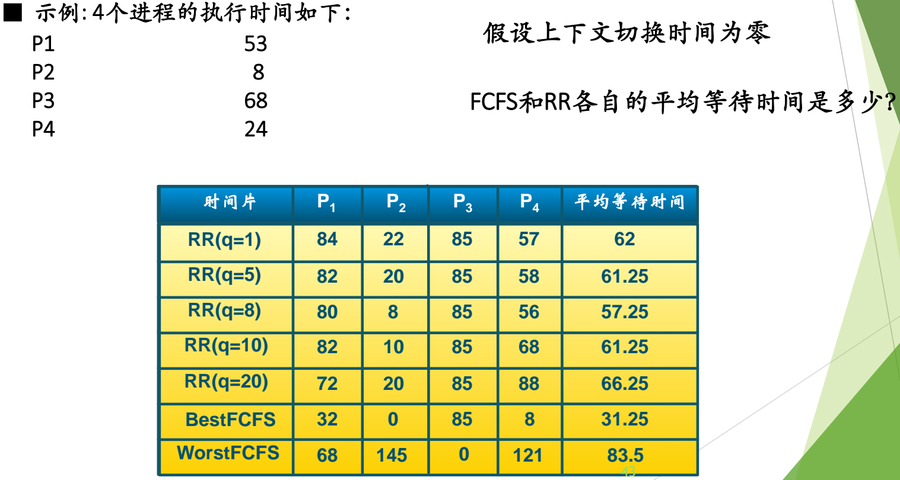

图：同一组进程（53/8/68/24，上下文切换时间为零）在 RR(q=1,5,8,10,20)、最好与最坏 FCFS 下各进程等待时间与平均等待时间，对比 BestFCFS 的 31.25 与各 RR 结果。

### 虚拟轮转（Virtual RR）

在普通 RR 的队列模型中，被调度的进程有三种去向：运行结束离开；时间片用完回到就绪队尾；时间片没用完就因 I/O 等事件进入相应的等待队列（不同原因进入不同的等待队列）。等待的事件发生后，进程重新进入就绪队列，排到**队尾**。（五状态模型与队列见 L04「04 扩展状态与实际系统」和 L05「01 进程表与队列模型」。）

问题在第三种去向：I/O 密集型进程往往时间片没用完就主动去做 I/O，把 CPU 让给别人，I/O 完成后却要重新排到队尾，相当于主动让出 CPU 反而吃亏。CPU 密集型进程则每次都能用满时间片。这与“偏好 I/O 密集型进程”的方向相反。

**虚拟轮转**（Virtual Round Robin, VRR）修改了队列模型：等待队列中的进程在事件发生后不直接回到就绪队列，而是进入一个专门增设的**辅助队列**（auxiliary queue）。调度程序挑选下一个进程时优先从辅助队列中选，或至少按某种比例从辅助队列和就绪队列中选（例如这边选一个、那边选两个）。这样主动让出 CPU 的进程能更快地回到 CPU，CPU 和各种设备都保持忙碌。该方法出自 1991 年的一篇论文（课件标注 Halder, S. etc., 1991）。

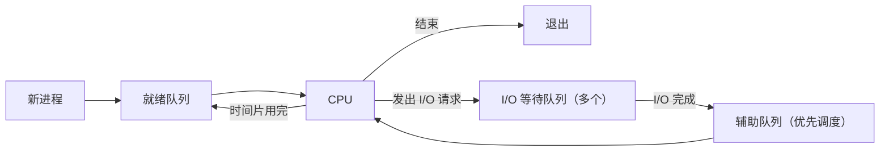

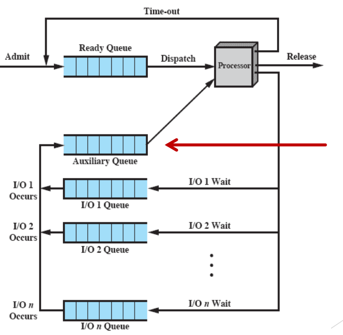

图：虚拟轮转的队列结构——I/O 完成的进程进入 Auxiliary Queue（红色箭头所指），调度时优先于 Ready Queue 被 Dispatch 到 Processor，时间片用完则经 Time-out 回到就绪队列。

**留待思考**：对计算密集型进程如何分配时间片？ 在上面的模型里，CPU 密集型进程总是用完时间片，经 Time-out 回到就绪队列按普通 RR 轮转，辅助队列只接收因 I/O 让出 CPU 的进程。虚拟轮转与 [多级反馈队列](#多级队列与多级反馈队列) 一样，用队列结构表达对 I/O 型进程的偏好。

> [!note] 补充解释
> 按 Stallings《Operating Systems: Internals and Design Principles》中的描述，从辅助队列被调度的进程只能运行“基本时间片减去它上次从就绪队列被选中后已用掉的时间”，不会拿到完整的新时间片。这样 I/O 型进程得到的是优先权而不是额外的 CPU 时间，对 CPU 型进程也较公平。这一细节课件未给出。

> [!question]- 自测：用 $q=8$ 重新调度 P1=53、P2=8、P3=68、P4=24（同时就绪、按序排队），P2 的等待时间为什么只有 8？
> 第一轮 P1 先运行 0–8，P2 在时刻 8 开始，一个时间片恰好运行完它的 8，在 16 结束，只等了 P1 的 8。这与表中 RR($q=8$) 的 P2=8 一致。

> [!question]- 自测：某系统时间片 5 ms，一次切换 0.5 ms，切换开销约占多少？如果交互请求一般需要 3 ms CPU，把时间片调大到 50 ms 会怎样？
> 开销约 $\frac{0.5}{5}=10\%$，偏高。调到 50 ms 后开销降到约 1%，但 50 ms 远大于典型交互时间 3 ms，几乎所有交互都在一个时间片内完成，RR 退化为 FCFS；遇到长的 CPU 密集型进程时，排在它后面的交互进程最多要多等 50 ms。应在两者之间折中。

> [!question]- 自测：在普通 RR 中，一个每次运行 2 ms 就去读盘的进程与几个 CPU 密集型进程竞争，它会遇到什么问题？虚拟轮转如何改善？
> 它每次读盘回来都要重新排到就绪队尾，等所有 CPU 密集型进程各跑完一个完整时间片才能再上 CPU，于是磁盘空闲、它的响应变慢。虚拟轮转让它 I/O 完成后进入辅助队列并被优先调度，能尽快再次发出 I/O 请求。

---

## 混合负载场景分析

> [!abstract] 本节要点
>
> - 场景：A、B 各需 1000 ms 纯计算；C 循环“用 CPU 1 ms、用 I/O 10 ms”。C 单独运行时磁盘利用率约 $\frac{10}{11}\approx 91\%$。目标是同时让处理器和磁盘忙。
> - I/O 型进程也必须先在 CPU 上运行才能发出 I/O 请求，所以 C 能否及时拿到 1 ms 的 CPU 决定了磁盘利用率。
> - FCFS：A 或 B 在 C 之前时，C 最多被挡约 2000 ms；RR(100 ms) 每 200 ms 只有约 10 ms 磁盘操作，磁盘大多空闲。
> - RR(1 ms)：磁盘利用率接近 90%，对 A、B 几乎无影响，但进程切换次数极多。
> - SRTN：C 每次 I/O 结束都因下次 CPU 突发最短而立即运行，序列为 CA-CA…，磁盘利用率高，但 B 长期得不到运行。

### 场景设定

前面每个算法都是单独看的。实际系统中 CPU 型与 I/O 型进程往往混在一起，用一个具体场景比较各算法的综合效果。

> [!info] 可视化资源
>
> - [OSTEP 第 7 章 7.8 节 结合 I/O（PDF）](https://pages.cs.wisc.edu/~remzi/OSTEP/cpu-sched.pdf)：看图 7.8 与图 7.9：把 I/O 型作业的每段 CPU 突发当作独立作业调度，CPU 与磁盘才能重叠工作。

- **进程 A**：需要 1000 ms 的计算。
- **进程 B**：需要 1000 ms 的计算。
- **进程 C**（伪代码）：

```c
while (1) {
    use_cpu(1);   /* 使用处理器 1 ms */
    use_io(10);   /* 使用 I/O（磁盘）10 ms */
}
```

单独运行时，A 或 B 都能使用处理器的 100%，C 能使用磁盘约 91%（每 11 ms 中有 10 ms 在用磁盘，$\frac{10}{11}\approx 91\%$）。A、B 是 CPU 型，C 是 I/O 型。问题是三者一起运行会怎样，目标是**同时保持处理器和磁盘忙**。

关键在于：I/O 型进程也要占用一点 CPU。所有 I/O 请求（读盘、写盘、打印、网卡发送）都必须由进程在 CPU 上运行时发出，CPU 再把请求交给 DMA 或设备控制器去完成。所以 C 每轮都需要先拿到 1 ms 的 CPU，否则磁盘就闲着。

> [!tip] 课堂强调
> 一定要理解 CPU 是分发任务的：进程要做 I/O，必须先在 CPU 上运行并提出 I/O 请求，CPU 再把请求交给 DMA 或控制器。

### 四种调度方式的比较

#### 先来先服务

FCFS 不抢占。只要 A 或 B 排在 C 之前，C 就要等它们运行完才能拿到第一个 1 ms，最多被挡约 2000 ms（A、B 都在 C 之前时），这期间磁盘完全空闲。 C 排在最前也没多大用：C 运行 1 ms 发出 I/O 后，A 上 CPU 一跑就是 1000 ms，C 的 I/O 10 ms 后就完成了，却要一直等到 A 结束。

#### 时间片轮转，时间片 100 ms

序列为 `CA---------B---------CA---------B---------...`。

谁先运行已不重要。假设 C 先运行 1 ms 后去做 I/O，接着 A 运行 100 ms、B 运行 100 ms。C 的 I/O 在 10 ms 后早已完成，却要在就绪队列里等 A、B 各用完一个时间片。结果是：A、B 运行时磁盘大多空闲，**每 200 ms 中大约只有 10 ms 在做磁盘操作**，磁盘利用率约 $\frac{10}{201}\approx 5\%$。

#### 时间片轮转，时间片 1 ms

序列为 `CABABABABABCABABABABABC...`。

1. C 运行 1 ms，发出 I/O 请求后阻塞。
2. C 做 I/O 的 10 ms 里，A、B 交替各运行 1 ms，共 10 个时间片。
3. C 的 I/O 完成后很快又排到 CPU，立即发出下一次 I/O。

C 被频繁调度，每次 I/O 完成后能立刻发起下一次 I/O，**磁盘接近 90% 的时间都在工作**（理想情况下每 11 ms 有 10 ms 在用磁盘）。A、B 只是每 11 ms 让出 1 ms，性能几乎没有影响。

问题是进程切换非常多（每 1 ms 一次），切换的开销会吃掉相当一部分 CPU 时间。

#### 最短剩余时间优先

序列为 `CA-------CA-------------CA--------- ...`。

1. C 运行 1 ms 后去做 I/O。就绪的 A、B 剩余时间相同，假设选 A。
2. 10 ms 后 C 的 I/O 结束，C 重新就绪。它的下次处理器突发只有 1 ms，是所有就绪进程中最短的，于是**立即抢占 A**。
3. C 运行 1 ms 后又去做 I/O，A 继续运行……循环往复。

处理器始终在忙，磁盘利用率也和 C 单独运行时差不多（约 91%），对资源利用而言很理想。但调度序列一直是 C、A、C、A，**B 始终上不了 CPU**。 按 SRTN 的规则，A 运行后剩余时间比 B 短，B 要等到 A 全部完成（约 1000 ms 计算加上穿插的 C）才能运行。这就是 SRTN 不公平的一面。

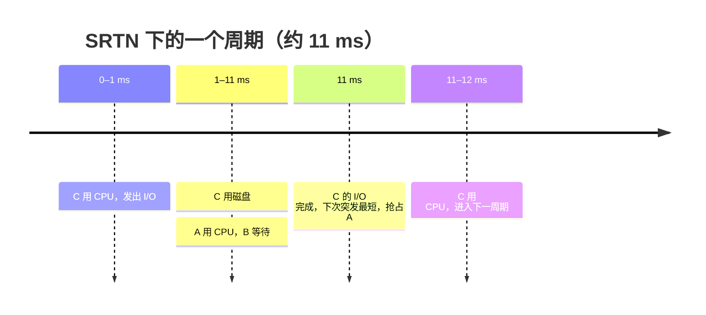

### 综合对比

| 调度方式             | 典型序列      | 磁盘利用率（估算）             | CPU 利用率                | 主要问题         |
| -------------------- | ------------- | ------------------------------ | ------------------------- | ---------------- |
| FCFS（A、B 在 C 前） | A…B…C…        | 前约 2000 ms 为 0              | 100%                      | C 被挡约 2000 ms |
| RR，$q=100$ ms       | CA…B…CA…B…    | 约 $\frac{10}{201}\approx 5\%$ | 100%                      | 磁盘大多空闲     |
| RR，$q=1$ ms         | CABABABABABC… | 接近 90%                       | 接近 100%，但部分用于切换 | 切换次数极多     |
| SRTN                 | CA-CA-…       | 约 91%                         | 100%                      | B 长期得不到运行 |

（磁盘与 CPU 利用率按理想条件估算，忽略切换时间，课件只给出 RR(100 ms) 的“每 200 ms 约 10 ms”和 RR(1 ms) 的“接近 90%”。）

这个场景再次说明，没有完美的调度算法：让 I/O 型进程及时拿到 CPU 才能保持磁盘忙，但小时间片带来切换开销，按剩余时间抢占又造成不公平。偏好 I/O 型进程、同时避免饥饿与过多切换，正是 [虚拟轮转](#时间片轮转与虚拟轮转) 和 [多级反馈队列](#多级队列与多级反馈队列) 要解决的问题。

> [!question]- 自测：在本场景中采用 RR，时间片取 10 ms，磁盘利用率大约是多少？
> 一个周期内 C 运行 1 ms，A、B 各运行 10 ms，周期约 21 ms；C 的 10 ms I/O 恰在 A 的时间片结束时完成，此时 B 已排在它前面，C 要等 B 的 10 ms 结束才能再上 CPU。磁盘每 21 ms 约忙 10 ms，利用率约 $\frac{10}{21}\approx 48\%$，介于 $q=100$ ms 和 $q=1$ ms 之间。

> [!question]- 自测：如果把 C 改为“用 CPU 1 ms、用 I/O 10 ms”只循环 5 次就结束，SRTN 下 B 还会饥饿吗？
> 不会长期饥饿，但仍要等 A。C 的 5 轮只占约 55 ms，之后只剩 A、B；A 已运行过，剩余时间短于 B，SRTN 继续让 A 运行到结束，B 在 A 完成后才运行。B 被推迟，但最终能运行。

---

## 优先级调度与优先级反转

> [!abstract] 本节要点
>
> - 最高优先级调度：每次选就绪进程中优先级最高的运行。一般原则是系统进程高于用户进程、前台高于后台、偏好 I/O 型进程。
> - 优先级可以静态也可以动态。动态时 PCB 中可同时有“基本优先级”和“调整后优先级”两个字段；就绪队列可以按优先级插队，也可以每个优先级一个队列。
> - 算法实现简单，但不公平，低优先级进程可能饥饿。
> - 优先级反转发生在基于优先级的抢占式调度下：低优先级进程 L 持有高优先级进程 H 需要的资源，CPU 型的中优先级进程 M 一直运行，L 放不掉资源，H 也就无法运行。
> - 三种解决方案：优先级天花板协议和优先级继承都是临时提升 L 的优先级；第三种是在临界区内禁止中断，让 L 不被打断。

### 最高优先级调度（Highest Priority First）

FCFS 只看到达顺序，SJF 只看运行时间，都不能直接表达“这个进程比那个更要紧”。**最高优先级调度算法**给每个进程一个**优先级**（priority）指标，每次调度都从就绪进程中选优先级最高的投入运行。

**优先级与优先数**：有的系统用整数**优先数**表示优先级。优先数大的优先级高还是优先数小的优先级高，由具体系统规定，换算一下即可。

#### 优先级如何确定

各系统设定优先级时一般遵循三条原则：

1. **系统进程高于用户进程**：系统进程的优先级一般设得很高，用户进程在它之下。[Windows 线程调度](#windows-线程调度)中，16–31 级实时优先级全部给系统线程，就体现了这一点。
2. **前台进程高于后台进程**：前台进程直接影响用户体验，后台进程的优先级较低。
3. **偏好 I/O 型进程**：I/O 型进程在 CPU 上停留很短就去做 I/O，优先让它运行，可以使 CPU 和外设同时保持忙碌。

#### 静态优先级与动态优先级

- **静态优先级**：进程创建时确定，运行期间不变。
- **动态优先级**：运行期间可以调整。这时一个实际系统的 PCB 里可能有两个字段，一个记录**基本优先级**，一个记录**调整后的优先级**（当前优先级）。

#### 就绪队列的组织

高优先级进程就绪时排在哪里，有两种做法：

1. **单队列插队**：只有一个就绪队列，按优先级有序，新就绪的进程按自己的优先级插到合适位置，调度时取队首。
2. **多队列**：每个优先级（或优先级段）一个就绪队列，进程进入与自己优先级匹配的队列，调度时从最高优先级的非空队列中取。

这两种组织方式在 L06「06 调度算法设计要点」中已经出现过。后面的 Windows 线程调度用的是第二种；多级反馈队列虽然也有多个队列，但进程一律先进第一级再按行为降级。

#### 优缺点

最高优先级调度思路清楚、实现简单，但**不公平**：只要不断有高优先级进程到达，低优先级进程就一直轮不到，产生**饥饿**（starvation）。饥饿的定义见 [批处理系统的调度算法](#批处理系统的调度算法)。

> [!warning] 易错点
> “优先级高的一定先运行”只在**抢占式**调度下随时成立。非抢占式的最高优先级调度只在当前进程主动让出 CPU 时才重新选择，高优先级进程就绪后仍要等当前进程让出。下面的优先级反转问题也以抢占式为前提。

### 优先级反转（Priority Inversion）

按优先级调度的本意是“高的先跑”。但当进程之间共享资源时，高优先级进程可能被一个低优先级进程拖住，这与优先级调度的初衷相反。

**优先级反转**（又称优先级反置、翻转、倒挂）指：一个低优先级进程持有一个高优先级进程所需要的资源，使得高优先级进程只能等待低优先级进程运行。 它的前提是**基于优先级的抢占式调度**：只要有更高优先级的进程就绪，就抢占当前进程。

#### 典型场景

设 H 是高优先级进程，L 是低优先级进程，M 是中优先级进程，并且 M 是 CPU 型的。H 和 L 都要执行同一段**临界区**代码，也就是操作同一共享资源的代码段（临界区的概念在“计算机系统导论”课程中学过）。过程如下：

1. **L 进入临界区**：L 正在运行，进入临界区，占有了共享资源。
2. **L 被抢占**：L 还没执行完临界区就有更高优先级的进程就绪。由于是抢占式调度，L 被换下 CPU，但仍然“停在”临界区里，资源没有释放。
3. **H 被阻塞**：H 上 CPU 后也要进入同一临界区，因为资源被 L 占着而失败，只能阻塞，等待 L 让出临界区。
4. **M 长期运行**：H 阻塞后，就绪进程中优先级最高的是 M。M 是 CPU 型的，会一直占用 CPU。
5. **结果**：L 的优先级比 M 低，得不到 CPU，无法走完临界区；L 不释放资源，H 就无法继续。于是 H 实际上被优先级比自己低的 M 无限期推迟。

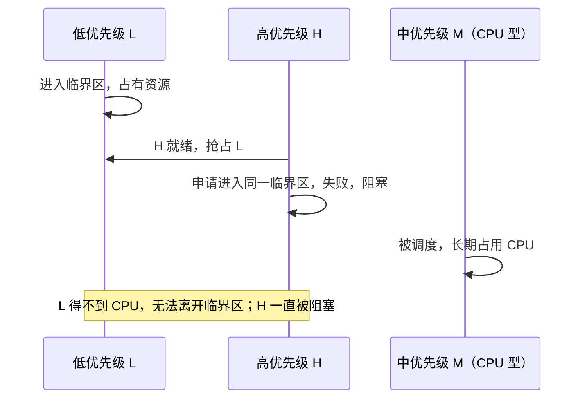

第 5 步的含义是：H 等待的时间不再只是 L 走完临界区那一小段，而是被一个与该资源无关的中优先级进程决定，可能无限长。

> [!warning] 易错点
> 优先级反转的关键不是“H 等了 L 一会儿”。H 短暂等待 L 走完临界区是使用互斥资源必然要付出的代价。真正的问题出在 M：M 与资源无关，却因为优先级高于 L 而间接阻挡了 H。没有 M 这样的中优先级进程插进来，L 很快就会释放资源。

#### 影响

- **系统错误**：在实时系统中，高优先级任务错过时限会被当作故障。出现优先级反转时系统必须干预，不能任其发展。
- **性能下降**：高优先级进程停滞不前，系统整体性能下降。

#### 案例：火星探路者（Mars Pathfinder）

火星探路者探测器上运行的是实时操作系统 **VxWorks**，采用基于优先级的抢占式调度，正好符合上述场景。探测器上的三类任务是：

> [!info] 可视化资源
>
> - [What really happened on Mars?（Mike Jones 记录，康奈尔 CS614 课程页）](https://www.cs.cornell.edu/courses/cs614/1999sp/papers/pathfinder.html)：一手讲述：低优先级气象任务持锁、中优先级通信任务抢占、看门狗复位，以及远程打开优先级继承修复的过程。

| 优先级 | 任务                      | 特点                            |
| ------ | ------------------------- | ------------------------------- |
| 高     | 数据传输（data transfer） | 需要使用共享的总线              |
| 中     | 通信（communications）    | 耗费大量 CPU 时间，不使用该总线 |
| 低     | 气象测量（meteorology）   | 也使用该总线                    |

低优先级的测量任务占着总线时被抢占，高优先级的数据传输任务申请总线而阻塞，中优先级的通信任务长时间占用 CPU。地面人员发现探测器上的系统频繁重启。原因是：系统本来提供优先级继承的选项，但这个开关被工程师关掉了。系统检测到高优先级任务长时间无法完成，判定为异常，于是重新启动。

> [!note] 补充解释
> 这件事发生在 1997 年。共享资源是保护信息总线的互斥量，看门狗定时器发现总线调度任务没有按时完成，就触发了系统复位。工程师在地面复现问题后，通过远程上传修改，为该互斥量打开了优先级继承，问题随之解决。详细经过见上方可视化资源中的 What really happened on Mars?。

### 优先级反转的解决方案

反转之所以会持续，是因为 L 拿不到 CPU、走不完临界区。所以三种方案都围绕同一个目标：让 L 尽快走完临界区、释放资源。

> [!info] 可视化资源
>
> - [维基百科：Priority inversion](https://en.wikipedia.org/wiki/Priority_inversion)：看示意图与 Solutions 一节：禁止中断、优先级天花板、优先级继承各自的做法与适用场合。

#### 优先级天花板协议（Priority Ceiling Protocol）

**优先级天花板协议**又称设置优先级上限。它的名字听起来复杂，核心做法很简单：把进入临界区的低优先级进程 L 的优先级调到“天花板”，也就是最高。这样 L 比其他进程都高，能马上上 CPU、走完临界区；出了临界区后，再把它的优先级调回原值。

> [!note] 补充解释
> 更精确的定义是：给每个共享资源规定一个**优先级上限**（ceiling），等于所有可能使用该资源的进程中最高的优先级。进程占有该资源期间，它的优先级被提升到这个上限，释放资源后恢复。这样 L 在临界区内不会被 M 这类优先级低于上限的进程抢占。

#### 优先级继承（Priority Inheritance）

**优先级继承**：当 H 因为 L 持有的资源而被阻塞时，H 把自己的优先级“借”给 L，L 临时以与 H 相同的优先级运行。此时 M 的优先级低于 L，抢不走 CPU，L 走完临界区、释放资源后恢复原优先级，H 随即获得资源并运行。

天花板协议和优先级继承思路相同，都是**临时改变 L 的优先级**。区别在于提升的时机和幅度：

| 方案             | 何时提升 L                                  | 提升到多高               | 何时恢复   |
| ---------------- | ------------------------------------------- | ------------------------ | ---------- |
| 优先级天花板协议 | L 进入临界区（占有资源）时，不等出现阻塞    | 最高（资源的优先级上限） | L 出临界区 |
| 优先级继承       | H 因 L 持有的资源被阻塞时，即真正发生反转时 | 与被阻塞的 H 相同        | L 释放资源 |

#### 使用中断禁止

第三种思路不改优先级，而是让 L 在临界区内**不可被打断**。L 之所以在临界区中途被换下，是因为有中断（例如时钟中断，或者唤醒 H 的 I/O 中断）把系统带进内核，出内核前的调度发现了更高优先级的就绪进程。如果 L 在进入临界区时关中断、离开时再开中断，那么 L 在临界区内不会被抢占，一定能把临界区执行完；出了临界区后，谁都可以抢占它，这时 H 再进入临界区就不会受阻。

> [!note] 补充解释
> 关中断只在单处理器上能保证“不被打断”，而且关中断是特权操作，只能在内核态短时间使用。临界区一长，系统对外部事件的响应就会变慢。多处理器上关掉本 CPU 的中断，并不能阻止其他 CPU 上的进程访问同一资源。

> [!example] 例：用优先级继承消除反转
> 单处理器，H、M、L 的优先级依次降低，H 和 L 共用一把锁。时刻 0 L 运行并加锁；时刻 1 H 就绪；时刻 2 M 就绪。L 的临界区还剩 3 个时间单位，H 拿到锁后还需运行 1 个单位，M 需要运行 100 个单位。比较有无优先级继承时 H 何时完成（忽略切换开销）。
>
> 1. 时刻 1：H 抢占 L，申请锁失败，阻塞。
> 2. **无优先级继承**：就绪进程只有 L，L 继续运行。时刻 2 M 就绪，M 优先级高于 L，抢占 L，一直运行到时刻 102。随后 L 运行剩下的 1 个单位，到 103 释放锁，H 被唤醒，运行到 104 完成。
> 3. **有优先级继承**：时刻 1 H 阻塞，L 继承 H 的优先级。时刻 2 M 就绪，但 M 低于 L 当前的优先级，不能抢占。L 在时刻 3 释放锁并恢复低优先级，H 运行到时刻 4 完成，之后 M 才开始运行。
> 4. 因此有继承时 H 在时刻 4 完成，没有继承时要到时刻 104。

> [!question]- 自测：同样是 H 和 L 共用一个临界区，但系统里没有中优先级进程 M。这时还会发生持续的优先级反转吗？
> 不会持续。H 阻塞后，就绪进程里只有 L（或者优先级更低的进程），L 很快能上 CPU 走完临界区，H 只等待这一小段时间。反转持续不退的根源是 M 这类与资源无关、优先级又介于两者之间的进程长期占用 CPU。

> [!question]- 自测：某进程在用户态执行一个很长的临界区，有人建议用“关中断”避免优先级反转。这个方案有什么问题？
> 关中断是特权操作，用户态进程不能执行。即使在内核中，长时间关中断也会使时钟中断和 I/O 中断得不到响应，损害系统的响应性；在多处理器上还不能阻止其他 CPU 进入临界区。这时更适合用优先级继承或天花板协议。

---

## 多级队列与多级反馈队列

> [!abstract] 本节要点
>
> - 多级队列把就绪进程分到多个队列，设计时要回答四个问题：按什么分队列、怎么排队、哪些队列优先级高、各级调度策略是否相同。
> - 多级反馈队列（MLFQ）由 Corbato 于 1962 年为 CTSS 提出，是综合考虑多种指标、折中权衡的调度算法，也是本课重点。
> - 固定的机制：多个就绪队列；第一级优先级最高、时间片最小，级别越低时间片越大；上级队列空了才调度下级；新进程进第一级；用完时间片降一级。
> - 可调的策略：阻塞后回到原级时排在队首还是队尾；再次上 CPU 时时间片用剩余的、给新的还是给奖励；被抢占的进程从公平角度应回原级队首，不宜升级。
> - MLFQ 偏好 I/O 型进程；CPU 型进程会逐渐沉到底层，可能饥饿，实际系统要另加补偿策略。

### 多级队列（Multilevel Queue）

单一就绪队列只能用一种排序标准。实际系统里既有系统进程也有用户进程，既有交互式也有批处理，把它们放进同一个队列、用同一种规则排，很难兼顾。**多级队列调度算法**把就绪进程分到多个队列中分别管理。这里的“级”不一定指优先级，不过实际系统最常见的做法是按优先级分。

设计一个多级队列调度算法，需要回答四个问题：

1. **根据什么分队列？** 例如按优先级、按进程类型（系统/交互/批处理）。
2. **排队方式？** 进程如何进入各个队列、如何在队列之间移动。
3. **哪些进程优先级高？** 队列之间按什么顺序调度。
4. **每一级队列的调度策略是否相同？** 例如上层用时间片轮转、下层用 FCFS，还是统一用一种。

对第 2 个问题，有两种典型的排队方式：

- **按优先级直接进入对应队列**：每个队列对应一个优先级，进程就绪时进入与自己优先级匹配的队列。Windows 采用这种方式（见 [Windows 线程调度](#windows-线程调度)）。
- **先进第一级，再逐级下降**：各队列同样有高低之分，但进程一律先进入第一级，之后根据运行情况逐级降级。BSD 采用这种方式，下面的多级反馈队列就是它。

这两种方式的区别在于，第一种的队列位置由事先给定的优先级决定，第二种由进程运行时的行为“反馈”决定。

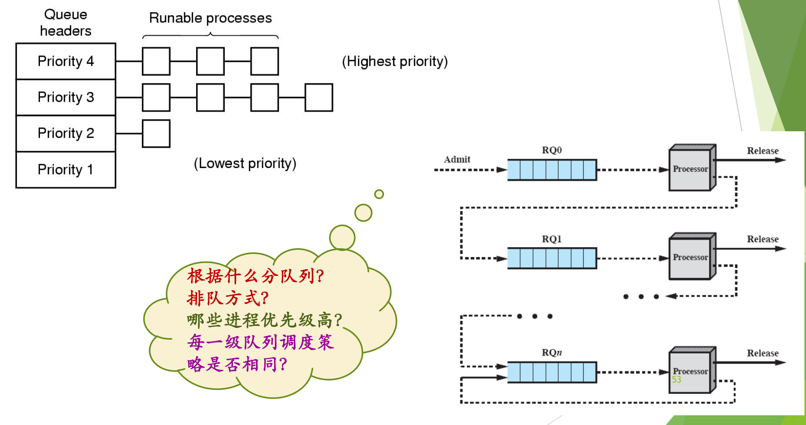

图：左为按优先级组织的多级就绪队列（Priority 4 最高到 Priority 1 最低），右为 RQ0 到 RQn 的反馈队列结构，进程从 RQ0 进入、未完成则降入下一级；气泡列出设计多级队列要回答的问题。

### 多级反馈队列（Multilevel Feedback Queue）

前面的算法各自只盯一个指标：FCFS 看到达顺序，SJF 看运行时间，RR 看公平和响应，最高优先级看优先级，因此各有明显缺陷。**多级反馈队列调度算法**（Multilevel Feedback Queues）的名字有两层含义：“多级”指它有多个就绪队列；“反馈”指进程在哪一级，由它过去的运行行为决定。它同时兼顾多种指标，是一个**综合调度算法**，核心是**折中权衡**（tradeoff）。

> [!info] 可视化资源
>
> - [OSTEP 第 8 章 多级反馈队列（PDF）](https://pages.cs.wisc.edu/~remzi/OSTEP/cpu-sched-mlfq.pdf)：看图 8.1–8.6：交互式作业插入、防止钻空子的时间配额记账，以及低优先级队列用更长时间片。

- 1962 年由 **Corbato** 提出，用于 **CTSS**（Compatible Time-Sharing System，兼容分时系统）。
- 课件记载 UNIX 的分支 BSD（加州大学伯克利分校开发和发布）在 5.3 版中采用了它。

> [!note] 补充解释
> BSD 的正式版本序列是 4.2BSD、4.3BSD、4.4BSD，没有官方的“5.3BSD”。常见资料描述的是 4.3BSD 的调度器采用了多级反馈队列的思想（按 CPU 使用情况动态降低优先级）。课件中的“5.3 版”可能是版本号笔误。

> [!tip] 课堂强调
> 多级反馈队列是本课的重点，“非常希望大家学会”。它也是机制与策略分离的典型例子：机制定好之后，策略仍可以调整。

机制与策略分离原则本身见 [算法比较与机制策略分离](#算法比较与机制策略分离)。下面按“机制”和“策略”两部分展开。

#### 固定的机制

所谓**机制**，是固定下来的流程。多级反馈队列的机制如下：

1. **多个就绪队列**：设置多个就绪队列，不管设几级，第一级队列的优先级最高，往下依次降低。
2. **时间片随级别增大**：不同队列中的进程分配长度不同的时间片。第一级时间片最小，队列优先级越低，时间片越大。
3. **按级别调度**：只有第一级队列为空时，才调度第二级队列的进程，以此类推。
4. **新进程进第一级**：新创建的进程就绪后进入第一级队列，以最高优先级尽快得到运行。
5. **用完时间片降一级**：进程用完了时间片而放弃 CPU，就进入下一级就绪队列。降到最底层后无级可降，就在最底层队列中轮转。
6. **阻塞后回原级**：进程因阻塞而放弃 CPU 时，进入相应的等待队列；等待的事件发生后，回到原来那一级就绪队列。

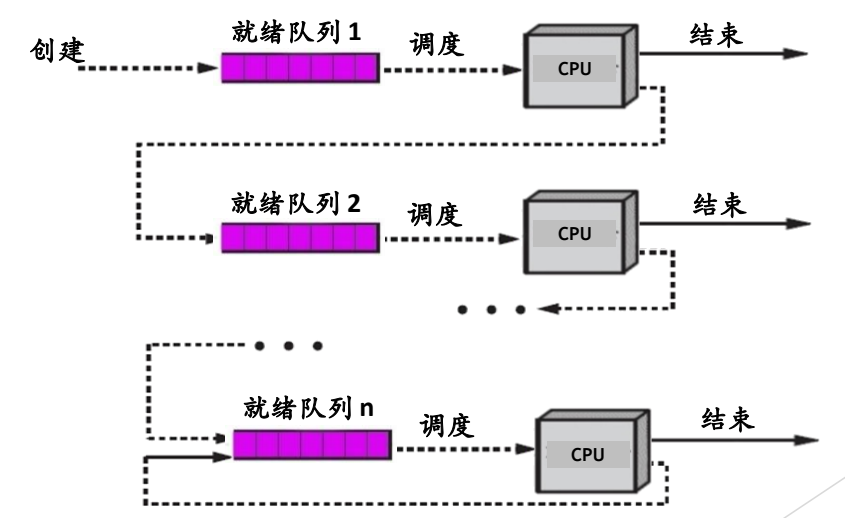

图：多级反馈队列模型——新进程“创建”后进入就绪队列 1，经“调度”上 CPU，未“结束”则沿虚线降入下一级，直至就绪队列 n 在本级循环。

图中的队列模型可以这样读：新创建的进程进入就绪队列 1；每一级队列被调度上 CPU 后，进程要么运行结束，要么用完时间片转入下一级队列，最后一级的进程用完时间片后仍回到本级。

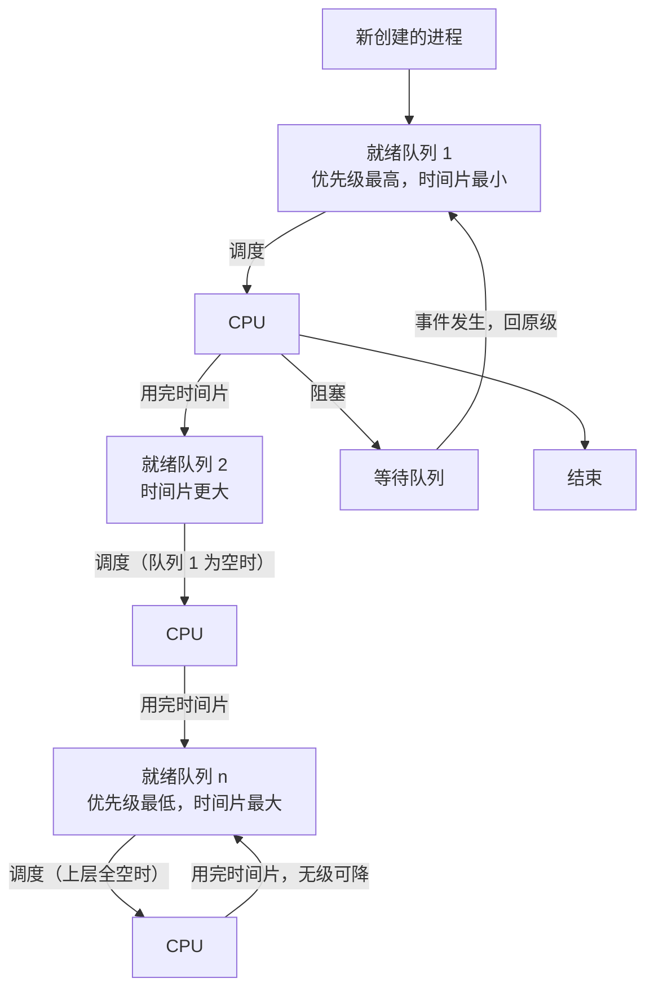

这里只画了第一级的阻塞路径，其余各级相同：在哪一级阻塞，事件发生后就回到哪一级。

**“优先级低、时间片大”是一种平衡**：低级队列的进程被调度的机会少，但一旦上了 CPU，就能连续运行较长时间，用老话说就是“打一巴掌给个枣”。对 CPU 型进程来说，时间片大还意味着切换次数少、开销小。

**“阻塞后回原级”体现了对 I/O 型进程的偏好**：I/O 型进程往往用不完时间片就去做 I/O（例如调用 `read` 这类阻塞系统调用，等磁盘中断到来才重新就绪），所以它不会降级，一直留在较高的队列里；CPU 型进程总是用完时间片，会被逐级降到底层。进程在哪一级，就是根据它的行为“反馈”出来的。

> [!warning] 易错点
> 课件说“各级队列按照时间片轮转方式进行调度”，这个说法不够准确：在普通的时间片轮转中，用完时间片的进程回到**同一队列**队尾；在多级反馈队列中，用完时间片的进程**降到下一级**。只有最底层队列无级可降，才真正是在本级轮转。

#### 可调的策略

机制中标了问号的几处就是留给策略的选择点：机制固定后，不同系统可以在这些点上做不同选择。

**讨论 1：阻塞的进程回到原级时，排在队首还是队尾？**（非抢占的情形）

- **回队首**：进程是因为自身 I/O 主动让出 CPU 的，回来时优先运行，更偏好 I/O 型进程。
- **回队尾**：进程只是没用完时间片就去做 I/O，回来时已经不用降级，比用完时间片要降级的进程已经得到了优惠，排在队尾也说得过去。
- **插到队列中间**：一般不选，因为很难说清该按什么原则插、插在哪里合适。

两种主要选择都有道理，取决于系统想多大程度地偏好 I/O 型进程。

**讨论 2：再次被调度上 CPU 时，时间片怎么处理？**

进程上次没用完时间片就阻塞了，回到队列后再次被调度上 CPU，可以有三种处理：

1. 接着用上次**剩余的时间片**；
2. 给一个**新的完整时间片**；
3. 在时间片上给予某种**奖励**（例如比本级的标准时间片更长）。

**讨论 3：若允许抢占，被抢占的进程回到哪里？**

允许抢占时，有更高优先级的进程就绪（例如上级队列来了新进程），可以抢占 CPU。默认规则是：被抢占的进程回到原来一级就绪队列的**末尾**，但这一点同样标了“（或者？）”，留作策略选择。

- **不能降级**：被抢占是外部原因，进程并没有用完时间片，降级显然不对。
- **回原级队首更合适**：进程刚上 CPU 不久就被抢下来，再排到队尾就不太公平。从公平角度看，回到原级队首更合适，[Windows 线程调度](#windows-线程调度)中 Windows 就是这样做的。
- **升到第一级不合适**：这样会过度偏好这个进程，除非能给出充分的理由。

#### 优缺点

- **优点**：综合了多种思想。新进程和短进程在第一级就能完成，接近短作业优先；I/O 型进程停留在高级队列，响应快；CPU 型进程在低级队列获得大时间片，切换开销小。而且不需要事先知道进程的运行时间，靠运行行为反馈自动分级。
- **缺点**：会产生**饥饿**。CPU 型进程逐渐沉到最底层，越往下被调度的机会越少；只要上层队列不断有新进程创建，底层进程就可能长期得不到 CPU。实际系统（Windows、Linux）都另有策略补偿这些饥饿进程，例如在 Windows 中由平衡集管理器提升长期得不到调度的线程，见 [Windows 线程调度](#windows-线程调度)。

> [!example] 例：进程在三级队列中的轨迹
> 三级反馈队列，第 1、2、3 级时间片分别为 1 ms、2 ms、4 ms，非抢占式，不考虑其他进程的干扰。CPU 型进程 A 需要 CPU 共 9 ms；I/O 型进程 B 每次只用 0.5 ms CPU 就发起 I/O。
>
> 1. A 新创建进入第 1 级，运行 1 ms 用完时间片，降到第 2 级，剩余 8 ms。
> 2. A 在第 2 级运行 2 ms 用完时间片，降到第 3 级，剩余 6 ms。
> 3. A 在第 3 级运行 4 ms，剩余 2 ms。最底层无级可降，回到第 3 级排队。
> 4. A 再次在第 3 级被调度，运行 2 ms 后结束。
> 5. B 每次只用 0.5 ms 就阻塞，从来用不完 1 ms 的时间片，I/O 完成后回到原级，所以始终在第 1 级，每次就绪都会优先于 A 得到调度。

> [!question]- 自测：某多级反馈队列允许抢占，被抢占的进程规定“升到第一级队首”。这条策略有什么问题？
> 被抢占本身并不说明进程是 I/O 型。这条规则会让本应在低级队列的 CPU 型进程只因被抢占一次就回到最高级，对它偏好过度，挤占真正需要快速响应的新进程和 I/O 型进程，这违背了按运行行为分级的初衷。按公平原则，回到原级队首就足够了。

> [!question]- 自测：系统中持续有大量短小的交互式进程被创建，同时有一个长时间运行的科学计算进程。在多级反馈队列下，计算进程会怎样？该如何改进？
> 计算进程很快就降到最底层。只要上层队列一直不空，它就几乎得不到 CPU，发生饥饿。改进方法是增加补偿策略，例如定期把长时间没被调度的进程提升到较高队列，或者给它更大的时间配额；Windows 的平衡集管理器就是这样做的。

> [!question]- 自测：多级反馈队列为什么不需要像 SJF 那样预先知道进程的运行时间，却仍能让短进程先完成？
> 所有新进程都先进入优先级最高、时间片最短的第一级。短进程在第一级或前几级的小时间片内就运行完了；长进程因为反复用完时间片而逐级下降。运行时间的长短是通过“用没用完时间片”这个反馈自动暴露出来的，不需要用户事先估计。

---

## 算法比较与机制策略分离

> [!abstract] 本节要点
>
> - 交互式系统还有公平共享调度、保证调度和彩票调度；彩票调度按持票比例概率地分配 CPU，票可转让，公平共享的思想后来体现在 Linux 的完全公平调度 CFS 中。
> - 比较各算法要同时看选择函数、决策模式、吞吐量、响应时间、开销、对各类进程的影响和饥饿；用 $w,e,s$ 表示，SJF 选 $\min[s]$，SRTN 选 $\min[s-e]$，HRRN 选 $\max\frac{w+s}{s}$。
> - 机制与策略分离：内核固定“在调度时机按优先级选人、做上下文切换”的机制，用优先级调整、时间片/配额调整等策略适配不同负载。
> - 用户级线程由内核按进程调度，一个进程的时间片内只能轮流运行其自身线程（A1,B1,A2,B2 不可能）；内核级线程由内核按线程调度，两种顺序都可能。
> - 典型系统：UNIX 动态优先数、5.3BSD 多级反馈队列、Windows 基于优先级的抢占式多任务、Linux 抢占式、Solaris 综合调度。

### 交互式系统的其他调度算法

前面几种算法都只关心“选哪个进程”，没有直接回答“每个进程或用户最终应得到多少 CPU”。以下三种算法从“份额”角度设计调度，它们是交互式系统中采用的其他算法，可以按原理、优缺点、策略和适用场景自行总结。

> [!info] 可视化资源
>
> - [OSTEP 第 9 章 比例份额调度（PDF）](https://pages.cs.wisc.edu/~remzi/OSTEP/cpu-sched-lottery.pdf)：看图 9.1 彩票调度决策代码、图 9.2 公平性实验，以及 9.7 节 CFS 的引入。

- **彩票调度**（Lottery scheduling）：创建进程时发给它若干张彩票，每次调度时随机抽一张，持有中奖彩票的进程上 CPU。这是一种概率调度：持票越多，被调度的机会越大。彩票还可以转让——想让某个进程尽快运行，就把别的进程的彩票都交给它。
- **公平共享调度**（Fair-share scheduling）：这一思想后来发展为 Linux 选用的**完全公平调度**（CFS），将在 L08「06 CFS 完全公平调度」中详细讲解。
- **保证调度**（Guaranteed scheduling）：课件只列出名称。

> [!note] 补充解释
> 按经典教材（Tanenbaum《现代操作系统》）的定义：**保证调度**向用户做出明确的性能承诺，例如系统中有 $n$ 个进程时，每个进程应得到 $\frac{1}{n}$ 的 CPU 时间。系统记录每个进程实际得到的 CPU 时间，并计算“实际所得 / 应得”的比值，每次选比值最小的进程运行，直到它超过其他进程。**公平共享调度**把“公平”的单位从进程换成用户（或用户组）：若用户 1 有 9 个进程、用户 2 只有 1 个进程，按进程轮转用户 1 会得到 90% 的 CPU；公平共享则先在用户之间平分 CPU，再在每个用户内部分配。

> [!example] 例：彩票调度的份额
> 进程 A 持 30 张票，B 持 15 张，C 持 5 张，共 50 张。
>
> 1. 每次抽签 A 中签的概率为 $\frac{30}{50}=60\%$，B 为 $30\%$，C 为 $10\%$。
> 2. 运行足够多次后，三者获得的 CPU 份额趋近 $6:3:1$。
> 3. 若 B 把自己的 15 张票全部转让给 A（例如 B 等待 A 的服务结果），A 的概率升为 $\frac{45}{50}=90\%$，B 在持票为零期间不会被调度。

### 调度算法的比较

这张比较表的每一列正是前面逐个讨论算法时考虑的因素：有没有饥饿、对哪类进程（I/O 型、CPU 型、长进程、短进程）有利、开销高低、响应时间与吞吐量。 表中符号：$w$ 为已花费的等待时间，$e$ 为到目前为止已花费的执行时间，$s$ 为进程所需的总服务时间（包括 $e$）。

| 调度算法             | 选择函数                         | 决策模式             | 吞吐量                 | 响应时间                               | 开销     | 对进程的影响                        | 饥饿 |
| -------------------- | -------------------------------- | -------------------- | ---------------------- | -------------------------------------- | -------- | ----------------------------------- | ---- |
| FCFS                 | $\max[w]$                        | 非抢占               | 不强调                 | 可能很高，特别是进程执行时间差别很大时 | 最小     | 对短进程不利；对 I/O 密集型进程不利 | 无   |
| RR                   | 常数                             | 抢占（时间片用完时） | 时间片小时吞吐量会很低 | 为短进程提供好的响应时间               | 最小     | 公平对待                            | 无   |
| SJF                  | $\min[s]$                        | 非抢占               | 高                     | 为短进程提供好的响应时间               | 可能较高 | 对长进程不利                        | 可能 |
| SRTN                 | $\min[s-e]$                      | 抢占（新进程到达时） | 高                     | 提供好的响应时间                       | 可能较高 | 对长进程不利                        | 可能 |
| HRRN                 | $\max\left(\frac{w+s}{s}\right)$ | 非抢占               | 高                     | 提供好的响应时间                       | 可能较高 | 很好的平衡                          | 无   |
| Feedback（多级反馈） | 见算法思想                       | 抢占（时间片用完时） | 不强调                 | 不强调                                 | 可能较高 | 可能对 I/O 密集型进程有利           | 可能 |

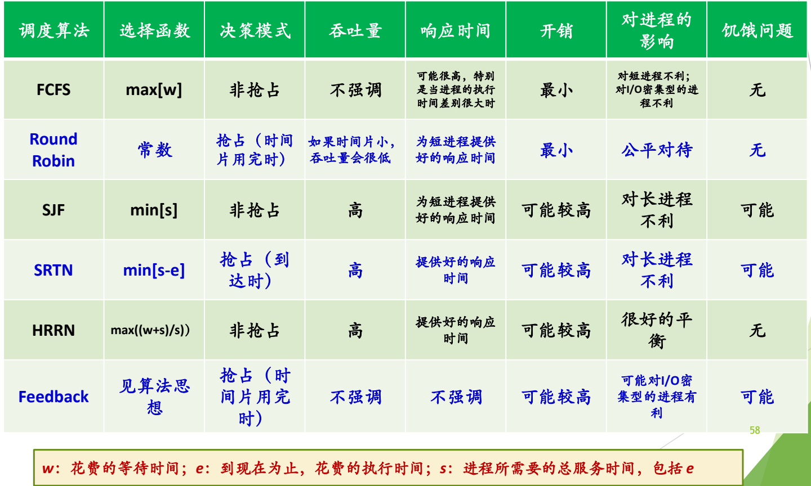

图：FCFS、Round Robin、SJF、SRTN、HRRN、Feedback 在选择函数、决策模式、吞吐量、响应时间、开销、对进程的影响和饥饿问题上的对比，其中 $w$ 为等待时间、$e$ 为已执行时间、$s$ 为总服务时间。

读表时把选择函数和前面各节联系起来：

1. **FCFS** 选 $w$ 最大者，即最早到达者；见[批处理系统的调度算法](#批处理系统的调度算法)。
2. **SJF / SRTN** 分别选总服务时间 $s$ 最小、剩余时间 $s-e$ 最小者，都需要预知 $s$，长进程可能饥饿。
3. **HRRN** 的 $\frac{w+s}{s}=1+\frac{w}{s}$ 就是响应比：$s$ 小则偏向短作业，$w$ 增大则长作业的响应比也会上升，所以无饥饿。
4. **RR** 选择函数为“常数”，即不比较进程属性，只按队列轮流；见[时间片轮转与虚拟轮转](#时间片轮转与虚拟轮转)。
5. **Feedback** 按所在级别和时间片使用情况决定；见[多级队列与多级反馈队列](#多级队列与多级反馈队列)。

> [!warning] 易错点
> 表中 RR 的“开销：最小”指**调度决策本身**的开销——选下一个进程不需要计算任何指标；它并不否认 RR 时间片过小时上下文切换开销很大（那一点体现在“吞吐量会很低”这一格）。同理，SJF、SRTN、HRRN、Feedback 的“可能较高”来自需要估计运行时间、反复计算响应比或维护多级队列。

### 机制与策略分离

调度框架需要长期稳定，而不同应用场景对“偏好谁”的要求各不相同；如果把两者写死在一起，每换一种场景就得改内核调度代码。**机制与策略分离**（separation of mechanism and policy）是一条历史悠久的原则（a long-established principle）：机制回答“怎么做”，策略回答“做什么、偏向谁”。

在调度中，这条原则的具体分工是：

1. **机制（固定）**：进程通过中断、异常或系统调用进入内核；处理完事件、返回用户态前是统一的调度时机；在该时机从就绪队列中选出优先级最高者，必要时做上下文切换。基于优先级的抢占正是这样一套机制。
2. **策略（可调）**：为了得到更好的结果，在不改机制的前提下调整参数，例如调整优先级（优先级继承、优先级提升）、调整时间片或时间配额的大小、决定进程回到队首还是队尾。

调度时机本身的理由见 L06「03 调度时机」，该原则在中断处理中的体现见 L03「08 低层步骤与机制策略」。本讲的多级反馈队列（机制固定、队首/队尾与时间片处理可调）和下一节的 Windows 线程调度（“机制已确定”，只讨论三种场景下的策略）都是这一原则的实例。

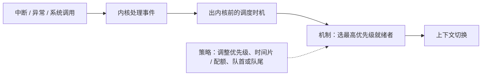

#### 上下文切换的代码：xv6 的 swtch

> [!info] 依据讲义整理
> 本小节对应课件 p14，课上只提到“上下文切换要看代码，代码很短，用汇编写”，未逐行讲解。

上下文切换是调度机制中最底层、最固定的一步。xv6（RISC-V 版）在 `kernel/swtch.S` 中实现，函数原型为 `void swtch(struct context *old, struct context *new);`：把当前寄存器保存到 `old`，再从 `new` 装入。按调用约定，寄存器 `a0` 存放第一个参数（指向 old 进程上下文的指针），`a1` 存放第二个参数（指向 new 进程上下文的指针）。

```asm
# Context switch
#
#   void swtch(struct context *old, struct context *new);
#
# Save current registers in old. Load from new.

.globl swtch
swtch:
        sd ra, 0(a0)
        sd sp, 8(a0)
        sd s0, 16(a0)
        sd s1, 24(a0)
        sd s2, 32(a0)
        sd s3, 40(a0)
        sd s4, 48(a0)
        sd s5, 56(a0)
        sd s6, 64(a0)
        sd s7, 72(a0)
        sd s8, 80(a0)
        sd s9, 88(a0)
        sd s10, 96(a0)
        sd s11, 104(a0)

        ld ra, 0(a1)
        ld sp, 8(a1)
        ld s0, 16(a1)
        ld s1, 24(a1)
        ld s2, 32(a1)
        ld s3, 40(a1)
        ld s4, 48(a1)
        ld s5, 56(a1)
        ld s6, 64(a1)
        ld s7, 72(a1)
        ld s8, 80(a1)
        ld s9, 88(a1)
        ld s10, 96(a1)
        ld s11, 104(a1)

        ret
```

执行过程分三步：

1. **保存旧上下文**：`sd`（store doubleword）把 14 个 64 位寄存器依次写入 `old` 指向的 `struct context`，每个占 8 字节，偏移 0 到 104。
2. **装入新上下文**：`ld`（load doubleword）按相同偏移从 `new` 读回这 14 个寄存器。
3. **返回**：`ret` 跳转到 `ra` 中的地址。由于 `ra` 和 `sp` 已经换成新进程保存的值，`ret` 回到的是**新进程**当初调用 `swtch` 的地方，并使用新进程的内核栈——切换就此完成。

> [!note] 补充解释
> `ra` 是返回地址寄存器，`sp` 是栈指针，`s0`–`s11` 是 RISC-V 调用约定中的**被调用者保存寄存器**（callee-saved）。`swtch` 是被 C 代码当作普通函数调用的，调用者保存寄存器（如 `t0`–`t6`、`a0`–`a7`）按约定已由调用方编译器负责保存在栈上，因此 `swtch` 只需保存 ra、sp 和 s0–s11。程序计数器不必单独保存：`ra` 已经记录了“回来后从哪里继续”。

### 线程调度

调度算法本身并不区分进程与线程：都是“排一个队，选一个上 CPU”。在既支持进程又支持线程、且线程是 CPU 调度单位的系统中，前面所有算法都直接适用；区别在于线程由谁调度。

- **用户级线程**（user-level threads）：内核只看得见进程。① 内核先选中一个进程；② 该进程内的运行时系统（runtime system）再选它的某个线程。在进程 A 的时间片内只能轮流运行 A 的线程，所以 A1, A2, A3, A1, A2, A3 是可能的，A1, B1, A2, B2, A3, B3 不可能。
- **内核级线程**（kernel-level threads）：内核直接以线程为单位选择，不必管线程属于哪个进程，因此 A1, A2, A3, A1, A2, A3 和 A1, B1, A2, B2, A3, B3 都可能。

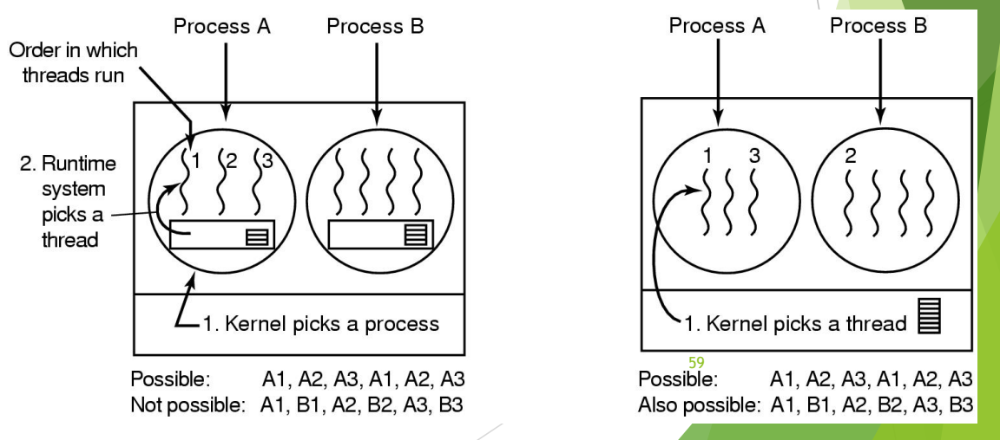

图：左为用户级线程——内核先选进程、运行时系统再选线程，只可能出现 A1, A2, A3 这类序列；右为内核级线程——内核直接选线程，A1, B1, A2, B2, A3, B3 也可能出现。

图中左半部分是用户级线程（Kernel picks a process，再由 Runtime system picks a thread），右半部分是内核级线程（Kernel picks a thread）。线程模型本身见 L05「06 线程的实现模型」。

### 典型系统的调度算法

各系统的命名反映了它组合了哪些要素：

- **UNIX**：动态优先数法。
- **5.3BSD**：多级反馈队列法（[多级队列与多级反馈队列](#多级队列与多级反馈队列)）。
- **Windows**：基于优先级的抢占式多任务调度，见[Windows 线程调度](#windows-线程调度)。
- **Linux**：抢占式调度，见 L08「04 Linux 2.4 与 O(1) 调度器」至「06 CFS 完全公平调度」。
- **Solaris**：综合调度算法。

> [!question]- 自测：某系统采用用户级线程，进程 A 有线程 A1、A2，进程 B 有线程 B1、B2。观察到的 CPU 执行序列为 A1, B1, A2, B2，这可能吗？若改为内核级线程呢？
> 用户级线程下不可能（课件图中的 Not possible 情形）：内核只按进程分配 CPU，进程 A 占有 CPU 期间，只由 A 的运行时系统在 A 的线程之间切换，内核看不见也不会去挑 B1，因此不会出现按线程交替的序列。内核级线程下可能：内核直接以线程为单位挑选，可以在 A、B 的线程之间任意交替。

> [!question]- 自测：比较表中哪些算法可能产生饥饿？HRRN 和 SJF 都偏向短作业，为什么 HRRN 没有饥饿？
> SJF、SRTN 和多级反馈队列可能产生饥饿。HRRN 的选择函数是 $1+\frac{w}{s}$：长作业的 $s$ 大，但等待时间 $w$ 持续增大，响应比会无限上升，最终一定超过新来的短作业而被选中；SJF 只看 $s$，源源不断的短作业可以一直排在长作业前面。

> [!question]- 自测：“优先级抢占”和“优先级继承”，哪个是机制、哪个是策略？为什么这样划分有用？
> 优先级抢占是机制：在调度时机总是让最高优先级就绪者上 CPU，这部分代码固定。优先级继承是策略：在出现优先级反转时临时修改某个进程的优先级，抢占机制本身一行不改就能得到不同的调度结果。这样划分后，适配新场景只需调整策略参数，不必改动调度框架。

---

## Windows 线程调度

> [!abstract] 本节要点
>
> - Windows 以线程为调度单位，采用基于动态优先级的抢占式调度并结合时间配额；按优先级进入 32 个就绪队列，总选最高优先级就绪线程，同一优先级内按时间片轮转，用完配额并不必然降级。
> - 优先级 0 为零页线程（系统线程），1–15 为可变优先级（用户线程，有基本优先级与当前优先级），16–31 为实时优先级（系统线程，优先级不变）。
> - 时间配额是配额单位的整数而非时间长度；增加配额可以在不提高优先级的前提下多给某线程 CPU 时间。
> - 被抢占线程回到原优先级队首：实时优先级线程重置完整配额，可变优先级线程只运行剩余配额；配额用完时优先级未降则回队尾（同级无人则再给新配额），优先级已降（提升后的回落）则让更高优先级线程运行。
> - 优先级提升只针对 1–15：I/O 完成按驱动指定幅度提升且配额减 1；平衡集管理器每秒扫描，就绪超过 300 个时钟中断间隔的线程提到 15 并给 4 倍配额，用完立即回到基本优先级。

### 调度单位、原则与调度时机

前几节分别回答了“优先级固定还是可变”“是否抢占”“按优先级分队列还是都从第一级进入”“时间片怎么处理”等问题，Windows 把这些答案组合成一个实际系统。

**Windows 线程调度**的基本规则：

1. **调度单位是线程**：Windows 同时支持进程和线程，线程是上 CPU 的单位。
2. **基于动态优先级的抢占式调度，结合时间配额调整**：优先级可变；时间片改称**时间配额**（quantum）。
3. **多个就绪队列**：就绪线程按优先级进入相应队列——即“不同优先级进不同队列”的排队方式，而不是像 BSD 那样新进程都进第一级再降级。
4. **总是选择优先级最高的就绪线程**：高优先级队列空了才轮到下一级。
5. **同一优先级内按时间片轮转**：不存在“用完时间片就降一级”的规则，但这不等于优先级绝不下降（见后文配额用完的第二种情况）。
6. **多处理机系统中允许多个线程并行运行**。

引发线程调度的条件中，以下四条就是通用的调度时机（见 L06「03 调度时机」）：线程正常终止或因错误终止；新线程创建或等待线程变为就绪；线程从运行态进入阻塞态；线程从运行态变为就绪态。Windows 另外增加了两条：

- **线程的优先级改变了**：在基于优先级的抢占式调度中，优先级一变，就绪队列的“格局”就变了，可能出现比当前运行者更高优先级的线程，必须重新调度。
- **线程改变了它的亲和（Affinity）处理机集合**：线程从一个处理器迁移到另一个时，原处理器上缓存等积累的“态势”会丢失，需要重新建立，所以系统希望线程留在它的亲和处理机上；亲和集合改变（例如增加了一个可用处理器）意味着选择变了，需要重新调度。

### 线程优先级与调度器数据结构

**Windows 线程优先级**共 32 级，分三类：

| 优先级 | 类别       | 使用者                       | 能否改变                 |
| ------ | ---------- | ---------------------------- | ------------------------ |
| 16–31  | 实时优先级 | 系统线程                     | 不改变                   |
| 1–15   | 可变优先级 | 用户线程（如游戏、文字处理） | 可在一定范围内升高或降低 |
| 0      | —          | 零页线程（系统线程）         | —                        |


图：Windows 的 32 级线程优先级——16–31 为实时优先级（不改变），1–15 为可变优先级（有基本优先级与当前优先级），0 为用于清零空闲物理页面的零页线程。

这一划分体现了“系统线程优先级高于用户线程”的一般原则。实时优先级线程的优先级由操作系统按重要性分配好，不再调整。可变优先级线程有两个类似 PCB 字段的属性：**基本优先级**（base priority，创建时确定）和**当前优先级**（current priority，可以被临时提升，调度依据的是它）。

**零页线程**（zero page thread）的工作是把系统中的空闲物理页面清零，它运行在优先级 0，只有在没有别的线程可运行时才轮得到它。

> [!note] 补充解释
> 讲授录音把优先级 0 的线程称作 idle 线程、说它“没事就刷内存”，混淆了两个线程。**零页线程**负责把空闲物理页清零（页面交给新进程前先清零，避免泄露上一个使用者的数据）；**空闲线程**（idle thread）是每个处理机在无事可做时运行的循环，见本节最后的“空闲线程”。课件把两者的优先级都写作 0；微软文档则把零页线程称为唯一优先级为 0 的线程，空闲线程不在就绪队列中参与竞争。笔记以课件为准区分二者。

**调度器数据结构**：进程对象中有缺省基本优先级、缺省处理机偏好和缺省时间配额，线程对象从中继承并拥有自己的基本优先级、当前优先级、处理机偏好和时间配额。此外，Windows 维护两张 32 位位图：

- **就绪位图**：每一位对应一个调度优先级，指示该优先级的就绪队列中是否有线程等待运行。调度器用它直接找到“有线程的最高优先级队列”，不必逐个检查 32 个队列。
- **空闲位图**：每一位对应一个处理机，指示该处理机是否处于空闲状态。

> [!info] 可视化资源
>
> - [Microsoft Learn：Scheduling Priorities](https://learn.microsoft.com/en-us/windows/win32/procthread/scheduling-priorities)：看文末表格：进程优先级类与线程优先级级别如何组合成 1–15、16–31 的基本优先级；0 级只属于零页线程。

### 时间配额

时间片若只是一段时间长度，就只能用来“到点切换”；Windows 把它改为可加可减的数值，使它同时成为调整偏好的手段。**时间配额**不是一个时间长度值，而是一个称为**配额单位**（quantum unit）的整数。线程对象 KTHREAD 中有 `Quantum`（当前剩余配额）和 `QuantumReset`（重置时的完整配额）两个字段，内核源码中有如下定义：

```c
#define CLOCK_QUANTUM_DECREMENT 3
#define WAIT_QUANTUM_DECREMENT 1
```

> [!note] 补充解释
> 据 *Windows Internals*：每次时钟中断，运行线程的配额减 `CLOCK_QUANTUM_DECREMENT`（3 个单位）；线程结束一次等待时减 `WAIT_QUANTUM_DECREMENT`（1 个单位）。客户端版本默认配额约为 6 个单位，即 2 个时钟中断间隔。用比时钟滴答更细的整数计量，是为了让“等待一次”这种不足一个时钟周期的消耗也能被计入。这是 Windows 2000/XP 时期的记账方式，Vista 起改为按 CPU 周期精确记账，但配额单位的概念保留。

一个线程用完时间配额时，如果没有其他相同优先级的线程，Windows 将重新给它分配一个新的时间配额并继续运行。

> [!example] 例：前台游戏与后台电子表格
> 用户先启动一个运行时间很长的电子表格计算程序，再切换到一个需要复杂图形计算和显示的游戏（CPU 型）。两者都是用户线程。
>
> 1. **若提高游戏的优先级**：游戏总在更高优先级队列中就绪，后台电子表格几乎得不到 CPU。
> 2. **若增加游戏的时间配额**：两者优先级相同、仍在同一队列轮转，电子表格照常推进，只是游戏每轮得到的 CPU 时间多一些。
>
> 因此 Windows 通过调整时间配额来调整对不同线程的偏好，而不改优先级。 多级反馈队列中“优先级低但时间片大”也是同样的平衡思想。

### 三种调度场景

调度机制已经确定（按优先级排队、选最高优先级），接下来讨论的是三种场景下的策略：主动切换、抢占、时间配额用完——与多级反馈队列中讨论过的场景相同。

#### 主动切换

运行线程因 I/O 或等待事件转入阻塞态，主动让出 CPU。调度器选当前最高优先级的非空队列中的线程。例如优先级 20 的线程阻塞，19 级队列为空，就从 18 级队列选一个线程上 CPU。

#### 抢占

优先级 18 的线程正在运行，先前阻塞的 20 级线程被唤醒回到就绪队列，立即抢占 18 级线程。被抢占的线程**放回相应优先级就绪队列的队首**；再次上 CPU 时配额的处理按类别不同：

- **实时优先级线程**：时间配额被重置为一个完整的时间配额。这些是为用户线程服务的重要系统线程，越快把服务做完越好，所以不计较配额。
- **可变优先级线程**：时间配额不变，重新得到处理机后只运行剩余的时间配额。它已经回到队首，待遇已算优厚，不再额外补偿。

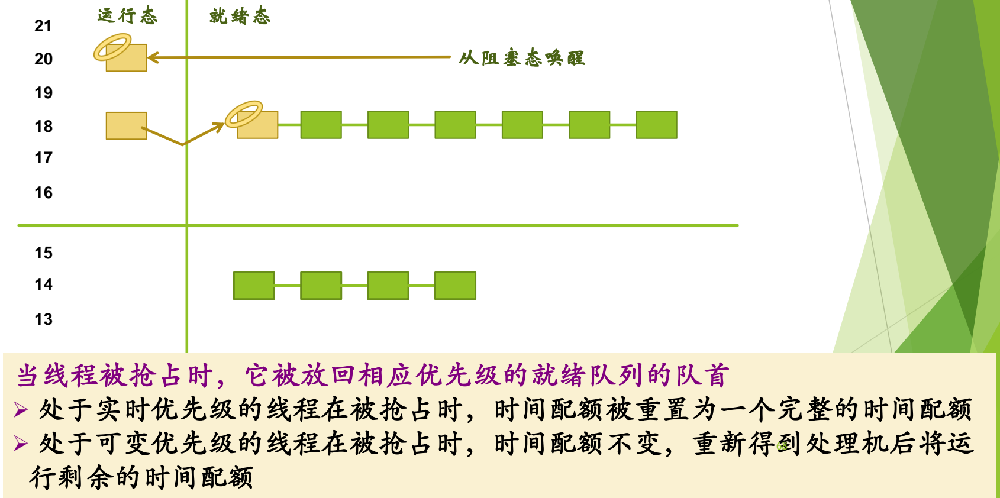

图：优先级 20 的线程从阻塞态唤醒后抢占正在运行的优先级 18 线程，被抢占线程放回优先级 18 就绪队列的队首；下方说明实时优先级重置完整配额、可变优先级保留剩余配额。

#### 时间配额用完

设线程 A 的时间配额用完，分两种情况：

1. **A 的优先级没有降低**：若同级队列中有其他就绪线程，选下一个线程执行，A 回到原就绪队列末尾；若同级没有其他就绪线程，系统给 A 分配一个新的时间配额，让它继续运行。
2. **A 的优先级降低了**：Windows 将选择一个更高优先级的线程。优先级之所以会降，是因为 A 此前被临时**提升**过——用完提升期间的配额后要回落到较低队列，这时原来比它低、现在比它高的线程就该运行了。

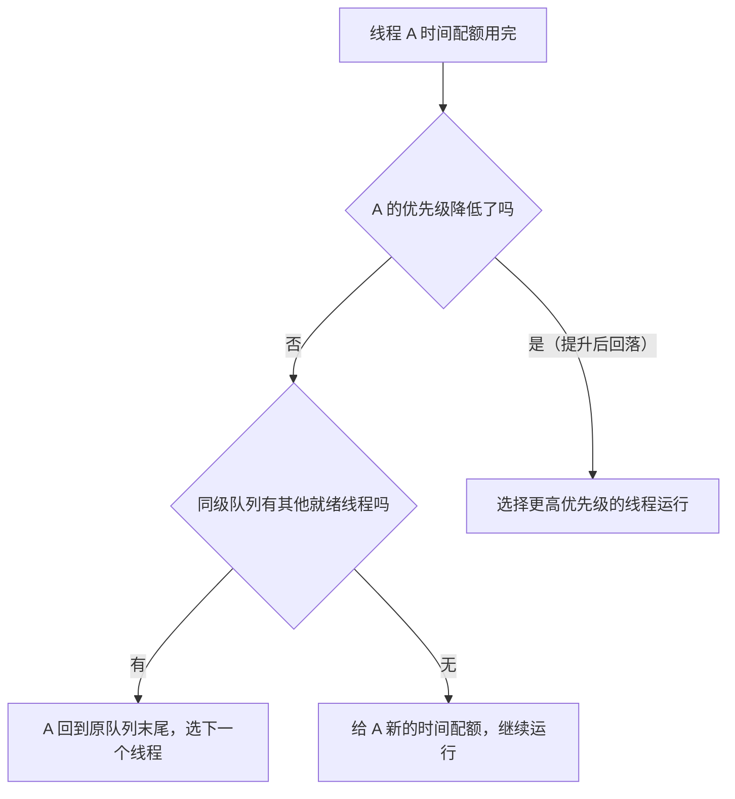

### 优先级提升与饥饿处理

任何调度策略都不是完美的，不会让所有应用都受益：它可能对某类线程有倾向性，可能因潜在的不公平造成饥饿，也需要改善吞吐量、响应时间等整体特征。Windows 的解决方案有两个：**提升线程的优先级**，以及**给线程分配一个很大的时间配额**。

> [!info] 可视化资源
>
> - [Microsoft Learn：Priority Boosts](https://learn.microsoft.com/en-us/windows/win32/procthread/priority-boosts)：确认只有基本优先级 0–15 的线程会被提升，前台、窗口输入、等待完成三类提升，以及每用完一个时间片降一级直至基本优先级。

**优先级提升**（priority boost）只针对可变优先级范围（1–15）内的线程，实时优先级线程不受影响。以下 5 种情况 Windows 会提升线程的当前优先级：

1. I/O 操作完成；
2. 信号量或事件等待结束；
3. 前台进程中的线程完成一个等待操作；
4. 由于窗口活动而唤醒窗口线程；
5. 线程处于就绪态超过一定时间还没有运行——“饥饿”现象。

#### I/O 操作完成后的提升

线程去做 I/O，说明它没用完配额就主动让出了 CPU，回来时应当对它友好一点。规则如下：

1. 完成 I/O 后，Windows 临时提升等待该操作的线程的优先级，使它更快上 CPU 处理数据。
2. 实际提升值由设备驱动程序决定，建议值在 `Wdm.h` 或 `Ntddk.h` 中；驱动在完成 I/O 请求时通过内核函数 `IoCompleteRequest` 指定提升幅度。
3. 提升幅度与 I/O 请求的响应时间要求一致：响应时间要求越高，提升幅度越大；提升后不超过 15。
4. 为避免不公平，唤醒等待线程时把它的时间配额减 1。

第 4 条是“给一点优惠、也要让别人觉得不太不公平”的平衡：优先级升了以尽快运行，但配额减少一点。

> [!note] 补充解释
> `Ntddk.h`/`Wdm.h` 中的建议值例如：`IO_DISK_INCREMENT` 为 1，`IO_NETWORK_INCREMENT` 为 2，`IO_KEYBOARD_INCREMENT` 为 6，`IO_SOUND_INCREMENT` 为 8——交互性越强的设备提升越多。调用方式见微软文档 [IoCompleteRequest](https://learn.microsoft.com/en-us/windows-hardware/drivers/ddi/wdm/nf-wdm-iocompleterequest)，其第二个参数 `PriorityBoost` 即提升幅度。

#### 等待事件和信号量后的提升

> [!info] 依据讲义整理
> 本小节对应课件 p73，课上只讲了 I/O 完成和饥饿两个例子，未讲这一种。

阻塞于事件或信号量的线程得到的处理器时间比 CPU 型线程少，这种提升用来减小两者之间的不平衡。`SetEvent`、`PulseEvent`、`ReleaseSemaphore` 等函数调用可导致事件对象或信号量对象的等待结束。规则如下：

1. 线程完成对事件或信号量的等待后，优先级提升 1 级；提升以**基本优先级**为基准，提升后不超过 15。
2. 等待结束时时间配额减 1，线程在提升后的优先级上执行完剩余的时间配额。
3. 随后优先级降低 1 级，运行一个新的时间配额；如此逐级下降，直到降回基本优先级。

第 3 步正是“配额用完且优先级降低了”的来源：每次回落都可能让出 CPU 给更高优先级线程。

#### 饥饿线程的提升

可变优先级的低优先级线程可能长期被高优先级线程压着，Windows 用一个专门的系统线程来补偿：

1. **扫描**：系统线程**平衡集管理器**（balance set manager）每秒醒来一次，扫描就绪队列，找出排队超过 300 个时钟中断间隔仍未被调度的线程。
2. **提升**：把这些线程的优先级提升到 15（可变范围的最高级），并分配一个长度为正常值 4 倍的时间配额。高优先级让它很快被调度，大配额让它运行足够长，以弥补此前饥饿的损失。
3. **回落**：被提升线程用完这次配额后，优先级立即衰减到它原来的基本优先级——这又是“配额用完、优先级降低”的情形。

> [!warning] 易错点
> 饥饿线程被提到 15 而不是 31：优先级提升只在可变优先级范围 1–15 内进行，用户线程永远不会进入实时优先级区间。另外，I/O 完成是“提升优先级 + 配额减 1”，饥饿处理是“提到 15 + 4 倍配额”，两者对配额的处理方向相反。

### 空闲线程

> [!info] 依据讲义整理
> 本小节对应课件 p75–76，课上未讲解。

处理机总得有东西可执行。如果一个处理机上没有可运行的线程，Windows 会调度该处理机对应的**空闲线程**（idle thread）。由于多处理机系统中可能有两个处理机同时空闲，系统为**每个处理机**都配了一个空闲线程。Windows 给空闲线程指定的优先级为 0，它只在没有其他线程要运行时才运行；它的功能就是在一个循环中检测是否有要进行的工作。

每轮循环依次做：

1. 处理所有待处理的中断请求；
2. 检查是否有待处理的 DPC（延迟过程调用）请求，若有则清除相应软中断并执行 DPC；
3. 检查是否有就绪线程可进入运行状态，若有则调度该线程运行；
4. 调用硬件抽象层（HAL）的处理机空闲例程，执行相应的电源管理功能。

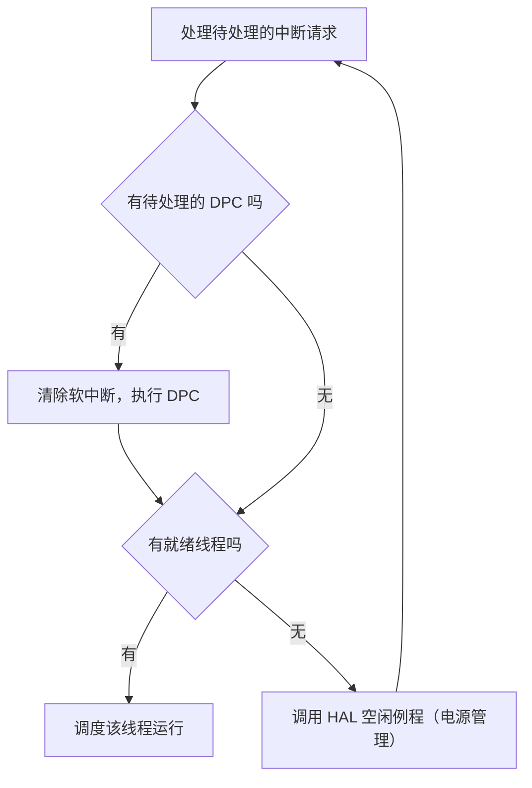

> [!question]- 自测：一个基本优先级为 8 的用户线程正在运行，剩余 2 个配额单位时被一个优先级 24 的线程抢占。它会被放到哪里？再次上 CPU 时能运行多少配额？如果被抢占的是一个优先级 20 的线程呢？
> 用户线程（可变优先级）放回自身当前优先级就绪队列的队首，再次上 CPU 时配额不变，只运行剩余的 2 个单位。优先级 20 的线程属于实时优先级，同样放回 20 级队首，但配额被重置为一个完整的时间配额。

> [!question]- 自测：基本优先级为 4 的线程在就绪队列中排了很久。平衡集管理器发现它后会怎样处理？它运行完这次配额后又会怎样？
> 若它已就绪超过 300 个时钟中断间隔，平衡集管理器（每秒扫描一次）把它的当前优先级提到 15，并给它正常值 4 倍的时间配额。用完这次配额后，它的优先级立即衰减回基本优先级 4，属于“配额用完且优先级降低”，调度器转而选更高优先级的线程。

> [!question]- 自测：一个基本优先级为 14 的线程等待信号量结束，它的优先级如何变化？若基本优先级为 15 呢？
> 等待结束时以基本优先级为基准提升 1 级到 15，配额减 1，在 15 级执行完剩余配额；随后降 1 级回到 14，运行一个新的配额，此后保持基本优先级。基本优先级为 15 时提升后仍不能超过 15，优先级不变，只有配额减 1。

---

## 本讲小结

各章的算法不是并列的清单，而是一条逐步“加因素”的演进线：从只看一个指标的 FCFS、SJF，到综合等待与长度的 HRRN；从时间片轮转到偏好 I/O 型进程的虚拟轮转；从静态的优先级到按运行行为反馈分级的多级反馈队列；最后由 Windows 把优先级、抢占、时间配额和优先级提升组合成实际系统。

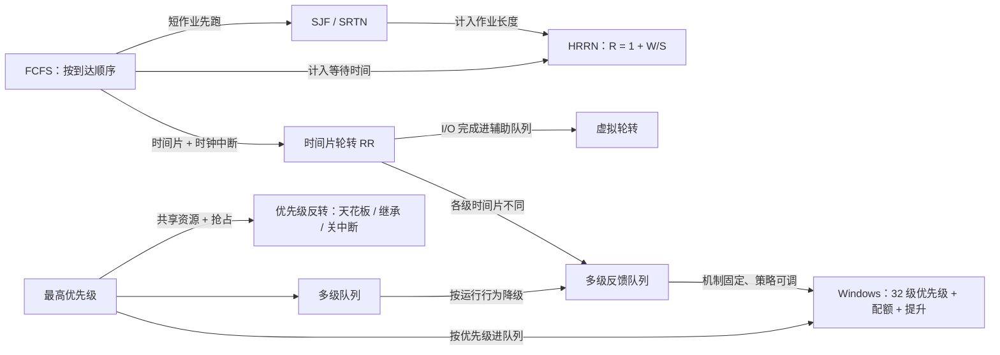

选算法时先问四个问题：要优化的是周转时间还是响应时间；是否允许抢占；能否预知运行时间；能否容忍饥饿。混合负载的分析说明，能同时让 CPU 和磁盘忙起来的算法都要尽快把 CPU 交给 I/O 型进程，代价则是切换开销或对 CPU 型进程的不公平，所以实际系统都靠可调的策略（优先级提升、配额调整）去补偿。

### 核心公式

| 公式                                                        | 含义                                                                             |
| ----------------------------------------------------------- | -------------------------------------------------------------------------------- |
| $T_{\rm turnaround} = T_{\rm completion} - T_{\rm arrival}$ | 周转时间；所有作业同时到达时等于完成时刻                                         |
| $R = \frac{W + S}{S} = 1 + \frac{W}{S}$                     | HRRN 响应比，$W$ 为已等待时间，$S$ 为处理时间                                    |
| $\min[s]$、$\min[s-e]$、$\max[w]$                           | SJF、SRTN、FCFS 的选择函数，$s$ 为总服务时间，$e$ 为已执行时间，$w$ 为已等待时间 |
| $\frac{t_{\rm switch}}{q}$                                  | RR 切换开销占比，例如 $\frac{0.1\ \text{ms}}{10\ \text{ms}} = 1\%$               |
