单处理器调度只回答“下一个运行谁”；多处理器和实际内核还要回答“在哪个 CPU 上运行”“截止时间能否保证”“怎样既公平又照顾交互式进程”。本讲先讨论 SMP 下的就绪队列组织、缓存亲和性与负载均衡（01–02），再讲实时调度的可调度性、RM 与 EDF（03），最后沿 Linux 调度器演化史从 2.4、O(1)、SD/RSDL 走到 CFS 的 vruntime 与四种情景，并说明 EEVDF 的改进方向（04–07）。前置知识是 L06「05 调度目标与衡量指标」中的调度指标和 L07「05 多级队列与多级反馈队列」中的 MLFQ。

---

## 多处理器调度的基本问题

> [!abstract] 本节要点
>
> - 多处理器调度在单处理器调度之上多了一维：既要决定**选哪个进程**，还要决定**在哪个 CPU 上执行**。
> - SMP 中所有处理器通过同一条总线访问内存，访问哪块内存代价都一样；NUMA 由多个节点组成，访问其他节点的内存更远，调度时必须考虑这一点。本课以 SMP 为基础。
> - SMP 上每个处理器运行自己的调度程序，算法与单处理器基本相同，但访问共享资源（如共享就绪队列）需要同步（加锁）。
> - 全局（公共）就绪队列天然负载均衡，但锁成为瓶颈、调度开销大；每 CPU 一个就绪队列开销小，但各 CPU 可能忙闲不均，需要负载均衡。
> - 进程跨 CPU 迁移会造成高速缓存失效和 TLB 失效，所以基本原则是尽量让进程总在同一个 CPU 上执行。

### 从单处理器到多处理器

单处理器调度（L06、L07）的重点是多级反馈队列和 Windows 调度。它们的共同经验是综合考虑多种因素：公平性，响应时间、吞吐量等指标，是否会导致饥饿，是否允许抢占，并且在算法上偏向 I/O 密集型进程（见 L07「05 多级队列与多级反馈队列」「07 Windows 线程调度」）。当系统中有多个处理器时，这些考虑依然成立，但又多出了与硬件结构有关的新问题。

> [!info] 可视化资源
>
> - [OSTEP 第 10 章 多处理器调度（PDF）](https://pages.cs.wisc.edu/~remzi/OSTEP/cpu-sched-multi.pdf)：看 10.3–10.5 节：单队列（SQMS）的锁与亲和性问题，多队列（MQMS）的负载不均与迁移。

调度算法的设计要和硬件架构相匹配。多处理器常见两种架构：

- **对称多处理器（SMP, Symmetric Multiprocessing）**：所有处理器（CPU、核）都挂在一条系统总线上，通过它访问同一块内存。任何处理器访问任何一块内存的代价相同，不存在“远近”之分。
- **非一致内存访问（NUMA, Non-Uniform Memory Access）**：由多个节点组合而成，每个节点有自己的处理器和本地内存。处理器访问本节点的内存近、快，访问其他节点的内存远、慢。因此调度时要考虑进程和它所用内存是否在同一节点上。

SMP 更常见，本课以 SMP 为基础讨论。NUMA 只需了解它的特性。

### SMP 调度的特征

**多处理机系统**由多个处理器组成。SMP 下的调度有三个特征：

1. **每个处理器运行自己的调度程序**：调度程序不是集中在某一个 CPU 上运行，而是每个处理器各自执行调度程序，为自己选择下一个进程。
2. **处理器间可负载共享**：工作可以在处理器之间分担，空闲的处理器可以运行别处的进程。
3. **调度程序对共享资源的访问需要同步**：多个处理器上的调度程序可能同时访问同一份数据（例如共享的就绪队列）。和 ICS 中学过的同步互斥一样，这时必须用锁等机制保护，否则会出现竞争。


图：两个物理 CPU 各含两个逻辑 CPU，共同挂在系统总线上；注意每个逻辑 CPU 都可运行自己的调度程序。

图中每个物理 CPU 包含两个逻辑 CPU（例如超线程），所有物理 CPU 通过同一条系统总线相连。对操作系统而言，每个逻辑 CPU 都是一个可被调度的处理器。

就算法本身而言，SMP 上每个处理器的调度算法与单处理器没有大的区别。唯一的“加法”是：**多处理器调度不仅要决定选择哪一个进程执行，还要决定它在哪一个 CPU 上执行**。 这个“选 CPU”的问题有多复杂，取决于就绪队列怎么组织。

### 全局队列与每 CPU 队列

就绪进程的排队方式有两种基本选择，它们决定了“选哪个 CPU”问题是否存在、以及代价落在哪里。

**全局就绪队列**（公共就绪队列）：所有处理器共享一个就绪队列，哪个 CPU 空闲就从队列里取进程运行。

- 好处是天然的负载均衡：只要有就绪进程，就不会有 CPU 闲着。
- 坏处是锁成为瓶颈：一个处理器从队列中选进程前要先加锁，其他处理器只能等它选完再选。CPU 越多，争抢这把锁越厉害。
- 进程每次可能被不同的 CPU 取走，迁移开销频繁出现。

**每 CPU 就绪队列**：每个处理器维护自己的就绪队列，调度程序只从本地队列选进程。

- 好处是简单、开销小：各 CPU 互不干扰，不需要争抢全局锁，也不存在“选哪个 CPU”的问题。
- 坏处是忙闲不均：进程排进了这个 CPU 的队就不在另一个队里。可能出现某个 CPU 的就绪进程特别多、而别的 CPU 空闲的情况，于是需要**负载均衡**（load balancing）。

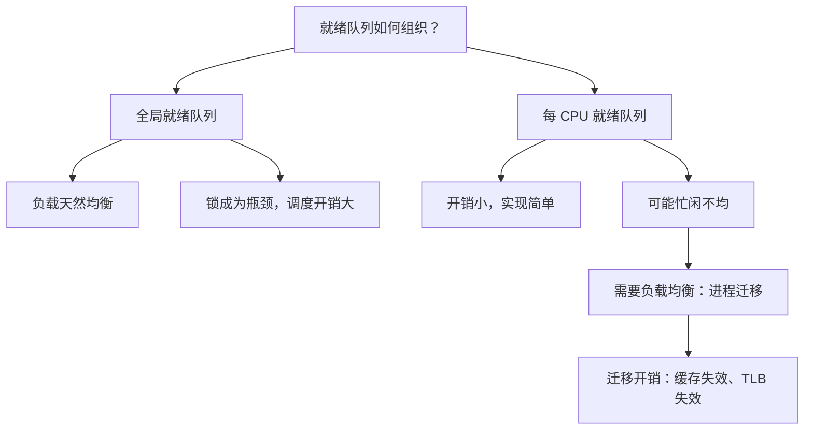

### 进程迁移的开销

负载均衡的做法是**进程迁移**：一个进程原来在某个 CPU 上运行，当别的 CPU 空闲时，把它移到那个 CPU 上去运行。迁移不是免费的。

- **高速缓存失效**：进程在 CPU1 上运行时，它的数据和指令已经装入 CPU1 的缓存。被调度到 CPU2 后，CPU2 的缓存里没有这些内容，开始阶段会大量缺失。
- **TLB 失效**：CPU1 的 TLB 中缓存了该进程的地址转换项，换到 CPU2 后要重新建立。

如果每个进程可以被调度到所有 CPU 上，进程上次在 CPU1、这次在 CPU2 运行，就会增加高速缓存失效和 TLB 失效；如果每个进程尽量调度到指定的 CPU 上，这些失效就会减少。所以基本思路是：**尽可能使进程总是在同一个 CPU 上执行**，同时兼顾负载均衡。这两个目标相互冲突，[多核缓存问题与负载均衡](#多核缓存问题与负载均衡)一章专门讨论这个矛盾及其解法。

### 静态分配与动态分配

把上面的讨论落到 SMP 的进程分配方式上，有两种基本方案：

| 维度     | 静态进程分配                             | 动态进程分配                           |
| -------- | ---------------------------------------- | -------------------------------------- |
| 分配方式 | 进程从开始到结束都固定在一个处理机上执行 | 进程在执行中可分配到任意空闲处理机执行 |
| 队列组织 | 每个处理机有自己的就绪队列               | 所有处理机共享一个公共就绪队列         |
| 调度开销 | 小（无全局锁、无迁移）                   | 大（需加锁，且有迁移带来的失效开销）   |
| 负载情况 | 各处理机可能忙闲不均                     | 各处理机负载均衡                       |

**静态进程分配**（static assignment）完全不考虑负载均衡，因此开销小，代价是“忙的忙、闲的闲”。**动态进程分配**（dynamic assignment）哪个处理机空闲进程就去哪个，负载均衡，但要承担锁的开销以及高速缓存失效、TLB 失效的开销。

> [!warning] 易错点
> “动态分配负载均衡”不等于“动态分配性能更好”。动态分配的均衡是用锁竞争和频繁迁移（缓存、TLB 失效）换来的；当进程很多、CPU 很多时，全局队列的锁可能反而拖慢整体。openEuler 等实际系统采用每 CPU 队列加上有节制的迁移（见 [多核缓存问题与负载均衡](#多核缓存问题与负载均衡)）。

> [!question]- 自测：一台 32 核服务器采用单一全局就绪队列，管理员发现 CPU 利用率不高、但就绪进程很多。最可能的原因是什么？
> 最可能是全局就绪队列的锁成为瓶颈。每个 CPU 选进程前都要先拿到这把锁，32 个核争抢同一把锁，大量时间花在等锁上。负载虽然“均衡”，CPU 却没在干活。

> [!question]- 自测：进程 P 上次在 CPU1 上运行，现在 CPU1 忙、CPU2 空闲。把 P 调度到 CPU2 上一定比在 CPU1 上排队等待更好吗？
> 不一定。迁移到 CPU2 能马上运行，但要付出高速缓存失效和 TLB 失效的代价。如果 P 在 CPU1 上很快就能再次运行，而且它依赖大量已缓存的数据，留在 CPU1 可能更划算。是否迁移要权衡等待时间和迁移开销。

---

## 多核缓存问题与负载均衡

> [!abstract] 本节要点
>
> - 多核下 L1/L2 缓存通常每核私有、L3 共享，缓存与主存的关系变了，于是出现四个问题：缓存一致性、缓存亲和性、核间数据共享、负载均衡。
> - 缓存一致性：P1、P2 各自缓存 $X=0$ 后各做 $X=X+1$，结果应为 2，却可能因缓存未同步而得到 1；硬件用 MESI 协议保证一致。
> - 缓存亲和性要求进程尽量留在同一核心上以复用缓存，负载均衡却要把任务迁走，两者天然矛盾（例：并行计算/图像渲染、CDN 缓存）。
> - 作业偷取（Work Stealing）：先执行本地队列，本地队列空时由空闲处理器主动从忙碌处理器的队列中“偷”任务；Go 的 GMP 调度器就是这样做的。
> - YARN 把任务放到存有所需数据的节点上（数据亲和），并由 ResourceManager 汇总资源、多队列分配；openEuler 用每 CPU 多队列，并通过迁移线程 migration/CPUID 做负载均衡。

### 多核缓存结构与四个问题

[多处理器调度的基本问题](#多处理器调度的基本问题)已经指出迁移会造成缓存失效。要看清代价从哪来，需要先看多核处理器的缓存结构。

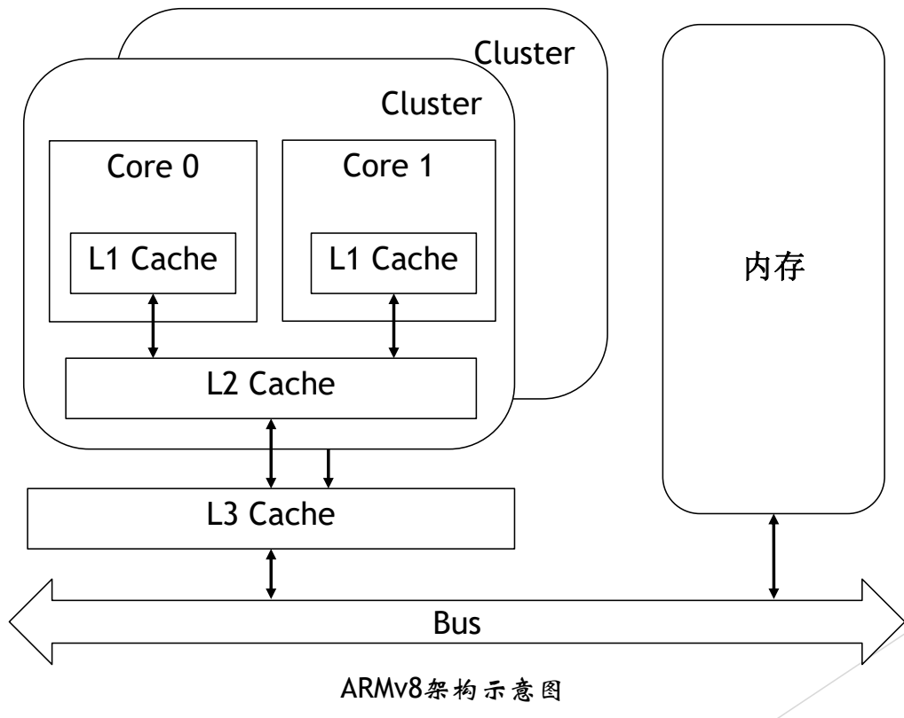

图：ARMv8 多核示意，Core 0/Core 1 各有私有 L1 Cache，同一 Cluster 共享 L2 Cache，多个 Cluster 共享 L3 Cache，再经 Bus 连接内存；看缓存逐级共享的范围。

以 ARMv8 架构为例：每个核心（Core 0、Core 1……）有自己私有的 L1 Cache；若干核心组成一个 Cluster，共享该 Cluster 的 L2 Cache；各 Cluster 通过总线（Bus）共享 L3 Cache，再连到内存。数据从内存先进入缓存，处理器再从缓存中取用。

缓存和主存的这种关系带来四个问题：

1. **缓存一致性问题**：同一个内存数据可能在多个核的私有缓存中各有一份副本。
2. **缓存亲和性问题**：进程在某个核上运行时，这个核的缓存对它“友好”；换一个核，缓存就对它不友好。
3. **核间数据共享**：多个核要共享同一份数据。
4. **负载均衡**：各核的工作量要大致均衡。

这些因素都是在前面单处理器调度算法的考虑之外新增的。

### 缓存一致性与 MESI

**缓存一致性**（cache coherence）指同一内存数据在多个缓存中的副本必须保持一致，否则各处理器会读到不同的值。

> [!info] 可视化资源
>
> - [维基百科：MESI protocol](https://en.wikipedia.org/wiki/MESI_protocol)：看 M/E/S/I 四种状态定义与状态转换图，理解硬件如何避免 X 被两个核各加 1 却只得 1。

> [!example] 例：两个处理器同时给 X 加 1
> 设共享数据 $X$ 初值为 0，P1 和 P2 都读取并修改它。
>
> 1. P1 读 $X$，P1 的缓存中 $X=0$；P2 读 $X$，P2 的缓存中 $X=0$。
> 2. P1 执行 $X=X+1$，P1 的缓存中 $X=1$。
> 3. P2 执行 $X=X+1$，它用的是自己缓存中的旧值 0，P2 的缓存中也是 $X=1$。
> 4. 两次加法后正确结果应为 $X=2$，但由于两个缓存没有同步，最终写回内存的可能是 1。

解决办法是由硬件通过协议保证一致性，常用的是 **MESI 协议**。它根据缓存行中的数据是否被修改过、是否与内存中的数据一致等信息来维护各缓存的副本。

> [!note] 补充解释
> MESI 是缓存行四种状态的首字母：**M**odified（已修改，只有本缓存有，与内存不一致）、**E**xclusive（独占，只有本缓存有，与内存一致）、**S**hared（共享，多个缓存都有，与内存一致）、**I**nvalid（无效）。一个核要写某行时，先让其他核中该行的副本变为 Invalid。上例中 P2 的旧副本 $X=0$ 会因此失效，P2 必须重新获得最新值 1 再加 1，结果就是 2。课程只要求知道问题和协议名称。

### 缓存亲和性与负载均衡的矛盾

**缓存亲和性**（cache affinity）指在多核处理器系统中，让特定进程或线程尽可能在同一个处理器核心上运行，以最大程度利用之前已经加载到该核心缓存中的数据，提高数据访问速度和系统整体性能。

负载均衡可能会改变亲和性：为了让各核忙闲均匀而把任务迁到别的核，原来缓存里的数据就用不上了，会带来性能损失。两者总是矛盾的，下面两个例子分别来自计算任务和网络服务。

**例 1：多核并行计算 / 图像渲染**

1. 把一部分数据对应的计算任务分配到某个核上。这部分数据被频繁访问，留在该核的缓存里，访问速度很快。
2. 但不同部分的计算量可能并不均匀，导致各核负载不同。
3. 于是把负载重的核上的部分计算任务转移到负载轻的核上，让大家同时计算，使整体计算时间最小化。
4. 代价是：被转移的任务在新核上会遇到额外的缓存不命中。

**例 2：CDN 缓存**

1. 按用户或地区，把常被访问的数据（如视频、商品详情）缓存到对应的 CDN 服务器上，加快用户访问。
2. 当某地服务器负载较大时，可能把该地区用户的请求路由到其他地区的服务器。
3. 代价是：其他地区的服务器上没有这些内容，增加了内容缓存不命中的开销。

两个例子结构相同：亲和带来命中率，均衡带来并行度，任何调度策略都要在两者之间折中。

> [!tip] 课堂强调
> 调度这部分讨论问题要把各种因素都考虑进去。要学的是一种思路：先把问题找出来，再去讨论它，而不是只给出一个答案就结束。

### 作业偷取

**作业偷取**（Work Stealing）的核心思想是：让空闲的处理器从忙碌的处理器那里“偷取”任务来执行，使各处理器的负载相对均衡。 它是每 CPU 队列结构下实现负载均衡的一种常见手段。

流程如下：

1. **初始分配**：任务按照一定策略分配到多个处理器各自的待执行队列（ready 队列）里。
2. **本地优先**：每个处理器优先执行本地队列里的任务，从而保持亲和性。
3. **空闲时偷取**：当某个处理器的本地待执行队列为空时，它去其他处理器的待执行队列里“偷取”任务来执行。

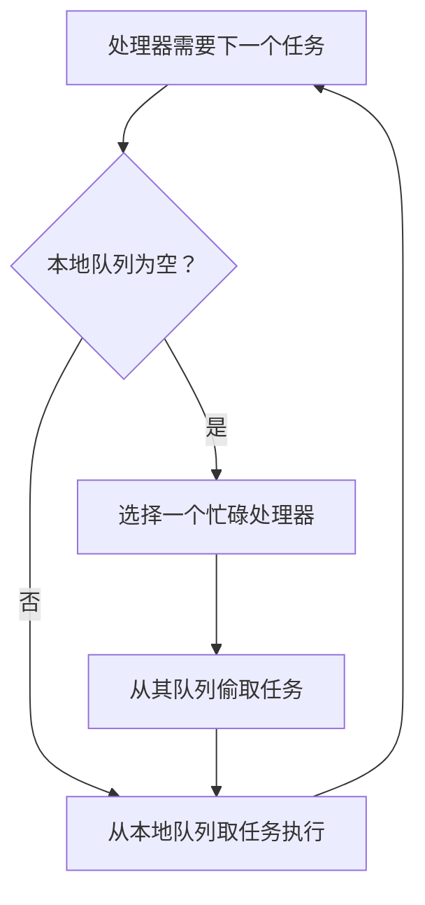

偷取是**空闲方主动去拿**，而不是忙碌方把任务推出去。

> [!note] 补充解释
> 幻灯片在此留有“优点/缺点？”的设问，课堂没有展开。按本章的分析可以这样归纳：**优点**是只有空闲时才发生迁移，平时任务留在本地，兼顾了亲和性与负载均衡；均衡工作由闲着的处理器承担，忙碌处理器不必花时间判断该推走谁；也没有全局队列锁。**缺点**是被偷走的任务失去缓存亲和性；偷取时要访问别人的队列，仍需同步；选错“受害者”（例如偷到一个马上就会结束的任务）会白白付出开销。

### 应用实例：Go GMP 与 Hadoop YARN

调度思想不只存在于操作系统的进程调度中，在很多层次都有。下面两个实例都体现了“亲和性 + 偷取或多队列分配”。

> [!info] 可视化资源
>
> - [Go 运行时 HACKING 文档：Scheduler structures](https://go.dev/src/runtime/HACKING)：看 Scheduler structures 一节：G（goroutine）、M（OS 线程）、P（执行资源，数量为 GOMAXPROCS，类似每 CPU 状态）的分工。

**Go 语言 GMP 调度器**：GMP 调度器是 Go 运行时系统的核心部分，用来管理和调度 Goroutine（Go 的协程），类似于操作系统内核管理和调度进程/线程，也类似用户级线程由 run-time system 调度。 其中 G 是 Goroutine，M 是内核线程，P 是逻辑处理器（调度上下文）。它的做法是：

- 尽量把 Goroutine 调度到之前访问过相同数据的同一处理器上执行；
- 尽量把 Goroutine 调度到之前执行它的同一个 P 所绑定的内核线程 M 上运行，以保持缓存亲和性；
- 每个 P 维护一个本地 Goroutine 队列；本地队列执行完后，尝试从其他 P 的本地队列中窃取 Goroutine 来执行，这正是作业偷取。

**Hadoop YARN**：YARN 是一种调度与资源管理框架，在分布式节点层面做调度。

- **NodeManager** 管理本节点上的资源和容器，与 HDFS 等分布式文件系统协作，保证数据在多个节点之间的缓存一致性；并把需要处理相同数据的任务分配到存储有该数据的节点上，以提高缓存利用率（数据亲和）。
- **ResourceManager** 收集各节点 NodeManager 上报的资源使用情况，协调任务的资源需求，把任务分配到不同节点上：哪个节点空闲，就往哪里分配。
- YARN 支持**多队列调度**，不同队列可以设置不同的资源分配策略。

| 维度       | Go GMP                     | Hadoop YARN                          |
| ---------- | -------------------------- | ------------------------------------ |
| 调度层次   | 语言运行时，调度 Goroutine | 分布式集群，调度任务到节点           |
| 亲和的对象 | 处理器缓存（同一 P/M）     | 数据所在节点（数据本地性）           |
| 均衡手段   | 本地队列空时从其他 P 窃取  | ResourceManager 汇总资源，多队列分配 |

### openEuler 的单队列、多队列与迁移线程

> [!info] 依据讲义整理
> 本小节对应讲义中 openEuler 多核调度的几页，课堂未讲解。其中 ARMv8 多核示意图和“多核处理器系统面临的问题”两页与本章开头内容相同，不再重复。

**单队列调度**：设有 5 个就绪进程 A、B、C、D、E 排在一个全局队列中，由 4 个 CPU 共同调度。

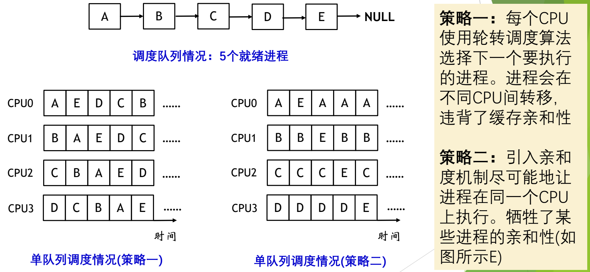

图：5 个就绪进程 A–E 组成单一队列，左侧策略一中进程在 CPU0–CPU3 间轮转迁移，右侧策略二借助亲和度让 A、B、C、D 基本固定在各自 CPU，只有 E 在多个 CPU 间移动。

- **策略一**：每个 CPU 使用轮转调度算法从公共队列中选择下一个要执行的进程。从图中可见，进程会在不同 CPU 之间轮流转移（如 A 依次出现在 CPU0、CPU1、CPU2……），违背了缓存亲和性。
- **策略二**：引入亲和度机制，尽可能让进程在同一个 CPU 上执行：A 基本留在 CPU0，B 留在 CPU1，以此类推。5 个进程分到 4 个 CPU 上总有一个要“流动”，图中由 E 在各 CPU 之间轮转填补空位。即牺牲了某些进程（如 E）的亲和性，换取其余进程的亲和性。

**多队列调度**：openEuler 使用多队列调度策略，每个 CPU 维护自己的队列，例如队列 Q0 由 CPU0 维护，Q1 由 CPU1 维护。

1. 调度之初：Q0 中有 A、C，Q1 中有 B、D，各 CPU 在本地队列中采用轮转调度。CPU0 上 A、C 交替运行，CPU1 上 B、D 交替运行。
2. 一段时间后，假设 A、C 两个进程都结束了，Q0 为空，Q1 中仍有 B、D：CPU0 空闲而 CPU1 上有两个进程，负载失衡。

这正是[多处理器调度的基本问题](#多处理器调度的基本问题)中每 CPU 队列“忙闲不均”的具体表现。

**迁移线程**：解决多 CPU 负载不均衡最直接的方法是让就绪进程跨 CPU 迁移。上例中把进程 D 迁移到 CPU0 上运行，CPU0 和 CPU1 就实现了负载均衡。在 openEuler 中，每个处理器都有一个**迁移线程**（名为 `migration/CPUID`），每个迁移线程有一个由函数组成的**停机工作队列**（stopper work queue）。 迁移过程如下：

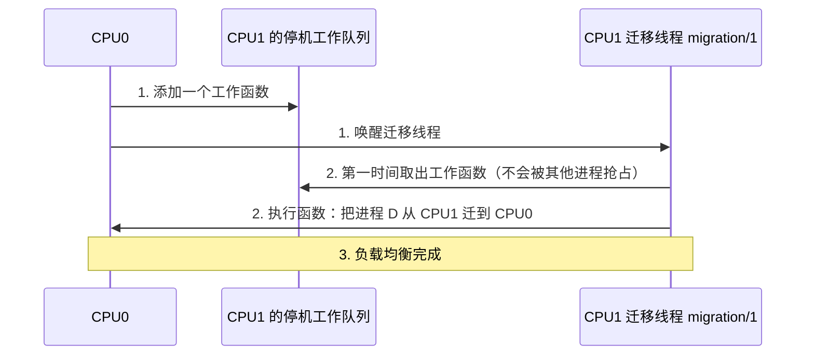

1. CPU0 向 CPU1 的停机工作队列中添加一个工作函数，并唤醒 CPU1 上的迁移线程。
2. 该迁移线程不会被其他进程抢占，因此能第一时间从停机工作队列中取出函数执行，把进程从 CPU1 迁移到 CPU0。
3. 此时实现负载均衡。

注意这里由空闲的 CPU0 发起迁移，思路与作业偷取一致。

> [!question]- 自测：两线程程序在双核机器上反复对同一全局计数器做 `count++`（未加锁），运行结束后计数常小于预期。只靠 MESI 协议能否解决这个问题？
> 不能完全解决。MESI 保证的是每个缓存行的副本最终一致，不会出现“各写各的副本、永远不同步”。但 `count++` 是“读—加—写”三步，两个核可能都读到同一个旧值再各自写回，这是并发访问的原子性问题，仍需要锁或原子指令来保证同步。

> [!question]- 自测：在作业偷取中，若每个处理器总是从别人队列里偷“刚加入、尚未运行过”的任务，而不是偷“已运行过一段时间”的任务，对缓存亲和性有什么影响？
> 影响更小。没运行过的任务在原处理器的缓存中还没有积累数据，偷到哪里都要从头装入缓存，迁移几乎不损失亲和性；已运行过的任务在原处理器缓存中有热数据，被偷走会造成额外的缓存不命中。

---

## 实时调度

> [!abstract] 本节要点
>
> - 实时系统的关键参数是时间：对外部请求在严格时间范围内作出反应，并且高可靠；实时任务的核心特点是确定性（能否在截止时间前完成是明确的）。
> - 硬实时要求动作绝对必须在规定时刻或时间范围内完成（如汽车装配线）；软实时接受偶尔违反时限（如边下边播的视频）。
> - $m$ 个周期事件可调度的必要条件是 $\sum_{i=1}^{m} C_i/P_i \le 1$，即 CPU 利用率不超过 100%。
> - RM 是静态优先级算法，周期越短优先级越高；$n$ 个任务满足 $U \le n(2^{1/n}-1)$ 时一定可调度，$n\to\infty$ 时上界约为 0.693。
> - EDF 是动态优先级算法，截止时间最早者优先，能在期限前完成全部任务、响应好，但每次要重新计算期限，开销和实现复杂度更高。

### 实时任务与实时系统

前面讨论的调度算法关心公平、响应时间、吞吐量；**实时系统**（real-time system）关心的是另一件事：请求到来后，必须在严格的时间范围内作出响应，不能把它晾着、让它饥饿。

实时系统的特征是：**关键参数是时间**。它追求两个目标：

- 对外部请求在严格时间范围内作出反应；
- 高可靠性。

实时任务最重要的特点是**确定性**：实时任务的完成时间是明确的，即能否在截止时间之前完成是可以确定的。

按对截止时间的要求，实时系统分为两类：

- **硬实时**（hard real-time）系统：某个动作绝对必须在规定的时刻或时间范围内完成。典型例子是工业过程控制系统，如汽车装配线：车到某个工位，必须在规定时间内把轮子装上、把螺丝拧紧到规定的圈数；拧的圈数不够，螺丝会松动，就会出问题。这个动作不能晚于规定时间完成。
- **软实时**（soft real-time）系统：可以接受偶尔违反最终时限。例如边下载边播放的网络视频，视频一帧一帧传来，网络偶尔卡顿一下、偶尔违反了时间限制，并不影响观看。

按到达方式，实时任务又分为**周期性任务**、**偶发性任务**和**非周期性任务**。实时系统面对的多数是周期性任务，下面的可调度性分析和 RM 都以周期任务为前提。

典型的实时调度算法只有两个：**速率单调**（RM）和**最早截止时间优先**（EDF）。现在很多嵌入式系统也就使用这两种，或在它们基础上稍加改变。

### 可调度性

一个系统可能要同时响应多个周期性事件流。根据每个事件需要的处理时间长短，系统甚至有可能根本无法处理完所有事件。因此要先判断：任务集合有没有可能全部按时完成？

设有 $m$ 个周期事件，事件 $i$ 以周期 $P_i$ 发生，每发生一次需要 $C_i$ 秒 CPU 时间来处理。系统能够处理这些负载的条件是：

$$
\sum_{i=1}^{m} \frac{C_i}{P_i} \le 1
$$

满足这个条件的实时系统称为**可调度的**（schedulable）。

式中 $C_i/P_i$ 是事件 $i$ 占用 CPU 的时间比例（单位时间内要花多少 CPU 时间处理它），求和就是 CPU 的总利用率 $U$。条件的含义是：所有周期任务加起来，对 CPU 的需求不能超过 100%。

这是一个**必要条件**：$U>1$ 时，无论用什么调度算法都必然有任务错过截止时间；$U\le 1$ 只说明“有可能”全部按时完成，能否做到还取决于调度算法。

> [!example] 例：判断利用率
> 三个周期任务：$(C_1,P_1)=(1,4)$、$(C_2,P_2)=(2,6)$、$(C_3,P_3)=(1,8)$，单位 ms。
>
> 1. $U = \frac{1}{4} + \frac{2}{6} + \frac{1}{8} = 0.25 + 0.333 + 0.125 \approx 0.708$。
> 2. $U \le 1$，满足可调度性条件。若再加入任务 $(3,10)$，$U \approx 1.008 > 1$，则一定不可调度。

### 速率单调 RM

**速率单调**（Rate-Monotonic, RM）是一种**静态优先级**调度算法：每个任务的优先级在开始前就确定，运行中不变，调度时总是运行就绪任务中优先级最高的那个。

- **前提条件**：所有任务都是周期性的，且任务的执行时间已知。
- **优先级分配**：周期越短（即发生速率越高）的任务优先级越高。“速率单调”说的就是优先级随任务的发生速率单调递增。

> [!note] 补充解释
> 幻灯片和课堂讲述都说 RM 中“执行时间较短的任务具有更高的优先级”，这与 RM 的经典定义（Liu 和 Layland，1973）不符。RM 按**周期**分配优先级：周期 $P_i$ 越短，优先级越高，与执行时间 $C_i$ 无关。下文的利用率上界也是在这一定义下成立的。

**充分条件**：对 $n$ 个周期任务，若 CPU 利用率满足

$$
U = \sum_{i=1}^{n} \frac{C_i}{P_i} \le n\left(2^{1/n} - 1\right)
$$

则 RM 一定能保证所有任务都不错过截止时间。 上界随 $n$ 增大而减小：

| $n$            | 1     | 2     | 3     | $\to\infty$           |
| -------------- | ----- | ----- | ----- | --------------------- |
| $n(2^{1/n}-1)$ | 1.000 | 0.828 | 0.780 | $\ln 2 \approx 0.693$ |

也就是说，只要 CPU 利用率在约 70% 以内，RM 一定能让所有任务按时完成。利用率超过这个上界（但不超过 1）时，任务集合**也可能**可调度，只是不能保证，要具体分析。这个上界不在幻灯片上，由课堂补充。

> [!warning] 易错点
> 两个条件方向相反，不要混淆：$\sum C_i/P_i \le 1$ 是**必要条件**（不满足一定不可调度）；$U \le n(2^{1/n}-1)$ 是 RM 的**充分条件**（满足一定可调度）。落在两者之间的任务集合，需要画出调度时间线才能判断。

> [!example] 例：超过上界仍可调度
> 两个任务 $T_1=(C_1,P_1)=(2,4)$，$T_2=(C_2,P_2)=(2,5)$，截止时间等于周期。$U=0.5+0.4=0.9$，大于 $n=2$ 时的上界 0.828，RM 不能保证。按 RM，$T_1$ 周期短、优先级高。在最小公倍数 20 内逐段模拟：
>
> 1. $[0,2]$ 运行 $T_1$；$[2,4]$ 运行 $T_2$，在 4 完成（截止 5）。
> 2. $[4,6]$ 运行 $T_1$（截止 8）；$T_2$ 第二次在 5 到达，$[6,8]$ 运行，在 8 完成（截止 10）。
> 3. $[8,10]$ 运行 $T_1$；$[10,12]$ 运行 $T_2$（截止 15）；$[12,14]$ 运行 $T_1$；$[14,15]$ 空闲。
> 4. $T_2$ 在 15 到达，$[15,16]$ 运行 1 ms；$T_1$ 在 16 到达并抢占，$[16,18]$ 运行；$[18,19]$ 运行 $T_2$ 剩余的 1 ms，在 19 完成（截止 20）。
>
> 所有任务都按时完成，说明超过上界不等于不可调度。

### 最早截止时间优先 EDF

RM 的优先级是事先固定的，可能出现“周期短的任务优先，却让截止时间更紧的任务错过”的情况。**最早截止时间优先**（Earliest Deadline First, EDF）改为在运行时动态决定优先级。

> [!info] 可视化资源
>
> - [维基百科：Earliest deadline first scheduling](https://en.wikipedia.org/wiki/Earliest_deadline_first_scheduling)：看三个周期任务的时序图（利用率 92.5% 仍可调度），以及 EDF 可达 100%、RM 约 69% 的对比段落。

- **动态优先级**：根据任务的最后期限（Deadline）和剩余执行时间来分配优先级，最先到期的任务优先级最高。每当有任务到达或完成，就按当前各任务的截止时间重新排序。
- **优点**：可以在任务最后期限之前完成所有任务，并具有较好的响应时间。
- **缺点**：实现复杂度较高。需要对每个任务的最后期限进行精确估计，而最后期限可能随时间变化，每次调度都要重新计算，带来时间和空间上的额外开销。

> [!note] 补充解释
> 在单处理器、允许抢占、各任务截止时间等于其周期的条件下，EDF 的可调度条件就是 $\sum C_i/P_i \le 1$：只要利用率不超过 100%，EDF 就能让所有任务按时完成。这就是“可以在最后期限前完成所有任务”的确切含义，也是它比 RM 更能充分利用 CPU 的原因。

> [!example] 例：RM 失败而 EDF 成功
> $T_1=(C_1,P_1)=(2,5)$，$T_2=(C_2,P_2)=(4,7)$，截止时间等于周期，$U = 0.4 + 0.571 \approx 0.971 \le 1$。
>
> **RM**（$T_1$ 周期短，优先级高）：$[0,2]$ 运行 $T_1$；$[2,5]$ 运行 $T_2$ 共 3 ms；5 时 $T_1$ 再次到达并抢占，$[5,7]$ 运行 $T_1$。到 7 时 $T_2$ 还差 1 ms，**错过截止时间 7**。
>
> **EDF**：
> 1. 0 时截止时间 $T_1$ 为 5、$T_2$ 为 7，$[0,2]$ 运行 $T_1$。
> 2. $[2,5]$ 运行 $T_2$；5 时 $T_1$ 新实例截止 10，晚于 $T_2$ 的 7，$T_2$ 继续运行到 6 完成。
> 3. $[6,8]$ 运行 $T_1$，在 8 完成（截止 10）；$T_2$ 在 7 到达（截止 14），$[8,12]$ 运行完成。
> 4. $T_1$ 在 10 到达（截止 15），$[12,14]$ 运行完成。
>
> EDF 让当时最紧迫的 $T_2$ 先完成，两个任务都按时完成。

| 维度           | RM                                      | EDF                                  |
| -------------- | --------------------------------------- | ------------------------------------ |
| 优先级         | 静态，按周期（越短越高）                | 动态，按当前截止时间（越早越高）     |
| 前提           | 周期任务，执行时间已知                  | 需要精确估计每个任务的最后期限       |
| 可保证的利用率 | $U \le n(2^{1/n}-1)$，大 $n$ 时约 0.693 | 可在期限前完成全部任务（见补充解释） |
| 开销与实现     | 小，优先级一次定好                      | 大，每次要重新计算期限               |

> [!question]- 自测：四个周期任务的利用率之和为 0.75，用 RM 调度，能否断定它们都能按时完成？
> 能。$n=4$ 时 $n(2^{1/n}-1)=4(2^{0.25}-1)\approx 0.757$，而 $0.75 \le 0.757$，满足 RM 的充分条件，所以一定可调度。若利用率为 0.80，则只能说满足必要条件，RM 能否成功需要画时间线分析。

> [!question]- 自测：任务 $T_a=(C,P)=(1,3)$，$T_b=(3,10)$。按 RM，哪个任务优先级更高？如果误按“执行时间短者优先”来分配，结果是否一样？
> 按 RM，周期 3 比 10 短，$T_a$ 优先级更高。这个例子里 $T_a$ 的执行时间也更短，两种规则恰好给出相同结果，所以要换一个例子来区分。比如 $T_x=(3,4)$ 与 $T_y=(2,20)$：按执行时间会让 $T_y$ 优先，$[0,2]$ 运行 $T_y$，$T_x$ 到 5 才完成，错过截止时间 4；按 RM 则 $T_x$ 优先，$[0,3]$ 运行 $T_x$，$[3,4]$ 运行 $T_y$，$[4,7]$ 再运行 $T_x$，$[7,8]$ 运行完 $T_y$，两者都按时完成。

---

## Linux 2.4 与 O(1) 调度器

> [!abstract] 本节要点
>
> - Linux 进程分为**实时进程**（FIFO、RR，优先级总高于普通进程）和**普通进程**（交互式、批处理）；普通进程调度的难点是照顾交互式进程。
> - 调度器演化：2.4 → 2.6 的 O(1) → SD 补丁 → RSDL 补丁 → CFS → EEVDF；主线是从“猜谁是交互式进程”转向“完全公平”。
> - 2.4：单一 runqueue，每次遍历全部进程比较优先级；优先级由 counter（剩余时间片）与 nice 决定；所有可运行进程的时间片都用完后统一重算，睡眠进程未用完的 counter 被累加，从而获得更高优先级。
> - 2.4 的缺点：选择与重算开销随进程数增长（可扩展性差）、高负载性能低、以睡眠时长界定交互式不准确、内核非抢占对实时支持不足。
> - O(1)：每个 CPU 两个按优先级组织的数组 active/expired，配合位图在常数时间内选出最高优先级进程；时间片用完的进程移入 expired，active 为空时交换指针；但基于平均睡眠时间的经验公式难懂、区分交互式仍常失效。

### Linux 的进程分类

调度算法先要回答“为谁优化”。Linux 把进程分成两类，分别走不同的调度路线。

- **实时进程**：对调度延迟要求最高，要求立即响应并执行；调度策略是 FIFO 和 Round Robin（RR）。
- **普通进程**：
  - **交互式进程**：间或处于睡眠态，对响应速度要求比较高；
  - **批处理进程**：在后台执行，能够忍受响应延迟。
  - 普通进程的调度策略是 CFS（见 [CFS 完全公平调度](#cfs-完全公平调度)）。

批处理进程不在乎延迟，因此普通进程调度真正的关注点是交互式进程。交互式进程有两个特征：**行为**上它在睡眠态与就绪态之间反复切换（典型的 I/O 型进程）；**目标**上它要求对用户的操作尽快给出回应。后面各代调度器的差别，主要就在于如何对待这类进程。

> [!warning] 易错点
> Linux 的“实时进程”和 Windows 优先级 16–31 的“实时”线程一样，不是[实时调度](#实时调度)意义上“必须在截止时间前完成”的实时任务。它只表示优先级比普通进程高、就绪后要尽快运行（多为服务用户的系统任务），因此不与普通进程共用算法，直接按 FIFO 或 RR 调度。Windows 的优先级分类见 L07「07 Windows 线程调度」。

#### openEuler 中的调度

openEuler 的调度概念与前面所学一致：

1. **CPU 调度**（进程调度）是操作系统在必要时中断当前进程、从就绪进程中选出一个占用 CPU 的过程；完成选择的程序叫**调度程序**（Scheduler），它依据**调度策略**（Scheduling Policy）决定何时、以何种方式选出新进程。有多个 CPU 或多核时，调度程序还要考虑核间的数据共享与数据同步。
2. 常见算法有 FIFO/FCFS、SJF、RR 和优先级调度；openEuler 联合使用 FIFO、RR 和优先级调度来调度**实时进程**。
3. openEuler 中大部分进程是普通进程，更需要公平性，核心策略“标准轮流分时调度策略”采用 **CFS**（Completely Fair Scheduler）：它使用时间片和优先级的概念，并引入虚拟运行时间，按系统负载和进程优先级分配 CPU 使用比例，保证普通进程的相对公平。

### 调度器的演化脉络

前面只列过名字的公平分享调度、保证调度等算法都指向同一件事：**公平**——CPU 是所有进程共享的，整体上每个进程对 CPU 的使用应当公平。 Linux 调度器的历史，就是在“优待交互式进程”和“公平、简单、低开销”之间不断调整的过程。


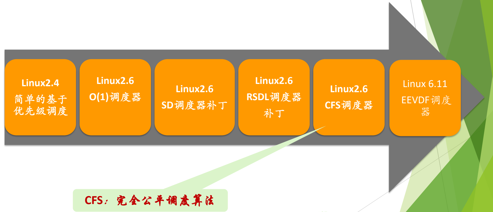

图：Linux 调度器演化顺序：2.4 简单的基于优先级调度 → 2.6 O(1) → SD 补丁 → RSDL 补丁 → CFS → 6.11 EEVDF；CFS 即完全公平调度算法。

> [!note] 补充解释
> 图中“Linux 6.11 EEVDF”是讲义的标注；主线内核中 EEVDF 实际于 Linux 6.6 合入，版本更正见 [CFS 情景分析与 EEVDF](#cfs-情景分析与-eevdf)。另外，SD 与 RSDL 是 Con Kolivas 维护的树外补丁，从未进入主线；主线在 Linux 2.6.23 由 O(1) 直接换成 CFS。图中把它们画成“Linux 2.6 补丁”，表示的是思想上的演化顺序。
演化的几个关键转折：

1. **2.4** 基于优先级，统治时间很长，但优先级计算越来越难解读。
2. **O(1)** 着眼于“选人要快”：调度算法本身也有开销，如果选一个进程要花很久，还不如直接选第一个。O(1) 选得快、开销小，但考虑的因素太简单，很快被替代。
3. **SD、RSDL** 是此后的两个补丁，放弃动态优先级，转向完全公平（见 [楼梯调度 SD 与 RSDL](#楼梯调度-sd-与-rsdl)）。
4. **CFS** 在此基础上长期落地；最新内核（新版 Ubuntu 也已跟进）切换到 **EEVDF**，但其核心思想仍是 CFS，相当于为 CFS 未考虑到的问题打补丁（见 [CFS 情景分析与 EEVDF](#cfs-情景分析与-eevdf)）。

### Linux 2.4 调度器

**Linux 2.4 调度器**的结构可以概括为 RunQueue + 时间片 + 优先级：

1. **选择**：对 runqueue 中所有进程的优先级依次比较，选优先级最高者作为下一个被调度的进程。
2. **时间片**：进程创建时被赋予一个时间片；每次时钟中断递减当前运行进程的时间片，时间片就是一个定时器，减到 0 就必须切换下去，等待重新赋予时间片才能再运行。
3. **统一重算**：只有当所有 RUNNING 进程的时间片都用完之后，才对所有进程重新分配时间片。这与轮转（RR）“转完一圈再来一圈”的思想一致，保证每个进程都有机会执行。

#### counter 与 nice

普通进程的优先级由进程描述符中的 **counter** 字段与 **nice** 设定的静态优先级共同决定。

- **counter** 就是时间片（剩余的时钟滴答数），每个进程的值可能不同，并随每轮重算而变化；counter 越大，优先级越高。
- **nice** 沿用自最初的 UNIX，表示进程的静态“负向”优先级，取值范围为 $-20 \sim 19$，$-20$ 优先级最高：nice 值越小，优先级越高。

> [!note] 补充解释
> 课堂口述的 nice 范围是“$-19$ 到 $20$”，这里按讲义改为 Linux 实际使用的 $-20 \sim 19$。 讲义把优先级简写为“counter + nice”，意思是两者共同决定优先级；由于 nice 越小优先级越高，2.4 内核源码中普通进程的权值（`goodness()`）实际约为 $\text{counter} + 20 - \text{nice}$，即 counter 越大、nice 越小，越优先。

**对睡眠进程的优待**：重算时不仅 RUNNING 进程，处于睡眠状态的进程也要重算 counter。睡眠进程的 counter 本来没有用完，重算时会加上这些未用完的部分，于是优先级提高——系统试图用这种方式提高交互式进程的响应速度。

实时进程的规则不同：实时进程的 counter 用完后立刻重置并放回就绪队列；非实时进程则要等 runqueue 中所有进程的时间片都用完，才统一重新计算 counter。

> [!note] 补充解释
> 2.4 源码中的重算公式是 `p->counter = (p->counter >> 1) + NICE_TO_TICKS(p->nice);`，即“剩余 counter 的一半 + 由 nice 决定的基准时间片”。因此长期睡眠的进程 counter 会逐轮累积，但上限不超过基准值的 2 倍，不会无限增长。

> [!example] 例：两个进程经过一轮重算
> 设 A、B 的 nice 相同，基准时间片都对应 counter $=6$。
>
> 1. A 是计算型进程，一直运行到 counter $=0$；B 运行了 2 个滴答后进入睡眠，counter 停在 $4$。
> 2. 所有可运行进程的时间片用完，触发重算：A 的新 counter $=0/2+6=6$，B 的新 counter $=4/2+6=8$。
> 3. B 的 counter 更大，优先级更高，醒来后更容易被先选中——这就是 2.4 对睡眠进程的“优待”。

#### 2.4 的缺点

讲义列出四个缺点，并指出 2.4 内核是**非抢占**的：

1. **可扩展性不好**：每次选择都要遍历 runqueue，每轮重算要遍历所有进程，队列里有 100 个进程和 1000 个进程时开销不同，算法开销与进程数量相关。
2. **高负载系统上调度性能低**：这一结论来自 benchmark 测试数据。
3. **交互式进程的优化不完善**：用睡眠时间代表“交互式”并不合理，睡眠时间长的进程不一定是交互式进程。
4. **对实时进程支持不够**：内核非抢占，高优先级的实时进程到来后也不能立即抢占正在运行的进程。

为解决这些问题，Ingo Molnar 开发了新的 O(1) 调度器。

### O(1) 调度器

**O(1) 调度器**在两个方面修改了 2.4 调度器：进程优先级的计算方法和 pick next 算法。

#### 优先级计算

O(1) 继续试图识别交互式进程，但换成了基于**平均睡眠时间**的经验公式：

- **普通进程**：平均睡眠时间用来判断进程是否是交互式进程；平均睡眠时间越长，其 bonus 越大，优先级越高。
- **实时进程**：优先级不会动态修改，而且总比普通进程高。

$$
\text{动态优先级} = \max\bigl(100,\ \min(\text{静态优先级} - \text{bonus} + 5,\ 139)\bigr)
$$

$$
\text{动态优先级} \le \frac{3 \times \text{静态优先级}}{4} + 28
$$

这里优先级是“数值越小越优先”的优先数：普通进程的动态优先级被夹在 $[100, 139]$ 内，bonus 越大，动态优先级数值越小、越优先。这些系数是经验值，难以从原理上解读。

> [!note] 补充解释
> 在 2.6 内核中，实时进程优先级为 $0 \sim 99$，普通进程为 $100 \sim 139$，静态优先级 $=120+\text{nice}$；bonus 由平均睡眠时间换算，范围 $0 \sim 10$。第二个不等式对应源码中的交互式判定（`TASK_INTERACTIVE`）：动态优先级满足它的进程被视为交互式进程。

> [!example] 例：nice 为 0 的两个进程
> 静态优先级 $=120$，交互式门槛 $=\frac{3\times120}{4}+28=118$。
>
> 1. 常睡眠的进程 bonus $=10$：动态优先级 $=\max(100,\min(120-10+5,139))=115 \le 118$，被判为交互式。
> 2. 计算型进程 bonus $=0$：动态优先级 $=\max(100,\min(125,139))=125 > 118$，被判为非交互式。

#### pick next 与 active/expired 数组

O(1) 为**每个 CPU** 维护两个进程队列数组，即 **active** 和 **expired**。数组的每个元素对应一个优先级，保存该优先级就绪进程队列的指针。 机制如下：

1. **选择**：直接从 active 数组中取当前最高优先级队列的第一个进程。用一个位图（mask）记录哪些优先级队列非空，就能在常数时间内找到有进程的最高优先级队列，开销与进程数无关，这就是“O(1)”的含义。
2. **时间片用完**：调度器判断进程类型。交互式进程或实时进程重置时间片后重新插入 active 数组；其他进程从 active 移到 expired 数组。
3. **防止长期占用 active**：进程占用 CPU 的时间超过一个固定值后，即使是实时进程或交互式进程，也必须移到 expired 数组。这保证 active 数组在有限时间内清空。
4. **交换**：当 active 中所有进程都移到了 expired 后，交换 active 与 expired 两个数组的指针，新一轮开始；进程被移入 expired 时调度器已重置其时间片，因此交换后无需再统一重算。

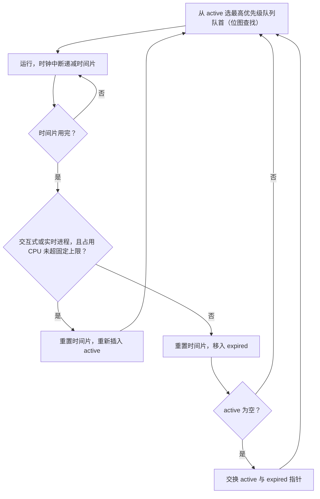

 调度器的活动与过期数组")

图：O(1) 调度器从活动进程数组调用进程，时间片用完的进程进入过期进程数组；活动数组为空时交换 Rq→active 与 Rq→expired 两个指针。

#### O(1) 为什么“昙花一现”

O(1) 区分交互式进程与批处理进程的算法比 2.4 有较大改进，但在很多情况下仍会失效：一些典型的测试程序总能使其性能下降，导致交互式进程反应缓慢。同时，动态优先级依赖平均睡眠时间和难以理解的经验公式，代码很难阅读和维护。 于是 Con Kolivas 开发了楼梯调度算法 SD 及其改进版 RSDL。

> [!warning] 易错点
> “O(1)”指的是**选择下一个进程**的时间复杂度为常数，并不意味着它的调度效果更好。O(1) 解决了 2.4 的可扩展性问题，但没有解决“如何准确识别交互式进程”这一根本问题。

> [!question]- 自测：2.4 调度器中，runqueue 有 1000 个可运行进程时，为什么调度开销明显大于 100 个进程？O(1) 是怎样消除这种差异的？
> 2.4 每次选进程都要遍历 runqueue 逐个比较优先级，所有时间片用完后还要为所有进程（包括睡眠进程）重算 counter，两者都是 $O(n)$。O(1) 按优先级把就绪进程分到数组的各个队列中，用位图常数时间找到最高优先级的非空队列并取队首；时间片在进程移入 expired 时就已重置，active 空时只交换两个指针，无需遍历重算。

> [!question]- 自测：一个 nice 为 0 的普通进程在 O(1) 中长期是交互式进程，它能否永远留在 active 数组里？
> 不能。交互式进程时间片用完后通常会被重新插入 active，但当它占用 CPU 的时间超过固定上限后，不论类型都必须移入 expired。这保证 active 在有限时间内清空，expired 中的进程不会饥饿。

---

## 楼梯调度 SD 与 RSDL

> [!abstract] 本节要点
>
> - **SD（楼梯调度）**放弃动态优先级：进程用完时间片就降到 active 数组中低一级的队列（进程本身的优先级不变），降到最低一级后再用完时间片，就回到初始优先级的下一级。
> - SD 能避免饥饿：高优先级进程终会降到与低优先级进程同一层竞争；交互式进程睡眠期间同级进程逐级下沉，醒来时它仍在高处，相当于获得补偿。
> - SD 与 MLFQ 的区别：MLFQ 新进程都进第一级、降到底不再上升；SD 按进程原优先级入队，降到底后回升。
> - **RSDL** 重新引入 expired 数组，为每个优先级设**组时间配额** $T_g$、为每个进程设**进程时间配额** $T_p$：用完 $T_p$ 降一级（minor rotation），本级 $T_g$ 用完则全组强制降一级，使低优先级进程的等待时间可预计。
> - RSDL 中时间片 $\ne T_p$（一般 $T_p <$ time_slice）：时间片用完进入 expired 数组的初始优先级队列；active 为空或所有进程降到最低级时触发 major rotation，交换两个数组。

### SD 楼梯调度（Staircase Scheduler）

O(1) 试图靠经验公式识别交互式进程却屡屡失效。SD 换了思路：不再动态计算优先级，而是让所有进程沿着优先级“楼梯”轮流下行，用结构本身保证公平并照顾交互式进程。

**楼梯调度**（staircase scheduler，SD）抛弃动态优先级的概念，采用完全公平的思路。与 O(1) 一样，它为每个优先级维护一个进程列表，组织在 active 数组中，选下一个进程时直接从 active 数组读取。 规则如下：

1. **按原优先级入队**：进程从自己的优先级所在的台阶开始。
2. **用完时间片就下一级台阶**：进程用完时间片后并不移到 expired 数组，而是加入 active 数组中低一优先级的列表；再次用完，就再放入更低一级。降级只改变它所在的队列，**任务本身的优先级并没有改变**。
3. **到底后回升**：任务到达最低一级后，如果时间片再次用完，会回到初始优先级的下一级任务队列。讲义的说法是：任务从第 $N$ 级台阶开始下楼梯并到达底部后，将回到第 $N+1$ 级台阶，同时被赋予 $N+1$ 倍的时间片。
4. **实时进程不参与楼梯**：实时进程仍然采用原来的 FIFO 或 RR 调度策略。

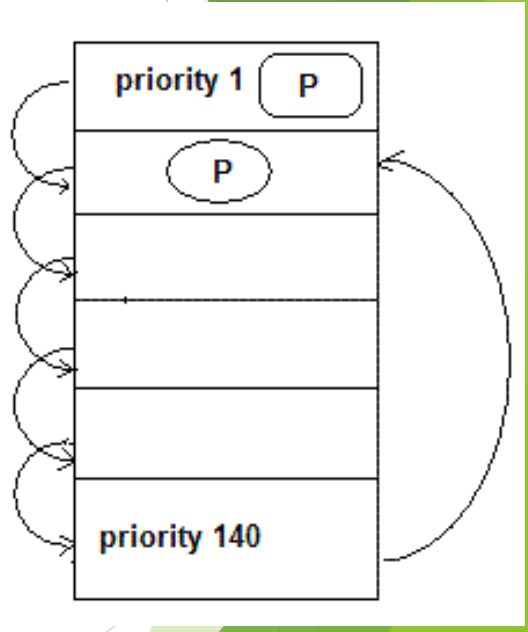

图：楼梯调度中进程 P 从 priority 1 逐级下到 priority 140，到底后回到初始优先级的下一级；看左侧逐级下降的箭头与右侧返回的长箭头。

#### 为什么能避免饥饿、照顾交互式进程

- **避免饥饿**：高优先级进程每用完一次时间片就下降一级，最终会降到和低优先级进程同一层竞争 CPU，低优先级进程因此一定能获得执行机会。
- **补偿交互式进程**：交互式进程进入睡眠后，与它同等优先级的其他进程一步一步下楼梯，进入低优先级队列；当它被唤醒时还留在高处的台阶，因而更快被选中，响应时间缩短。这相当于对“没用完时间片就去睡眠”的补偿，而且无需任何睡眠时间统计或经验公式。

#### SD 与多级反馈队列的比较

SD 的“用完时间片降一级”与多级反馈队列（MLFQ，见 L07「05 多级队列与多级反馈队列」）很像，区别在入口和出口：

| 对比项           | 多级反馈队列 MLFQ      | SD 楼梯调度                                            |
| ---------------- | ---------------------- | ------------------------------------------------------ |
| 新进程进入哪一级 | 都进入第一级（最高级） | 按进程原有的优先级进入对应级                           |
| 用完时间片       | 降一级                 | 降一级（进程优先级本身不变）                           |
| 降到最低一级后   | 停留在最底层不动       | 再用完时间片则回到初始优先级的下一级，并获得更多时间片 |
| 睡眠进程醒来     | 视具体规则而定         | 仍在原来的级别，同级进程已下沉，相当于补偿             |

> [!warning] 易错点
> SD 中进程“降级”降的是它所在的**队列层级**，不是它的**优先级**。正因为优先级固定不变，SD 才能在到底后让进程回到“初始优先级的下一级”——它必须记得自己的初始优先级。

### RSDL（The Rotating Staircase Deadline Scheduler）

SD 有一个问题：低优先级进程必须等所有高优先级进程（在楼梯上）执行完才能获得 CPU，高优先级层进程越多，它要等得越久，**等待时间无法确定**。RSDL 是 Con Kolivas 对 SD 的改进，核心思想仍是“完全公平”，没有复杂的动态优先级调整（一计算优先级就要花时间），而是用配额给每一层的运行时间设上限。

RSDL 涉及三个时间量：

- **组时间配额** $T_g$：每个优先级分配一个组时间配额，无论该级有多少进程，这一级总共能运行的时间是固定的。
- **进程时间配额** $T_p$：同一优先级的每个进程拥有同样的时间配额。
- **时间片** time_slice：沿用原来的概念，每个进程有一个时间片；一般有 $T_p <$ time_slice。

RSDL 重新引入了 O(1) 的 expired 数组，运行规则如下：

1. **minor rotation**：进程用完自己在本级的 $T_p$ 后，下降到下一优先级进程组（与 SD 的降级相同），在新的一级再获得 $T_p$。
2. **组配额强制降级**：当高优先级进程组用完了它们的 $T_g$ 时，无论组中是否还有进程的 $T_p$ 尚未用完，该组所有进程都被强制降低到下一优先级进程组。
3. **时间片用完进入 expired**：进程在各级累计使用的配额达到它的 time_slice 时，被放入 **expired 数组中它初始的优先级队列**。
4. **major rotation**：当 active 数组为空，或所有进程都降低到最低优先级时触发 major rotation：交换 active 数组和 expired 数组，所有进程恢复到初始状态，重新开始 minor rotation 过程。

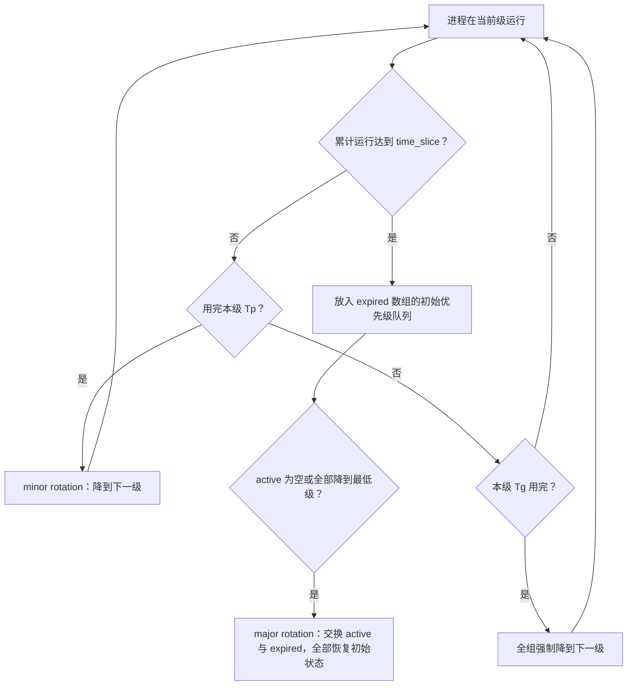

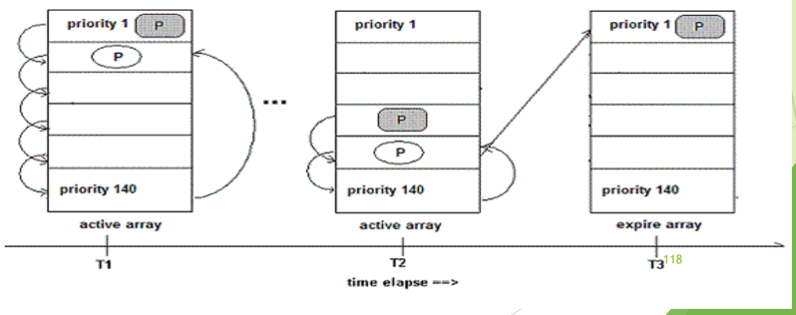

图：RSDL 中进程在 active array 内逐级下降（T1、T2），用完时间片后进入 expire array 的初始优先级队列（T3）；看三个时刻的数组与箭头。

因此低优先级任务可以在“可以预计的未来”得到调度。 原因在于每一级每轮最多运行 $T_g$：一个低优先级进程之上有 $k$ 个非空优先级时，它的等待时间不超过约 $k T_g$。RSDL 的设计体现了多个指标的折中：优先级高的先运行、不饥饿、等待时间可预计，同时不付出动态计算优先级的开销。

> [!example] 例：组时间配额如何限制高优先级层（据课程内容构造）
> 设第 1 级有 A、B、C 三个进程，$T_p=2$ ms，第 1 级的 $T_g=4$ ms；第 2 级有进程 D。
>
> 1. A 运行 2 ms，用完 $T_p$，minor rotation 降到第 2 级。
> 2. B 运行 2 ms，用完 $T_p$；此时第 1 级已累计运行 4 ms，$T_g$ 用完。
> 3. C 虽然还一次都没运行，也与 B 一起被强制降到第 2 级。
> 4. 于是 D 最多只需等第 1 级的 4 ms，就能与 A、B、C 在第 2 级竞争。若在 SD 中，第 1 级每增加一个进程，D 的等待时间就多一个时间片，无法预计。

> [!warning] 易错点
> $T_p$ 不是时间片。用完 $T_p$ 只是**降一级**（仍在 active 数组中）；用完时间片才**离开 active**，进入 expired 数组，并且放回的是它**初始优先级**的队列，等 major rotation 后从原来的台阶重新开始。

> [!question]- 自测：SD 中某交互式进程 X 与计算型进程 Y 初始优先级相同。X 运行一会儿就睡眠，Y 持续运行并连续用完三次时间片。X 醒来时谁更容易被选中？为什么 SD 不需要统计睡眠时间就能做到这一点？
> X 更容易被选中。Y 每用完一次时间片就下一级台阶，已降了三级；X 睡眠期间没有用完时间片，仍留在原来的高层，醒来后处于比 Y 更高的队列。优待来自楼梯结构本身——只有消耗了时间片的进程才会下沉——因此无需像 2.4、O(1) 那样记录睡眠时长或使用经验公式。

> [!question]- 自测：RSDL 中，一个进程用完了在本级的 $T_p$，另一个进程用完了它的 time_slice，二者分别去哪里？
> 前者执行 minor rotation，降到 active 数组中的下一优先级组，并在那一级获得新的 $T_p$；后者离开 active，放入 expired 数组中它**初始**优先级的队列，等到 active 为空或所有进程降到最低级触发 major rotation、交换两个数组后，才从初始优先级重新开始。

---

## CFS 完全公平调度

> [!abstract] 本节要点
>
> - CFS 吸收 SD/RSDL 的完全公平思想，不再跟踪睡眠时间、不再区分交互式进程，只按权重比例分配 CPU。
> - 公式 1：分配给进程的运行时间 $=$ 调度周期 $\times$ 进程权重 $/$ 所有进程权重之和。
> - 公式 2：$\text{vruntime} = \text{实际运行时间} \times \text{NICE\_0\_LOAD} / \text{进程权重}$；代入公式 1 后每个进程一个周期内的 vruntime 增量都是 $\text{调度周期} \times \text{NICE\_0\_LOAD} / \text{总权重}$，即“从 vruntime 角度大家分到的时间一样”；NICE_0_LOAD 是 nice 0 的权重，Linux 中为 1024。
> - 调度器每次选 vruntime 最小的进程：以 vruntime 为键的红黑树中取最左结点运行并移出，切换下来后按新 vruntime 重新插入。
> - 框架之外还有细节要定：新进程 vruntime 初值、休眠进程 vruntime、唤醒是否立即抢占、跨 CPU 迁移时 vruntime 如何处理。

### CFS 的基本思想

2.4 和 O(1) 总想考虑进程的睡眠时间、区分交互式与非交互式进程以优待 I/O 型进程，结果公式越来越复杂、效果仍不令人满意。**CFS**（完全公平调度，Completely Fair Scheduler）放弃这种努力，改为完全公平：每个进程公平地得到 CPU 时间。

> [!info] 可视化资源
>
> - [OSTEP 第 9 章 9.7 节 Linux CFS（PDF）](https://pages.cs.wisc.edu/~remzi/OSTEP/cpu-sched-lottery.pdf)：看图 9.4 CFS 简单示例与图 9.5 CFS 红黑树，直观理解按 vruntime 选择进程。

CFS 从 RSDL/SD 中吸取了完全公平的思想，不再跟踪进程的睡眠时间，也不再企图区分交互式进程。 它的核心是三句话：

1. 每个进程有一个**虚拟运行时间**（vruntime），表示该进程“运行了多长时间”；
2. 调度器总是选择虚拟运行时间最小的进程运行；
3. 虚拟运行时间与进程实际运行时间成正比，与进程优先级（权重）成反比。

CFS 以 vruntime 为键值构造红黑树，实现快速的更新与删除。本章讲按权重分配、vruntime 与数据结构；具体情景分析见 [CFS 情景分析与 EEVDF](#cfs-情景分析与-eevdf)。

#### 把 vruntime 理解为“进度”

vruntime 不是真实运行时间，而是**进度**：每个进程在一个调度周期里应得的份额不同，vruntime 衡量的是它完成了自己份额的百分之几。

例如 A 在本周期应运行 10 ms，B 应运行 20 ms，二者的“100%”长度不同。A 运行 2 ms，进度是 20%；B 要运行 4 ms 才是 20%。若你的进度是 20%、他的是 30%，说明你落后了，就该先让你上 CPU。CFS 每次选 vruntime 最小者，就是让进度最落后的进程先跑，于是所有进程的进度宏观上同步推进。

### 按权重分配与 vruntime

**核心思想**：根据进程的优先级按比例分配运行时间。

> [!info] 可视化资源
>
> - [Linux 内核文档：CFS Scheduler](https://docs.kernel.org/scheduler/sched-design-CFS.html)：官方说明 CFS 模拟“理想多任务 CPU”、按 vruntime 排序的红黑树取最左结点，以及 sched_class 调度类模块化。

$$
\text{分配给进程的运行时间} = \text{调度周期} \times \frac{\text{进程权重}}{\text{所有进程权重之和}} \qquad \text{（公式 1）}
$$

其中**调度周期**是把所有处于 TASK_RUNNING 态的进程都调度一遍的时间；**进程权重**由优先级决定，优先级越高权重越大。

CFS 对时钟做抽象，引入**虚拟运行时间** vruntime，每个进程有自己的 vruntime：

$$
\text{vruntime} = \text{实际运行时间} \times \frac{\text{NICE\_0\_LOAD}}{\text{进程权重}} \qquad \text{（公式 2）}
$$

其中 NICE_0_LOAD 是 nice 值为 0 的进程的权重（Linux 中为 1024），作为折算基准：nice 0 的进程 vruntime 与实际运行时间相等，权重更大（优先级更高）的进程 vruntime 增长得更慢，权重更小的增长得更快。

把公式 1 中进程一个周期内的运行时间代入公式 2：

$$
\text{vruntime} = \left(\text{调度周期} \times \frac{\text{进程权重}}{\text{所有进程总权重}}\right) \times \frac{\text{NICE\_0\_LOAD}}{\text{进程权重}} = \text{调度周期} \times \frac{\text{NICE\_0\_LOAD}}{\text{所有进程总权重}}
$$

进程权重被消去，结果与具体进程无关：**从 vruntime 的角度，分配给所有进程的时间是一样的**。 两个公式达到同样的效果：按公式 1 分配真实时间，等价于让所有进程的 vruntime 以相同步调增长。

> [!note] 补充解释
> 课堂口述把公式 2 说成“乘以 nice 值”，按讲义应为乘以 **NICE_0_LOAD**。 在 Linux 中，NICE_0_LOAD 对应 nice 0 的权重 1024；nice 每减小 1，权重约乘以 1.25（例如 nice $-5$ 约为 3121，nice 5 约为 335），使相邻 nice 值的进程 CPU 份额相差约 10%。权重表见内核源码 [`sched_prio_to_weight`](https://github.com/torvalds/linux/blob/master/kernel/sched/core.c)。

> [!example] 例：权重 1:2，调度周期 30 ms
> 设 A 的权重为 NICE_0_LOAD（即 1024），B 的权重为 2048，比例 1:2，调度周期 30 ms。
>
> 1. 公式 1：A 分得 $30 \times \frac{1}{3} = 10$ ms，B 分得 $30 \times \frac{2}{3} = 20$ ms。
> 2. 公式 2：A 跑完 10 ms，vruntime 增加 $10 \times \frac{1024}{1024} = 10$；B 跑完 20 ms，vruntime 增加 $20 \times \frac{1024}{2048} = 10$。
> 3. 合并式验证：$30 \times \frac{1024}{3072} = 10$。两者 vruntime 都增加 10，都达到“100%”，只是 A 的 100% 是 10 ms，B 的 100% 是 20 ms。

> [!warning] 易错点
> “选 vruntime 最小者”不等于“选实际运行时间最少者”。高权重进程的 vruntime 增长慢，同样跑 10 ms，它的 vruntime 只增加一部分，因此会更频繁地成为最小者、累计得到更多真实 CPU 时间。

### 红黑树与调度数据结构

选“vruntime 最小者”需要一个能快速找最小值、并能频繁插入删除的结构。CFS 维护一棵按 vruntime 排序的**红黑树**：

1. **选择**：每次选择最左侧结点（vruntime 最小）的进程运行，并把它从树中删除；
2. **运行**：运行期间 vruntime 按公式 2 增长；
3. **重新插入**：进程切换时，切换下来的就绪态进程按新的 vruntime 重新插入树中。换下来的进程刚运行过，vruntime 一般比较大，所以会落在树的右侧；总体上树的内容不断从右侧向左侧迁移，所有进程的 vruntime 宏观上同时推进。


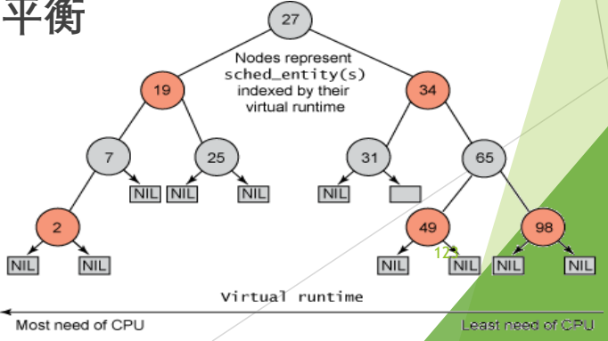

图：CFS 红黑树的结点是按虚拟运行时间索引的 sched_entity，越靠左 vruntime 越小、越需要 CPU，调度器选最左侧结点运行。

#### 重要数据结构

Linux 中所有任务都由 **task_struct** 表示，它完整描述任务，包括当前状态、堆栈、进程标识、优先级（静态和动态）等；task_struct 通过 **sched_entity** 和 **sched_class** 分别定义调度实体和调度类。

```c
struct cfs_rq {
    ...
    struct rb_root tasks_timeline;   /* 红黑树的根 */
    ...
};

struct task_struct {
    volatile long state;
    void *stack;
    unsigned int flags;
    int prio, static_prio, normal_prio;
    const struct sched_class *sched_class;   /* 调度类 */
    struct sched_entity se;                  /* 调度实体 */
    ...
};

struct sched_entity {
    struct load_weight load;      /* 权重 */
    struct rb_node run_node;      /* 红黑树结点 */
    struct list_head group_node;
    ...
};

struct rb_node {
    unsigned long rb_parent_color;
    struct rb_node *rb_right;
    struct rb_node *rb_left;
    ...
};
```

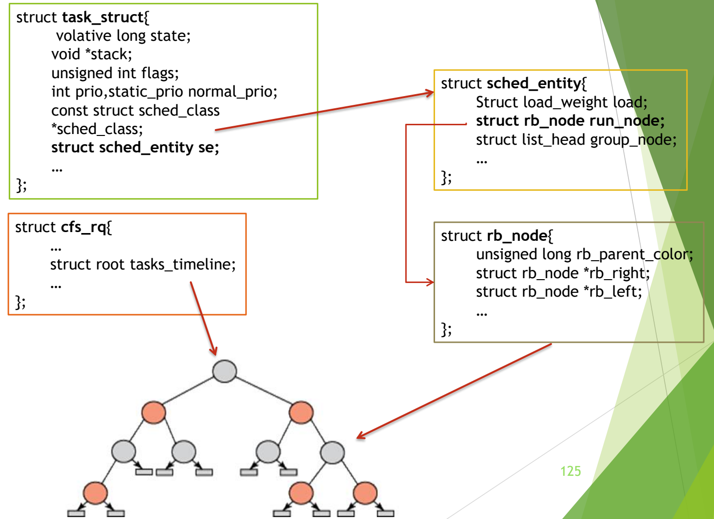

图：task_struct 内嵌 sched_entity se，sched_entity 内嵌 rb_node run_node，cfs_rq 的 tasks_timeline 指向红黑树根；看箭头如何把进程描述符连到红黑树结点。

各结构的职责：

- **sched_entity**（调度实体）：包含实现对单个任务或任务组调度所需的完整信息，其中的 `run_node` 就是该任务在红黑树中的结点，`load` 是它的权重。
- **sched_class**（调度类）：类似一个模块链，协助内核调度程序工作；每个调度程序模块都要实现 sched_class 规定的一组函数，内核通过它调用具体策略。
- **cfs_rq**：每个运行队列都有一个 cfs_rq 结构保存相关红黑树的信息（如树根 `tasks_timeline`）。

从 task_struct 经 `se.run_node` 就能定位到该进程在红黑树中的位置。

> [!tip] 课堂强调
> 这些 Linux 数据结构比较复杂，**不需要记那么多**，大概知道通过它们能找到进程在红黑树中的位置即可。

### 框架之外的细节问题

CFS 的思想很清楚，但要真正运转，还有几个细节必须专门处理：

1. **新进程的 vruntime 初值是不是 0？** 新进程还没运行过，按理是 0；但若真为 0，它会远小于树中所有进程，一直占据最左端，长时间独占 CPU。因此必须做弥补，初值不能太低。
2. **休眠进程的 vruntime 一直保持不变吗？** 进程睡眠期间不运行，vruntime 不增长；但别的进程的 vruntime 一直在涨。
3. **休眠进程唤醒时会立刻抢占 CPU 吗？** 长时间睡眠的进程醒来时，vruntime 可能比树中最小值小很多，按理应立即抢占；但系统会干预，不一定这样做。
4. **进程从一个 CPU 迁移到另一个 CPU 时 vruntime 会不会变？** SMP 下每个处理器有自己的一棵红黑树，两棵树的 vruntime 水平不同，迁移时原 vruntime 能否直接带过去需要考虑。

前三个问题由进程创建、进程唤醒等情景回答，见 [CFS 情景分析与 EEVDF](#cfs-情景分析与-eevdf)；迁移本身的开销与负载均衡见 [多处理器调度的基本问题](#多处理器调度的基本问题)。

> [!note] 补充解释
> 第 4 个问题课上只提出未作答。在经典 CFS 实现中，进程离开源 CPU 的队列时把 vruntime 减去源队列的 `min_vruntime`，加入目标队列时再加上目标队列的 `min_vruntime`，即保留它“相对于本队列下限超前或落后多少”，而不是带着绝对值迁移，避免因两棵树水平不同而获得不公平的优待或惩罚。

> [!question]- 自测：三个进程权重分别为 1024、1024、2048，调度周期 40 ms。各自分得多少实际运行时间？一个周期后各自 vruntime 增加多少？
> 总权重 4096。按公式 1，前两个各分得 $40\times\frac{1024}{4096}=10$ ms，第三个分得 $40\times\frac{2048}{4096}=20$ ms。按公式 2，vruntime 增量分别为 $10\times\frac{1024}{1024}=10$、$10$、$20\times\frac{1024}{2048}=10$，都等于 $40\times\frac{1024}{4096}=10$。

> [!question]- 自测：树中 A 的 vruntime 为 50、B 为 52；A 被选中运行 4 ms 后切换下来。若 A 的权重是 NICE_0_LOAD，接下来谁运行？若 A 的权重是 2 倍 NICE_0_LOAD 呢？
> 权重为 NICE_0_LOAD 时，A 的 vruntime 增加 4，变为 54 > 52，B 成为最左结点，B 运行。权重为 2 倍时，A 的 vruntime 只增加 $4\times\frac{1}{2}=2$，变为 52，与 B 持平（Linux 实现中键相等时新插入者放在右侧，因此 B 仍为最左结点、先运行，但 A 紧随其后）；可见高权重进程能以更多真实时间换取相同的 vruntime 增长。

---

## CFS 情景分析与 EEVDF

> [!abstract] 本节要点
>
> - **时钟中断**：每次都把这段实际运行时间折算为 vruntime 累加；只有累计运行超过本调度周期内分配给它的时间才打标记并重新调度，否则继续运行。
> - **主动调度**：更新当前进程运行信息 → 插回红黑树 → 选择下一个 → 移出红黑树；选择时 cfs_rq 的 next（刚被调度上 CPU 的抢占者）优先、last（刚被调度出去的进程）次之，选完清空，并用 `wakeup_preempt_entity` 判断：只有 vruntime 小过调度粒度才抢占。
> - **进程创建**：$\text{vruntime} = \text{min\_vruntime} + \text{一个调度周期内可增加的 vruntime}$（假装已运行过一轮）；满足四个条件时交换父子 vruntime，让子进程先运行。
> - **进程唤醒**：取 $\max(\text{min\_vruntime} - \text{补偿值},\ \text{原 vruntime})$，既补偿长睡眠者，又防止靠频繁睡眠获取额外时间；唤醒抢占也有门槛，避免频繁切换。
> - **EEVDF**（讲义标为 Linux 6.11，主线实际于 6.6 合入）本质仍是 CFS 的补丁：在公平之外考虑延迟，引入两个新指标；Linux 调度细节不要求记忆。

### 时钟中断与主动调度

[CFS 完全公平调度](#cfs-完全公平调度)给出了框架，但何时更新 vruntime、何时换人、换谁，要按情景分别规定。CFS 分四种情景：时钟中断、主动调度、进程唤醒、进程创建。 这与 Windows 按“主动让出、被动等待、时间片到”划分场景的思路类似，也回答了上一节提出的几个细节问题。

#### 情景一：时钟中断

时钟中断时 CFS 做两件事：

1. **更新进程运行信息**：把当前进程这一段的实际运行时间按公式 2 换算为 vruntime，加到原来的 vruntime 上。
2. **判断是否满足抢占条件**：如果当前进程这一段实际运行的时间超过了一个调度周期内分配给它的时间（公式 1 的结果），就做标记，随后主动进行一次进程调度；否则继续运行当前进程。

时钟中断**不等于**时间片到。之所以每次时钟中断都要累加 vruntime，是因为只有这样才知道进程到底运行了多久；累计超过本周期的分配量（相当于“时间配额到”）才触发重新调度。

> [!example] 例：时钟中断中的判断
> A 的权重为 NICE_0_LOAD，本调度周期分得 10 ms，时钟中断每 4 ms 一次。
>
> 1. 第 1 次中断：A 已运行 4 ms，vruntime $+4$；$4 < 10$，继续运行。
> 2. 第 2 次中断：累计 8 ms，vruntime 再 $+4$；$8 < 10$，继续运行。
> 3. 第 3 次中断：累计 12 ms $> 10$，打上需要重新调度的标记，随后进行一次主动调度。

#### 情景二：主动调度

进程让出 CPU（或被标记需要重新调度）时，执行标准的四步：

1. **更新当前进程运行信息**（vruntime 等）；
2. **将当前进程插入红黑树**（按新 vruntime 定位）；
3. **选择要运行的进程**；
4. **将该进程移出红黑树**。

第 3 步并不是简单取红黑树最左侧结点。cfs_rq 有两个与调度策略关系很大的指针：

- **last**：指向最近被调度出去的进程；
- **next**：指向被调度上 CPU 的进程。

例如 A 正在运行时被 B 抢占，则 last 指向 A，next 指向 B。选择下一个进程时，若这两个指针不为 NULL，**优先选 next，其次选 last**，选完后清空这两个指针。

这种优先选择是通过 `wakeup_preempt_entity(cfs_rq->next, se)` 与 `wakeup_preempt_entity(cfs_rq->last, se)` 实现的，即使从 next/last 中选，也要再计算一次是否值得。函数返回值的含义：

| 返回值 | 条件                                               | 能否抢占       |
| ------ | -------------------------------------------------- | -------------- |
| $-1$   | 新进程的 vruntime 大于当前进程                     | 不能抢占       |
| $0$    | 新进程的 vruntime 比当前进程小，但没有小到调度粒度 | 一般也不能抢占 |
| $1$    | 新进程的 vruntime 比当前进程小，且差值超过调度粒度 | 可以抢占       |

**调度粒度**是一个阈值：vruntime 只差一点点就换人，切换开销会超过公平带来的好处，所以要求差值超过粒度才抢占。

> [!note] 补充解释
> 在经典 CFS 源码的 `pick_next_entity()` 中，先取最左结点 left，然后用 `wakeup_preempt_entity(cfs_rq->next, left) < 1` 判断：只要 left 没有比 next“领先”超过调度粒度，就选 next（last 同理）。也就是说 next/last 的优待是有限度的，不会以明显破坏公平为代价。

### 进程创建与进程唤醒

这两个情景回答“新进程 vruntime 初值是不是 0”和“休眠进程唤醒时会不会立刻抢占”。它们都依赖一个基准量。

**min_vruntime** 是每个 cfs 队列一个的变量，一般小于等于所有就绪态进程的最小 vruntime，体现目前所有进程整体虚拟运行时间的**下限**。 新进程和刚醒来的进程都以它为参照，而不是用 0 或自己过时的旧值。

#### 情景三：进程创建

新建进程不是立刻投入运行，而是：

1. **更新新进程的 vruntime**：以 cfs 队列的 min_vruntime 为基准，再加上进程在一次调度周期中能够增加的 vruntime，相当于假设新进程在这一轮调度中已经运行过了。这样它既不会因 vruntime 为 0 而长期独占 CPU，也不会落后太多。
2. **必要时交换父子 vruntime**：新进程 vruntime 确定后进行判断，满足特定条件就交换父子进程的 vruntime。
3. **将新建进程插入红黑树**。
4. **判断当前进程能否被新建进程抢占**：调用 `wakeup_preempt_entity`，满足抢占条件则标记，之后进行调度。

同时满足以下条件时，交换父子进程的 vruntime：

- sysctl 设置了子进程优先运行；
- fork 出的子进程与父进程在同一个 CPU 上；
- 父进程不为空；
- 父进程的 vruntime 小于子进程的 vruntime。

交换的目的是让子进程更快地运行：父进程 vruntime 更小时，把这个较小值给子进程，子进程就排到父进程前面。

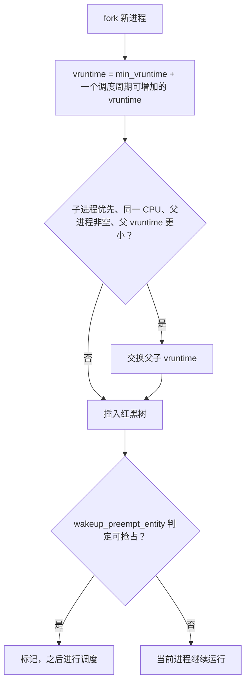

#### 情景四：进程唤醒

进程睡眠（例如等待 I/O）期间 vruntime 不变，而其他进程的 vruntime 在增长。唤醒时的处理：

1. **调整唤醒进程的 vruntime**：用 min_vruntime 减去一个值，作为对睡眠进程的补偿，使它醒来时能较快得到 CPU。但有些进程只睡眠很短时间，醒来后 vruntime 仍大于 min_vruntime，不能让进程通过睡眠获得额外的运行时间，所以最终取**计算出的补偿值与进程原本 vruntime 中的较大者**：

    $$
    \text{vruntime}_{\text{新}} = \max\bigl(\text{min\_vruntime} - \text{补偿值},\ \text{vruntime}_{\text{原}}\bigr)
    $$

2. **将唤醒进程插入红黑树**。
3. **判断是否满足调度条件**：醒来并不一定立刻抢占。若醒来就切换，会造成频繁切换，因此设有门槛——只有与当前进程的 vruntime 差值超过门槛，才设置重新调度标志、换人；差值不大就不换。

> [!example] 例：长睡眠与短睡眠进程醒来
> 设 min_vruntime $=100$，补偿值为 $6$，则候选值 $=94$。
>
> 1. X 睡了很久，原 vruntime $=50$：新 vruntime $=\max(94, 50)=94$。X 得到补偿、排在前面，但不会以 50 这样极小的值长时间独占 CPU。
> 2. Y 只睡了一下，原 vruntime $=98$：新 vruntime $=\max(94, 98)=98$。Y 保持原值，频繁短睡眠换不到额外时间。

> [!note] 补充解释
> 经典 CFS 源码（`place_entity()`）中，唤醒补偿值取调度延迟 `sysctl_sched_latency`，启用 GENTLE_FAIR_SLEEPERS 时取其一半。这一取值课上未讲，仅供理解“补偿有上限”。

> [!warning] 易错点
> 唤醒补偿**不是**“睡得越久补偿越多”。补偿以当前 min_vruntime 为参照、最多补偿一个固定值；睡得再久，新 vruntime 也不会低于 $\text{min\_vruntime} - \text{补偿值}$。

### CFS 与进程状态转换

四种情景其实就是 CFS 的调度策略，与进程模型的状态转换一一对应：

- **新建**（fork）→ 就绪态：计算 vruntime，插入红黑树；
- **schedule**（就绪态 → 运行态）：选出红黑树最左下的结点；
- **时钟中断**（运行态）：更新时间片信息，检测是否满足抢占条件——时钟中断不一定立即切换；
- **唤醒**（阻塞态 → 就绪态）：更新 vruntime 并插入红黑树。

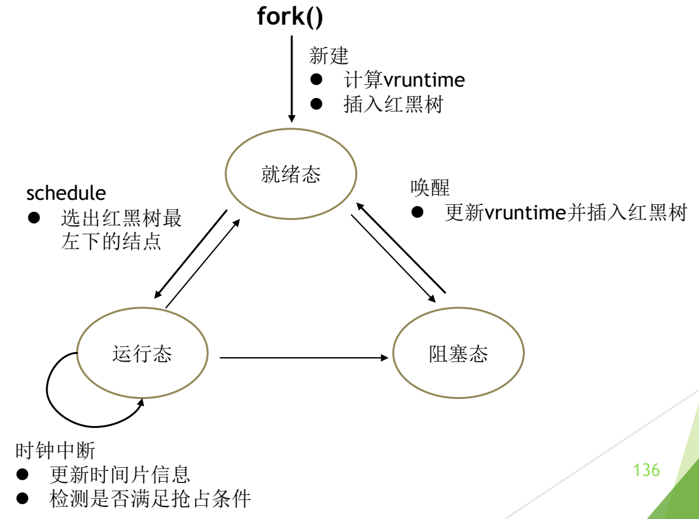

图：fork() 新建进程时计算 vruntime 并插入红黑树；schedule 选出红黑树最左下结点运行；时钟中断更新时间片并检测抢占；唤醒时更新 vruntime 并重新插入红黑树。

进程状态模型见 L04「03 三状态模型」。

### EEVDF 调度器

讲义的演化图在 CFS 之后标出了 **Linux 6.11 的 EEVDF 调度器**。 EEVDF 本质仍是 CFS，但 CFS 只追求公平，EEVDF 在公平之外还考虑**延迟**，希望延迟最短，为此引入了两个新的指标。

> [!warning] 易错点：EEVDF 的合入版本
> 讲义写的是“Linux 6.11 EEVDF 调度器”。按主线内核记录，EEVDF 于 **Linux 6.6**（2023 年 10 月）合入，取代 CFS 的选择逻辑；6.12 又合入剩余部分（如 delayed dequeue）。记版本时以 6.6 为准。参见 [内核文档：EEVDF Scheduler](https://docs.kernel.org/scheduler/sched-eevdf.html)。

> [!info] 可视化资源
>
> - [Linux 内核文档：EEVDF Scheduler](https://docs.kernel.org/scheduler/sched-eevdf.html)：看 lag（与公平份额的差）和 virtual deadline 两个新指标，正好对应课堂派调研题；注意该文档写的是自 6.6 起逐步替代 CFS。

> [!tip] 课堂强调
> 这次 Linux 调度算法**不需要记**，因为算法太复杂；需要了解的是 EEVDF 为什么要给 CFS 打补丁、改进了哪些方面。

> [!note] 补充解释
> **EEVDF**（Earliest Eligible Virtual Deadline First，最早合格虚拟截止时间优先）的两个指标通常指 **lag（滞后量）/合格性** 与 **虚拟截止时间**（virtual deadline）：
>
> 1. **lag**：进程“理应得到的服务”与“实际得到的服务”之差。lag $\ge 0$ 表示它得到的少于应得的份额，称为**合格**（eligible），只有合格的进程才能被选中；lag $<0$ 的进程已经多跑了，要先等别人追上。
> 2. **虚拟截止时间**：进程按自己请求的时间片长度和权重算出的“应在何时完成这一片”的虚拟时间，约为合格起点 $+\ \text{请求时间片}/\text{权重}$。
> 3. **选择规则**：在所有合格进程中，选虚拟截止时间最早者运行。请求较短时间片的延迟敏感进程截止时间更早、更早被选中，但每次只能跑一小片，整体 CPU 份额仍由权重决定。
>
> 由此，EEVDF 用 lag 保证公平，用虚拟截止时间区分延迟需求，取代了 CFS 中依赖启发式补偿（如唤醒补偿）的做法。

### 重点小结与源码阅读

> [!info] 依据讲义整理
> 本小节内容来自讲义的总结页与源码阅读页，课上未讲解。

调度部分（L06–L08）涉及的重点：

1. **调度相关的基本概念**：调度的层次、进程的行为、调度算法的设计目标（见 L06「02 调度层次与处理器调度」「05 调度目标与衡量指标」）。
2. **典型的调度算法**（设计思想及应用）：FCFS、RR、SPN、SRT、HRRN、Feedback（见 L07「01 批处理系统的调度算法」「02 时间片轮转与虚拟轮转」「05 多级队列与多级反馈队列」）。
3. **Linux 进程调度算法**（本讲 [Linux 2.4 与 O(1) 调度器](#linux-24-与-o1-调度器) 至本章）与 **Windows 线程调度算法**（见 L07「07 Windows 线程调度」）。
4. **调度的时机**与**进程切换过程**（见 L06「03 调度时机」「04 进程切换与上下文切换」）。

**源代码阅读**：阅读并理解 xv6 中与进程线程调度相关的代码 `kernel/swtch.S`、`kernel/proc.h`、`kernel/proc.c`，可参考 xv6 手册 §7.1–§7.4。

> [!note] 补充解释
> 在 xv6（RISC-V 版）中，`swtch.S` 实现上下文切换：把当前内核线程的 `ra`、`sp` 和被调用者保存寄存器 `s0`–`s11` 存入旧的 `struct context`，再从新的 context 恢复；`proc.h` 定义 `struct proc`（进程状态、内核栈、context 等）、`struct context` 与 `struct cpu`；`proc.c` 中的 `scheduler()` 是每个 CPU 上循环寻找 RUNNABLE 进程并切换过去的调度循环，`sched()`、`yield()`、`sleep()`/`wakeup()` 负责让出 CPU 与睡眠唤醒。xv6 用的是最简单的轮转式选择，可与 Linux 的 CFS 对照阅读。手册第 7 章 Scheduling 的 §7.1–§7.4 依次讲多路复用、上下文切换代码、调度代码和 `mycpu`/`myproc`。

> [!question]- 自测：某 cfs 队列 min_vruntime $=200$，一个调度周期内新进程可增加的 vruntime 为 $8$。父进程 P 的 vruntime 为 $203$，sysctl 设置了子进程优先，子进程 C 与 P 在同一 CPU。fork 后 C 和 P 的 vruntime 各是多少？
> C 的初值为 $200+8=208$。四个交换条件全部满足（子进程优先、同一 CPU、父进程非空、父 $203 <$ 子 $208$），于是交换：C 得到 $203$，P 得到 $208$，C 会排在 P 前面先运行。

> [!question]- 自测：当前进程 vruntime 为 300，刚唤醒的进程 W 调整后 vruntime 为 298，调度粒度对应的差值为 4。W 会立即抢占吗？若 W 为 290 呢？
> 298 时不会：W 虽比当前进程小，但差值 2 未超过粒度，`wakeup_preempt_entity` 返回 0，一般不抢占，避免频繁切换。290 时差值 10 超过粒度，返回 1，设置重新调度标记，W 抢占当前进程。

> [!question]- 自测：时钟中断到来，当前进程累计运行时间尚未超过本周期分配给它的时间，但树中已有 vruntime 比它小的进程。CFS 会在此时切换吗？时钟中断这一步还做了什么？
> 按讲义的时钟中断规则不会：只要累计运行未超过本周期分配量，就继续运行当前进程。但这一步仍必须把本段实际运行时间折算成 vruntime 累加到它的 vruntime 上，否则无法判断它到底运行了多久。

---

## 本讲小结

本讲的三条线索都在回答“除了选哪个进程，还要权衡什么”：多处理器要在亲和性与负载均衡之间折中，实时调度要保证截止时间，Linux 调度器则经历了从“猜测谁是交互式进程”到“按权重完全公平”的转变。

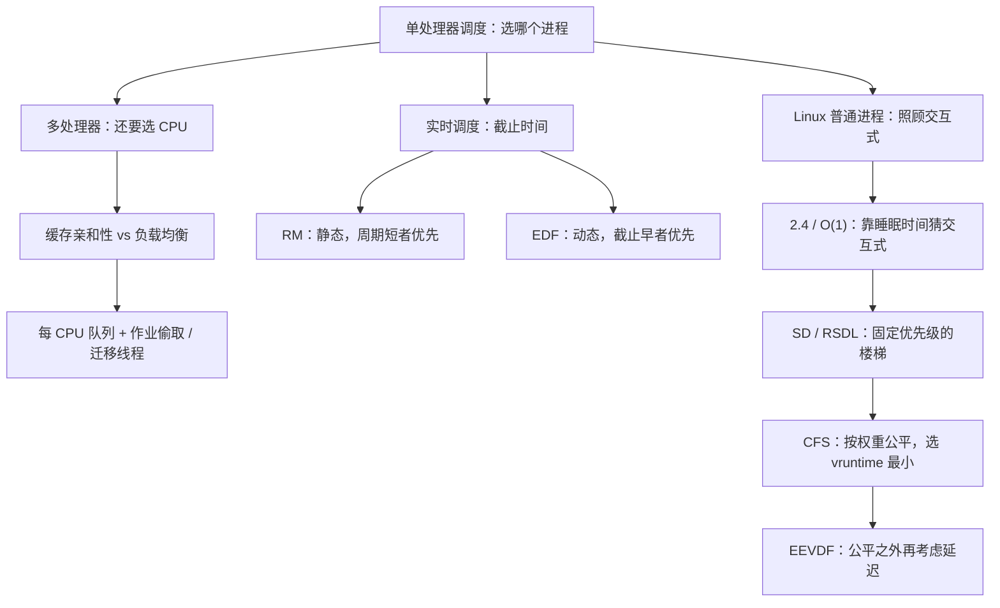

| 调度器    | 选择方式                                 | 如何对待交互式进程                 | 主要问题                 |
| --------- | ---------------------------------------- | ---------------------------------- | ------------------------ |
| Linux 2.4 | 遍历 runqueue 比较 counter 与 nice       | 睡眠进程重算时累加未用完的 counter | 开销随进程数增长，非抢占 |
| O(1)      | active/expired 数组 + 位图               | 平均睡眠时间换算 bonus             | 经验公式难懂，识别常失效 |
| SD / RSDL | 固定优先级，用完时间片（或 $T_p$）降一级 | 睡眠者留在高层，相当于补偿         | 已被 CFS 取代            |
| CFS       | 红黑树最左结点（vruntime 最小）          | 不区分，只按权重；唤醒时有限补偿   | 只管公平，不管延迟       |

### 核心公式

| 公式                                                                                                     | 含义                                                                               |
| -------------------------------------------------------------------------------------------------------- | ---------------------------------------------------------------------------------- |
| $\sum_{i=1}^{m} C_i/P_i \le 1$                                                                           | 周期任务可调度的必要条件；也是 EDF（单处理器、可抢占、截止时间等于周期）的充要条件 |
| $U \le n(2^{1/n}-1)$                                                                                     | RM 的充分条件，$n\to\infty$ 时趋于 $\ln 2 \approx 0.693$                           |
| $\text{分配时间} = \text{调度周期} \times \frac{\text{进程权重}}{\text{总权重}}$                         | CFS 公式 1：按权重分配真实时间                                                     |
| $\text{vruntime} = \text{实际运行时间} \times \frac{\text{NICE\_0\_LOAD}}{\text{进程权重}}$              | CFS 公式 2：NICE_0_LOAD 是 nice 0 的权重 1024                                      |
| $\text{vruntime}_{\text{新}} = \max(\text{min\_vruntime} - \text{补偿值},\ \text{vruntime}_{\text{原}})$ | CFS 唤醒补偿，防止靠频繁睡眠获利                                                   |
