进程要运行就必须有内存，本讲回答“操作系统怎样把物理内存交给多个进程使用”：先建立地址空间这一抽象，弄清逻辑地址何时、由谁转换为物理地址，以及多道程序带来的越界保护与离散化需求；再看物理内存的空闲管理、适配算法、伙伴系统与 SLAB；然后比较从单一连续区到段页式的六种方案，最后用覆盖与交换回答“大程序如何在小内存上运行”。阅读前应熟悉 L04「06 进程地址空间」中的地址空间布局与 L06「04 进程切换与上下文切换」，本讲是下一讲虚存的基础。

---

## 内存管理的任务

> [!abstract] 本节要点
> - 创建进程必须拿到三样资源：PID、PCB 和地址空间（一块内存），所以内存管理与进程模型密不可分。
> - 内存管理 $\neq$ 虚存管理：先弄清“纯粹的”内存管理要解决什么，再看它如何演化成今天的虚存。
> - **地址空间**是对内存的抽象，正如进程是对 CPU 的抽象；OS 管理地址空间，以及地址空间到物理内存的映射（映射需要硬件支持）。
> - 两个空间对应两类地址：逻辑地址与物理地址；二者之间的转换称为地址重定位，也叫地址转换、地址变换、地址翻译、地址映射。
> - 内存管理更高的要求是存储保护（不越界、不越权）与存储共享；虚存得以成立靠两个支点：局部性原理和存储体系。

### 为什么需要内存管理

进程要运行，就必须在内存里有一块属于它的地方。创建进程有几个固定的标准步骤：分配一个进程标识 PID，分配一个进程控制块 PCB，再给它一个**地址空间**，用最传统的说法就是“分配一块内存”。这三样是进程创建后必须拿到的资源。 所以内存管理最朴素的任务就是：进程要内存，操作系统就给它内存。

这也解释了为什么教材 OSTEP（*Operating Systems: Three Easy Pieces*，可免费在线阅读）把进程（CPU 虚拟化）和内存虚拟化一起放在第一部分“虚拟化”里：二者是一体的，讲内存管理时要把进程模型的知识串起来。早期 UNIX 的内核结构中，内存管理模块也与进程控制紧密相连。

今天大家熟悉的是**虚存**（virtual memory）：操作系统给进程的是一块虚拟内存，运行中需要哪部分内容，才把磁盘上的内容真正放进物理内存并建立映射。但**内存管理不等于虚存管理**。本讲先回到早期，看最纯粹的内存管理要解决什么问题、遇到了什么困难，再看它如何一步步演化成今天的虚存、演化后为什么更好；虚存本身留到下一讲。

本讲围绕以下问题展开：

1. 内存管理从简单到复杂的演化过程是什么？
2. 怎样理解“地址空间（address space）是对内存的抽象”？
3. 内存管理追求哪些目标？
4. 程序什么时候进入内存？
5. 进程空间与物理内存空间怎么对应？
6. 物理内存如何分配？空闲空间怎么管理，有哪些数据结构和算法？
7. 怎样“扩充”内存？
8. Linux 伙伴系统、SLAB/SLUB/SLOB 的作用是什么？

### 地址空间：内存的抽象

操作系统管理计算机的各种资源：CPU、内存、磁盘和各种设备。它并不直接管 CPU，而是管**进程**：进程是对 CPU 的抽象，OS 通过调度进程上 CPU，间接地把 CPU 管起来。内存也是同样的思路。

> [!info] 可视化资源
> - [OSTEP 第 13 章 地址空间（PDF）](https://pages.cs.wisc.edu/~remzi/OSTEP/vm-intro.pdf)：看图 13.1–13.3：从早期单进程独占内存到多进程共享内存，再到代码、堆、栈组成的地址空间示例。

**地址空间**（address space）是对内存的抽象。引入这层抽象后，系统中就有了两个空间：

- **进程地址空间**：每个进程看到的那个“框”，今天也就是它的虚存；
- **物理内存空间**：真实的存储单元。

操作系统要做两件事：管好进程的地址空间，并完成地址空间到物理内存的映射。这个映射功能需要硬件支持，具体机制见 [地址绑定与重定位](#地址绑定与重定位)。

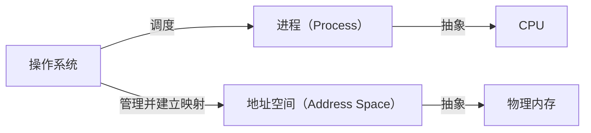

### 逻辑地址、物理地址与地址重定位

两个空间各有自己的地址：

- **逻辑地址**（logical address）：进程地址空间中的地址；
- **物理地址**（physical address）：物理内存中存储单元的地址。

CPU 执行指令时，指令里的地址属于地址空间，要访问真正的存储单元，就要把它转换成物理地址。这个转换过程叫**地址重定位**（address relocation）：一条指令在地址空间里有一个地址，要“重新定位”到它在物理内存中的位置。同一件事还有多种叫法，可以混用，即**地址转换、地址变换、地址翻译、地址映射**。 两类地址的严格定义、绑定时机和静态/动态重定位见 [地址绑定与重定位](#地址绑定与重定位)。

> [!tip] 课堂强调
> “重要概念”页第一行左边两个（地址重定位、逻辑地址/物理地址）是本讲的重点。

### 存储保护、存储共享与内存管理方案

在地址转换之上，内存管理还有两项更高的要求：

- **存储保护**：分两方面。一是**不越界**，进程只能访问属于自己的那块空间，不能“出圈”；二是**不越权**，比如某块区域只允许读，就不能对它做写操作。
- **存储共享**：不同进程可以共享物理内存中的同一块区域（例如同一个物理页面）。

越界保护的具体硬件机制见 [地址保护与地址空间](#地址保护与地址空间)。

从最早到今天，内存管理方案一共六种：**单一连续区、固定分区、可变分区、页式、段式、段页式**。今天的系统基本以页式为主（ICS 课程学的就是页式），但理解另外几种方案有助于看清演化脉络，详见 [连续分配方案](#连续分配方案) 和 [页式与段式管理](#页式与段式管理)。

历史上程序越来越大，而内存昂贵、容量小，于是出现了“大程序如何在小内存上运行”的问题，相应有两种内存“扩充”技术：**覆盖技术**和**交换技术**。覆盖技术只流行过一段时间，今天已经不用；交换技术则是今天虚存的基础，虚存就是交换技术再加页式。 两者的细节见 [覆盖与交换技术](#覆盖与交换技术)。

本讲的整体结构如下：

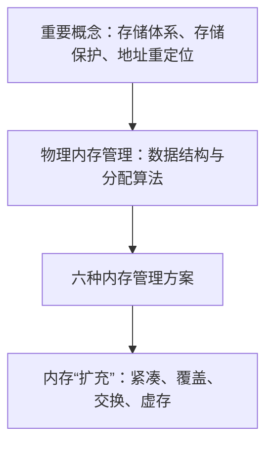

### 局部性原理与存储体系

地址空间这套机制发展到今天的虚存，之所以能很好地支撑整个系统运行，靠的是两个支点。

**局部性原理**（principle of locality）：程序在一段时间内访问的地址往往集中在一个小范围内。缓存设计正是利用这一点：设计 L1、L2、L3 多级缓存，访问越多地在 L1 命中，性能就越好。

**存储体系**（memory hierarchy）：从快到慢、从小到大依次是寄存器、L1/L2/L3 高速缓存、内存、本地磁盘、远程磁盘。 今天说的“内存”已经不只是一块物理内存：虚存把物理内存、磁盘甚至云盘都算了进来，构成一个存储体系。

存储体系越往上速度越快、容量越小、单位价格越高。局部性原理保证了大多数访问能落在上层，存储体系则让下层的大容量成为上层的后备，两者合起来才使“地址空间比物理内存大”成为可能。

> [!question]- 自测：为什么说“OS 管内存实际上是在管地址空间”？试用 CPU 的例子类比。
> 因为 OS 并不直接操作物理内存单元，而是给每个进程一个地址空间，再负责地址空间到物理内存的映射。这与 OS 不直接管 CPU、而是通过管理进程（CPU 的抽象）并调度其上 CPU 来间接管理 CPU 完全对应。

> [!question]- 自测：一位同学说“内存管理就是虚存管理”，这种说法哪里不准确？
> 虚存是内存管理演化到今天的形态。早期的内存管理（如单一连续区、分区）要求整个进程一次性、连续地装入物理内存，没有虚拟地址空间，也没有按需调入。内存管理是更大的范畴，虚存只是其中最新的一种方案。

---

## 地址绑定与重定位

> [!abstract] 本节要点
> - 程序执行前要经过编译 → 链接 → 装载 → 运行；地址可以在这四个时机中的任何一个绑定到物理地址，但各有约束。
> - 逻辑地址（相对地址）以 0 为首地址，不能直接访存；物理地址（绝对地址）可直接寻址。严格配对：逻辑↔物理、相对↔绝对、虚拟↔实。
> - **静态重定位**：装载时由软件一次性改写所有地址，例如 `store 20` → 链接后 `store 120` → 装入 1000 处后 `store 1120`；之后程序不能移动。
> - **动态重定位**：装载时不改地址，每条指令执行时才转换，必须由硬件 MMU 完成。
> - 最早的 MMU 只是一个重定位寄存器：物理地址 = 重定位寄存器 + 逻辑地址，如 $12000 + 456 = 12456$。

### 程序执行前的准备过程

“程序什么时候进入内存”这个问题，要从源程序变成运行中的进程的整个过程说起。

1. **编译**：每个源程序（`.c`）被编译成一个目标文件（`.o`）。
2. **链接**：链接器把多个目标文件，加上其他目标文件和系统库，链接成一个**装载模块**，也就是磁盘上的可执行文件（它有自己的文件格式，这里不关心格式）。
3. **装载**：装载器（loader）把装载模块从磁盘读入内存。
4. **运行**：CPU 执行内存中的指令。

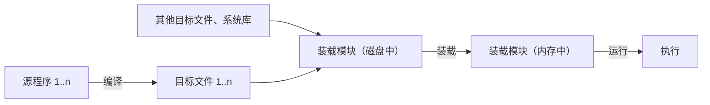

这里关心的是：在这条流水线上，**何时把指令和数据绑定到内存地址**，也就是何时完成地址转换。

### 地址绑定的四个时机

**地址绑定**（address binding）指把程序中的指令地址、数据地址确定为物理内存地址。可选的时机有四个：Compile time、Linking time、Load time、Run time。 四个时机在技术上都可行，但各有约束，或者没有必要这样做。

| 绑定时机 | 能否做到 | 前提与问题 |
| --- | --- | --- |
| 编译时（compile time） | 可以 | 必须事先知道程序在物理内存的起点，且只有一个 `.c` 文件。例如已知程序从 1000 开始装入，变量 `i` 的相对地址 200 可直接改成 1200。但实际程序有多个 `.o`，谁在前谁在后编译时还不知道，所以没人这样做 |
| 链接时（linking time） | 可以 | 多个 `.o` 链接后先后顺序和各自长度都已确定，可以改成物理地址，但同样需要预知装入起点，实际也不这样做 |
| 装载时（load time） | 可以 | 装载器此时知道程序放在哪里，逐条把地址改掉即可，很早以前就是这么做的。缺点是程序装入后就不能移动，要“搬家”就得把所有地址重改一遍 |
| 运行时（run time） | 可以 | 今天的做法：CPU 拿到的不是物理地址，执行时再转换成物理地址，最灵活 |

### 逻辑地址与物理地址

两类地址的概念见 [内存管理的任务](#内存管理的任务)，它们的严格定义如下。

- **逻辑地址**（相对地址、虚拟地址）：用户程序经过编译、汇编后形成目标代码，目标代码通常采用相对地址的形式，首地址为 0，其余指令中的地址都相对于首地址编址。**不能用逻辑地址直接在内存中读取信息。**
- **物理地址**（绝对地址、实地址）：内存中存储单元的地址，可以直接寻址。

**地址重定位**就是把用户程序中的逻辑地址转换为运行时可由机器直接寻址的物理地址的过程，目的是保证 CPU 执行指令时能正确访问内存单元。

> [!warning] 易错点
> 从严格意义上说，术语是成对的：**逻辑↔物理、相对↔绝对、虚拟↔实（real）**。现在习惯说“虚拟地址对物理地址”，因为“实地址”不好听。讨论时要清楚自己说的是哪个空间的地址，不要把不同配对的词混用而说错空间。

### 静态地址重定位

**静态地址重定位**（static relocation）：用户程序加载到内存时，一次性完成逻辑地址到物理地址的转换，一般可以由软件（装载器）完成。

用一个例子跟踪地址的变化。源程序 S 中声明了整型变量 `i`，有赋值 `i = …`，并调用了定义在另一个源文件中的函数 `f()`。

1. **编译后（目标程序）**：S 的目标代码首地址为 0，变量 `i` 被分配在相对地址 20，赋值语句编译成 `store 20`；`f` 不在本文件，调用编译成 `branch f`。函数 `f` 另有自己的目标程序。
2. **链接后（磁盘中的装载模块）**：链接器把函数 `f` 放在前面，占 0–100；S 接在后面从 100 开始。于是 `i` 的地址从 20 变为 $100 + 20 = 120$，指令变成 `store 120`；`f` 从 0 开始，调用变成 `branch 0`。这时地址仍是相对地址，只是换成了整个可执行文件内的新相对地址。
3. **装载后（内存中的装载模块）**：假设装载模块从物理地址 1000 开始存放，`f` 占 1000–1100，S 从 1100 开始。装载器把所有地址都加上 1000：`store 120` → `store 1120`，`branch 0` → `branch 1000`。

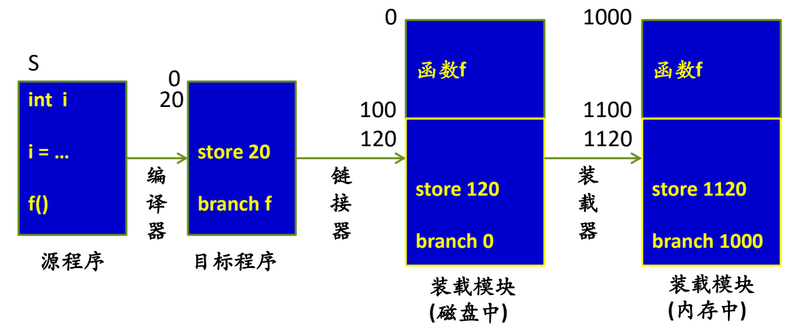

图：源程序经编译器、链接器、装载器三步，看 `store 20` 变为 `store 120` 再变为 `store 1120`、`branch f` 变为 `branch 0` 再变为 `branch 1000`，装载时一次性把逻辑地址加上装入起址 1000。

上图从左到右依次是源程序、目标程序、磁盘中的装载模块和内存中的装载模块，标出了编译器、链接器、装载器三步各自做的改写。真正改成物理地址的只有最后一步，即装载时，这就是“静态”重定位。

静态重定位的问题在于：装入后所有地址都已固定，程序只能待在这个位置；要换位置，就得把所有地址重新改一遍。而且它默认整个进程一次性全装进内存，程序很大、有些部分根本不执行时，这种做法就很浪费。

### 动态地址重定位与 MMU

**动态地址重定位**（dynamic relocation）：装载时不改地址，在进程执行过程中逐条指令完成地址映射。 在同样的例子中，编译、链接两步不变，装入内存（从 1000 开始）后指令仍是 `store 120`、`branch 0`，直到执行时才映射到物理地址。

> [!info] 可视化资源
> - [OSTEP 第 15 章 地址转换（PDF）](https://pages.cs.wisc.edu/~remzi/OSTEP/vm-mechanism.pdf)：看图 15.2 单个重定位进程在物理内存中的位置，以及图 15.3/15.4 动态重定位对硬件与 OS 的要求。

由于**每执行一条指令都要做一次地址转换**，用软件做必然太慢，必须由专门的硬件完成。这个部件就是**内存管理单元**（Memory Management Unit, MMU）：CPU 发出逻辑地址，经 MMU 转换为物理地址后再访问物理内存。

最早的 MMU 只有一个**重定位寄存器**（relocation register），记录当前进程在物理内存中的起始地址；每个逻辑地址都加上它，就得到物理地址：

$$
\text{物理地址} = \text{重定位寄存器的值} + \text{逻辑地址}
$$

例如重定位寄存器为 12000，CPU 发出逻辑地址 456，则物理地址为 $12000 + 456 = 12456$。

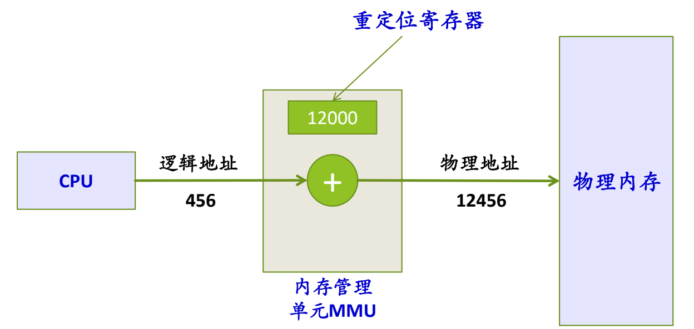

图：CPU 发出逻辑地址 456，MMU 将其与重定位寄存器中的 12000 相加，得到物理地址 12456 后访问物理内存。

图中 CPU 发出的逻辑地址 456 经过 MMU 中的加法器与重定位寄存器 12000 相加，得到物理地址 12456 再去访问物理内存。思路和装载时改地址一样，都是“起点 + 相对地址”，区别只在于它推迟到每条指令执行时由硬件完成。今天 MMU 框里的机制已换成虚存的那套映射（页表等，见 [页式与段式管理](#页式与段式管理)），但“CPU 发出逻辑地址、MMU 转换后访存”的结构没有变。

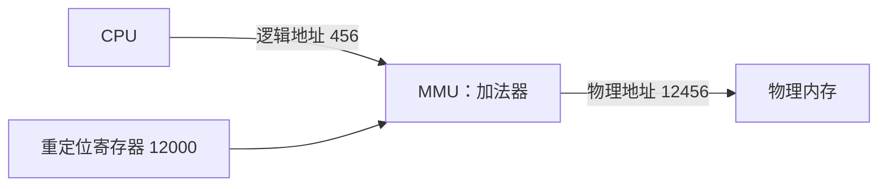

| 比较维度 | 静态重定位 | 动态重定位 |
| --- | --- | --- |
| 转换时机 | 装载时一次性完成 | 每条指令执行时 |
| 谁来完成 | 软件（装载器） | 硬件（MMU） |
| 内存中的代码 | 已改写为物理地址（`store 1120`） | 保持相对地址（`store 120`） |
| 程序能否移动 | 不能，移动需重改全部地址 | 能，只需修改重定位寄存器 |

> [!question]- 自测：在静态重定位的例子中，如果装载器把装载模块放在 3000 而不是 1000，`store 120` 和 `branch 0` 会变成什么？若采用动态重定位呢？
> 静态重定位：所有地址加 3000，变成 `store 3120`、`branch 3000`。动态重定位：内存中的指令仍是 `store 120`、`branch 0`，重定位寄存器置为 3000，执行 `store 120` 时 MMU 算出物理地址 3120。

> [!question]- 自测：为什么编译时绑定在实际中不可行，而运行时绑定一定需要硬件？
> 编译时绑定要求事先知道装入起点，而且只能有一个源文件；多个 `.o` 的排列顺序要到链接时才确定，起点要到装载时才知道。运行时绑定意味着每条访存指令都要转换一次地址，软件开销无法接受，只能由 MMU 用硬件完成。

---

## 地址保护与地址空间

> [!abstract] 本节要点
> - 多道程序下多个进程同时在内存，每个进程只能访问 $[\text{基址}, \text{基址}+\text{界限})$ 内的地址，否则陷入 OS；基址/界限寄存器由 OS 用特权指令加载。
> - 整进程连续装入越来越难，出路是三个转变：连续性 → 离散性、驻留性 → 交换性、一次性 → 多次性，页式由此而来。
> - 演化路线：早期单进程独占 → 多道程序分时共享（整进程连续装入）→ 虚拟化内存；今天 x86-64 Linux 的地址空间为 $2^{48}$，远大于 16G/32G 物理内存。
> - 虚拟地址空间的特点：巨大、统一一致、私有（越界问题天然消失，只剩越权），再加稀疏。
> - 内存管理的基本功能：分配地址空间、加载（建立与可执行文件各 section 的映射）、保护、共享、最小化访问时间；Linux 用 `vm_area_struct` 的起始地址、结束地址、flags、protection 描述一个区域。

### 越界保护：基址寄存器与界限寄存器

早期的做法是把一个进程的整个地址空间**连续地**放进物理内存。多道程序设计让多个进程同时在内存里：进程 A、B、……、Z 各占一段，操作系统也在内存中。 每个程序长短不一样（大程序和 hello world 所需空间差别很大），只要进程要运行，就在物理内存中找一块地方把它整个放进去。

> [!info] 可视化资源
> - [OSTEP 第 15 章 地址转换（PDF）](https://pages.cs.wisc.edu/~remzi/OSTEP/vm-mechanism.pdf)：重点看图 15.5/15.6：启动时与运行时 OS 和硬件如何配合加载 base/bounds、越界时陷入 OS。

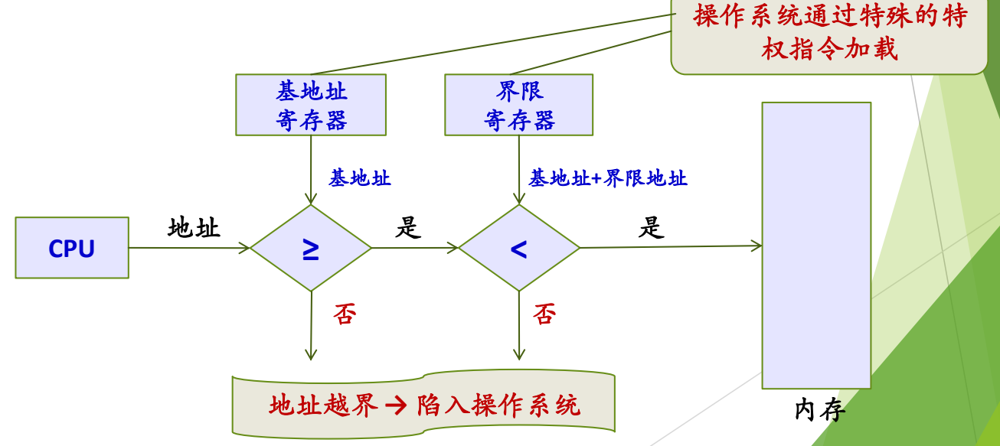

图：CPU 给出的地址先与基地址比较（$\ge$），再与基地址+界限地址比较（$<$），两项都为“是”才访问内存，任一为“否”则地址越界并陷入操作系统；两个寄存器由操作系统通过特权指令加载。

这时就有了第一个问题：进程 Z 执行时访问的任何地址都必须落在自己那一段里，既不能低于它的下界，也不能高于它的上界，更不能进入别的进程或操作系统的空间。这就是**地址越界保护**。 地址保护有两层含义：

- 确保每个进程有独立的地址空间；
- 确定进程可以访问的合法地址范围，确保进程只访问合法地址。

只有一个重定位寄存器（起始地址）只能做转换，做不了检查，所以要增加一个寄存器：

- **基址寄存器**（base register）：进程在物理内存中的起始地址；
- **界限寄存器**（limit register）：进程地址空间的长度。

每次访存时，硬件对地址做两次比较：

1. 地址 $\ge$ 基址？否则越界；
2. 地址 $<$ 基址 + 界限？否则越界；
3. 两项都满足才访问内存；任一不满足即**地址越界，陷入操作系统**。

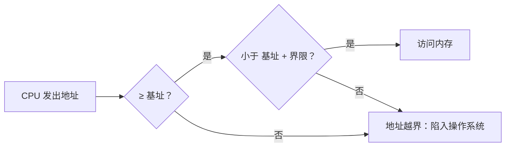

基址寄存器和界限寄存器由操作系统通过**特殊的特权指令**加载，用户进程不能自己修改。 因此，在那个时期，地址转换（地址映射）时必须同时考虑保护。

> [!example] 例：判断是否越界
> 某进程基址为 30000，界限为 12000，合法范围是 $[30000, 42000)$。
>
> 1. 访问 35000：$35000 \ge 30000$ 且 $35000 < 42000$，合法。
> 2. 访问 42000：$42000 < 42000$ 不成立，越界，陷入 OS（上界是开区间）。
> 3. 访问 29999：小于基址，越界。

### 从连续到离散：要解决的第二个问题

第二个问题是：进程越来越大，要为它在物理内存中找到一整块连续空间越来越难。 出路就是今天已经普遍接受的三个转变：

- **连续性 → 离散性**：把一个进程切成几块（页），在内存中各找一块空位放进去，逻辑上的一页对应物理内存中的一页，只要有空位就能放。页式管理就是这样来的。
- **驻留性 → 交换性**：驻留指进程一进内存就一直待到运行结束才归还；交换指进程还没运行完也可以先出内存，过一会儿再进来。
- **一次性 → 多次性**：不必一次全部装入，可以分多次进入内存。

这样就不必为整个进程找一块连续空间，内存管理变得灵活得多。页式的细节见 [页式与段式管理](#页式与段式管理)，交换见 [覆盖与交换技术](#覆盖与交换技术)。

### 已成为常识的前提

下面这些今天已经是常识，也是讨论内存管理的前提：

- **多道程序设计模型**：允许多个程序同时进入内存，正因如此才需要考虑越界等问题；
- **程序装载到内存才可以运行**：程序以文件形式（可执行文件格式）保存在磁盘上；
- **每个进程有自己独立的地址空间**：一个进程执行时不能访问另一个进程的地址空间，任何进程也不能访问操作系统所在的空间；
- **不能执行不适当的操作**：例如只允许读的区域不能写；
- 局部性原理与存储体系（见 [内存管理的任务](#内存管理的任务)）。

**为什么有了多道程序，内存管理就要多做很多工作？** 因为同时有多个用户程序在内存中：

1. **需要支持地址重定位**：程序中的地址不一定是最终的物理地址，因为程序运行前无法确定它会被加载到内存什么地方，也就算不出物理地址；
2. **需要支持地址保护**：进程之间不能互相访问对方的内存。

### 内存管理的演化与虚拟地址空间

内存管理从最简单到今天的虚存，大致经过以下几个阶段：

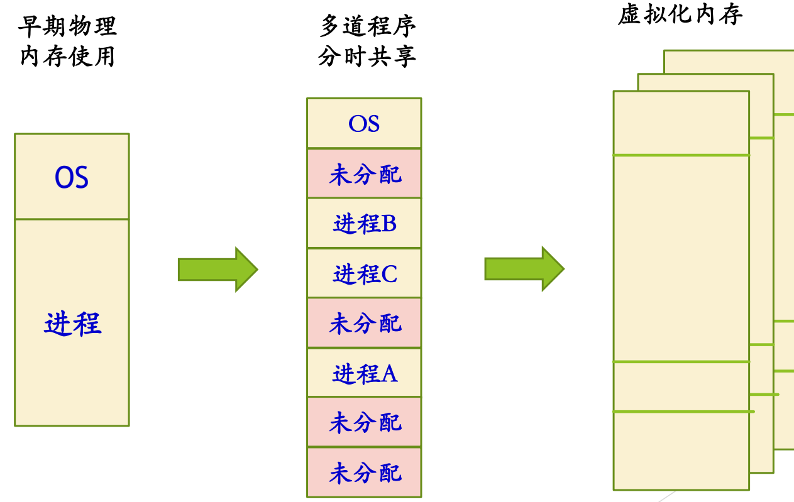

图：从早期单个进程独占内存（OS+进程），到多道程序分时共享（OS 与进程 A/B/C 及若干未分配区共存），再到每个进程各自一份虚拟化内存的三个阶段。

图中从左到右：早期内存里只有 OS 和一个进程，这个进程运行完，整个换出，新的进程再进来；多道程序阶段内存中有 OS、进程 A/B/C 和若干未分配区，新进程到来时找一块足够大的空闲区放进去，但仍以整个进程为单位连续装入；最后是虚拟化内存，每个进程都拥有一个很大的虚拟地址空间。中间还经历过把进程分成多块、不连续存放的阶段，这里从略。

今天每个进程的地址空间比物理内存大得多。例如 x86-64 Linux 的进程地址空间为 $2^{48}$ 字节（256 TB），而机器的物理内存通常只有 16G 或 32G，根本放不下。之所以可行，是因为地址空间按页划分后离散存放，并不要求所有页都在内存中，需要时才调入。

ICS 课程总结了虚拟地址空间的三个特点，为了在 PCB 中描述它，又加上第四个：

1. **巨大**：每个进程一个地址空间，范围非常大；
2. **统一一致**：每个进程的内存布局都一样；
3. **私有**：每个进程独占自己的整个地址空间，不论怎样寻址都出不了这个圈，所以**地址越界问题天然被解决**，只剩下**越权**问题；
4. **稀疏**：巨大的空间中只有少数区域真正在用，PCB 中描述地址空间的数据结构要能表达这种稀疏性。

> [!warning] 易错点
> 基址/界限寄存器解决的是多个进程共处一块物理内存时的**越界**问题。到了虚存时代，每个进程的地址空间私有，越界不再是问题，保护的重点变成**越权**（读/写/执行权限）。不要把两个时代的保护机制混为一谈。

### 内存管理的基本功能

内存管理的基本功能有五项：

1. **给进程分配内存**：今天就是进程一创建，就给它一个地址空间（虚存）。
2. **往内存加载内容**：把进程地址空间映射到物理内存。
3. **存储保护**：防止地址越界，检查访问权限。
4. **共享内存**（后续讲次再讲）。
5. **最小化存储访问时间**：已知的手段之一就是缓存（cache），访问命中缓存就不必去内存取。

对第 2 项要理解清楚：**地址空间的内容是设计（约定）出来的，真正的内容在磁盘上**。设计好“这块放代码、这块放数据”之后，建立地址空间实际上只是在地址空间与**可执行文件**的各个 section（代码、数据等）之间建立映射；把地址空间再映射到物理内存，是下一步的事。

在 Linux 中，地址空间的每个区域用一个 `vm_area_struct` 结构描述，其中最重要的四项信息是：

- **起始地址**（start）：该区域的起点，例如代码 section 映射到地址空间后的起点；
- **结束地址**（end）：该区域的终点；
- **标志**（flags）；
- **保护属性**（protection）：该区域的访问权限。

栈区在磁盘上的可执行文件中没有对应内容，但它同样是一个区域，同样有保护属性（例如不可执行）。

> [!tip] 课堂强调
> `vm_area_struct` 中的起始地址、结束地址、flags、protection 这四项信息一定要记住。

> [!note] 补充解释
> 在 Linux 源码中，这几个字段的实际名称是 `vm_start`、`vm_end`、`vm_flags` 和 `vm_page_prot`（见 [include/linux/mm_types.h](https://elixir.bootlin.com/linux/latest/source/include/linux/mm_types.h)）。一个进程的所有 `vm_area_struct` 由其 `mm_struct` 统一管理。

**虚拟化内存**还要满足三项要求：

- **透明性**：用户进程不关心内存如何管理，只要能运行就好；
- **效率**；
- **保护**。

虚存能同时满足这三项，因此也满足了内存管理的基本要求。

### 进程地址空间的布局

地址空间的布局就是一种**约定**：规定好什么东西放在哪里，大家就知道到哪里去找。程序的地址应当与物理内存地址无关。 关于地址空间要能回答三个问题：有什么内容？从哪里加载到地址空间？具体放在什么位置？

> [!info] 可视化资源
> - [xv6 RISC-V 教材 rev4（MIT 6.1810，PDF）](https://pdos.csail.mit.edu/6.1810/2024/xv6/book-riscv-rev4.pdf)：看图 2.3 进程虚拟地址空间布局与图 3.4 用户地址空间及初始栈（布局属考核内容）。

各区域的含义与来历已在 L04「06 进程地址空间」讲过，这里只列出经典 32 位 Linux 的布局作为对照（从低地址到高地址）：

| 区域 | 起始地址（示意） | 说明 |
| --- | --- | --- |
| 只读的代码和数据 | `0x08048000` | 代码段 |
| 读/写数据 | 紧接代码之后 | 数据段 |
| 运行时堆 | 数据段之后，向高地址增长 | 运行时由 `malloc` 创建 |
| 共享库的存储器映射区域 | `0x40000000` | 共享库、内存映射文件 |
| 用户栈 | `0xc0000000` 以下，向低地址增长 | 运行时创建 |
| 内核虚拟存储器 | `0xc0000000`–`0xffffffff` | 内核空间 |

简化来看，地址空间分为高处的内核地址空间和低处的用户地址空间；用户地址空间中从低到高是代码段（PC 指向这里）、数据段、堆，最上面是栈（SP 指向这里），此外还有共享库、内存映射文件等内容。

代码、数据和共享库的内容都来自磁盘上的可执行文件或库文件，堆和栈在磁盘上没有对应内容，运行时才创建；这一区别决定了换出进程时只需写出堆和栈（见[覆盖与交换技术](#覆盖与交换技术)）。

**xv6 的地址空间**布局相对简单（定义见 `kernel/memlayout.h`）：

- 地址从低到高依次为 text、data & bss、stack、heap……；
- 高地址处有 trampoline 和 trapframe，它们在用户态和内核态都有映射。

> [!tip] 课堂强调
> xv6 的地址空间布局较简单，课后要去读，这部分属于将来的考核内容。

有了地址空间，最终还要把它的内容装进物理内存，因此还要把物理内存的**空闲空间**组织起来，负责分配、回收、分割与合并，详见 [空闲内存管理与分配](#空闲内存管理与分配)。英文文献把“分配”称为 **placement**（放置），与 **replacement**（置换）同根，读文献时要认得。

> [!question]- 自测：某进程基址寄存器为 0x4000，界限寄存器为 0x1000。CPU 依次访问 0x4FFF 和 0x5000，结果分别如何？谁负责设置这两个寄存器？
> 合法范围是 $[\text{0x4000}, \text{0x5000})$。访问 0x4FFF 合法；访问 0x5000 不满足“小于基址+界限”，越界，陷入操作系统。两个寄存器由操作系统用特权指令加载，用户程序无权修改。

> [!question]- 自测：为什么说在虚拟地址空间中“越界”问题天然消失，而“越权”问题仍然存在？
> 每个进程的虚拟地址空间是私有的，进程无论怎样寻址都只能落在自己的空间里，碰不到别的进程。但同一个地址空间内部的不同区域权限不同（如代码只读、栈不可执行），对只读区写入这类越权访问仍需要通过 `vm_area_struct` 的保护属性等机制来检查。

---

## 空闲内存管理与分配

> [!abstract] 本节要点
> - 物理内存管理只管空闲部分：分出去的不再管，归还后重新纳入空闲管理；本质是数据结构与算法问题。
> - 等长划分（页框）用位图，每个单元 1 位；不等长划分（可变分区）用空闲区表/已分配区表或空闲块链表（隐式、显式、分离）。
> - 衡量指标有两类：内存利用率（内碎片、外碎片）和性能（分配延迟、CPU 开销）。
> - 首次、下次、最佳、最差四种适配都是“切出所需部分，剩余成为新空闲区”，所以才有碎片；省搜索时间就要花排序时间，首次适配仍常用。
> - 回收时按上相邻、下相邻、上下都相邻、上下都不相邻四种情况合并，并修改空闲区表。

### 两种划分与对应的数据结构

把地址空间的内容装进物理内存，就要知道物理内存中哪些地方是空的。**物理内存管理只管空闲的部分**：分出去之后就不再管，归还回来再变成空闲并重新管起来。所以这本质上是一个数据结构与算法问题。

物理内存的划分方式有两种，分别对应不同的数据结构：

- **等长划分**：把物理内存划分成大小相同的单元，例如今天页式管理中的页框（page frame）。
- **不等长划分**：每个空闲区大小不等，例如传统的可变分区。

三种数据结构中，位图适合等长划分，空闲区表和空闲块链表适合不等长划分。

#### 位图

**位图**（bitmap，位示图）：每个分配单元对应位图中的一位，0 表示空闲，1 表示占用（也可以反过来）。 一位的信息量很小，但对等长划分已经够用：

- 若进程需要**连续** 10 页，就在位图中找连续 10 个 0；
- 若**不要求连续**，就逐个找 0，找到一个分一个，跳过中间的 1 继续找。

#### 空闲区表与已分配区表

不等长划分不能用位图，改用表格。**空闲区表**（或**已分配区表**）的每一项记录一个空闲区（或已分配区）的**起始地址、长度、标志**。 可以用两张表分别记录空闲区和已分配区，也可以合成一张表、用标志区分空闲与已分配。表的大小事先不知道，通常设计得比较大，所以会有许多没有意义的“空项”。

> [!info] 可视化资源
> - [OSTEP 第 17 章 空闲空间管理（PDF）](https://pages.cs.wisc.edu/~remzi/OSTEP/vm-freespace.pdf)：看图 17.4/17.6 空闲链表嵌在堆中如何被切分，以及最佳/最差/首次/下次适配的比较。

#### 空闲块链表

空闲区也可以组织成**空闲块链表**，有隐式空闲链表、显式空闲链表、分离空闲链表三种，ICS 课程的 malloc 实验中都实现过。

### 衡量指标与碎片

不论等长还是不等长划分，追求的目标都是一样的：

- **内存资源利用率**：尽可能减少资源浪费，关注**内碎片**和**外碎片**；
- **性能**：尽可能降低分配延迟，节约 CPU 资源。

> [!note] 补充解释
> **内碎片**（internal fragmentation）是分给进程的区域内部没有用上的部分，例如按固定大小的页或分区分配时，最后一块装不满；**外碎片**（external fragmentation）是夹在已分配区之间、太小而难以再分配出去的空闲区。哪种方案产生哪种碎片，在 [连续分配方案](#连续分配方案) 和 [页式与段式管理](#页式与段式管理) 中分别讨论。

这类分配算法在数据结构中很常见，也可以参考 Knuth《计算机程序设计艺术》中的相关内容。

### 四种分配算法

四种适配算法的区别只在于**选哪个空闲区**：

- **首次适配**（first fit）：在空闲区表中找到第一个满足进程要求的空闲区；
- **下次适配**（next fit）：从上次找到的空闲区处接着往下查找；
- **最佳适配**（best fit）：查找整个空闲区表，找到能满足进程要求的**最小**空闲区；
- **最差适配**（worst fit）：总是分配满足进程要求的**最大**空闲区。

选中之后的处理都一样：**把该空闲区分为两部分，一部分给进程使用，另一部分形成新的空闲区。** 算法并不是把整个空闲区都给进程，而是切出所需的大小，剩余部分留作空闲。正因为不断切分，才会出现碎片问题。

> [!warning] 易错点
> “最差适配”的“差”不是说算法差，而是指它挑**最大**的空闲区来切。切完后剩下的空闲区仍然比较大，还能继续使用。

至于哪种算法更好，其实并不重要：如果每次要找最小或最大的空闲区，要么分配时逐个查找花时间，要么空闲区归还时维护排序花时间，总要在某处付出代价。所以简单的**首次适配**至今仍被常用。

### 分配示例

初始时内存 0K–120K 的使用情况如下，有三个空闲区：

| 区间 | 长度 | 状态 |
| --- | --- | --- |
| 0K–15K | 15K | $P_1$ |
| 15K–38K | 23K | 空闲 |
| 38K–48K | 10K | $P_2$ |
| 48K–68K | 20K | 空闲 |
| 68K–80K | 12K | $P_3$ |
| 80K–110K | 30K | 空闲 |
| 110K–120K | 10K | $P_4$ |

对应的空闲区表为（15K, 23K, 未分配）、（48K, 20K, 未分配）、（80K, 30K, 未分配），其余为空项；已分配区表为 $P_1$–$P_4$ 四项。

> [!example] 例：判断所用的分配算法
> 1. 进程 $P_5$ 申请 5K，系统从 80K 处分出 80K–85K。空闲区表中原来的（80K, 30K）变为（85K, 25K），已分配区表增加（80K, 5K, $P_5$）。
> 2. 判断算法：三个空闲区分别是 23K、20K、30K，系统选的是最大的 30K；切出 5K 后剩下的 25K 仍然是最大的空闲区。如果是首次适配，应选 15K 处的 23K 区；如果是最佳适配，应选 20K 区。所以这里用的是**最差适配**。
> 3. 进程 $P_6$ 再申请 13K，仍从当前最大的 25K 区（85K 处）切出 85K–98K。空闲区表变为（15K, 23K）、（48K, 20K）、（98K, 12K），已分配区表增加（85K, 13K, $P_6$），此时已分配区表已经用满。

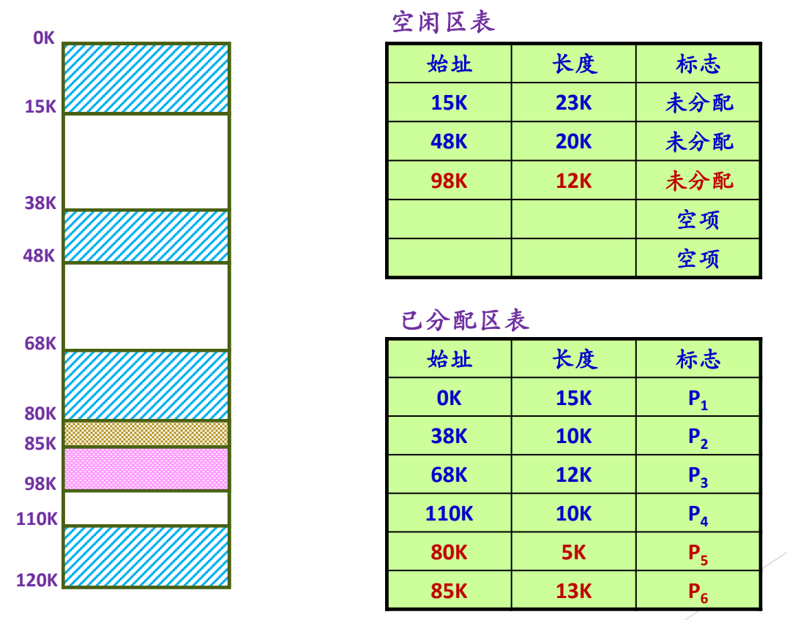

图：左侧 0K–120K 的内存布局与右侧两张表对应，空闲区表记录 15K/23K、48K/20K、98K/12K 三个未分配区，已分配区表记录 $P_1$–$P_6$ 的始址与长度，对照每项的始址和长度找到图中位置。

图中左侧是内存布局，新增的 80K–85K 和 85K–98K 两段分别分给 $P_5$ 和 $P_6$；右侧是两次分配后空闲区表和已分配区表的变化过程。

### 回收与合并

内存不是无限的，用完要收回来。**内存回收算法**：某一块归还后，与前后的空闲空间合并，并修改空闲区表。 设归还区为 $R$，按它与相邻空闲区的位置关系分四种情况：

| 情况 | 含义 | 空闲区表的变化 |
| --- | --- | --- |
| 上相邻 | $R$ 的上方（低地址侧）紧挨一个空闲区 | 与上方空闲区合并：该表项长度增加，起始地址不变 |
| 下相邻 | $R$ 的下方（高地址侧）紧挨一个空闲区 | 与下方空闲区合并：该表项起始地址改为 $R$ 的起址，长度增加 |
| 上下都相邻 | 两侧都是空闲区 | 三块合成一块：保留一个表项，删除另一个，表项数减 1 |
| 上下都不相邻 | 两侧都已分配 | 新增一个表项记录 $R$ |

也就是说，回收后可能三个空闲区合成一个，可能两个合成一个，也可能新增一个空闲区。

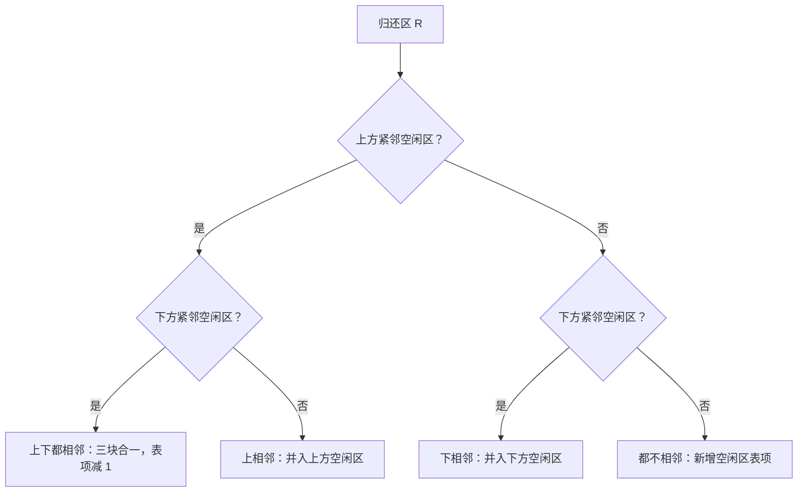

按大小分类组织空闲块以减少搜索开销，就是**分离适配**的思想，Linux 伙伴系统即属于这一类，见 [伙伴系统与 SLAB](#伙伴系统与-slab)。

> [!question]- 自测：在示例的初始状态（空闲区 23K、20K、30K，依地址顺序排列）下，进程申请 18K。首次适配、最佳适配、最差适配分别从哪个起始地址分配？分配后新空闲区多大？
> 首次适配：第一个能放下 18K 的是 15K 处的 23K 区，分出 15K–33K，剩下（33K, 5K）。最佳适配：能放下的最小区是 48K 处的 20K 区，分出 48K–66K，剩下（66K, 2K）。最差适配：最大的是 80K 处的 30K 区，分出 80K–98K，剩下（98K, 12K）。

> [!question]- 自测：接上例最终状态（$P_5$ 占 80K–85K，$P_6$ 占 85K–98K，98K–110K 空闲），若 $P_6$ 归还，属于哪种回收情况？空闲区表如何变化？
> $P_6$（85K–98K）上方是 $P_5$（已分配），下方紧邻空闲区 98K–110K，属于“下相邻”。合并后表项（98K, 12K）改为（85K, 25K）：起始地址前移到 85K，长度变为 $13+12=25$K，表项数不变。

---

## 伙伴系统与 SLAB

> [!abstract] 本节要点
> - **分离适配**按块大小分类，各类各维护一条空闲链表，分配时只搜索对应的类，从而减少搜索开销；伙伴系统、SLAB 和 PagedAttention 都是它的变体。
> - 伙伴系统把整块看作 $2^U$：若 $2^{U-1} < s \le 2^U$ 就把整块分配出去，否则一分为二，一直分到能容纳 $s$ 的最小块为止。
> - 只有从同一块一分为二得到的两块（buddy）才能合并；地址相邻但不是伙伴的两个空闲块不能合并。合并可以逐级连锁，一直合回更大的块。
> - SLAB 管理内核中频繁分配的小对象（PCB、inode、VMA 等），做法是“批发—零售”：先拿一大块内存预先切好，用时直接取。
> - SLUB 简化了数据结构，减少多核下的锁竞争，并针对 NUMA 做本地性设计；SLOB 力求极简紧凑，用于嵌入式和资源受限系统。

### 分离适配（Segregated Fit）

[首次、最佳等适配算法](#空闲内存管理与分配)每次分配都要在一条空闲链表上逐个查找，空闲块越多，搜索就越慢。**分离适配**（segregated fit）是内存管理和资源分配领域的经典思路：按块的大小把空闲块**分类**，每一类各自组织成空闲链表；申请时先根据大小确定类别，只在该类（或更大的类）中查找，从而减少搜索开销。

这一思想有多种变体，适用于从嵌入式系统到大模型推理的各种场合：

| 变体 | 特点 | 典型应用 |
| --- | --- | --- |
| 简单分离存储（Simple Segregated Storage） | 块大小固定，不分割也不合并 | 嵌入式实时系统（延迟可预测） |
| Segregated Fit | 允许分割大块，释放时可选择合并 | dlmalloc（Doug Lea malloc） |
| 伙伴系统（Buddy System） | 只允许 2 的幂大小，合并严格配对 | Linux 内核页分配、GPU 显存管理 |
| Slab 分配器（Slab Allocator） | 按**对象类型**分离，而不只按大小 | Linux 内核 kmalloc、对象缓存 |
| PagedAttention | 按 token 数分配 block，动态分配 | vLLM 的 KV Cache 管理 |

PagedAttention 说明这套几十年前的思想今天仍然适用：大模型推理时 KV Cache 的长度随生成的 token 数增长，把它切成固定大小的 block 按需分配，就是分离适配加上页式管理的思路。

### 伙伴系统（Buddy System）

可变大小的分配容易产生大量难以合并的小空闲块。伙伴系统给块的大小和合并对象都加了限制，从而换来快速的分配与合并。Linux 内核底层的物理内存分配（包括 GPU 显存管理）采用的就是伙伴系统，它是一种特殊的分离适配算法。

> [!info] 可视化资源
> - [维基百科：Buddy memory allocation](https://en.wikipedia.org/wiki/Buddy_memory_allocation)：看示例表格：1024K 内存逐行展示 A、B、C、D 申请时的分裂与释放时只与真伙伴合并，和课件 1MB 例子同构。
> - [OSTEP 第 17 章 图 17.8（PDF）](https://pages.cs.wisc.edu/~remzi/OSTEP/vm-freespace.pdf)：图 17.8 用二叉树画出伙伴系统的递归二分。

**伙伴系统**（buddy system）把内存按 2 的幂划分，相同大小的空闲块组成同一条空闲链表；分配时查找能满足请求的**最佳匹配块**。

**分配算法**如下（设请求大小为 $s$）：

1. **初始状态**：把整个可用空间看作一块，大小为 $2^U$。
2. **判断是否整块分配**：若 $2^{U-1} < s \le 2^U$，即 $s$ 超过块的一半、又不超过整块，就把整个块分配出去。
3. **否则对半划分**：把块分成两个大小相等的**伙伴**（buddy），各为 $2^{U-1}$，取其中一块继续执行第 2 步，另一块挂到 $2^{U-1}$ 的空闲链表上。
4. **重复**，直到得到大于或等于 $s$ 的最小块。

**回收规则**：块释放时，检查它的伙伴是否也空闲。若是，两者合并成大一倍的块，再用这个新块重复检查，可能一路合并上去（连锁合并）；若伙伴不空闲，就停在当前大小。关键在于**只有同一块一分为二得到的两块才是伙伴**，只有伙伴才能合并。

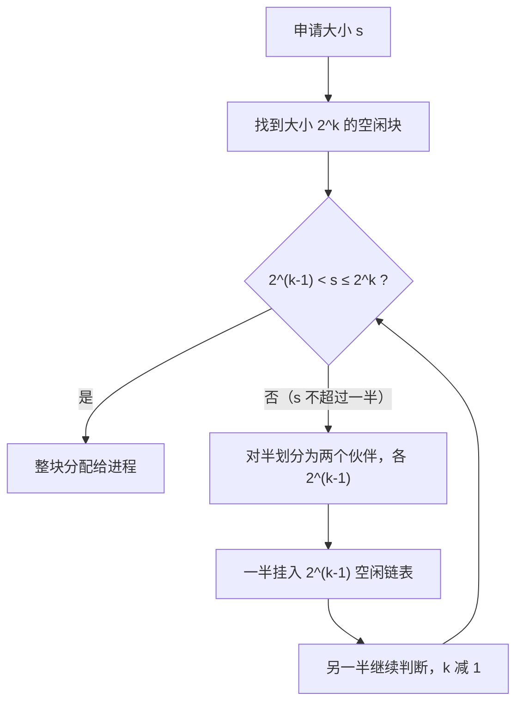

#### 1 MB 例子

下面的例子从 1 MB 空闲内存开始，内存布局从低地址写到高地址。

| 操作 | 内存布局（低 → 高） | 过程说明 |
| --- | --- | --- |
| 初始 | 1M | 整块空闲 |
| A 申请 100K | A=128K, 128K, 256K, 512K | 1M→512K→256K→128K 逐级对半，$64 < 100 \le 128$，分配 128K |
| B 申请 240K | A, 128K, B=256K, 512K | 已有空闲 256K，$128 < 240 \le 256$，直接分配 |
| C 申请 64K | A, C=64K, 64K, B, 512K | 把第二个 128K 对半，分配 64K |
| D 申请 256K | A, C, 64K, B, D=256K, 256K | 没有空闲 256K，把 512K 对半 |
| 释放 B | A, C, 64K, 256K, D, 256K | 左侧 64K 空闲但不是伙伴，不合并 |
| 释放 A | 128K, C, 64K, 256K, D, 256K | A 的伙伴已被拆开且 C 在用，不合并 |
| E 申请 75K | E=128K, C, 64K, 256K, D, 256K | $64 < 75 \le 128$，直接用空闲 128K |
| 释放 C | E, 128K, 256K, D, 256K | C 与伙伴 64K 合成 128K；该 128K 的伙伴 E 在用，停止 |
| 释放 E | 512K, D, 256K | E+128K→256K，再与伙伴 256K→512K（连锁合并） |
| 释放 D | 1M | D+256K→512K，再与伙伴 512K→1M |

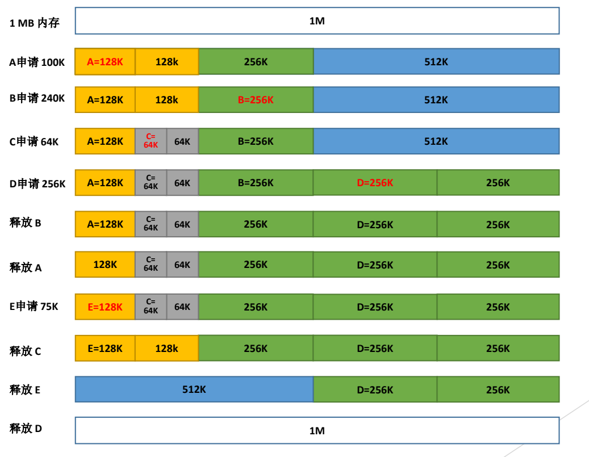

图：1 MB 内存依次处理 A 申请 100K、B 申请 240K、C 申请 64K、D 申请 256K 及后续释放，看块如何按 2 的幂对半拆分（如 512K→256K→128K→64K），以及释放后相邻伙伴如何合并回 512K 乃至 1M。

“释放 B”这一步最容易判断错：B 所在的 256K（地址 256K–512K）左边紧挨着一个 64K 空闲块，但 B 的伙伴是地址 0–256K 那一整块，而那块已被拆成 A、C 和 64K，所以 B 不能和任何块合并，只是多了一个 256K 空闲块。

> [!warning] 易错点
> 判断能否合并要看**是否同出一块且大小相同**，不能只看地址是否相邻。例中 64K 空闲块和释放后的 256K 空闲块地址相邻，但大小不同、也不是从同一块分出来的，所以不能合并。

> [!note] 补充解释
> 伙伴系统总是按 $2^k$ 分配，请求大小不是 2 的幂时会产生内碎片：A 申请 100K 拿到 128K，浪费 28K；E 申请 75K 拿到 128K，浪费 53K。这是它用空间换取快速分配与合并的代价。伙伴的地址也很好算：大小为 $2^k$、起始地址为 $a$（$a$ 是 $2^k$ 的整数倍）的块，其伙伴起始地址为 $a \oplus 2^k$（按位异或），所以查找伙伴只需一次位运算。

### SLAB 分配器（SLAB Allocator）

用户空间的内存基本按页分配，比较简单；内核却要频繁地申请和释放大量**小对象**，例如创建进程要分配 PCB，创建文件要分配 inode，此外还有 VMA 等结构。这些对象往往远小于一页，如果每次都从伙伴系统现场分配，既慢又浪费。

**SLAB 分配器**是 Linux 内核中用于运行时动态分配、释放内核内存的分配器，目标是可靠性和高性能。它由 Jeff Bonwick 在 20 世纪 90 年代最先在 Solaris 2.4 内核中设计实现。它把大块内存进一步细分成小块管理，只分配固定大小的内存块，块大小通常为 $2^n$ 字节（$3 \le n < 12$，即 8 B 到 2 KB）。

它的思想可以概括为**批发—零售**：先从下层“批发”一大块内存，按对象大小预先切好，用时直接“零售”取一个。用户空间的堆也是批发零售，只不过发生在用户态。

**实现方法**：

1. **按大小分区**：把可用内存按对象大小划分为不同区域，每个区域有一个空闲对象列表。
2. **分配**：在大小合适的空闲对象列表中取一个与请求相符的空闲对象。
3. **释放**：把对象放回相应的空闲对象列表。
4. **缓存**：SLAB 有 slab cache，对象释放时优先放入本地高速缓存，下次分配可以直接复用。

SLAB 广泛用于文件系统、网络协议栈等内核模块。在 Linux 上可以用 `cat /proc/slabinfo`（通常需要 `sudo`）查看当前的 slab 缓存。

> [!tip] 课堂强调
> 对 SLAB 系列只需知道“有这种分配器、它管理哪些对象、基本思路是什么”，具体实现不作要求。

### SLAB 的问题与 SLUB、SLOB

**SLAB 的问题**：它维护的队列太多，实现日趋复杂，存储开销也随之增大；更关键的是，在高并发环境下多个 CPU 同时从同一队列取对象必须加锁，容易出现锁竞争，多核系统中性能下降。 这和 L08「01 多处理器调度的基本问题」中的情形一样：所有 CPU 共用一个全局就绪队列时要加锁，竞争激烈；改为每个 CPU 一个队列，别的 CPU 不来争，锁竞争就少了。

**改进一：SLUB**。为提高性能和可伸缩性，SLUB 采用更简单的数据结构，减少锁竞争，提高多核下的并发性能；它还可以针对体系结构优化，例如针对多核、多节点（NUMA）的本地性设计。NUMA 下访问离本节点近的内存比访问远的内存快，所以 SLUB 尽量从离当前 CPU 近的节点分配。SLUB 于 2007 年并入 Linux 2.6.22。

**改进二：SLOB**。SLOB 是一个极简的内核内存分配器，设计目标是尽可能简单、紧凑，减少代码量和内存开销，适用于小型嵌入式系统和资源受限的环境。

| 分配器 | 设计目标 | 适用场景 |
| --- | --- | --- |
| SLAB | 小对象预切分 + 缓存，高性能 | 通用内核小对象分配（早期默认） |
| SLUB | 简化结构、减少锁竞争、NUMA 本地性 | 多核、多节点服务器 |
| SLOB | 极简紧凑，代码和内存开销小 | 嵌入式、资源受限系统 |

> [!note] 补充解释
> 课件标注“SLUB 由 Pekka Enberg 开发”“SLOB 最早出现在 Linux 内核 2.2 版本”，与公开记录不符：SLUB 的作者是 Christoph Lameter（Pekka Enberg 当时是 slab 子系统的维护者之一），SLOB 由 Matt Mackall 编写，于 2.6.16（2006 年）并入主线。此外，近年的内核已移除 SLOB（6.4）和 SLAB（6.8），目前 SLUB 是唯一的 slab 分配器。参见 [Linux 内核文档：SLUB](https://docs.kernel.org/mm/slub.html)。

> [!question]- 自测：在 1 MB 伙伴系统中依次申请 A=70K、B=35K、C=80K，各得到多大的块？此时最大的空闲块是多少？
> A 得到 128K（1M→512K→256K→128K，$64<70\le128$）；B 得到 64K（把剩下的 128K 拆成两个 64K，$32<35\le64$）；C 得到 128K（把空闲的 256K 拆成两个 128K）。剩余空闲块为 64K、128K、512K，最大的是 512K。

> [!question]- 自测：两个大小同为 64K 的空闲块地址相邻，一定能合并吗？
> 不一定。只有当它们是同一个 128K 块对半拆开的两半时才是伙伴。例如位于 64K–128K 和 128K–192K 的两块虽然相邻、大小相同，却分属 0–128K 和 128K–256K 两个不同的 128K 块，不能合并。

> [!question]- 自测：为什么 SLAB 在多核机器上会变慢，SLUB 的改进思路与多处理器调度有什么共同点？
> 多个 CPU 并发从共享的空闲对象队列取对象时要加锁，等锁的时间拖慢了分配。SLUB 简化结构、减少共享以降低锁竞争，这与调度器从全局就绪队列改为每 CPU 队列的思路相同：减少共享，就减少竞争。

---

## 连续分配方案

> [!abstract] 本节要点
> - 六种基本方案是单一连续区、固定分区、可变分区、页式、段式、段页式；它们的共同前提是**加载单位为整个进程**，进程必须整个在内存中。
> - 单一连续区一次只有一个用户进程，简单但利用率低；固定分区预先切好大小固定的分区，每区只装一个进程，多队列排队会使小分区拥挤、大分区闲置，单队列可以缓解。
> - 可变分区按需切出分区，剩余部分成为新空闲区；反复分配回收会留下许多难以利用的小空闲区，即**外碎片**（“洞”）。
> - 紧缩把进程搬到一起、把小空闲区合成大空闲区，但要考虑**开销**是否值得、**移动时机**是否允许；动态重定位才便于搬，正在 I/O 的进程不能搬。

### 六种基本方案总览

从早期到今天，内存管理方案基本可以概括为六种：单一连续区、固定分区、可变分区、页式、段式、段页式。 它们的差别在于用户程序的地址空间怎样划分、物理内存怎样划分、以什么为单位分配：

| 方案 | 地址空间划分 | 物理内存划分 | 分配单位 | 是否要求连续 |
| --- | --- | --- | --- | --- |
| 单一连续区 | 不划分 | 用户区独占 | 整个用户区 | 连续 |
| 固定分区 | 不划分 | 预先切成大小固定的分区 | 一个分区 | 连续 |
| 可变分区 | 不划分 | 按进程需求动态切分 | 恰好所需大小的分区 | 连续 |
| 页式 | 等长的页 | 等长的页框 | 页 | 页内连续，页间可不连续 |
| 段式 | 按逻辑关系分段 | 不等长的物理段（可变分区） | 段 | 段内连续，段间可不连续 |
| 段页式 | 先分段，段内分页 | 页框 | 页 | 页间可不连续 |

后三种方案见[页式与段式管理](#页式与段式管理)。

> [!tip] 课堂强调
> 汇总表中最重要的是顶部的标注“加载单位：进程”：这六种方案都以整个进程为单位，要求整个进程都在内存中。今天的进程可以“大卸八块”，一部分在内存、一部分不在，那是下一讲虚存的内容。

### 单一连续区

**单一连续区**（single contiguous allocation）指一段时间内只有一个用户进程在内存中：用户程序独占用户区，并且总是被加载到同一个内存地址上。

操作系统与用户程序的相对位置有三种常见安排：操作系统在 RAM 低址、用户程序在其上；操作系统在 RAM 高址（如放在 ROM 中）、用户程序在下；或操作系统在 RAM 低址、ROM 中的设备驱动程序在高址、用户程序夹在中间。 这种方案非常好管理，但同一时刻只能运行一个程序，内存利用率低。

### 固定分区

为了让多个进程同时驻留，最直接的办法是预先把内存切好。**固定分区**（fixed partitioning）把可分配的内存空间分割成若干连续区域，每个区域称为**分区**；各分区大小可以相同也可以不同，但大小固定不变，每个分区装一个且只能装一个进程。

进程按大小排队等待分区。例如操作系统占 0–100K，Partition 1–4 分别为 100K–200K（100K）、200K–400K（200K）、400K–700K（300K）、700K–800K（100K）。两种排队方式：

1. **多队列**（multiple input queues）：每个分区一个队列，进程排在能装下自己的最小分区的队列里。问题是，如果不到 100K 的小进程很多，它们都挤在小分区的队列里，而 300K 的 Partition 3 没人排、空着不用，很不合理。
2. **单队列**（single input queue）：所有进程排一个队，哪个分区空了又装得下，就把它分过去，就像银行办事“叫号”。

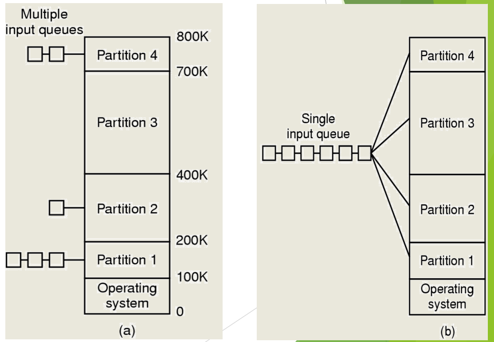

图：内存被分为操作系统区与 Partition 1–4（边界 100K、200K、400K、700K、800K），(a) 每个分区各有一个输入队列，(b) 所有作业共用一个输入队列并分派到各分区。

> [!note] 补充解释
> 固定分区中，进程小于分区时，分区内剩余的空间别人也用不了，这属于内碎片（概念见[空闲内存管理与分配](#空闲内存管理与分配)），这是分区大小固定的直接结果。

固定分区也是“昙花一现”的方案，只在某些特定场景使用；更重要的是可变分区，它至今仍可用于一些小型系统。

### 可变分区与外碎片

**可变分区**（variable partitioning）根据进程的需求，从空闲空间中切出一个分区分配给该进程，剩余部分成为新的空闲区。 这与[空闲内存管理与分配](#空闲内存管理与分配)中的切分—回收过程完全一致：分区表、四种适配算法和回收合并都直接适用。

> [!info] 可视化资源
> - [OSTEP 第 16 章 分段（PDF）](https://pages.cs.wisc.edu/~remzi/OSTEP/vm-segmentation.pdf)：看图 16.6 未紧缩与紧缩后的物理内存对比，直观理解外碎片与“搬家”。

刚开始进程挨个放，利用率很好；经过一段时间的分配、回收后，进程之间会夹着一些较小的空闲区，大小不足以放下新进程，又很难利用。这种位于已分配区**之外**、进程与进程之间的小空闲区就是**外碎片**（external fragmentation），也叫“洞”（hole），它导致内存利用率下降。

> [!example] 例：外碎片是怎样产生的
> 内存共 64M，操作系统占 8M。
>
> 1. P1（20M）、P2（14M）、P3（18M）依次装入，剩余 4M 空闲。
> 2. P2 换出，P4（8M）装入它腾出的 14M，剩下 6M 洞。
> 3. P1 换出，P2（14M）再装入 P1 腾出的 20M，又剩下 6M 洞。
> 4. 最终布局：OS 8M、P2 14M、空 6M、P4 8M、空 6M、P3 18M、空 4M。
>
> 空闲总量为 $6+6+4=16$M，但最大的连续空闲区只有 6M，一个 10M 的进程仍然装不下。

> [!warning] 易错点
> 内碎片在**已分配**区域内部（分出去的比实际需要多），外碎片在已分配区域**之外**（空闲块太小、太散）。可变分区按需切分，几乎没有内碎片，主要问题是外碎片；页式恰好相反。

### 紧缩技术（Memory Compaction）

外碎片单个太小，合起来却可能很可观。**紧缩技术**（memory compaction）在内存中移动程序，把所有小的空闲区合并成较大的空闲区，又称压缩技术、紧致技术、搬家技术，“搬家”一词最形象。

紧缩时要考虑两个问题：

1. **系统开销**：搬家要花时间，也可能需要额外空间。解决问题之前先看代价，代价小才值得做；代价太大，宁可不解决这个问题。
2. **移动时机**：搬家意味着进程的起始地址改变，要考虑此刻是否每个进程都能移动。

关于移动时机，有两层判断：

- **重定位方式**：采用[动态重定位](#地址绑定与重定位)时，地址在运行时才转换，搬家后只需修改重定位寄存器；采用静态重定位时，每次搬家都要把程序中的地址全部改一遍，可以做但开销大。
- **是否正在 I/O**：即使采用动态重定位，**正在进行 I/O 的进程也不能移动**。

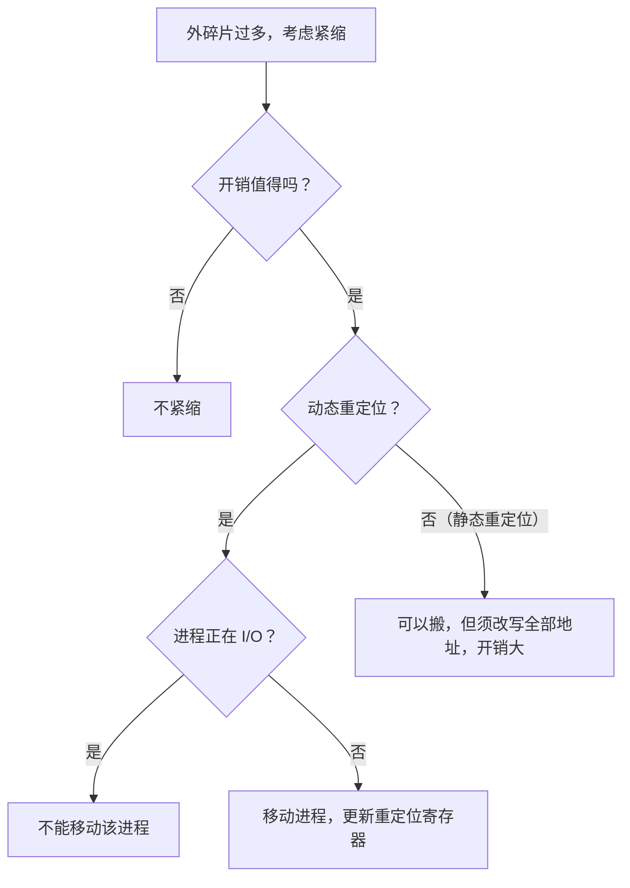

**为什么正在 I/O 的进程不能动**：以进程 A 调用 `read` 为例。A 经系统调用进入内核后被阻塞，读盘工作不由 CPU 亲自完成，而是交给磁盘控制器或 DMA。内核只告诉 DMA 很简单的信息：从磁盘某处取多少字节，送到内存某个地址。DMA 随后占用总线，机械地把数据逐个传到那个物理地址，直到计数减到零。如果此时把 A 搬到别处，DMA 仍会把数据写到原地址，A 就找不到自己的数据，原地址上的其他内容还会被覆盖。

这就像点了外卖送到教室，骑手已经在路上，你却临时去了机场，不能再要求他改送机场。后面讲交换时还会遇到同样的约束（见[覆盖与交换技术](#覆盖与交换技术)）。

> [!question]- 自测：内存中有空闲区 6M、6M、4M，现在来了一个 12M 的进程。用首次适配能分配吗？紧缩后呢？
> 首次适配不能分配：没有任何单个空闲区达到 12M。紧缩后三块合并为 16M 的连续空闲区，就可以分配。前提是紧缩开销可以接受，且被移动的进程都采用动态重定位、都没有在进行 I/O。

> [!question]- 自测：系统采用动态重定位，进程 B 刚发出磁盘读请求并被阻塞。此时做紧缩，能否把 B 搬走？
> 不能。B 的读请求已交给 DMA，DMA 会把数据写入 B 原来所在的物理地址；B 被搬走后，数据会落到错误的位置。动态重定位只解决了 CPU 访存的地址转换问题，解决不了 DMA 直接使用物理地址的问题。

> [!question]- 自测：固定分区为 100K、200K、300K、100K，用多队列方式，此时来了 5 个 80K 的进程，会出现什么现象？改用单队列呢？
> 多队列下 5 个进程都排在 100K 分区的队列里，只有两个 100K 分区能用，另外 3 个进程要等，而 200K、300K 分区空着。单队列下，哪个分区空闲且装得下就去哪个，4 个进程能立即装入。

---

## 页式与段式管理

> [!abstract] 本节要点
> - 页式把逻辑地址空间分成等长的**页**（page），把物理内存分成同样大小的**页框**（page frame），逐页分配，逻辑上相邻的页在物理上不必相邻。
> - 32 位地址、4K 页面时，高 20 位是页号（0–1048575），低 12 位是页内偏移（0–4095）；按 2 的幂划分，硬件取位非常容易，对用户透明。
> - 页表由页表项组成，记录页号→页框号；每个进程一个页表，进程切换时要切换页表，其起始地址在 x86 中放在 CR3，进程下 CPU 时保存在 PCB 中。
> - MMU 把逻辑地址分成页号和偏移，用页号查页表得到页框号，再与偏移拼接成物理地址；页式会产生内碎片。
> - 段式按逻辑关系分段，段表记录段号、段起址和段长，物理内存按可变分区管理；段页式在段内再分页。x86 虽有段机制，操作系统通常只用一个段。

### 页式内存管理（Paging）

前三种方案都要求整个进程连续地放在一块内存里，这很浪费：程序中大量的错误处理代码可能永远不会执行，全部读进内存只是白占空间。如果进程可以离散地放在内存各处，就为“不必一次全部读入”打下了基础。

**页式内存管理**的设计思想是：

- 把用户程序的地址空间划分为大小相等的区域，称为**页**（page）。
- 把内存空间按页的大小划分为大小相等的区域，称为**页框**（page frame），也叫页帧、物理页面或内存块。
- **分配规则**：以页为单位，按进程需要的页数分配；逻辑上相邻的页，物理上不一定相邻。

> [!tip] 课堂强调
> 读英文文献时一定要分清空间：**page 一定指逻辑（虚拟）空间**中的页，**page frame 指物理内存**中的块。一看到 page frame，就知道说的是物理内存。

#### 逻辑地址的划分

典型的页面大小是 4K 或 4M。 以 32 位逻辑地址、4K（$2^{12}$ 字节）页面为例：

$$
\text{逻辑地址} = \underbrace{\text{页号 } p}_{\text{第 31–12 位，共 20 位}} \;\Vert\; \underbrace{\text{页内偏移 } d}_{\text{第 11–0 位，共 12 位}}
$$

页号 $p$ 的取值为 $0 \sim 2^{20}-1 = 1048575$，页内偏移 $d$（页内相对地址）的取值为 $0 \sim 2^{12}-1 = 4095$。 一般地，若页面大小为 $2^k$ 字节，则对逻辑地址 $A$ 有

$$
p = \left\lfloor \frac{A}{2^k} \right\rfloor, \qquad d = A \bmod 2^k
$$

由于页面大小是 2 的整数次幂，这两个运算在硬件上就是“取高位”和“取低位”，不需要做真正的除法。这种划分由系统（实际上是硬件）自动完成，对用户透明。在虚存中，硬件必须介入地址转换。

### 页表与地址转换

逻辑上连续的页在物理内存中分散存放，执行到页的末尾、跳到下一页时，下一页并不在相邻的页框中，所以必须把每一页放在哪个页框记录下来。这个记录就是**页表**（page table）。

> [!info] 可视化资源
> - [OSTEP 第 18 章 分页：介绍（PDF）](https://pages.cs.wisc.edu/~remzi/OSTEP/vm-paging.pdf)：看图 18.3 虚拟页号/偏移拆分与页框号拼接的转换过程，以及图 18.5 x86 页表项。

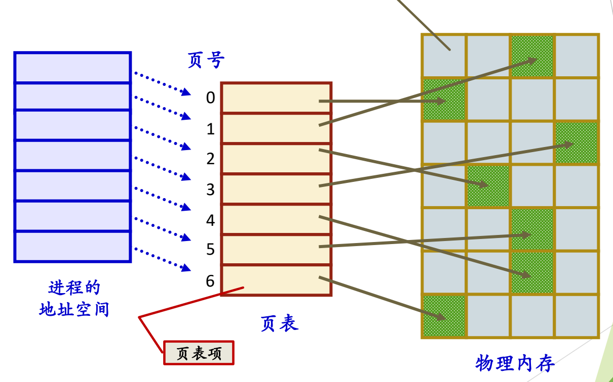

图：进程地址空间按页编号 0–6，每页对应页表中的一个页表项，页表项指向物理内存中不连续的页框（绿色格子），看相邻页号如何映射到分散的页框。

页表的要点：

- 页表由**页表项**（page table entry, PTE）组成，页表项记录逻辑页号与页框号的对应关系，这是它最主要的作用（页表项的其他字段在虚存中展开）。
- **每个进程一个页表**，页表存放在内存中。

**页表起始地址保存在何处？** 硬件有一个专门的寄存器指向当前页表的起始地址，x86 中是 **CR3**。进程在 CPU 上运行时，页表起始地址在 CR3 中；进程下 CPU 时，它保存在该进程的 PCB 中。 因此在上下文切换（A 下、B 上）中，最重要的一步就是切换页表：把 B 的页表起始地址从 B 的 PCB 装入 CR3（进程切换见 L06「04 进程切换与上下文切换」）。

物理内存的空闲管理在页式中比较简单：页框等长，用[位图](#空闲内存管理与分配)等任何方案都可以管理。

**地址转换**由硬件（MMU）完成：

1. CPU 取到逻辑地址，交给 MMU，自动划分为页号和页内地址；
2. 用页号查页表，得到页框号；
3. 把页框号与页内地址（页内偏移）拼接，得到物理地址。

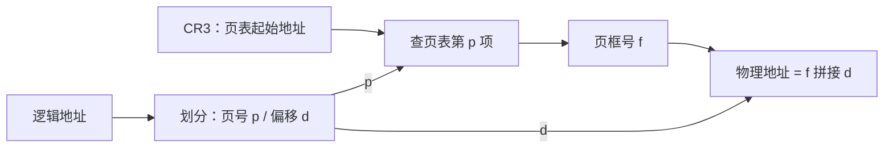

> [!example] 例：页式地址转换
> 32 位地址，页面大小 4K。进程页表中第 3 项的页框号为 `0x12`。求逻辑地址 `0x00003A7C` 对应的物理地址。
>
> 1. 低 12 位为偏移：$d = \texttt{0xA7C}$；高 20 位为页号：$p = \texttt{0x00003} = 3$。
> 2. 查页表第 3 项，得到页框号 $f = \texttt{0x12}$。
> 3. 拼接：物理地址 $= f \times 2^{12} + d = \texttt{0x12000} + \texttt{0xA7C} = \texttt{0x12A7C}$。
>
> 偏移 `0xA7C` 原样保留，只有页号被替换成页框号。

这里假设进程的所有页都已装入内存，所以转换总能成功；页不在内存时会发生什么，是下一讲虚存的问题。

**页式的碎片**：分配以页为单位，进程最后一页通常用不满，页内剩余空间就是**内碎片**。 例如 10K 的进程在 4K 页面下要占 3 页（12K），浪费 2K。不同的管理方案产生不同的碎片：可变分区产生外碎片，页式产生内碎片。

> [!warning] 易错点
> 页式转换中**偏移不参与查表**，页框号与偏移是“拼接”而不是“相加”页号。若把物理地址写成“页框号 + 偏移”，单位就错了：正确的是 $f \times 2^k + d$。

### 段式内存管理（Segmentation）

页式像切西瓜，不管内容，按大小切成等份；但如果蛋糕上有一朵漂亮的花，切蛋糕时会把整朵花完整地切下来，而不是按大小一刀切开。段式就按程序自身的逻辑结构划分。 历史上段式的想法比页式更早。

**段式内存管理**的设计思想：

- 用户程序地址空间按程序自身的逻辑关系划分为若干**程序段**，每段有一个段名，如主程序段 M、子程序段 X 和 Y、数组 A、工作区段 B，每段都从段内地址 0 开始编址。
- 内存空间被动态地划分为若干长度不同的区域，称为**物理段**，每个物理段由起始地址和长度确定。
- **分配规则**：以段为单位分配，每段在内存中占一块连续空间，各段之间可以不相邻。
- 逻辑地址由**段号**和**段内地址**两部分组成。

> [!info] 可视化资源
> - [OSTEP 第 16 章 分段（PDF）](https://pages.cs.wisc.edu/~remzi/OSTEP/vm-segmentation.pdf)：看图 16.2 代码、堆、栈分别放入物理内存，以及图 16.3–16.5 段基址/界限/增长方向/保护位。

**段表**（segment table）记录段号、段首地址和段长度之间的关系；每个进程一个段表，存放在内存中。 例如进程 1 有 5 个段，段表如下：

| 段号 | 段 | 长度 | 段起址 |
| --- | --- | --- | --- |
| 0 | M | K | 3200 |
| 1 | X | P | 1500 |
| 2 | Y | L | 6000 |
| 3 | A | N | 8000 |
| 4 | B | S | 5000 |

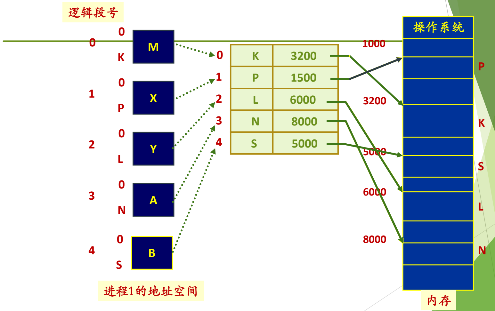

图：进程 1 的五个段 M、X、Y、A、B 对应逻辑段号 0–4，段表把各段映射到内存基址（K 3200、P 1500、L 6000、N 8000、S 5000），每段的段内地址都从 0 开始。

**物理内存管理**：物理段长度不等，管理方法同[可变分区](#连续分配方案)。

**地址转换**（硬件完成）：CPU 取到逻辑地址，用段号查段表，得到段的起始地址，再与段内偏移相加得到物理地址。 例如访问段 2 的段内地址 100，查段表得起址 6000，物理地址为 $6000 + 100 = 6100$。

> [!note] 补充解释
> 与页式的“拼接”不同，段起址是任意值，所以段式必须做**加法**；又因为各段长度不同，偏移必须先与段长比较，偏移 $\ge$ 段长时说明越界，要产生异常交给操作系统处理。段表中记录长度，正是为了做这一检查，作用与[界限寄存器](#地址保护与地址空间)相同。

段式要为每一段记录起址和长度，段有大有小，物理内存又要按可变分区管理，管理起来很复杂，所以段式用得很少。

### 段页式与 x86 的取舍

**段页式内存管理**结合了页式和段式的优点、克服二者的缺点。 设计思想：

- **用户程序划分**：对用户按段的逻辑关系划分；对系统，每一段再按页划分。
- **逻辑地址**：段号 + 段内地址，段内地址再分为页号 + 页内地址。
- **内存划分与分配**：按页式划分内存，以页为单位分配。

数据结构：

- **段表**：记录每一段的页表始址和页表长度。
- **页表**：记录逻辑页号与内存块号的对应关系；每一段有一个页表，所以一个程序可能有多个页表。
- **空闲区管理、分配与回收**：同页式。

> [!note] 补充解释
> 依据上述地址格式和数据结构，段页式的地址转换过程是：
> 1. 用段号查段表，得到该段页表的始址和长度（页号不小于页表长度即越界）；
> 2. 用段内地址中的页号查该段的页表，得到内存块号；
> 3. 内存块号与页内地址拼接，得到物理地址。
>
> 一次访存需要先后查两张表。

x86（Intel）硬件本来就有段机制，这是早期内存越来越大、需要分段管理时留下的设计。但操作系统觉得多段太复杂，于是采用了简单办法：每个进程只用一个段，并把这个段设计得足够大，实际依靠分页管理内存。所以段页式只需了解几个名词。

> [!question]- 自测：32 位地址、页面大小 4K，逻辑地址 `0x0040F123` 的页号和偏移各是多少？若该页映射到页框 `0x2B`，物理地址是多少？
> 页号为高 20 位 `0x0040F`，偏移为低 12 位 `0x123`。物理地址为 `0x2B` 与 `0x123` 拼接，即 $\texttt{0x2B} \times 2^{12} + \texttt{0x123} = \texttt{0x2B123}$。

> [!question]- 自测：进程 A 切换到进程 B 时，页表方面要做什么？段式系统中段表起始地址可能放在哪里？
> 要把 A 的页表起始地址（当前在 CR3 中）保存进 A 的 PCB，再把 B 的页表起始地址从 B 的 PCB 装入 CR3。段表起始地址可以按同样道理推出：运行时放在专门的段表寄存器中，进程下 CPU 时保存在 PCB 中。

> [!question]- 自测：用上面的段表，访问段 1 的段内地址 300，物理地址是多少？如果段 1 的长度 $P$ 只有 200 呢？
> 段 1 的起址为 1500，物理地址为 $1500 + 300 = 1800$。若段长为 200，则偏移 $300 \ge 200$，越界，硬件产生异常，交给操作系统处理，不会形成物理地址。

---

## 覆盖与交换技术

> [!abstract] 本节要点
> - 程序大于可用内存时的对策有：内存紧凑、覆盖、交换、虚存，目标都是在较小的存储空间中运行较大的程序。
> - 覆盖技术让**不会同时执行**的模块共享同一块内存区，要求模块间调用结构清晰，由程序员声明覆盖结构、操作系统自动覆盖；对用户不透明，并且以时间换空间。
> - 交换技术在内存紧张时把某些进程暂时移到外存，再把外存中的进程换入；最早用于小型分时系统（roll in / roll out）。
> - 只有运行时创建或修改的栈和堆需要换出，存放在交换区或交换文件中；在内存不够或有不够的危险时换出，不换出等待 I/O 的进程；有动态重定位时换入不必回到原处。
> - 早期数据与栈挨着放，要预留增长空间；后来让堆和栈相向增长，形成今天的地址空间布局。

### 内存“扩充”的几条路

前面的方案都要求整个进程在内存中。程序比可用内存还大时怎么办？有四种对策，目标都是解决“在较小的存储空间中运行较大程序”的矛盾：

1. **内存紧凑**：装不下只是因为碎片太多时，[紧缩](#连续分配方案)就能腾出足够大的连续空间（例如可变分区）。
2. **覆盖技术**：让程序的不同部分轮流使用同一块内存。
3. **交换技术**：让进程在内存与外存之间换进换出。
4. **虚存技术**：今天的方案，它已经解决了这个问题，是下一讲的主题。

### 覆盖技术（Overlaying）

**覆盖技术**要解决的问题是程序大小超过物理内存总和。它让程序的不同部分在执行过程中在内存中相互替代：按照程序自身的逻辑结构，让那些**不会同时执行**的程序段共享同一块内存区域。

> [!info] 可视化资源
> - [维基百科：Overlay (programming)](https://en.wikipedia.org/wiki/Overlay_(programming))：看顶部覆盖示意图与 Example 一节的覆盖树：同深度段共享同一覆盖区。

使用覆盖有两个前提：

- 程序各模块之间要有**明确的调用结构**，才能判断哪些模块不会同时执行。
- **程序员声明覆盖结构**（用脚本写出哪些模块共享哪个覆盖区），**操作系统完成自动覆盖**，即按声明在需要时把模块装入覆盖区。

覆盖技术主要用在早期的操作系统中。

> [!example] 例：54K 的程序在 30K 内存中运行
> 程序 X 的调用结构：A（8K）调用 B（8K）或 C（10K）；B 调用 D（12K）；C 调用 E（4K）或 F（10K）。总大小 $8+8+10+12+4+10=54$K。
>
> 1. **常驻区**：A 是根模块，始终要在内存中，单独占 8K。
> 2. **覆盖区 0**：B 和 C 是 A 的两个分支，不会同时执行，可以共享一块区域，大小取两者中较大者 $\max(8,10)=10$K。
> 3. **覆盖区 1**：D 只在 B 之下执行，E、F 只在 C 之下执行，三者两两不会同时执行，共享一块区域，大小取 $\max(12,4,10)=12$K。
> 4. **总内存占用**：$8+10+12=30$K。

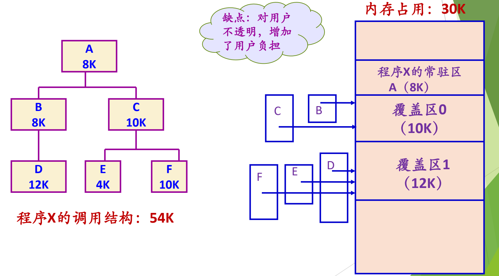

图：程序 X 的调用结构 A(8K) 下有 B(8K)、C(10K)，B 下有 D(12K)，C 下有 E(4K)、F(10K)，共 54K；A 常驻，B/C 共用覆盖区 0（10K），D/E/F 共用覆盖区 1（12K），内存占用仅 30K。

**覆盖技术的不足**：

1. **增加编程困难**：程序员要自己划分功能模块并确定模块间的覆盖关系，增加了编程复杂度。覆盖对用户**不透明**，用户必须亲自参与；页式的划分则对用户完全透明。
2. **增加执行时间**：覆盖模块要从外存装入，本质是以时间换空间。

因此覆盖技术只是“昙花一现”。

> [!warning] 易错点
> 覆盖区的大小取共享该区的模块中**最大**的那个，而不是它们的和；但要判断哪些模块能共享，必须确认它们在调用树上**不可能同时处于执行中**。例中 B 和 D 有调用关系（B 调用 D 时两者同时在执行），所以不能放进同一个覆盖区。

### 交换技术（Swapping）

交换技术最早用于**小型分时系统**。当时一台机器可能有十几到几十个用户，内存只有几百 K，不可能平均分给每个用户（大部分用户不在用机时，他们的那份就空着）。做法是：时间片一到就切换，轮到哪个用户上 CPU，整个内存就归他，上一个用户的内容换到外存。这种滚进滚出叫 **roll in / roll out**。

> [!info] 可视化资源
> - [OSTEP 第 21 章 超越物理内存：机制（PDF）](https://pages.cs.wisc.edu/~remzi/OSTEP/vm-beyondphys.pdf)：看图 21.1 物理内存与交换空间中各进程页的分布。

**交换技术**的设计思想：内存空间紧张时，系统把内存中某些进程暂时移到外存，把外存中某些进程换进内存，占据前者让出的区域。这实际上是进程在内存与外存之间的动态调度。

实现交换要回答五个问题：

#### 1. 换出什么、放在哪里

进程地址空间中，代码、数据和共享库在磁盘的可执行文件或库文件中本来就有，不必写出；只有**运行时创建或修改的内容，即栈和堆**，需要写到磁盘上。

被换出的内容存放在专门的区域，有两种管理方式：

- **交换区**（swap space）：系统指定一块特殊的磁盘区域作为交换空间，由连续的磁道组成，操作系统用底层磁盘读写操作直接管理（管到扇区、磁道），访问效率高。
- **交换文件**：向文件系统申请一个文件，把换出内容存放在这个文件里，例如 Windows 的页文件。

#### 2. 何时交换

“只要不用就换出”无法实现，因为操作系统判断不了一个进程以后还会不会用。实际做法是在**内存空间不够或有不够的危险时**换出，并与调度器结合使用。

“有不够的危险”就要提前做准备，就像双十一前商家备货：备多了积压库存，备少了断货、影响用户体验。内存要提前留多少余量，也面临同样的权衡。

#### 3. 选择换出哪个进程

这相当于后面要学的置换问题，要综合考虑进程的各种属性。无论用什么算法，**都不应换出处于等待 I/O 状态的进程**。 原因与[紧缩时正在 I/O 的进程不能移动](#连续分配方案)相同：DMA 会把数据传到原来的物理地址，而进程换回时不一定还在原处。

#### 4. 换入时是否回到原处

早期的交换（也叫“对换”）要求进程换出后再换回原来的位置。有了[动态重定位](#地址绑定与重定位)，进程无论装到哪里都能执行，所以**换出后再换入的进程不一定回到原处**。

#### 5. 如何处理进程空间增长

进程运行时数据（堆）和栈会增长。图 (a) 中，进程 A、B 各自在上方预留了增长空间（Room for growth），一旦超出预留就会碰到相邻的进程。过去常说的“堆栈”是把两者挨着放，要分别给它们留空间，堆长多了就会压到栈。图 (b) 的解决办法是在每个进程内部让**栈从高地址向低地址长、数据（堆）从低地址向高地址长**，两者相向增长，共用中间的一块空闲区，任何一方都可以用到另一方没用的空间。

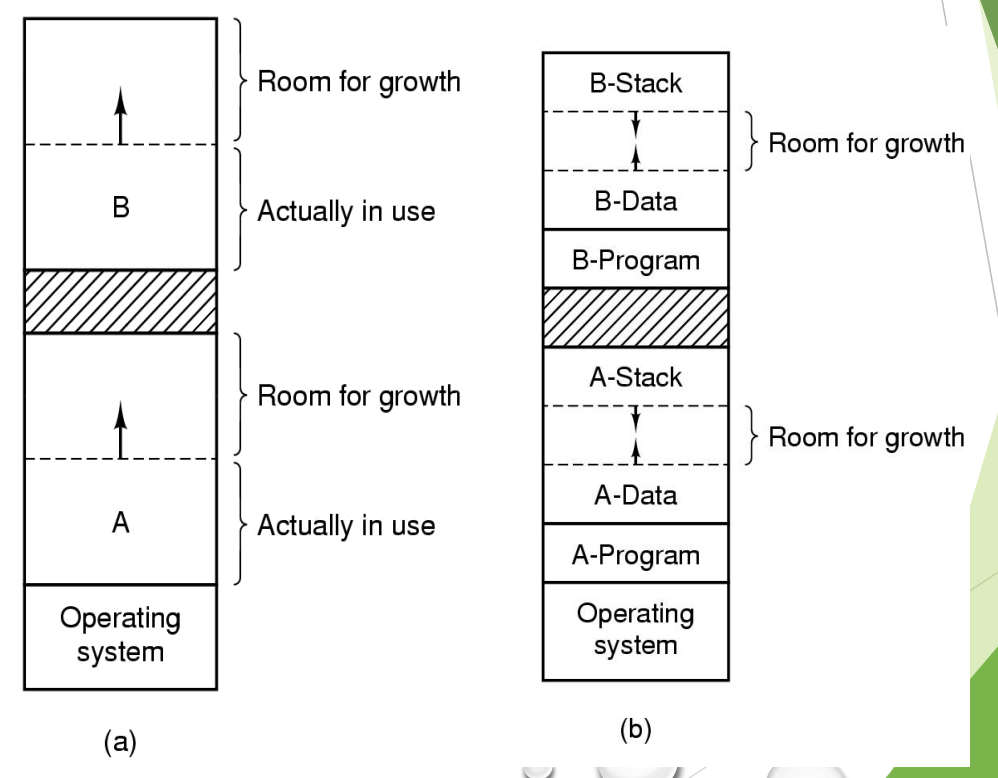

图：(a) 为进程 A、B 在实际使用区上方各预留增长空间；(b) 每个进程的数据段向上、栈段向下增长，两者之间共用一段预留空间。

这正是今天进程地址空间布局的由来：代码、数据在低处，堆向上长，栈从高处向下长（布局细节见[地址保护与地址空间](#地址保护与地址空间)）。

> [!note] 补充解释
> 换出的单位起初是整个进程；结合页式之后，可以只换出进程的一部分页面，这就是虚存中的页面换出。虚存以交换技术为基础，再加上页式管理。

### 重点回顾

> [!info] 依据讲义整理
> 以下按讲义的“重点小结”整理，并标出对应章节。

本讲需要掌握的内容可以归为三类：

1. **基本概念**：存储体系；交换与覆盖技术；逻辑地址、物理地址、地址重定位；地址保护。分别见[内存管理的任务](#内存管理的任务)、[地址绑定与重定位](#地址绑定与重定位)、[地址保护与地址空间](#地址保护与地址空间)和本节。
2. **物理内存管理**：位示图、空闲区表/已分配区表、空闲块链表、伙伴系统；分配与回收算法；碎片问题（内碎片、外碎片）。见[空闲内存管理与分配](#空闲内存管理与分配)和[伙伴系统与 SLAB](#伙伴系统与-slab)。
3. **各种内存管理方案**：单一连续区、固定分区、可变分区、分页、分段、段页式，以及各方案的相关数据结构和地址转换过程。见[连续分配方案](#连续分配方案)和[页式与段式管理](#页式与段式管理)。

其中“相关数据结构”和“地址转换过程”要能对每种方案说清楚：页式用页表把页号换成页框号再拼接偏移，段式用段表取段起址再加偏移（并检查段长），段页式先查段表找到页表、再查页表。

> [!question]- 自测：程序调用结构为 A（6K）调用 B（10K）和 C（7K），C 调用 D（9K）和 E（5K），B 不调用其他模块。用覆盖技术最少需要多少内存？
> A 常驻 6K；B、C 互斥，覆盖区 0 取 $\max(10,7)=10$K；D、E 只在 C 下执行且互斥，覆盖区 1 取 $\max(9,5)=9$K。共 $6+10+9=25$K，而程序总大小为 $6+10+7+9+5=37$K。

> [!question]- 自测：一个进程被换出到交换区，为什么它的代码段不需要写出？它被换回时，必须装回原来的地址吗？
> 代码段在运行中不会被修改，磁盘上的可执行文件中就有完整副本，换入时直接从文件读即可；需要写出的只有运行时创建或修改的栈和堆。如果系统采用动态重定位，换入时可以放在任意空闲位置，只需更新重定位信息；只有静态重定位的系统才要求回到原处。

> [!question]- 自测：内存紧张需要换出一个进程。P1 处于等待磁盘 I/O 状态，P2 处于就绪状态，两者大小相同。应换出哪个，为什么？
> 应换出 P2。P1 的磁盘读请求已交给 DMA，DMA 会把数据写入 P1 原来的物理地址；P1 被换出后，这块内存可能已分给别的进程，数据会写错地方，而 P1 换回时也不一定在原处。所以不应换出处于等待 I/O 状态的进程。

---

## 本讲小结

本讲的主线是“逻辑地址如何落到物理内存”：重定位方式决定程序能否移动，分配单位决定产生哪种碎片，而“整个进程必须在内存”这一前提最终由交换和页式打破，演化为虚存。

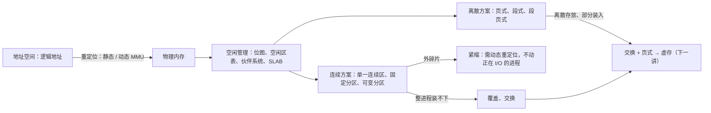

| 方案 | 分配单位 | 地址转换 | 主要碎片 |
| --- | --- | --- | --- |
| 单一连续区 / 固定分区 / 可变分区 | 整个进程（一个分区） | 基址 + 逻辑地址，并用界限检查 | 固定分区内碎片，可变分区外碎片 |
| 页式 | 页 | 页号查页表得页框号 $f$，物理地址 $= f \times 2^k + d$ | 内碎片 |
| 段式 | 段 | 段号查段表得段起址，加段内偏移（偏移须小于段长） | 外碎片 |
| 段页式 | 页 | 段表 → 该段页表 → 页框号，再拼接页内偏移 | 内碎片 |

### 核心公式

| 公式 | 含义 |
| --- | --- |
| $\text{物理地址} = \text{重定位寄存器} + \text{逻辑地址}$ | 最早的 MMU（动态重定位） |
| $\text{基址} \le \text{地址} < \text{基址} + \text{界限}$ | 越界保护的合法范围 |
| $p = \lfloor A / 2^k \rfloor,\ d = A \bmod 2^k$ | 页面大小 $2^k$ 时逻辑地址 $A$ 的页号与页内偏移 |
| $2^{U-1} < s \le 2^U$ | 伙伴系统中请求 $s$ 整块分配 $2^U$ 块的条件 |
